# Use Case Karyawan — TP Docs (By System)

## 1. Definisi Aktor Karyawan

**Karyawan** adalah pengguna tambahan yang menerima link undangan dari User Induk dan menggunakan akun pribadi untuk bergabung ke perusahaan. Jika belum memiliki akun, calon Karyawan melakukan registrasi dan verifikasi email terlebih dahulu melalui alur undangan. Karyawan memperoleh fitur sesuai langganan perusahaan.

## 2. Daftar Use Case — Karyawan

Selain menerima undangan dan memantau akses langganan, Karyawan dapat mengisi Local File organisasi yang ditugaskan oleh User Induk. Karyawan tidak dapat membuat Local File baru, membeli paket atau add-on, mengelola pembayaran, mengundang anggota lain, atau mengubah penugasan.

### 2.1 Visual Aktivitas Karyawan

```mermaid
flowchart TB
    A([Karyawan])

    UIK01(["UK-01<br/>Menerima Undangan Langganan Perusahaan"])
    UIK02(["UK-02<br/>Melihat Status Akses Langganan"])
    UIK03(["UK-03<br/>Mengisi Local File yang Ditugaskan"])

    A --> UIK01
    A --> UIK02
    A --> UIK03

    OPEN["UK-01.1<br/>Membuka Link Undangan"]
    CHECK["UK-01.2<br/>Memeriksa Kepemilikan Akun"]
    REGISTER["UK-01.2.E1<br/>Registrasi & Verifikasi Akun Baru"]
    LOGIN["UK-01.3<br/>Login atau Melanjutkan dengan Akun"]
    VALIDATE["UK-01.4<br/>Memvalidasi Email Undangan"]
    ACCEPT["UK-01.5<br/>Menyetujui Bergabung"]
    ACTIVATE["UK-01.6<br/>Mengaktifkan Akses Langganan"]
    REJECT["UK-01.E1<br/>Menolak Undangan"]
    INVALID["UK-01.E2<br/>Undangan Tidak Valid / Kedaluwarsa"]

    UIK01 -. "&lt;&lt;include&gt;&gt;" .-> OPEN
    UIK01 -. "&lt;&lt;include&gt;&gt;" .-> CHECK
    CHECK -. "&lt;&lt;extend&gt;&gt;" .-> REGISTER
    UIK01 -. "&lt;&lt;include&gt;&gt;" .-> LOGIN
    UIK01 -. "&lt;&lt;include&gt;&gt;" .-> VALIDATE
    UIK01 -. "&lt;&lt;include&gt;&gt;" .-> ACCEPT
    UIK01 -. "&lt;&lt;include&gt;&gt;" .-> ACTIVATE
    UIK01 -. "&lt;&lt;extend&gt;&gt;" .-> REJECT
    UIK01 -. "&lt;&lt;extend&gt;&gt;" .-> INVALID
    ACTIVATE ~~~ REJECT
    ACTIVATE ~~~ INVALID

    COMPANY["UK-02.1<br/>Melihat Perusahaan Induk"]
    PACKAGE["UK-02.2<br/>Melihat Paket yang Diwarisi"]
    STATUS["UK-02.3<br/>Melihat Status Membership"]
    PERIOD["UK-02.4<br/>Melihat Masa Berlaku Akses"]
    EXPIRED["UK-02.E1<br/>Akses Langganan Berakhir"]

    UIK02 -. "&lt;&lt;include&gt;&gt;" .-> COMPANY
    UIK02 -. "&lt;&lt;include&gt;&gt;" .-> PACKAGE
    UIK02 -. "&lt;&lt;include&gt;&gt;" .-> STATUS
    UIK02 -. "&lt;&lt;include&gt;&gt;" .-> PERIOD
    UIK02 -. "&lt;&lt;extend&gt;&gt;" .-> EXPIRED
    PERIOD ~~~ EXPIRED

    ASSIGNED["UK-03.1<br/>Membuka Draft yang Ditugaskan"]
    SECTION["UK-03.2<br/>Memilih Bagian 01–10 dalam Urutan Bebas"]
    EDIT["UK-03.3<br/>Mengisi dan Menyimpan Bagian"]
    SHARED["UK-03.4<br/>Melihat Perubahan Bersama"]
    CONFLICT["UK-03.E1<br/>Konflik Versi Saat Menyimpan"]

    UIK03 -. "&lt;&lt;include&gt;&gt;" .-> ASSIGNED
    UIK03 -. "&lt;&lt;include&gt;&gt;" .-> SECTION
    UIK03 -. "&lt;&lt;include&gt;&gt;" .-> EDIT
    UIK03 -. "&lt;&lt;include&gt;&gt;" .-> SHARED
    UIK03 -. "&lt;&lt;extend&gt;&gt;" .-> CONFLICT
```

**Legenda:** garis penuh menunjukkan aktivitas yang dimulai langsung oleh Karyawan. Panah `<<include>>` menunjukkan tahapan wajib, sedangkan `<<extend>>` menunjukkan kondisi atau pilihan tambahan.

| ID         | Tingkat / Induk           | Use Case                                   | Deskripsi / Aktivitas                                                                                  | Include (`<<include>>`) | Extend (`<<extend>>`) |
| ---------- | ------------------------- | ------------------------------------------ | ------------------------------------------------------------------------------------------------------ | ----------------------- | --------------------- |
| **UK-01**  | **`[AKTOR DIRECT]`**      | **Menerima Undangan Langganan Perusahaan** | [Aktivitas menerima akses paket perusahaan melalui link undangan yang dikirim ke email calon Karyawan] | UK-01.1 s/d UK-01.6     | UK-01.E1, UK-01.E2    |
| UK-01.1    | └── _sub dari UK-01_      | Membuka Link Undangan                      | [Aktivitas membuka tautan unik yang dikirim User Induk melalui sistem]                                 | [-]                     | [-]                   |
| UK-01.2    | └── _sub dari UK-01_      | Memeriksa Kepemilikan Akun                 | [Aktivitas sistem memeriksa apakah email tujuan sudah memiliki akun]                                   | [-]                     | UK-01.2.E1            |
| UK-01.2.E1 | └── _extend dari UK-01.2_ | Registrasi dan Verifikasi Akun Baru        | [Aktivitas calon Karyawan membuat akun dan memverifikasi email jika belum terdaftar]                   | [-]                     | [-]                   |
| UK-01.3    | └── _sub dari UK-01_      | Login atau Melanjutkan dengan Akun         | [Aktivitas autentikasi akun tanpa kehilangan konteks link undangan]                                    | [-]                     | [-]                   |
| UK-01.4    | └── _sub dari UK-01_      | Memvalidasi Email Undangan                 | [Aktivitas memastikan email akun sama dengan email tujuan undangan]                                    | [-]                     | [-]                   |
| UK-01.5    | └── _sub dari UK-01_      | Menyetujui Bergabung                       | [Aktivitas menerima membership perusahaan]                                                             | [-]                     | [-]                   |
| UK-01.6    | └── _sub dari UK-01_      | Mengaktifkan Akses Langganan               | [Aktivitas memperoleh fitur sesuai paket dan sisa masa aktif perusahaan]                               | [-]                     | [-]                   |
| UK-01.E1   | └── _extend dari UK-01_   | Menolak Undangan                           | [Aktivitas menolak bergabung ke perusahaan]                                                            | [-]                     | [-]                   |
| UK-01.E2   | └── _extend dari UK-01_   | Undangan Tidak Valid atau Kedaluwarsa      | [Aktivitas menolak token salah, digunakan, dibatalkan, atau kedaluwarsa]                               | [-]                     | [-]                   |
| **UK-02**  | **`[AKTOR DIRECT]`**      | **Melihat Status Akses Langganan**         | [Aktivitas melihat sumber dan masa berlaku akses berbayar]                                             | UK-02.1 s/d UK-02.4     | UK-02.E1              |
| UK-02.1    | └── _sub dari UK-02_      | Melihat Perusahaan Induk                   | [Aktivitas menampilkan perusahaan tempat Karyawan menjadi anggota]                                     | [-]                     | [-]                   |
| UK-02.2    | └── _sub dari UK-02_      | Melihat Paket yang Diwarisi                | [Aktivitas menampilkan paket perusahaan yang berlaku bagi Karyawan]                                    | [-]                     | [-]                   |
| UK-02.3    | └── _sub dari UK-02_      | Melihat Status Membership                  | [Aktivitas menampilkan status aktif, tertunda, atau dicabut]                                           | [-]                     | [-]                   |
| UK-02.4    | └── _sub dari UK-02_      | Melihat Masa Berlaku Akses                 | [Aktivitas menampilkan tanggal berakhir berdasarkan langganan perusahaan]                              | [-]                     | [-]                   |
| UK-02.E1   | └── _extend dari UK-02_   | Akses Langganan Berakhir                   | [Aktivitas mencabut fitur berbayar saat paket perusahaan berakhir]                                     | [-]                     | [-]                   |

| **UK-03** | **`[AKTOR DIRECT — KARYAWAN DITUGASKAN]`** | **Mengisi Local File yang Ditugaskan** | [Aktivitas Karyawan berkontribusi pada draft organisasi yang sama dengan User Induk] | UK-03.1 s/d UK-03.4 | UK-03.E1 |
| UK-03.1 | └── _sub dari UK-03_ | Membuka Draft yang Ditugaskan | [Karyawan hanya melihat Local File yang penugasannya masih aktif] | [-] | [-] |
| UK-03.2 | └── _sub dari UK-03_ | Memilih Bagian Pengisian | [Bagian 01–10 dapat dibuka dalam urutan bebas, tanpa menyelesaikan bagian sebelumnya] | [-] | [-] |
| UK-03.3 | └── _sub dari UK-03_ | Mengisi dan Menyimpan Bagian | [Perubahan disimpan pada draft organisasi bersama dengan identitas pengubah dan waktu pembaruan] | [-] | UK-03.E1 |
| UK-03.4 | └── _sub dari UK-03_ | Melihat Perubahan Bersama | [Data dan status bagian yang telah disimpan User Induk atau Karyawan lain terlihat setelah dimuat ulang] | [-] | [-] |
| UK-03.E1 | └── _extend dari UK-03.3_ | Konflik Versi Saat Menyimpan | [Perubahan berbasis versi lama ditolak; Karyawan memuat data terbaru sebelum menyimpan kembali] | [-] | [-] |

Bagian 11, Review & Generate, dapat dibuka untuk melihat kelengkapan. Pembuatan file akhir dilakukan oleh User Induk setelah seluruh syarat valid. Pencabutan penugasan langsung mengakhiri akses Karyawan ke dokumen tersebut.

Karyawan dengan penugasan aktif dapat membuka History Versi pada Local File yang ditugaskan dan membandingkan dua versi hasil generate dari Local File tersebut secara baca saja. Karyawan tanpa penugasan tidak dapat melihat daftar atau hasil perbandingan versi.
