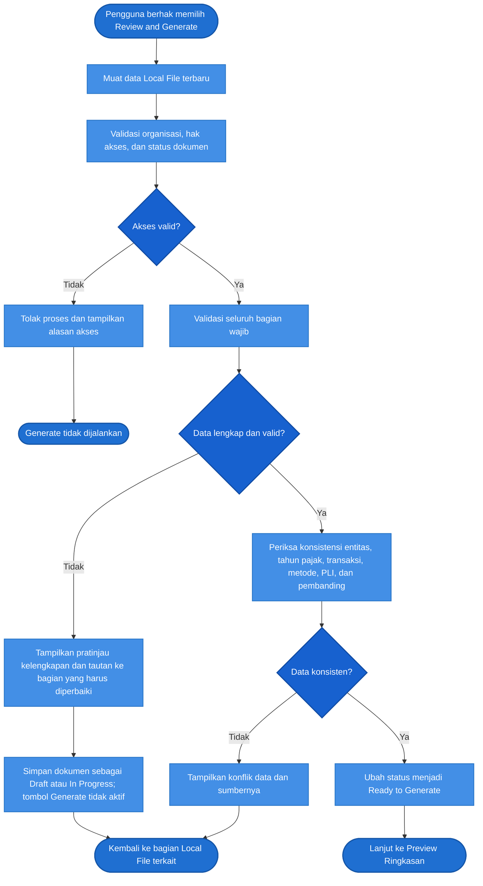
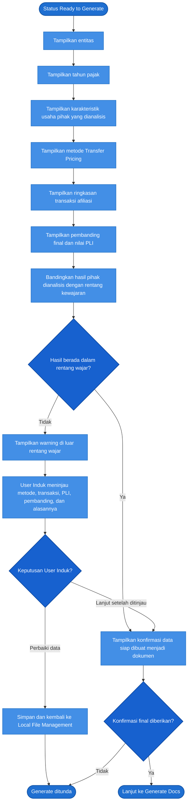
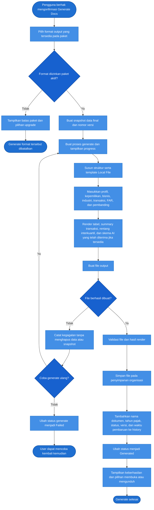
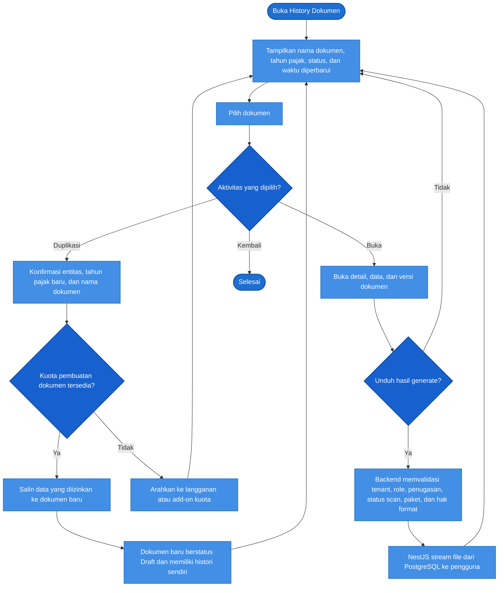

# Document Generation Business Flow — TP Docs (By System)

> Template master dan hasil DOCX/PDF disimpan sebagai file biner PostgreSQL. Worker membaca serta menulisnya melalui `BinaryFileRepository`; pengguna mengunduh melalui streaming NestJS setelah validasi akses dan paket.

## 1. Tujuan dan Cakupan

Dokumen ini menjelaskan proses detail sejak data Local File selesai diisi sampai draft dokumen dihasilkan, disimpan pada history, dibuka kembali, atau diduplikasi.

Flow ini merupakan kelanjutan dari [03-Local-File-Management.md](./03-Local-File-Management.md) dan mengacu pada:

- `UI-04.11 — Review and Generate`.
- `UI-04.11.1 — Preview Ringkasan`.
- `UI-04.11.2 — Generate Docs`.
- `UI-06 — Melihat History Dokumen`.

Dokumen yang dihasilkan TP Docs tetap berstatus **draft** dan wajib ditinjau pengguna yang melakukan generate. Sistem tidak mengirim dokumen langsung kepada DJP.

## 2. Prasyarat Generate

| Pemeriksaan | Kondisi yang Harus Dipenuhi |
| --- | --- |
| Identitas dokumen | Entitas dan tahun pajak tersedia |
| Profil perusahaan | Seluruh data wajib telah diisi |
| Kepemilikan dan manajemen | Tabel pemegang saham serta pengurus valid |
| Bisnis dan proses | Uraian bisnis tersedia; skema proses bisnis AI bersifat opsional dan hanya digunakan jika telah diterima User Induk |
| Transaksi | Data afiliasi, independen, dan summary dapat diproses |
| Analisis FAR | Fungsi, aset, risiko, metode, pihak dianalisis, PLI, dan alasan tersedia |
| Pembanding | Strategi, PLI, pembanding final, serta rentang interkuartil tersedia |
| Hak akses | User Induk, Karyawan pembuat, atau Karyawan dengan penugasan aktif memiliki akses terhadap dokumen dan organisasi |
| Paket | Format output yang dipilih diizinkan oleh paket aktif |

Kuota dokumen telah digunakan ketika dokumen baru berhasil dibuat. Menekan generate tidak mengurangi kuota dokumen untuk kedua kalinya.

Bagian Review & Generate dapat dibuka kapan saja oleh pengguna yang berhak mengakses dokumen. Urutan pengisian bagian 01–10 bebas. User Induk, Karyawan pembuat, dan Karyawan dengan penugasan aktif dapat memberi konfirmasi final serta memulai generate setelah seluruh validasi lulus. Hasil dokumen privat tetap privat dari User Induk hingga dibagikan atau diambil alih setelah membership pembuat dicabut.

## 3. Flow Pemeriksaan Kesiapan Generate

## 4. Flow Preview Ringkasan dan Warning

Preview harus menampilkan data inti sebelum proses generate dimulai.

Warning di luar rentang wajar tidak otomatis mengubah data atau memberikan opini pajak. Keputusan untuk memperbaiki data atau melanjutkan generate tetap berada pada User Induk.

## 5. Flow Generate Dokumen

Target proses generate adalah maksimal lima menit. Sistem harus menampilkan progress sehingga pengguna tidak perlu mengirim permintaan generate berulang kali.

## 6. Flow History, Buka, dan Duplikasi Dokumen

### 6.1 Perbandingan History Versi

Pengguna yang berhak memilih satu Local File dari History Dokumen, lalu membuka panel **History Versi**. Daftar versi hasil generate ditampilkan terbaru dahulu dan dimuat bertahap agar puluhan versi tetap dapat ditelusuri. Dokumen privat buatan Karyawan tidak ditampilkan kepada User Induk sebelum dibagikan atau diambil alih. Draft yang sedang dikerjakan ditampilkan terpisah; draft bukan versi hasil generate.

Pengguna dapat memilih tepat dua versi hasil generate dari Local File yang sama sebagai titik A dan B. Sistem memeriksa izin akses, mengambil dua `document_snapshots` immutable yang terkait dengan `document_versions`, lalu membandingkan data terstruktur per bagian. Ringkasan menampilkan bagian yang berubah dan nilai sebelum/sesudah; rincian dapat dibuka per bagian. Perbedaan format DOCX/PDF atau template saja tidak boleh diklaim sebagai perubahan data. Jika snapshot menggunakan schema berbeda, sistem menormalisasi dengan pemetaan yang didukung atau menampilkan bahwa perbandingan bagian tersebut tidak tersedia.

Perbandingan bersifat baca saja, tidak mengubah draft, versi lama, nomor versi, maupun kuota. Versi dari Local File berbeda, versi yang gagal dibuat, atau dokumen di luar hak akses harus ditolak. Buka versi, unduh, dan duplikasi tetap merupakan tindakan terpisah.

## 7. Status Dokumen dan Generate

| Status | Makna | Aktivitas Berikutnya |
| --- | --- | --- |
| `Draft` | Dokumen baru atau belum lengkap | Lanjutkan pengisian Local File |
| `In Progress` | Sebagian data telah disimpan | Buka bagian yang belum lengkap |
| `Ready to Generate` | Validasi minimum berhasil | Preview ringkasan |
| `Generating` | File sedang dibuat | Pantau progress; jangan mengirim proses duplikat |
| `Generated` | File berhasil disimpan | Buka, unduh, atau buat versi berikutnya |
| `Failed` | Proses file gagal | Jalankan generate ulang tanpa membuat dokumen baru |

## 8. Exception dan Aturan Penting

1. Perubahan data setelah generate tidak mengubah file lama; generate berikutnya membuat versi baru.
2. Proses generate ulang harus idempoten dan tidak membuat file atau transaksi kuota ganda akibat klik berulang.
3. Kegagalan generate tidak menghapus data Local File.
4. Warning rentang kewajaran harus tetap tercatat pada versi yang dihasilkan jika User Induk memilih melanjutkan.
5. File hanya dapat diakses melalui streaming endpoint NestJS setelah validasi organisasi pemilik, role, penugasan aktif jika berlaku, status scan, paket, dan hak format; akses dicatat dalam audit log.
6. Isi dokumen, NPWP lengkap, dan data finansial mentah tidak boleh dicatat pada application log.
7. Administrator tidak dapat membuka isi dokumen melalui portal operasional.
8. Draft hasil sistem tidak merupakan opini atau jaminan kepatuhan pajak.

## 9. Referensi

- [Business Flow Overview](./00-Business-Flow-Overview.md).
- [Local File Management](./03-Local-File-Management.md).
- [Use Case User Induk](../02-Use-Case/Organization-Owner.md): `UI-04.11` dan `UI-06`.
- [Document Generation Architecture](../05-Architecture/Document-Generation-Architecture.md).
- [Non-Functional Requirements](../01-Requirements/Non-Functional-Requirements.md).
