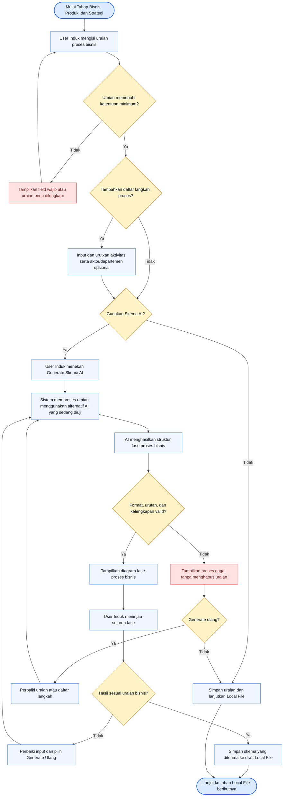
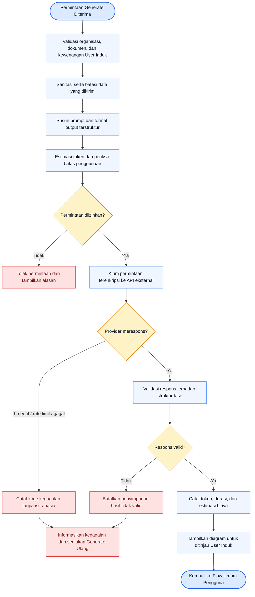
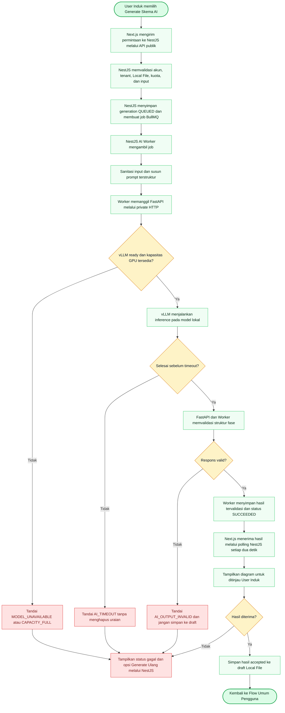

# AI Content Generation Business Flow — TP Docs (By System)

## 1. Tujuan dan Cakupan

Dokumen ini menjelaskan alur opsional pembentukan **Skema Proses Bisnis — Generated by AI** berdasarkan uraian proses bisnis dan daftar langkah opsional yang diinput User Induk. Skema AI merupakan visual pendukung kegiatan operasional dalam Local File, bukan pengganti analisis transaksi, FAR, metode TP, pembanding, atau informasi keuangan.

Dokumen ini membandingkan dua alternatif pemrosesan yang akan dievaluasi sebelum implementasi final:

1. AI melalui API eksternal berbayar.
2. AI lokal yang dijalankan pada server TP Docs.

Kedua alternatif merupakan pilihan arsitektur internal. User Induk hanya berinteraksi dengan tombol **Generate Skema AI** dan tidak memilih provider AI dari antarmuka aplikasi. Implementasi final hanya akan menggunakan satu alternatif berdasarkan hasil benchmark. Local File tetap dapat dilanjutkan ketika AI tidak digunakan atau generation gagal.

Referensi use case:

- `UI-04.03.1` — Mengisi Uraian Proses Bisnis.
- `UI-04.03.1a` — Menekan Tombol Skema AI.
- `UI-04.03.1a.1` — Skema Proses Bisnis — Generated by AI.

## 2. Posisi AI dalam Penyusunan Local File

Uraian proses bisnis merupakan input wajib, sedangkan daftar langkah proses dan Generate Skema AI bersifat opsional. Hasil AI tetap berstatus draft sampai ditinjau dan diterima oleh User Induk.



## 3. Struktur Output Skema AI

Setiap fase yang dihasilkan harus memiliki struktur minimum berikut:

| Komponen | Keterangan |
| --- | --- |
| Nomor fase | Nomor urut fase, dimulai dari fase pertama |
| Nama fase | Nama ringkas untuk mengidentifikasi tahapan |
| Judul aktivitas | Aktivitas utama yang dilakukan pada fase tersebut |
| Deskripsi | Penjelasan singkat tentang aktivitas atau hasil fase |
| Kategori | `Input`, `Proses`, `Kontrol`, atau `Output` |
| Urutan | Posisi fase dalam rangkaian proses bisnis |
| Hubungan | Hubungan fase saat ini dengan fase sebelum dan sesudahnya |
| Referensi langkah | `sourceStepId` yang menunjuk langkah eksplisit pengguna, atau `null` jika hanya menggunakan narasi |

Jumlah dan isi fase mengikuti input pengguna dan tidak ditetapkan secara permanen. Jika daftar langkah opsional diberikan, setiap langkah harus menghasilkan tepat satu fase dalam urutan yang sama. Narasi digunakan untuk memperkaya nama dan deskripsi, bukan menghapus langkah eksplisit. AI tidak boleh menambahkan proses material yang tidak disebutkan pengguna.

Contoh uraian manufaktur yang menyebut penerimaan PO afiliasi, persetujuan manajemen dan logistik, perencanaan produksi dan QC, produksi, inspeksi QC, pergudangan barang jadi, serta pengiriman harus menghasilkan tujuh fase tersebut. Bagian persetujuan tidak boleh dihilangkan atau digabung tanpa dasar dari input pengguna.

User Induk tidak mengedit kartu fase secara langsung. Jika hasil belum sesuai, User Induk memperbaiki uraian atau daftar langkah lalu memilih generate ulang.

## 4. Alternatif 1 — AI melalui API Eksternal Berbayar

Pada alternatif ini, backend TP Docs mengirim permintaan terstruktur ke provider AI eksternal. Tidak ada perpindahan otomatis ke AI lokal ketika provider gagal.



### 4.1 Implikasi Deployment API Eksternal

- Aplikasi TP Docs tidak memerlukan GPU untuk menjalankan inferensi AI.
- API key disimpan pada secret manager dan tidak boleh berada di source code, browser, atau log.
- Komunikasi dengan provider menggunakan koneksi terenkripsi.
- Sistem memerlukan batas penggunaan per organisasi, monitoring biaya, timeout, dan perlindungan terhadap permintaan berulang.
- Kebijakan penyimpanan dan pemrosesan data provider harus ditinjau sebelum provider digunakan.
- Prompt dan respons lengkap tidak dicatat pada application log.
- Nama provider, model, tarif token, batas konteks, dan kebijakan retensi provider berstatus **Pending Evaluation**.

Estimasi biaya penggunaan:

`Biaya API = jumlah permintaan × rata-rata token input dan output × tarif provider`

Apabila tarif input dan output berbeda, perhitungan dipisahkan:

`Biaya API = (token input × tarif input) + (token output × tarif output)`

## 5. Alternatif 2 — AI Lokal pada Server TP Docs

Pada alternatif ini, model AI dijalankan pada infrastruktur yang dikelola TP Docs. AI lokal tidak berarti model dijalankan pada perangkat pengguna. FastAPI dan model server merupakan layanan internal; browser tidak mengetahui alamat keduanya dan tidak dapat mengaksesnya secara langsung. Tidak ada perpindahan otomatis ke API eksternal ketika layanan lokal gagal.



### 5.1 Implikasi Deployment AI Lokal

```text
Browser / Next.js
        ↓ public HTTPS
NestJS API
        ↓ PostgreSQL + BullMQ
NestJS AI Worker
        ↓ private HTTP
FastAPI AI Service
        ↓ private HTTP
vLLM Model Server
        ↓
Model lokal pada GPU
```

Pembagian tanggung jawab deployment:

| Komponen | Tanggung jawab |
| --- | --- |
| Next.js | Mengirim permintaan generate ke NestJS, melakukan polling dua detik, dan menampilkan hasil |
| NestJS API | Memvalidasi akun, tenant, Local File, kuota, input, dan akses; frontend hanya berkomunikasi dengan komponen ini |
| PostgreSQL | Menyimpan generation, status, hasil tervalidasi, dan hasil accepted |
| BullMQ | Menjadi satu-satunya antrean bisnis generation AI |
| NestJS AI Worker | Mengambil job, memanggil FastAPI, memvalidasi hasil akhir, serta memperbarui status |
| FastAPI | Menjadi internal AI adapter untuk prompt, request inference, schema validation, dan safe error mapping |
| vLLM | Memuat model, melakukan batching, mengendalikan concurrency inference, dan menggunakan GPU |

Ketentuan utama:

- FastAPI dan vLLM tidak memiliki endpoint publik dan tidak pernah dipanggil langsung oleh frontend.
- FastAPI tidak mengelola session, membership, billing, kuota, atau Local File dan tidak memerlukan akses langsung ke PostgreSQL.
- FastAPI tidak membuat antrean bisnis kedua; BullMQ tetap menjadi sumber antrean generation.
- Worker memanggil FastAPI secara synchronous melalui jaringan privat dengan timeout, retry terbatas, service credential, dan correlation ID.
- Deployment awal menggunakan satu Linux GPU VM yang menjalankan container FastAPI dan vLLM secara terpisah.
- Layanan inferensi dipisahkan dari aplikasi utama agar gangguan model tidak menghentikan login, pengisian Local File, atau penyimpanan uraian bisnis.
- Jika AI gagal, uraian dan daftar langkah tetap tersimpan serta User Induk dapat melanjutkan bagian Local File lain.
- Hasil AI belum menjadi bagian Local File sampai User Induk memilih menerima hasil.
- Model artifact disimpan di volume atau artifact storage privat, dikunci berdasarkan revision dan checksum, serta tidak dibundel ke image FastAPI.
- Data pelanggan tidak digunakan untuk melatih ulang atau melakukan fine-tuning model secara otomatis.
- Nama model, lisensi, kebutuhan VRAM, quantization, concurrency, waktu respons, dan kapasitas harian berstatus **Pending Benchmark**.

Estimasi biaya operasional lokal:

`Biaya AI lokal bulanan = biaya server/GPU + storage model + monitoring + tenaga operasional`

## 6. Referensi

- [Business Flow Overview](./00-Business-Flow-Overview.md)
- [Local File Management](./03-Local-File-Management.md)
- [Use Case User Induk](../02-Use-Case/Organization-Owner.md)
- [Non-Functional Requirements](../01-Requirements/Non-Functional-Requirements.md)
- [AI Processing Architecture](../05-Architecture/AI-Processing-Architecture.md)

Rincian deployment final akan ditetapkan pada `AI-Processing-Architecture.md` setelah benchmark menentukan alternatif yang digunakan.
