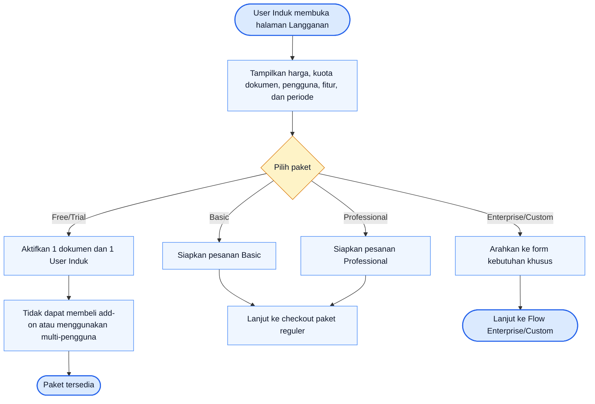
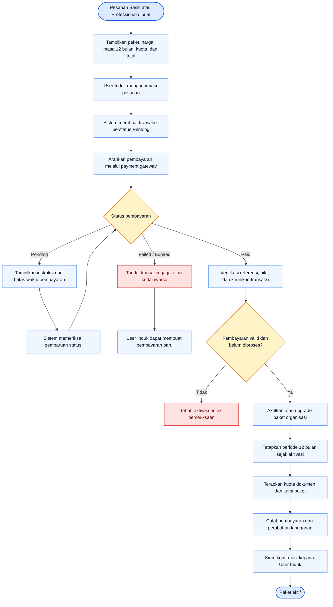
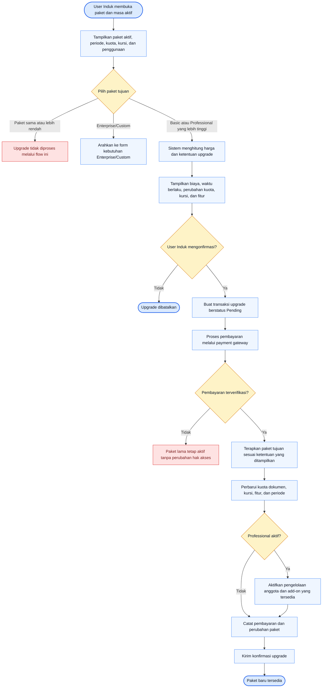
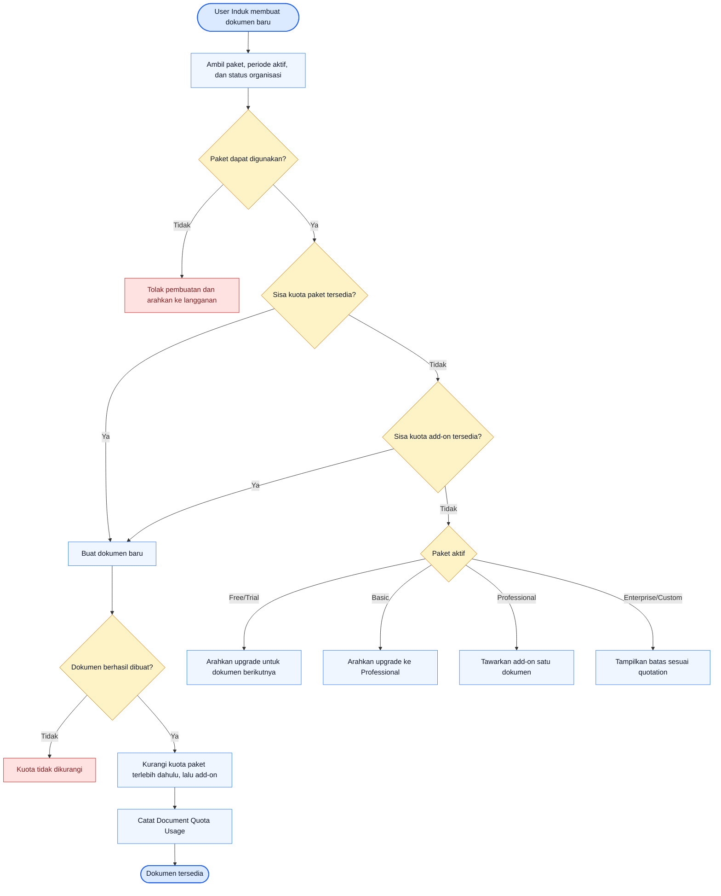
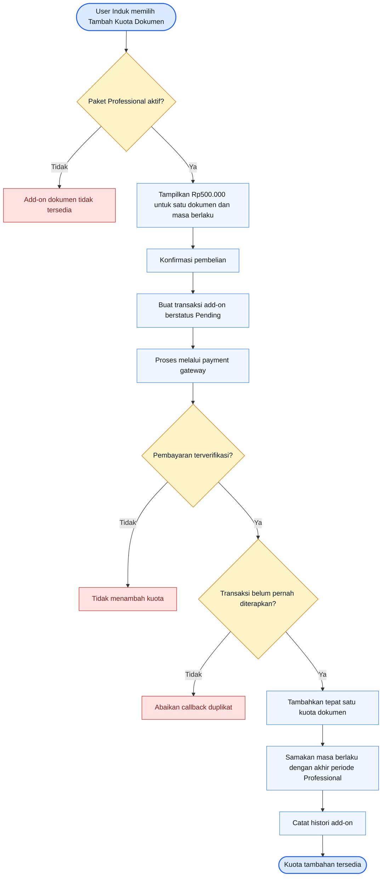
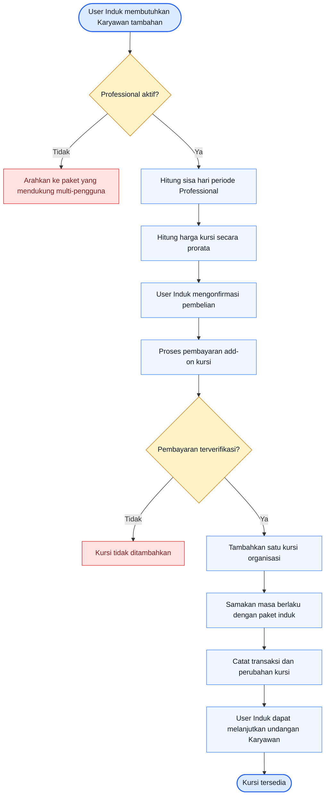
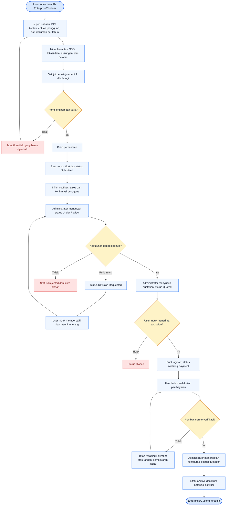
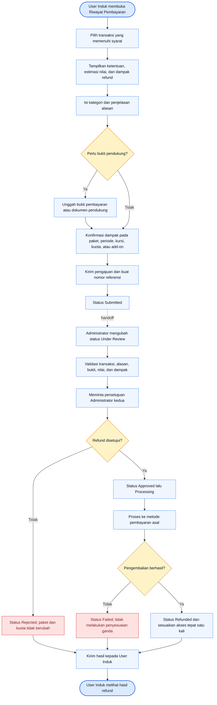
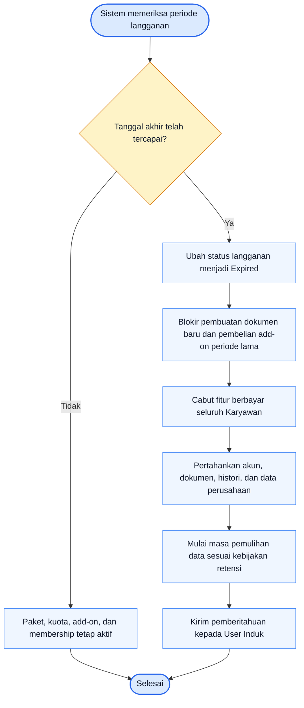
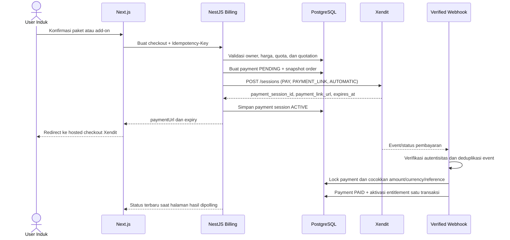

# Subscription and Billing Business Flow — TP Docs (By System)

## 1. Tujuan dan Cakupan

Dokumen ini menjelaskan business flow paket langganan organisasi, pembayaran, masa aktif, kuota dokumen, kursi pengguna, add-on, Enterprise/Custom, histori transaksi, dan refund.

Aktor yang terlibat:

- **User Induk** memilih paket, melakukan pembayaran, membeli add-on, mengajukan Enterprise/Custom, dan mengajukan refund.
- **Administrator** memelihara katalog, memantau pembayaran, memproses Enterprise/Custom, dan memproses refund terotorisasi.
- **Sistem TP Docs** menghitung periode aktif, kuota, kursi, status transaksi, dan hak akses organisasi.

Karyawan hanya mewarisi akses dari perusahaan dan tidak dapat membeli paket, add-on, atau melihat informasi pembayaran.

Referensi use case: `UI-08.1` sampai `UI-08.8`, `UA-05`, `UA-06.5`, dan `UK-02`.

## 2. Katalog dan Aturan Paket

| Paket | Periode | Kuota dokumen | Kuota pengguna | Add-on dokumen | Add-on kursi |
| --- | --- | --- | --- | --- | --- |
| Free/Trial | Selama masa akun | 1 dokumen | 1 User Induk | Tidak tersedia | Tidak tersedia |
| Basic | 12 bulan sejak aktif | 5 dokumen | 1 User Induk | Tidak tersedia | Tidak tersedia |
| Professional | 12 bulan sejak aktif | 10 dokumen | 3 pengguna total | Rp500.000 per dokumen | Tersedia secara prorata |
| Enterprise/Custom | Sesuai quotation | Sesuai quotation | Sesuai quotation | Sesuai kontrak | Sesuai kontrak |

Periode Basic dan Professional dihitung dari tanggal pembayaran terverifikasi dan paket diaktifkan, bukan berdasarkan tahun kalender.

## 3. Flow Memilih Paket

## 4. Flow Checkout Paket Reguler

Flow checkout berlaku untuk Basic dan Professional. Enterprise/Custom tidak melakukan checkout otomatis sebelum quotation diterima.

Aktivasi harus bersifat idempotent: satu transaksi pembayaran hanya boleh mengaktifkan paket atau menambah hak akses satu kali.

## 5. Flow Upgrade Paket Reguler

Flow ini digunakan ketika User Induk meningkatkan paket organisasi, termasuk dari Free/Trial ke Basic atau Professional serta dari Basic ke Professional. Upgrade ke Enterprise/Custom mengikuti flow pengajuan dan quotation pada bagian tersendiri.

Ketika Basic berhasil ditingkatkan ke Professional, organisasi memperoleh kapasitas tiga pengguna total—satu User Induk dan maksimal dua Karyawan—serta dapat mulai mengirim undangan. Harga upgrade, perlakuan sisa masa Basic, dan tanggal periode baru harus ditampilkan sebelum pembayaran sesuai kebijakan upgrade yang dikonfigurasi.

## 6. Flow Kuota Dokumen

Kuota hanya digunakan setelah dokumen berhasil dibuat. Dokumen yang sudah ada tidak dihapus ketika kuota habis atau paket berakhir.

## 7. Flow Pembelian Add-on Dokumen Professional

Sisa add-on dokumen tidak dibawa ke periode langganan berikutnya.

## 8. Flow Pembelian Add-on Kursi Professional

## 9. Flow Enterprise/Custom

Enterprise/Custom menggunakan form, review Administrator, dan quotation. Sistem tidak membuka Gmail atau meminta User Induk mengirim email secara manual.

Status Enterprise/Custom yang digunakan bersama oleh User Induk dan Administrator:

`Submitted`, `Under Review`, `Revision Requested`, `Quoted`, `Awaiting Payment`, `Active`, `Rejected`, dan `Closed`.

## 10. Flow Refund

Status refund yang sama digunakan pada kedua sisi:

`Submitted`, `Under Review`, `Approved`, `Rejected`, `Processing`, `Refunded`, dan `Failed`.

## 11. Flow Masa Aktif dan Berakhirnya Paket

## 12. Riwayat dan Informasi Langganan

User Induk dapat melihat:

- Paket aktif dan tanggal berakhir.
- Kuota dokumen paket, dokumen terpakai, sisa kuota, dan tanggal reset.
- Kuota add-on dokumen dan masa berlakunya.
- Kursi terpakai dan tersedia.
- Transaksi paket dan add-on.
- Status pembayaran `Pending`, `Paid`, `Failed`, atau `Expired`.
- Status pengajuan Enterprise/Custom.
- Status dan hasil refund.

Perubahan katalog atau koreksi kuota oleh Administrator harus tercermin pada tampilan dan histori User Induk. Laporan atau histori tidak menampilkan kredensial payment gateway maupun data pembayaran mentah.

## 13. Aturan Bisnis

### Diskon Event Opsional

Admin mengatur sasaran, nilai, periode Asia/Jakarta, dan batas penggunaan opsional. Saat checkout paket baru, upgrade, perpanjangan, atau add-on, sistem memilih satu diskon terbesar yang aktif dan sesuai. Jika tidak ada, harga katalog berlaku. Quotation Enterprise/Custom membekukan potongan saat diterbitkan; invoice mengikuti total snapshot hingga quotation kedaluwarsa. Payment gagal melepas reservasi setelah TTL; redemption dicatat sekali saat PAID. Refund mengacu pada jumlah dibayar. Free/Trial tidak mendapat diskon.

~~~mermaid
flowchart TD
 P[Harga normal] --> E{Event aktif sesuai?}
 E -->|Tidak| N[Harga normal]
 E -->|Ya| D[Satu diskon terbesar]
 N --> S[Snapshot harga]
 D --> S
 S --> X[Checkout atau quotation]
 X --> V{Pembayaran berhasil?}
 V -->|Ya| R[Catat penggunaan promo]
 V -->|Tidak| F[Lepas reservasi saat TTL]
~~~

- Hanya User Induk yang dapat membeli paket, add-on, atau mengajukan refund.
- User Induk tetap menjadi pemilik organisasi pada Free/Trial dan Basic, tetapi tidak dapat mengundang Karyawan.
- Upgrade Basic ke Professional mengaktifkan hak multi-pengguna setelah pembayaran terverifikasi.
- Pembayaran upgrade yang gagal tidak mengubah paket, kuota, kursi, periode, atau hak akses sebelumnya.
- Karyawan mewarisi fitur dan masa aktif organisasi tanpa memiliki langganan terpisah.
- Basic dan Professional berlaku 12 bulan sejak paket diaktifkan.
- Sistem menggunakan kuota paket sebelum kuota add-on.
- Kuota berkurang hanya setelah dokumen baru berhasil dibuat.
- Add-on Professional berakhir bersama periode paket yang sedang berjalan.
- Sisa add-on tidak dibawa ke periode berikutnya.
- Pembayaran gagal tidak mengaktifkan paket dan tidak menambah kuota atau kursi.
- Callback pembayaran yang sama tidak boleh menerapkan hak akses lebih dari satu kali.
- Enterprise/Custom tidak aktif sebelum quotation diterima dan pembayaran terverifikasi.
- Refund yang ditolak tidak mengubah paket, periode, kursi, kuota, atau add-on.
- Refund yang gagal tetap tercatat dan tidak boleh menghasilkan pengembalian maupun penyesuaian akses ganda.
- Pengembalian dana dilakukan melalui metode pembayaran asal.
- Formula prorata kursi, kelayakan refund, batas waktu refund, dan formula nilai refund mengikuti kebijakan bisnis yang masih perlu divalidasi.

## 14. Implementasi Pembayaran Xendit

### 14.1 Produk Xendit yang Digunakan

TP Docs menggunakan **Payment Session dengan mode `PAYMENT_LINK`** untuk paket reguler, upgrade, add-on, serta pembayaran quotation Enterprise/Custom. Session memakai `session_type: PAY` dan `capture_method: AUTOMATIC`. Browser hanya diarahkan ke `payment_link_url`; secret API key tidak pernah dikirim ke frontend.

Pada MVP, perpanjangan dilakukan melalui checkout baru. Penyimpanan metode pembayaran (`allow_save_payment_method`) dan auto-renew belum diaktifkan sampai consent, kanal, penanganan kegagalan recurring, dan kebijakan penghentian telah divalidasi.

| Kebutuhan TP Docs | Implementasi Xendit |
| --- | --- |
| Paket Basic/Professional | Payment Session `PAYMENT_LINK` |
| Upgrade paket | Session baru dengan snapshot selisih harga yang telah dihitung backend |
| Add-on dokumen/kursi | Session baru dengan purpose dan order terpisah |
| Enterprise/Custom | Session dibuat setelah quotation diterima |
| Identitas billing | Customer bertipe `BUSINESS` opsional per organisasi |
| Refund | Refund V3 terhadap `payment_id` asal |
| Pencairan dana | Bukan refund; lihat batas payout pada bagian 14.6 |

### 14.2 Checkout dan Aktivasi

Return URL hanya untuk pengalaman pengguna dan **bukan** bukti pembayaran. Paket, quota, kursi, atau add-on hanya aktif setelah webhook valid atau rekonsiliasi server-to-server mengonfirmasi pembayaran berhasil.

`reference_id` dibuat unik oleh TP Docs dan tidak menggunakan email atau nama perusahaan. Metadata provider hanya memuat ID internal aman seperti `paymentId`, `organizationId`, dan `purpose`; data Local File tidak dikirim.

### 14.3 Pemetaan Status

| Status provider | Status internal | Dampak |
| --- | --- | --- |
| Session `ACTIVE` | `PENDING` | Menunggu tindakan pengguna |
| Payment Request `REQUIRES_ACTION` | `PENDING` | Tampilkan instruksi/redirect dari provider |
| Sedang diproses | `PROCESSING` | Jangan membuat session pengganti otomatis |
| Pembayaran berhasil | `PAID` | Terapkan entitlement tepat satu kali |
| Gagal | `FAILED` | Tidak mengubah paket atau quota |
| Kedaluwarsa | `EXPIRED` | Checkout ulang membuat payment/session baru |
| Dibatalkan | `CANCELLED` | Tidak mengubah entitlement |
| Refund `PENDING` | Refund `PROCESSING` | Akses belum disesuaikan |
| Refund `SUCCEEDED` | Refund `REFUNDED` | Sesuaikan akses tepat satu kali |
| Refund `FAILED` | Refund `FAILED` | Pertahankan akses dan tandai tindak lanjut |

Status provider disimpan sebagai metadata integrasi. Domain TP Docs tetap menggunakan enum internal agar perubahan API provider tidak langsung mengubah aturan bisnis.

### 14.4 Webhook, Idempotensi, dan Rekonsiliasi

- webhook masuk melalui endpoint NestJS khusus dan memverifikasi token/signature sesuai konfigurasi Xendit;
- raw payload hanya digunakan untuk verifikasi, lalu log menyimpan hash dan metadata aman;
- deduplication key memakai event ID provider; untuk event yang dapat berulang, key mencakup resource ID, status, alasan, dan waktu pembaruan;
- amount, currency, `reference_id`, serta provider payment ID harus cocok dengan snapshot internal;
- database lock mencegah dua worker mengaktifkan subscription yang sama;
- event duplikat mengembalikan respons sukses tanpa mengulang quota ledger atau aktivasi;
- job rekonsiliasi memeriksa payment `PENDING/PROCESSING` yang melewati batas waktu melalui API Xendit;
- redirect sukses dari browser tidak pernah langsung menandai payment `PAID`.

### 14.5 Refund dan Dispute

Refund dibuat terhadap pembayaran asal menggunakan reference ID unik. TP Docs menyimpan `refund_id` provider dan memetakan status `PENDING`, `SUCCEEDED`, atau `FAILED`. Pengurangan quota, kursi, atau masa aktif baru dilakukan setelah status provider `SUCCEEDED` dan memakai idempotency key terpisah.

Pembayaran kartu dapat menghasilkan dispute. Event `dispute.action_required` dapat dikirim lebih dari sekali dan mempunyai `due_date`; karena itu sistem menyimpan kasus dispute, status reason, tenggat, serta evidence yang diizinkan. Dispute tidak otomatis diperlakukan sebagai refund. Administrator menerima alert dan tindakan finansial mengikuti keputusan provider.

### 14.6 Settlement, Withdrawal, dan Payout

Refund mengembalikan dana ke metode pembayaran pelanggan. Payout adalah transfer keluar ke rekening penerima dan bukan mekanisme refund.

Untuk MVP:

- settlement dana merchant dipantau sebagai laporan/rekonsiliasi Xendit;
- TP Docs tidak membuat payout kepada User Induk atau Karyawan;
- tombol pencairan di portal Admin hanya boleh diaktifkan jika akun Xendit, rekening perusahaan, izin API, limit, dan alur dual approval telah tervalidasi;
- bila payout diaktifkan, hanya rekening perusahaan yang telah di-allowlist yang dapat dipilih;
- status payout seperti `SUCCEEDED` atau `FAILED` disinkronkan melalui provider ID dan failure code;
- operasi payout wajib re-authentication, persetujuan Administrator kedua, idempotency, serta audit log.

### 14.7 Mata Uang dan Pelanggan Luar Negeri

Database menyimpan nominal dalam minor unit dan currency ISO-4217. Kanal, negara, currency, biaya lintas negara, settlement currency, serta ketersediaan refund harus diperiksa dari konfigurasi akun Xendit sebelum ditampilkan. MVP tidak melakukan konversi mata uang otomatis. Apabila harga tersedia dalam currency lain, TP Docs menggunakan `plan_prices` atau quotation dalam currency tersebut; rate konversi tidak dihitung sendiri saat checkout.

### 14.8 Referensi Xendit

- [Subscription with Initial Payment — Payment Session](https://docs.xendit.co/docs/subscription-with-initial-payment)
- [Payment Request Details](https://docs.xendit.co/apidocs/get-payment-request)
- [Get Payment Details](https://docs.xendit.co/docs/retrieving-authorization-and-decline-details)
- [Refund V3](https://docs.xendit.co/apidocs/get-a-refund)
- [Payout V3](https://docs.xendit.co/apidocs/get-payout-v3-by-id)
- [Manage Disputes via API](https://docs.xendit.co/docs/manage-disputes-via-api)

## 15. Referensi

- [Business Flow Overview](./00-Business-Flow-Overview.md)
- [Membership and Organization](./05-Membership-Organization.md)
- [Use Case User Induk](../02-Use-Case/Organization-Owner.md)
- [Use Case Karyawan](../02-Use-Case/Employee.md)
- [Use Case Administrator](../02-Use-Case/Admin.md)
- [Functional Requirements](../01-Requirements/Functional-Requirements.md)
- [Non-Functional Requirements](../01-Requirements/Non-Functional-Requirements.md)
