# Administrator Business Flow — TP Docs (By System)
## Mengelola Event Diskon

Admin membuat draft, memvalidasi target, nilai, periode, dan batas, lalu mengaktifkannya. Dashboard billing menampilkan status dan pemakaian. Penonaktifan hanya memengaruhi transaksi baru; snapshot checkout dan quotation yang telah terbit tidak diubah. Semua perubahan masuk audit log.

> Pemeliharaan file mencakup status malware, karantina, retensi, serta bukti penghapusan. Backup dan uji restore PostgreSQL harus mencakup metadata maupun chunk biner dan memverifikasi checksum file hasil pemulihan.

## 1. Tujuan dan Batas Kewenangan

Dokumen ini menjelaskan aktivitas Administrator dalam memelihara operasional platform TP Docs, paket dan billing, akun dan organisasi, keamanan, integrasi, serta siklus data. Flow mengikuti `UA-01` sampai `UA-09` pada use case Administrator dan memperinci overview pada `00-Business-Flow-Overview.md`.

Administrator tidak diperbolehkan:

- Mengundang, menghapus, atau menugaskan Karyawan perusahaan.
- Mengubah isi Local File atau hasil analisis Transfer Pricing.
- Menetapkan atau melihat password pengguna.
- Menyamar sebagai pengguna.
- Membaca dokumen pelanggan tanpa kewenangan yang sah.
- Mengubah billing atau kuota tanpa alasan, autentikasi ulang, dan persetujuan yang diwajibkan.
- Menonaktifkan atau mengubah audit log.

Setiap Administrator menggunakan akun pribadi, MFA, dan audit log. Aktivitas berisiko tinggi memerlukan autentikasi ulang dan persetujuan Administrator kedua.

## 2. Flow Utama Portal Administrator

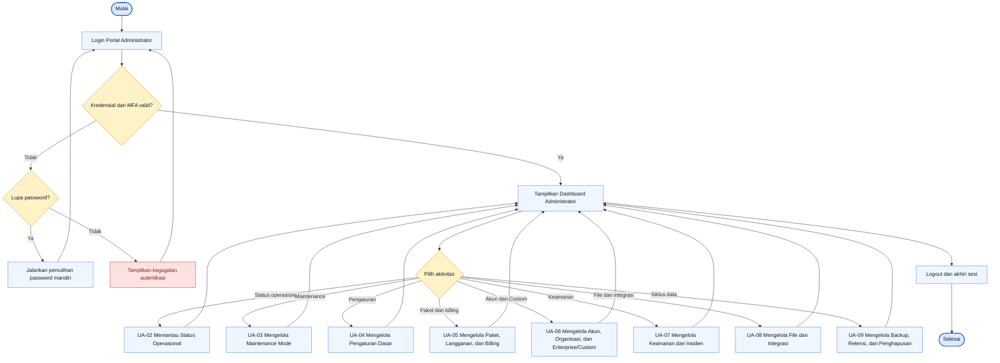

## 3. UA-01 — Mengakses Portal dan Dashboard Administrator

### 3.1 Login, MFA, dan Lupa Password

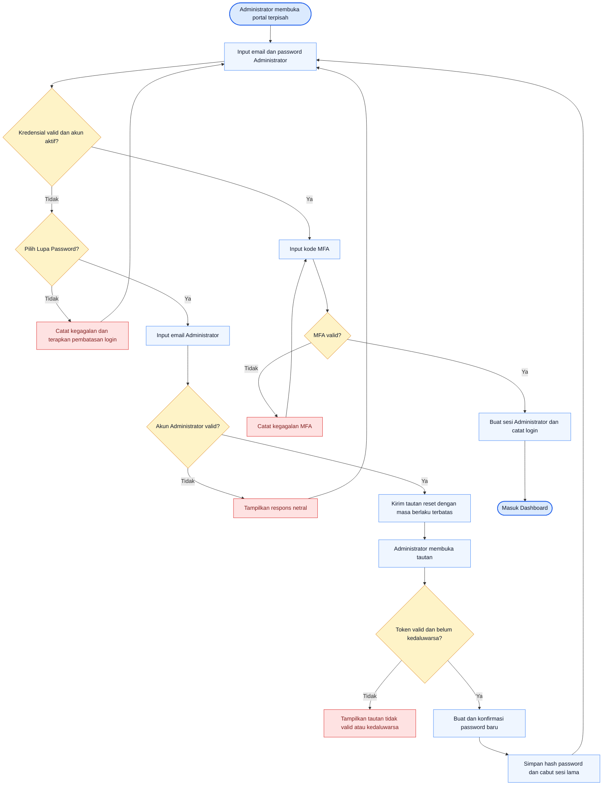

### 3.2 Dashboard dan Laporan Operasional

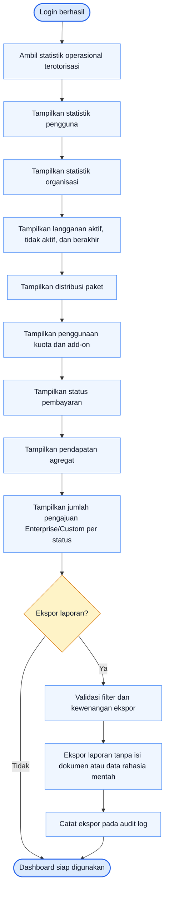

Dashboard tidak menampilkan password, token, NPWP lengkap, data finansial mentah pelanggan, isi Local File, CPU/RAM, antrean internal, atau SLA teknis.

## 4. UA-02 — Memantau Status Operasional

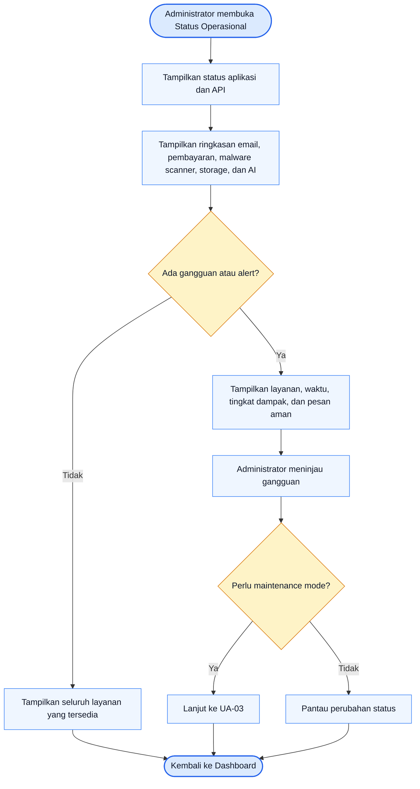

## 5. UA-03 — Mengelola Maintenance Mode

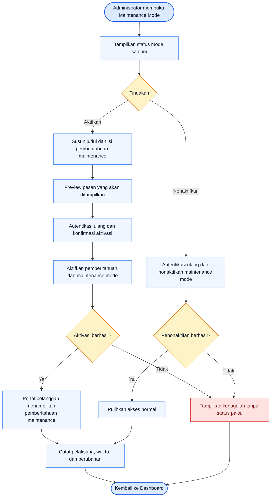

Flow ini tidak mencakup penjadwalan maintenance, pemilihan layanan terdampak, maintenance darurat, atau pencatatan teknis hasil maintenance.

## 6. UA-04 — Mengelola Pengaturan Dasar Platform

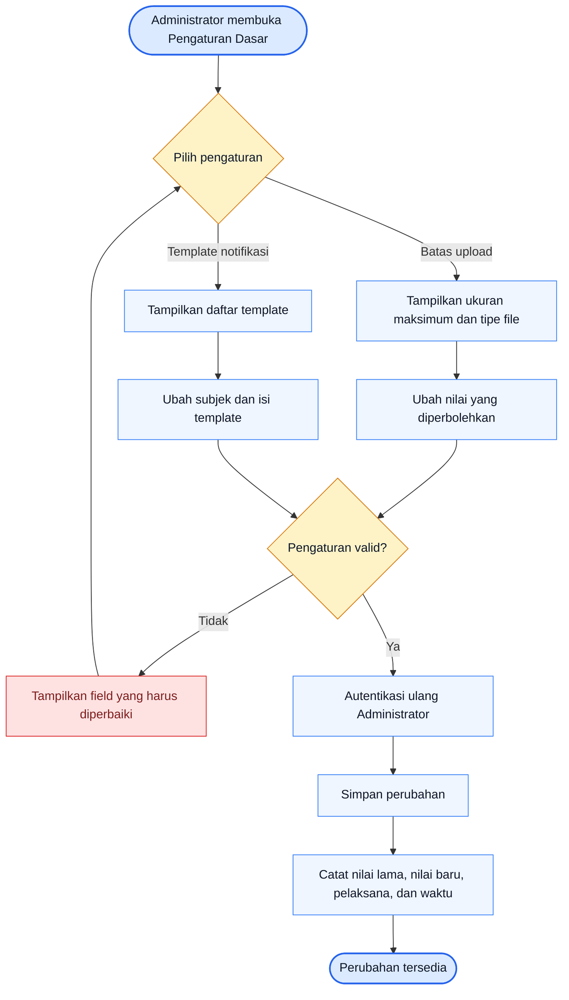

Feature flag, timeout, rate limit, konfigurasi infrastruktur, dan rollback tidak dikelola melalui flow Administrator ini.

## 7. UA-05 — Mengelola Paket, Langganan, dan Billing

### 7.1 Katalog, Kuota, Pembayaran, dan Koreksi

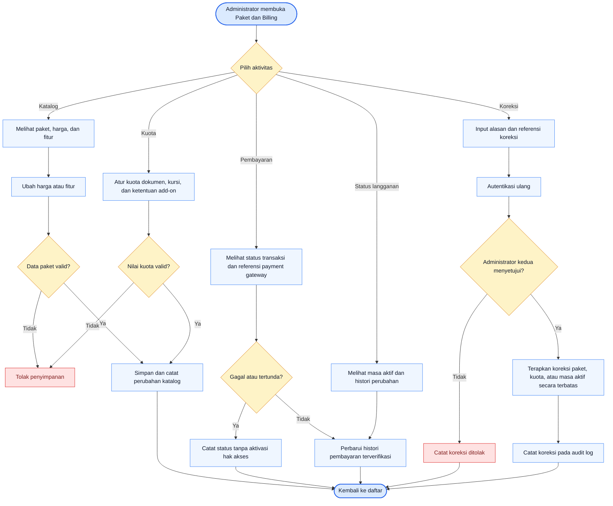

### 7.2 Refund Terotorisasi

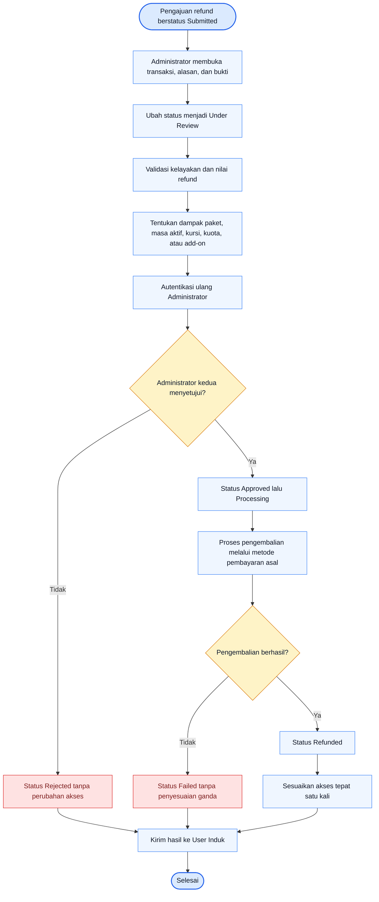

Status refund: `Submitted`, `Under Review`, `Approved`, `Rejected`, `Processing`, `Refunded`, dan `Failed`.

## 8. UA-06 — Mengelola Akun, Organisasi, dan Enterprise/Custom

### 8.1 Detail Akun, Pemulihan, dan Status

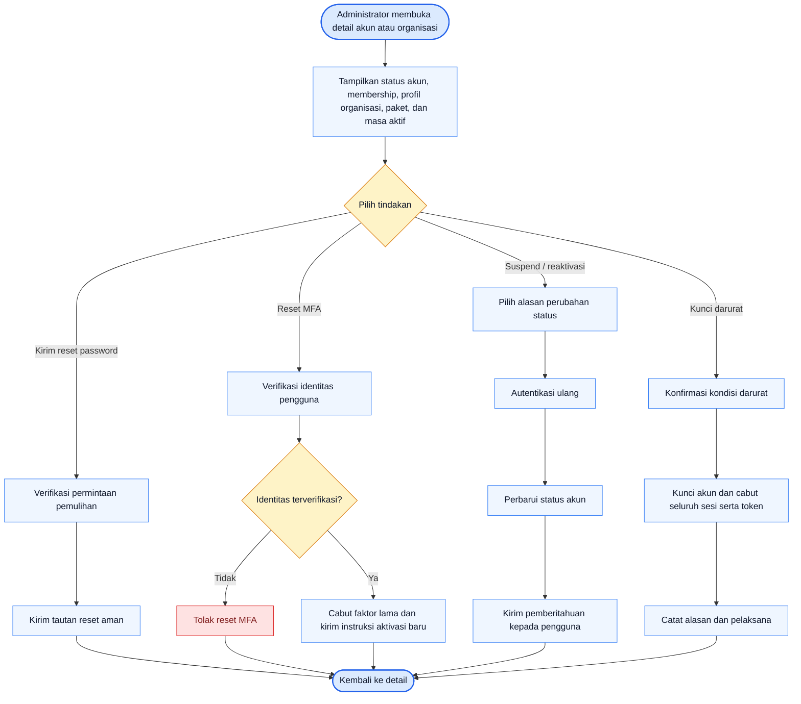

Administrator hanya mengirim tautan reset; password baru tetap dibuat oleh pemilik akun.

### 8.2 Pengajuan Enterprise/Custom

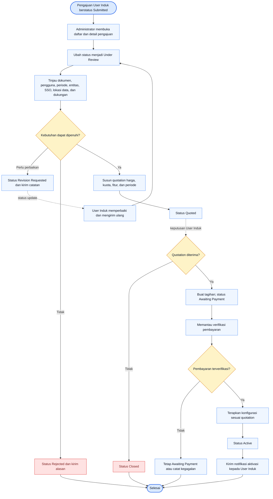

Status Enterprise/Custom: `Submitted`, `Under Review`, `Revision Requested`, `Quoted`, `Awaiting Payment`, `Active`, `Rejected`, dan `Closed`.

## 9. UA-07 — Mengelola Keamanan dan Insiden

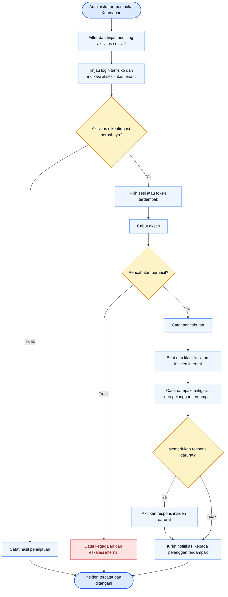

## 10. UA-08 — Mengelola File dan Integrasi

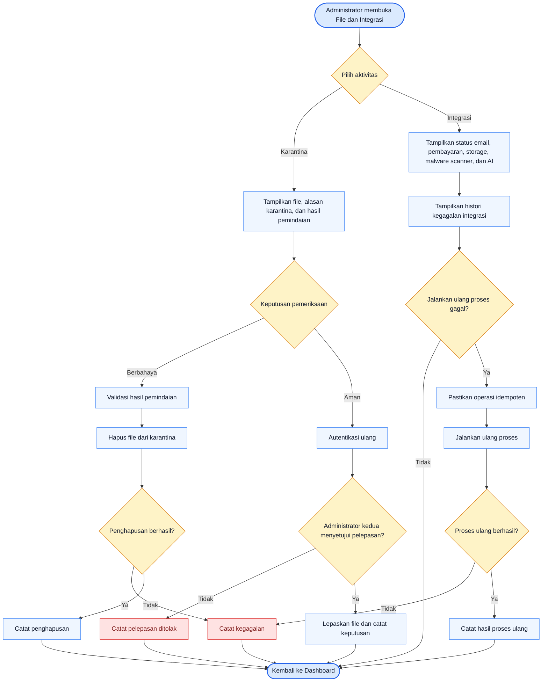

Proses ulang tidak boleh mengirim email, membuat transaksi, menambah kuota, atau menghasilkan efek bisnis yang sama lebih dari satu kali.

## 11. UA-09 — Mengelola Backup, Retensi, dan Penghapusan

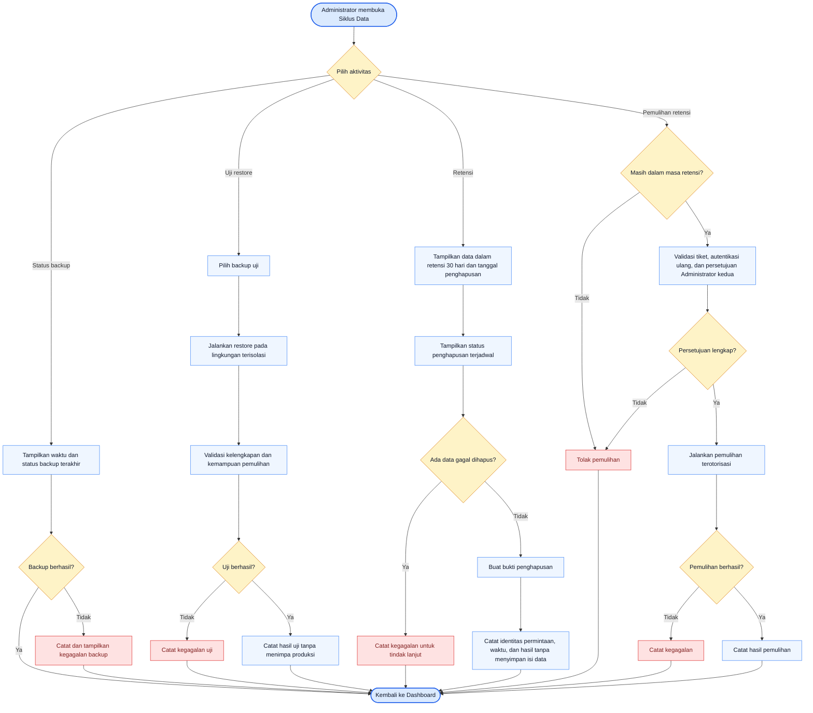

Restore pengujian selalu dilakukan pada lingkungan terisolasi dan tidak boleh menimpa data produksi.

## 12. Handoff dan Status Lintas Aktor

| Proses | Pemicu dari User Induk | Aktivitas Administrator | Status/Hasil ke User Induk |
| --- | --- | --- | --- |
| Enterprise/Custom | `UI-08.1.2.4` | `UA-06.5` | Revisi, quotation, tagihan, aktivasi, penolakan, atau penutupan |
| Refund | `UI-08.8` | `UA-05.4` | Status refund dan dampak akses |
| Pembayaran | Transaksi paket atau add-on | `UA-05.3` | Status transaksi tercermin pada riwayat pembayaran |
| Koreksi paket/kuota | Tiket koreksi sah | `UA-05.E1` | Paket, kuota, dan histori diperbarui setelah dual approval |
| Reset password | Permintaan pemulihan terverifikasi | `UA-06.2` | Tautan reset dikirim; Administrator tidak menetapkan password |
| Reset MFA | Permintaan setelah verifikasi identitas | `UA-06.3` | Faktor lama dicabut dan instruksi aktivasi baru dikirim |
| Suspend/reaktivasi | Keputusan operasional yang sah | `UA-06.4` | Pengguna menerima alasan dan status akun terbaru |

Garis lintas aktor merupakan handoff dan status update, bukan relasi UML `include` atau `extend`.

## 13. Aturan Bisnis

- MFA wajib sebelum Administrator memperoleh akses portal.
- Dashboard hanya menampilkan data operasional sesuai kewenangan dan pendapatan agregat.
- Setiap tindakan Administrator memiliki identitas pelaksana, waktu, alasan bila diperlukan, dan audit log.
- Tindakan berisiko tinggi memerlukan autentikasi ulang.
- Koreksi billing, refund, pelepasan file karantina, dan pemulihan data memerlukan Administrator kedua.
- Administrator tidak dapat menetapkan password pengguna atau mengubah keanggotaan perusahaan.
- Enterprise/Custom tidak aktif sebelum quotation diterima dan pembayaran terverifikasi.
- Refund yang ditolak tidak mengubah akses; refund berhasil menyesuaikan akses tepat satu kali.
- Retry integrasi wajib idempoten.
- Audit log dan bukti penghapusan tidak menyimpan kembali isi data pelanggan.
- Retensi data perusahaan setelah langganan berakhir mengikuti kebijakan 30 hari dan siklus backup maksimum 90 hari.

## 14. Referensi

- [Business Flow Overview](./00-Business-Flow-Overview.md)
- [Authentication](./01-Authentication.md)
- [Membership and Organization](./05-Membership-Organization.md)
- [Subscription and Billing](./06-Subscription-Billing.md)
- [Use Case Administrator](../02-Use-Case/Admin.md)
- [Use Case User Induk](../02-Use-Case/Organization-Owner.md)
- [Non-Functional Requirements](../01-Requirements/Non-Functional-Requirements.md)
