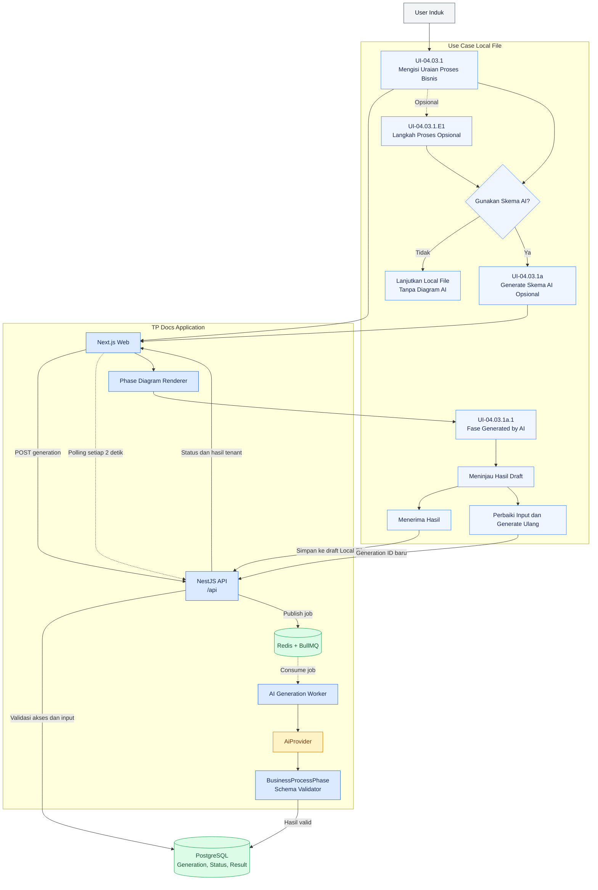
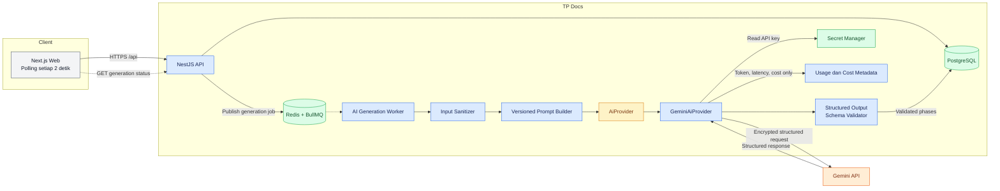
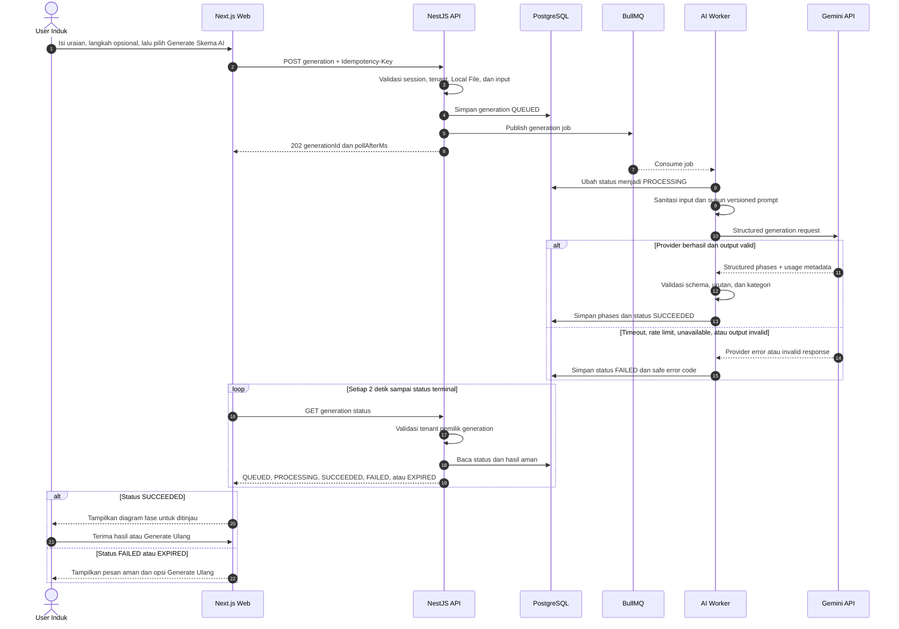
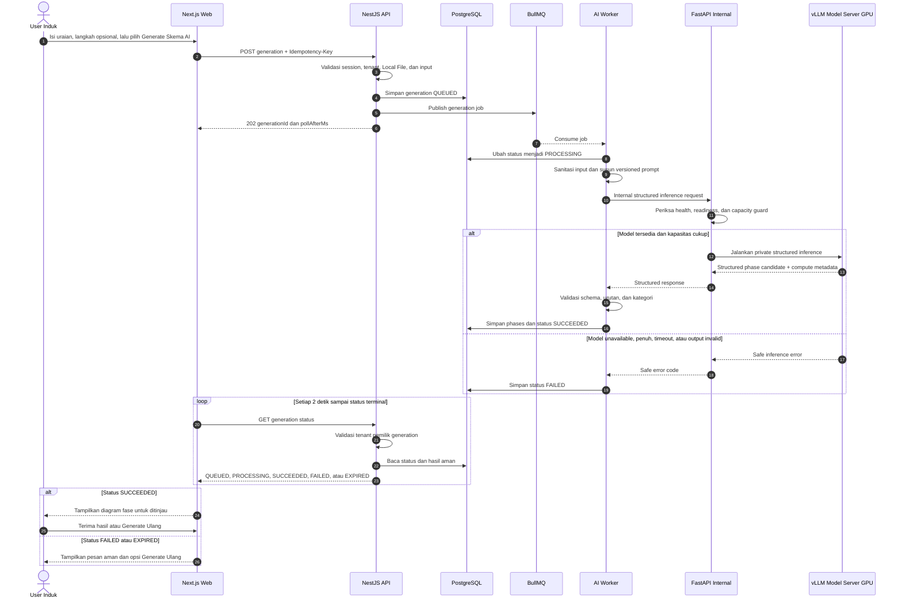
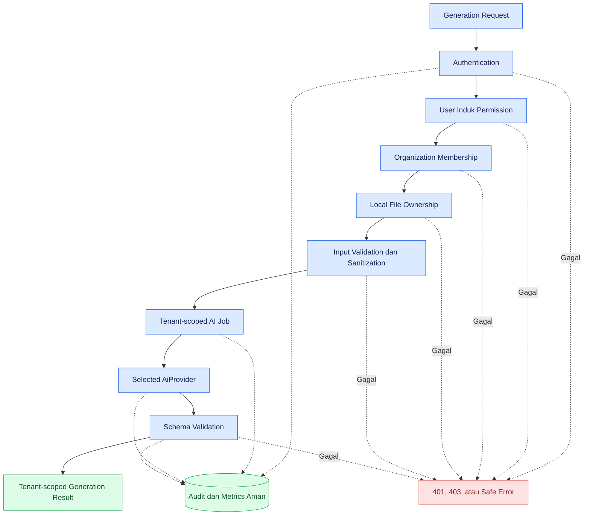
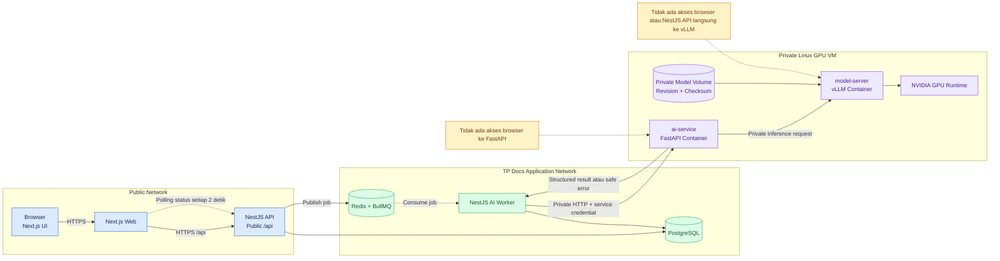
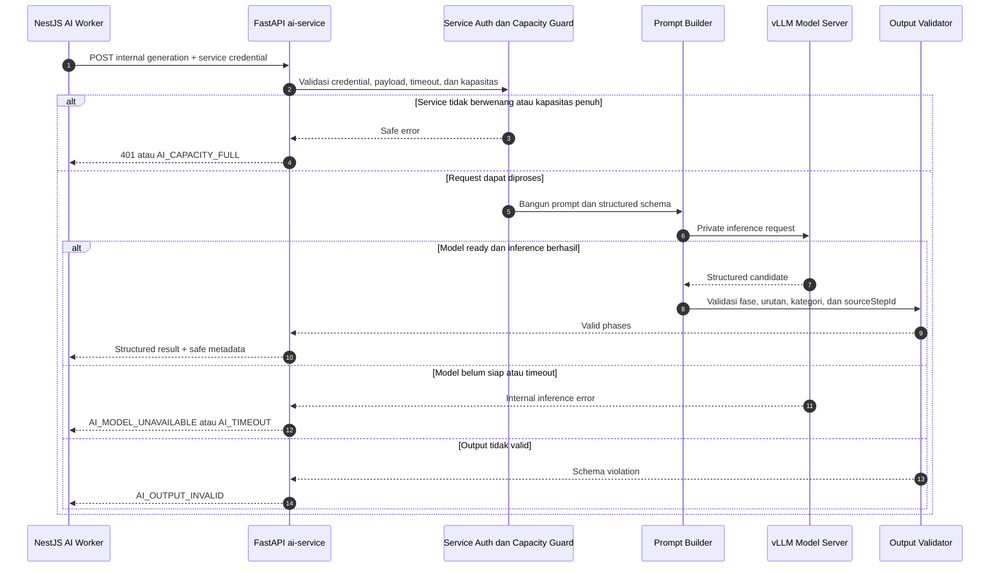

# AI Processing Architecture — TP Docs By System

## 1. Tujuan dan Cakupan

Dokumen ini menjelaskan arsitektur teknis fitur opsional **Skema Proses Bisnis — Generated by AI** dari uraian proses bisnis wajib dan daftar langkah proses opsional yang diinput User Induk.

Arsitektur menyediakan dua implementasi yang saling eksklusif:

1. Gemini API sebagai AI eksternal.
2. Model AI lokal melalui FastAPI dan model server/GPU.

Kedua implementasi menggunakan antarmuka, job, status, validasi output, dan renderer fase yang sama. Frontend tidak mengetahui provider yang digunakan. Hanya satu `AiProvider` yang diaktifkan pada environment production.

### 1.1 Referensi use case

| Use case | Aktivitas |
| --- | --- |
| `UI-04.03.1` | User Induk mengisi uraian proses bisnis |
| `UI-04.03.1a` | User Induk menekan tombol Skema AI |
| `UI-04.03.1a.1` | Sistem menampilkan fase Skema Proses Bisnis — Generated by AI |

### 1.2 Prinsip arsitektur

- Pemrosesan AI dijalankan asynchronous melalui BullMQ worker.
- Frontend memeriksa status generation melalui polling setiap dua detik.
- Uraian proses bisnis tetap wajib, sedangkan daftar langkah dan generation AI bersifat opsional.
- Local File dapat diselesaikan tanpa diagram AI.
- Uraian asli tidak dihapus ketika generation gagal atau diulang.
- Hasil AI belum menjadi bagian Local File sampai diterima User Induk.
- Output dari semua provider wajib mengikuti schema yang sama.
- Domain module bergantung pada `AiProvider`, bukan SDK Gemini atau model server.
- Tidak ada fallback otomatis antara Gemini API dan AI lokal.
- Prompt, uraian lengkap, dan respons mentah tidak ditulis pada application log.
- User Induk tidak mengedit fase secara langsung; koreksi dilakukan pada input lalu generation dibuat ulang.

---

## 2. Posisi AI dalam Local File

Diagram berikut memperlihatkan hubungan use case dengan komponen teknis. Diagram ini menunjukkan batas sistem, bukan detail implementasi provider.



### 2.1 Batas perilaku

- Generate ulang membuat generation baru dan tidak menimpa generation sebelumnya.
- Local File tetap dapat dilanjutkan tanpa membuat generation AI.
- Hanya generation berstatus `SUCCEEDED` yang dapat diterima.
- Hanya hasil yang diterima yang ditautkan sebagai skema aktif pada draft Local File.
- History generation digunakan untuk audit teknis, bukan sebagai versi Local File yang aktif.
- Penyuntingan manual setiap fase belum termasuk ruang lingkup versi awal.

---

## 3. Kontrak Bersama

### 3.1 Provider port

```ts
interface AiProvider {
  generateBusinessProcessPhases(
    input: BusinessProcessGenerationInput
  ): Promise<BusinessProcessPhase[]>;
}
```

Provider dipilih melalui dependency injection berdasarkan konfigurasi environment. Application layer tidak menggunakan pengecekan vendor pada business logic.

### 3.2 Input generation

```ts
type ProcessStepInput = {
  id: string;
  sequence: number;
  activity: string;
  actorOrDepartment?: string;
  description?: string;
};

type BusinessProcessGenerationInput = {
  generationId: string;
  organizationId: string;
  localFileId: string;
  description: string;
  processSteps?: ProcessStepInput[];
  locale: 'id-ID';
  promptVersion: string;
  correlationId: string;
};
```

`organizationId` dan `localFileId` berasal dari konteks yang telah diverifikasi backend. Nilainya tidak dipercaya langsung dari body request frontend.

### 3.3 Status generation

```ts
type AiGenerationStatus =
  | 'QUEUED'
  | 'PROCESSING'
  | 'SUCCEEDED'
  | 'FAILED'
  | 'EXPIRED';
```

Status terminal adalah `SUCCEEDED`, `FAILED`, dan `EXPIRED`. Frontend menghentikan polling ketika salah satu status terminal diterima.

### 3.4 Struktur fase

```ts
type BusinessProcessPhase = {
  phaseNumber: number;
  phaseName: string;
  activityTitle: string;
  shortDescription: string;
  category: 'INPUT' | 'PROCESS' | 'CONTROL' | 'OUTPUT';
  nextPhaseNumber: number | null;
  sourceStepId: string | null;
};
```

### 3.5 Validasi output

- `phaseNumber` berupa bilangan positif, unik, berurutan, dan dimulai dari satu.
- `phaseName`, `activityTitle`, dan `shortDescription` wajib terisi.
- `category` hanya menerima `INPUT`, `PROCESS`, `CONTROL`, atau `OUTPUT`.
- `nextPhaseNumber` menunjuk fase berikutnya yang valid.
- Fase terakhir menggunakan `nextPhaseNumber: null`.
- Jumlah fase tidak ditetapkan permanen dan mengikuti uraian proses bisnis.
- Jika `processSteps` tersedia, setiap langkah menghasilkan tepat satu fase, mempertahankan urutan, dan menggunakan `sourceStepId` yang sesuai.
- Narasi memperkaya nama dan deskripsi fase, tetapi tidak boleh menghapus langkah eksplisit.
- Jika hanya narasi tersedia, AI mengekstrak seluruh aktivitas eksplisit dan tidak menambahkan proses material yang tidak disebut pengguna.
- Output yang gagal divalidasi tidak disimpan sebagai hasil yang dapat diterima.

---

## 4. Kontrak API dan Polling

### 4.1 Membuat generation

```http
POST /api/local-files/{localFileId}/ai/business-process
Idempotency-Key: <unique-key>
```

Request:

```json
{
  "description": "Uraian proses bisnis perusahaan",
  "processSteps": [
    {
      "id": "step-1",
      "sequence": 1,
      "activity": "Penerimaan PO afiliasi",
      "actorOrDepartment": "Sales",
      "description": "Menerima pesanan dari pihak afiliasi"
    }
  ]
}
```

`processSteps` boleh tidak dikirim. Jika dikirim, ID dan urutan langkah menjadi referensi wajib untuk `sourceStepId` pada hasil fase.

Response `202 Accepted`:

```json
{
  "generationId": "generation-id",
  "status": "QUEUED",
  "pollAfterMs": 2000
}
```

### 4.2 Memeriksa status

```http
GET /api/ai-generations/{generationId}
```

Response generation selesai:

```json
{
  "generationId": "generation-id",
  "status": "SUCCEEDED",
  "phases": [],
  "createdAt": "ISO-8601 timestamp",
  "completedAt": "ISO-8601 timestamp"
}
```

Error internal, prompt, raw provider response, token provider, dan data tenant tidak dikirim pada response publik.

### 4.3 Menerima hasil

```http
POST /api/ai-generations/{generationId}/accept
Idempotency-Key: <unique-key>
```

Endpoint hanya menerima generation milik organisasi dan Local File yang sama, berstatus `SUCCEEDED`, serta belum diterima sebelumnya.

### 4.4 Generate ulang

Generate ulang menggunakan endpoint pembuatan generation yang sama. Sistem membuat `generationId` baru, mempertahankan uraian asli, dan tidak menghapus history generation sebelumnya.

---

## 5. Versi A — Gemini API

Gemini API merupakan kandidat implementasi MVP. Inferensi berlangsung di luar infrastruktur TP Docs, sedangkan validasi tenant, job, schema, penyimpanan hasil, dan renderer tetap dikelola TP Docs.

### 5.1 Component diagram



### 5.2 Sequence diagram



### 5.3 Komponen Gemini API

| Komponen | Tanggung jawab |
| --- | --- |
| `GeminiAiProvider` | Mengubah kontrak internal menjadi request Gemini dan memetakan response/error |
| Input sanitizer | Membatasi isi yang dikirim dan menghapus data yang tidak diperlukan |
| Prompt builder | Menyusun system instruction, output schema, Bahasa Indonesia, dan prompt version |
| Secret manager | Menyimpan API key Gemini di luar source code dan browser |
| Schema validator | Memastikan provider response sesuai `BusinessProcessPhase[]` |
| Usage recorder | Menyimpan token, latency, model, prompt version, dan estimasi biaya tanpa raw prompt |

### 5.4 Batasan versi Gemini

- Seluruh komunikasi provider menggunakan koneksi terenkripsi.
- API key tidak berada pada Next.js client bundle.
- Request menggunakan batas token dan timeout yang dapat dikonfigurasi.
- Retry hanya dilakukan untuk error provider yang aman untuk diulang.
- Retry memakai generation ID dan idempotency agar biaya tidak tercatat ganda oleh aplikasi.
- Tidak terdapat fallback otomatis ke AI lokal.
- Region, retensi data provider, tarif, model, dan rate limit berstatus **Pending Evaluation**.

---

## 6. Versi B — AI Lokal

Pada versi lokal, model berjalan pada server yang dikelola TP Docs. Model tidak berjalan pada perangkat pengguna dan FastAPI tidak dapat diakses dari internet publik.

### 6.1 Component diagram

```mermaid
flowchart LR
    subgraph CLIENT["Client"]
        WEB["Next.js Web<br/>Polling setiap 2 detik"]
    end

    subgraph APP["TP Docs Application"]
        API["NestJS API"]
        DB[("PostgreSQL")]
        QUEUE[("Redis + BullMQ")]
        WORKER["AI Generation Worker"]
        SANITIZER["Input Sanitizer"]
        PROMPT["Versioned Prompt Builder"]
        PORT["AiProvider"]
        ADAPTER["LocalAiProvider"]
        SCHEMA["BusinessProcessPhase<br/>Schema Validator"]
    end

    subgraph INTERNAL_AI["Private AI Network"]
        FASTAPI["FastAPI<br/>Internal Inference API"]
        SERVER["vLLM Model Server<br/>Batching + Concurrency + GPU Runtime"]
        ARTIFACT[("Model Artifact Storage<br/>Name, Version, Checksum, License")]
        HEALTH["Health dan Capacity Metrics"]
    end

    WEB -->|"HTTPS /api"| API
    API --> DB
    API -->|"Publish generation job"| QUEUE
    QUEUE -.-> WORKER
    WORKER --> SANITIZER
    SANITIZER --> PROMPT
    PROMPT --> PORT
    PORT --> ADAPTER
    ADAPTER -->|"Private network only"| FASTAPI
    FASTAPI --> SERVER
    ARTIFACT --> SERVER
    SERVER --> FASTAPI
    FASTAPI --> ADAPTER
    ADAPTER --> SCHEMA
    SCHEMA -->|"Validated phases"| DB
    FASTAPI --> HEALTH
    SERVER --> HEALTH
    WEB -.->|"GET generation status"| API

    classDef client fill:#f3f4f6,stroke:#4b5563,color:#111827
    classDef app fill:#dbeafe,stroke:#2563eb,color:#172554
    classDef data fill:#dcfce7,stroke:#16a34a,color:#14532d
    classDef port fill:#fef3c7,stroke:#d97706,color:#78350f
    classDef local fill:#ede9fe,stroke:#7c3aed,color:#4c1d95

    class WEB client
    class API,WORKER,SANITIZER,PROMPT,ADAPTER,SCHEMA app
    class DB,QUEUE,ARTIFACT data
    class PORT port
    class FASTAPI,SERVER,HEALTH local
```



### 6.2 Sequence diagram



### 6.3 Komponen AI lokal

| Komponen | Tanggung jawab |
| --- | --- |
| `LocalAiProvider` | Menghubungkan kontrak internal NestJS ke internal FastAPI |
| FastAPI | Memvalidasi request internal, menyusun prompt, menerapkan capacity guard, dan mengatur komunikasi dengan vLLM |
| vLLM model server | Memuat model serta menangani batching, concurrency, GPU runtime, timeout inference, dan structured generation |
| Model artifact storage | Menyimpan model, version, checksum, konfigurasi quantization, dan informasi lisensi |
| Health monitor | Mencatat model availability, queue duration, GPU utilization, dan inference latency |

### 6.4 Kandidat model benchmark

| Kandidat | Tujuan evaluasi |
| --- | --- |
| Qwen2.5-7B-Instruct | Kandidat awal untuk instruction following, structured output, dan multilingual |
| Gemma 3 4B IT | Kandidat lebih ringan untuk mengukur kebutuhan resource minimum |
| Qwen3-8B | Kandidat tambahan untuk kualitas dan kemampuan reasoning terstruktur |

Model final, lisensi, kebutuhan VRAM, quantization, runtime, throughput, concurrency, dan target latency berstatus **Pending Benchmark**.

### 6.5 Batasan versi lokal

- FastAPI dan model server hanya berada pada private network.
- Service-to-service authentication diterapkan antara worker dan FastAPI.
- Model tidak dilatih ulang atau di-fine-tune otomatis menggunakan data pelanggan.
- Prompt tidak digunakan lintas organisasi.
- Concurrency limit melindungi GPU dari kelebihan beban.
- Model artifact diverifikasi menggunakan checksum sebelum digunakan.
- Tidak terdapat fallback otomatis ke Gemini API.

---

## 7. Phase Diagram Renderer

Renderer berada pada aplikasi Next.js dan menerima `BusinessProcessPhase[]` yang sudah divalidasi backend. Renderer tidak menginterpretasikan ulang uraian dan tidak memanggil AI.

```mermaid
flowchart LR
    P1["Fase 1<br/>INPUT<br/>Penerimaan PO Afiliasi"]
    P2["Fase 2<br/>CONTROL<br/>Persetujuan Manajemen dan Logistik"]
    P3["Fase 3<br/>PROCESS<br/>Perencanaan Produksi dan QC"]
    P4["Fase 4<br/>PROCESS<br/>Proses Produksi"]
    P5["Fase 5<br/>CONTROL<br/>Inspeksi QC"]
    P6["Fase 6<br/>OUTPUT<br/>Pergudangan Barang Jadi"]
    P7["Fase 7<br/>OUTPUT<br/>Logistik Pengiriman"]

    P1 --> P2
    P2 --> P3
    P3 --> P4
    P4 --> P5
    P5 --> P6
    P6 --> P7

    classDef input fill:#dbeafe,stroke:#2563eb,color:#172554
    classDef process fill:#fef3c7,stroke:#d97706,color:#78350f
    classDef control fill:#dcfce7,stroke:#16a34a,color:#14532d
    classDef output fill:#ffedd5,stroke:#ea580c,color:#7c2d12

    class P1 input
    class P2,P5 control
    class P3,P4 process
    class P6,P7 output
```



### 7.1 Aturan renderer

- Fase diurutkan menggunakan `phaseNumber`.
- Label warna berasal dari `category`.
- Hubungan antarfase menggunakan `nextPhaseNumber`.
- Jumlah kartu mengikuti jumlah fase dari backend.
- Fase eksplisit seperti persetujuan manajemen dan logistik tidak boleh dihilangkan hanya untuk membatasi jumlah kartu.
- Data di-render sebagai teks aman dan tidak dijalankan sebagai HTML mentah.
- Renderer menyediakan loading, processing, failed, expired, dan empty state.
- Hasil tetap diberi label sebagai draft Generated by AI sampai diterima User Induk.

---

## 8. Penyimpanan Data AI

| Data | Lokasi | Retensi dan batasan |
| --- | --- | --- |
| Uraian proses bisnis aktif | PostgreSQL pada Local File | Mengikuti retensi Local File dan tenant scope |
| Daftar langkah proses opsional | PostgreSQL pada Local File | Disimpan berurutan dan dapat diperbaiki sebelum generate ulang |
| Generation ID dan status | PostgreSQL | Disimpan sebagai histori teknis |
| Hasil fase tervalidasi | PostgreSQL JSON/relational sesuai schema final | Hanya hasil accepted yang menjadi skema aktif Local File |
| Job payload | Redis/BullMQ | TTL terbatas; membawa tenant context dan correlation ID |
| Idempotency key | PostgreSQL atau penyimpanan idempotency terkontrol | Mencegah generation ganda dari request yang sama |
| Gemini API key | Secret manager | Tidak disimpan pada database atau browser |
| Token, latency, dan estimasi biaya | PostgreSQL/metrics store | Tidak memuat prompt atau respons mentah |
| Local model artifact | Model artifact storage | Version, checksum, lisensi, dan access restriction |
| GPU dan inference metrics | Metrics store | Tidak memuat uraian atau hasil pelanggan |

---

## 9. Error Model

Frontend hanya menerima kode aman dan pesan yang dapat ditindaklanjuti. Detail provider disimpan pada telemetry internal yang telah disanitasi.

| Error code | Berlaku untuk | Arti aman | Retry pengguna |
| --- | --- | --- | --- |
| `AI_INPUT_INVALID` | Keduanya | Uraian kosong, terlalu singkat, atau tidak memenuhi format | Setelah input diperbaiki |
| `AI_ACCESS_DENIED` | Keduanya | User tidak berhak mengakses Local File atau generation | Tidak |
| `AI_TIMEOUT` | Keduanya | Proses tidak selesai dalam batas waktu | Ya |
| `AI_RATE_LIMITED` | Gemini | Batas provider atau batas penggunaan organisasi tercapai | Setelah jeda |
| `AI_PROVIDER_UNAVAILABLE` | Gemini | Provider eksternal tidak tersedia | Ya |
| `AI_OUTPUT_INVALID` | Keduanya | Output tidak sesuai schema fase | Ya |
| `AI_MODEL_UNAVAILABLE` | Lokal | Model belum siap atau gagal dimuat | Ya setelah layanan pulih |
| `AI_CAPACITY_FULL` | Lokal | Kapasitas inference sedang penuh | Setelah jeda |
| `AI_GENERATION_EXPIRED` | Keduanya | Generation melewati masa tunggu yang ditetapkan | Buat generation baru |

Error internal tidak boleh membocorkan nama tenant lain, prompt, API key, alamat internal, stack trace, atau respons mentah provider.

---

## 10. Security dan Tenant Isolation



### 10.1 Kontrol wajib

- Generation, polling, dan accept memvalidasi tenant serta Local File.
- Job payload membawa `organizationId`, `localFileId`, `generationId`, dan `correlationId` yang berasal dari backend.
- Queue, cache, metrics, dan result menggunakan identifier yang tenant-aware.
- Prompt dan hasil tidak digunakan sebagai context generation tenant lain.
- Prompt dan respons lengkap tidak ditulis pada log atau error tracking.
- API key dan service credential disimpan pada secret manager.
- Data untuk provider eksternal dibatasi pada uraian yang diperlukan.
- Service AI lokal tidak memiliki endpoint publik.

---

## 11. Observability dan Metrik

| Metrik | Gemini API | AI lokal | Tujuan |
| --- | --- | --- | --- |
| Generation request count | Ya | Ya | Mengukur volume penggunaan |
| Queue duration | Ya | Ya | Menilai kapasitas worker |
| End-to-end latency | Ya | Ya | Mengukur waktu hingga hasil tersedia |
| Success rate | Ya | Ya | Mengukur keandalan generation |
| Invalid output rate | Ya | Ya | Mengukur kualitas structured output |
| Timeout rate | Ya | Ya | Mengukur kebutuhan tuning timeout/capacity |
| Token input/output | Ya | Tidak | Mengukur penggunaan dan biaya API |
| Cost per generation | Ya | Estimasi infrastruktur | Membandingkan efisiensi |
| Provider rate-limit count | Ya | Tidak | Mengukur kecukupan quota provider |
| GPU utilization | Tidak | Ya | Mengukur pemakaian compute lokal |
| Inference concurrency | Tidak | Ya | Mengukur kapasitas model server |
| Model load failure | Tidak | Ya | Mendeteksi masalah artifact/runtime |

Label metrics tidak boleh memuat uraian, nama perusahaan, NPWP, prompt, response, atau identifier sensitif ber-cardinality tinggi.

---

## 12. Kebutuhan Deployment per Versi

| Kebutuhan | Gemini API | AI lokal |
| --- | --- | --- |
| NestJS API | Wajib | Wajib |
| Redis dan BullMQ worker | Wajib | Wajib |
| PostgreSQL | Wajib | Wajib |
| Secret manager | Gemini API key | Service credential dan secret internal |
| FastAPI | Tidak | Wajib |
| Model server | Tidak | Wajib |
| GPU compute | Tidak | Wajib sesuai hasil benchmark |
| Model artifact storage | Tidak | Wajib |
| Token/cost monitoring | Wajib | Tidak berbasis token provider |
| GPU/capacity monitoring | Tidak | Wajib |
| Akses internet ke provider | Wajib dari worker | Tidak diperlukan untuk inference runtime |
| Private AI network | Tidak | Wajib |

Kedua versi tidak dijalankan bersamaan sebagai fallback otomatis. Pemilihan provider dilakukan melalui konfigurasi environment dan Architecture Decision Record.

---

## 13. Deployment AI Lokal

Bagian ini berlaku apabila `AI_PROVIDER=local` dipilih. Untuk MVP, FastAPI dan vLLM dideploy sebagai dua container terpisah pada satu Linux GPU VM. NestJS tetap menjadi satu-satunya backend publik; FastAPI dan vLLM hanya tersedia pada jaringan privat.

### 13.1 Batas komunikasi antarlayanan



Aturan komunikasi:

- Browser hanya mengakses Next.js dan endpoint publik NestJS dengan prefix `/api`.
- NestJS API melakukan autentikasi, otorisasi, tenant validation, validasi Local File, dan validasi kuota sebelum membuat job.
- BullMQ menjadi satu-satunya antrean bisnis generation. FastAPI tidak membuat antrean generation kedua.
- Worker memanggil FastAPI secara synchronous untuk satu job yang sedang diproses. Status asynchronous dari sudut pandang pengguna tetap dikelola melalui BullMQ dan PostgreSQL.
- FastAPI memanggil vLLM melalui jaringan container privat.
- vLLM tidak dapat diakses oleh browser, Next.js, atau public load balancer.
- FastAPI tidak mengakses PostgreSQL, Redis, session pengguna, membership, billing, kuota, atau isi Local File selain payload minimum yang dikirim worker.

### 13.2 Struktur monorepo layanan AI

```text
apps/
├── web/                         # Next.js
├── api/                         # NestJS public API
├── worker/                      # BullMQ worker
└── ai-service/                  # Python + FastAPI
    ├── app/
    │   ├── main.py
    │   ├── api/
    │   │   ├── generation.py
    │   │   └── health.py
    │   ├── schemas/
    │   │   ├── generation.py
    │   │   └── phases.py
    │   ├── services/
    │   │   ├── prompt_builder.py
    │   │   ├── inference_client.py
    │   │   └── output_validator.py
    │   ├── security/
    │   │   └── service_auth.py
    │   └── observability/
    │       ├── logging.py
    │       └── metrics.py
    ├── tests/
    ├── Dockerfile
    └── pyproject.toml
```

`ai-service` berisi adapter dan orchestration inference. Model tidak dimuat langsung pada proses FastAPI. Container `model-server` menjalankan vLLM agar lifecycle model, batching, penggunaan GPU, dan concurrency tidak bercampur dengan validasi request serta kontrak aplikasi.

### 13.3 Kontrak publik NestJS

Endpoint yang digunakan frontend tetap dimiliki NestJS:

| Method dan path | Fungsi |
| --- | --- |
| `POST /api/local-files/{localFileId}/ai/business-process` | Memvalidasi akses dan input, membuat generation serta job, kemudian mengembalikan `generationId` |
| `GET /api/ai-generations/{generationId}` | Mengembalikan status dan hasil aman untuk polling tenant pemilik |
| `POST /api/ai-generations/{generationId}/accept` | Menyimpan hasil `SUCCEEDED` yang diterima ke draft Local File |

Next.js tidak mengetahui endpoint internal FastAPI atau vLLM. Semua error internal diterjemahkan NestJS menjadi error aman yang telah ditetapkan pada bagian Error Model.

### 13.4 Kontrak internal NestJS Worker–FastAPI

Endpoint FastAPI hanya tersedia pada jaringan privat:

| Method dan path | Fungsi |
| --- | --- |
| `POST /internal/ai/business-process/generate` | Menjalankan generation terstruktur melalui vLLM |
| `GET /internal/health/live` | Menyatakan proses FastAPI hidup tanpa menjamin model siap |
| `GET /internal/health/ready` | Menyatakan FastAPI dapat menjangkau vLLM dan model siap menerima inference |

Contoh request internal:

```json
{
  "generationId": "gen_01HXYZ",
  "description": "Alur produksi dimulai dari penerimaan PO afiliasi...",
  "processSteps": [
    {
      "id": "step-1",
      "sequence": 1,
      "activity": "Penerimaan PO afiliasi",
      "actorOrDepartment": "Sales",
      "description": null
    }
  ],
  "promptVersion": "business-process-v1",
  "schemaVersion": "business-process-phase-v1",
  "correlationId": "corr_01HXYZ"
}
```

Contoh response berhasil:

```json
{
  "generationId": "gen_01HXYZ",
  "phases": [
    {
      "phaseNumber": 1,
      "phaseName": "Penerimaan PO",
      "activityTitle": "Penerimaan PO Afiliasi",
      "shortDescription": "Sales menerima purchase order dari pihak afiliasi.",
      "category": "INPUT",
      "nextPhaseNumber": null,
      "sourceStepId": "step-1"
    }
  ],
  "model": "selected-local-model",
  "modelRevision": "pinned-revision",
  "schemaVersion": "business-process-phase-v1",
  "inferenceDurationMs": 1240,
  "computeUsage": {
    "inputTokens": 186,
    "outputTokens": 112
  }
}
```

Ketentuan kontrak internal:

- `generationId` dan `correlationId` digunakan untuk traceability, bukan untuk memberikan akses database kepada FastAPI.
- FastAPI tidak menerima password, session token pengguna, NPWP, data pembayaran, atau seluruh snapshot Local File.
- `description` dan `processSteps` merupakan data minimum untuk tugas pembentukan fase.
- Worker tetap menjalankan validasi kontrak akhir sebelum menyimpan hasil ke PostgreSQL.
- Response mentah vLLM tidak diteruskan ke browser dan tidak ditulis pada application log.
- Request menggunakan service credential, content type JSON, batas ukuran payload, timeout, dan correlation ID header.

### 13.5 Komunikasi FastAPI–vLLM

FastAPI menggunakan internal inference client untuk memanggil endpoint kompatibel yang disediakan vLLM. Prompt builder mengubah input menjadi system instruction, data pengguna yang telah disanitasi, dan schema structured output.



vLLM menangani pemuatan model, batching, GPU memory, dan inference concurrency. FastAPI menangani kontrak bisnis AI yang stabil sehingga penggantian model atau parameter vLLM tidak mengubah API publik TP Docs.

### 13.6 Unit deployment satu GPU VM

```text
Linux GPU VM
├── ai-service container         # FastAPI, CPU-oriented
├── model-server container       # vLLM, akses NVIDIA GPU
├── private model volume         # Artifact, revision, checksum
├── private container network
└── NVIDIA Driver + NVIDIA Container Toolkit
```

Deployment MVP menggunakan ketentuan berikut:

- VM menggunakan Linux dan GPU NVIDIA yang kapasitasnya ditentukan melalui benchmark.
- FastAPI dan vLLM menggunakan image serta lifecycle deployment terpisah.
- Port FastAPI hanya dapat dijangkau worker melalui private VPC, VPN, atau jaringan internal yang setara.
- Port vLLM hanya diekspos ke private container network dan hanya dapat dijangkau FastAPI.
- Tidak ada port FastAPI atau vLLM pada public load balancer.
- Model disimpan pada private volume atau artifact storage terkontrol dan tidak dibundel ke image aplikasi.
- Satu instance vLLM menjadi batas kapasitas awal. High availability dan multi-GPU node tidak termasuk MVP.

### 13.7 Tahapan provisioning dan deployment

1. Sediakan Linux GPU VM berdasarkan hasil benchmark model, quantization, VRAM, latency, dan concurrency.
2. Instal driver NVIDIA yang kompatibel serta NVIDIA Container Toolkit.
3. Buat private network, firewall rule, dan service identity untuk koneksi worker ke FastAPI.
4. Siapkan private container registry, secret manager, model volume, dan lokasi metrics.
5. Unduh model dengan nama serta revision yang dikunci.
6. Verifikasi checksum, lisensi, dan izin penggunaan model sebelum artifact digunakan.
7. Jalankan container vLLM dan mount model volume sebagai read-only bila runtime memungkinkan.
8. Tunggu health model sampai artifact selesai dimuat pada GPU.
9. Jalankan container FastAPI dengan alamat internal vLLM dan service credential.
10. Jalankan readiness check, schema test, serta smoke test menggunakan fixture Bahasa Indonesia.
11. Konfigurasikan worker dengan `AI_PROVIDER=local` dan private URL FastAPI.
12. Aktifkan pemrosesan generation setelah liveness, readiness, dan smoke test berhasil.

Jika salah satu tahap gagal, provider lokal tidak ditandai ready. Fungsi TP Docs selain AI tetap tersedia dan job baru menghasilkan status aman tanpa kehilangan input pengguna.

### 13.8 Konfigurasi environment

Konfigurasi worker/NestJS:

```text
AI_PROVIDER=local
LOCAL_AI_BASE_URL=<private-fastapi-url>
LOCAL_AI_SERVICE_TOKEN=<secret-manager-reference>
LOCAL_AI_TIMEOUT_SECONDS=<benchmark-result>
LOCAL_AI_MAX_RETRIES=<limited-value>
LOCAL_AI_SCHEMA_VERSION=business-process-phase-v1
```

Konfigurasi FastAPI dan vLLM:

```text
LOCAL_AI_MODEL=<selected-model>
LOCAL_AI_MODEL_REVISION=<pinned-revision>
LOCAL_AI_MODEL_CHECKSUM=<verified-checksum>
VLLM_BASE_URL=<private-vllm-url>
VLLM_MAX_CONCURRENCY=<benchmark-result>
VLLM_REQUEST_TIMEOUT_SECONDS=<benchmark-result>
PROMPT_VERSION=business-process-v1
```

Nilai rahasia disimpan pada secret manager dan tidak ditempatkan pada source code, image, atau file konfigurasi yang masuk version control. Production hanya mengaktifkan satu nilai `AI_PROVIDER`; tidak ada fallback otomatis antara `local` dan `gemini`.

### 13.9 Liveness, readiness, dan kapasitas

| Pemeriksaan | Makna | Dampak |
| --- | --- | --- |
| FastAPI liveness | Proses HTTP FastAPI hidup | Container dapat direstart jika gagal |
| FastAPI readiness | Service auth, konfigurasi, dan koneksi vLLM siap | Worker tidak mengirim inference jika gagal |
| vLLM health | Model berhasil dimuat dan runtime merespons | FastAPI memetakan kegagalan menjadi `AI_MODEL_UNAVAILABLE` |
| Capacity guard | Concurrency aktif masih di bawah batas aman | Request baru ditolak dengan `AI_CAPACITY_FULL` saat penuh |
| Inference timeout | Request selesai dalam batas benchmark | Kegagalan dipetakan menjadi `AI_TIMEOUT` |

Readiness FastAPI tidak boleh berhasil hanya karena proses FastAPI hidup. Readiness harus gagal selama vLLM masih memuat model, checksum tidak sesuai, atau model tidak dapat digunakan.

### 13.10 Queue, concurrency, retry, dan idempotency

- BullMQ tetap menjadi sumber antrean dan status asynchronous dari perspektif pengguna.
- Worker mengambil satu job dan melakukan satu internal call ke FastAPI dalam batas timeout.
- vLLM menangani batching serta inference concurrency; FastAPI menerapkan capacity guard sebelum request diteruskan.
- Retry worker dibatasi hanya untuk error yang dapat dipulihkan seperti timeout sementara atau service unavailable.
- `AI_OUTPUT_INVALID` tidak disimpan sebagai hasil dan hanya di-retry sesuai kebijakan terbatas.
- Idempotency key generation berada pada NestJS/PostgreSQL. FastAPI tidak membuat generation baru.
- Retry dengan `generationId` yang sama tidak membuat histori, hasil accepted, atau penggunaan kuota ganda.
- Ketika service penuh, FastAPI mengembalikan `AI_CAPACITY_FULL` dan tidak menahan request tanpa batas.

### 13.11 CI/CD dan release model

Release aplikasi AI dan release model dipisahkan:

| Pipeline | Pemeriksaan dan hasil |
| --- | --- |
| FastAPI application | Lint, type check, unit test, schema contract test, dependency scan, image scan, dan push image ke private registry |
| Model evaluation | Lisensi, revision, checksum, benchmark Bahasa Indonesia, structured output, latency, VRAM, throughput, dan safety fixture |
| Deployment | Pull image dan artifact terpilih, start vLLM, start FastAPI, readiness, smoke test, lalu enable provider |

Aturan release:

- Image FastAPI tidak memuat model agar pembaruan aplikasi tidak mengunduh ulang artifact besar.
- Pergantian model atau revision membutuhkan benchmark dan smoke test baru.
- Deployment belum ready sebelum model selesai dimuat dan schema fixture berhasil.
- Rollback aplikasi menggunakan image FastAPI sebelumnya.
- Rollback model menggunakan revision artifact sebelumnya yang checksum-nya telah diverifikasi.
- Development tanpa GPU menggunakan `MockAiProvider` yang mengikuti kontrak sama. Mock tidak tersedia sebagai fallback production.

### 13.12 Keamanan jaringan dan data

- Worker dan FastAPI menggunakan service credential yang disimpan pada secret manager.
- Firewall hanya mengizinkan sumber worker yang sah menuju port FastAPI.
- vLLM hanya menerima koneksi dari FastAPI pada private container network.
- TLS internal digunakan ketika komunikasi melewati host atau segmen jaringan berbeda.
- Payload dibatasi ukurannya dan hanya membawa data minimum untuk generation.
- Prompt, uraian lengkap, process steps, dan respons mentah tidak dicatat pada log.
- Alamat internal, service token, model path, dan stack trace tidak diteruskan ke frontend.
- Model volume tidak dapat ditulis oleh request inference.
- Data pelanggan tidak digunakan untuk training atau fine-tuning otomatis.
- Container FastAPI berjalan tanpa hak akses GPU; hanya vLLM yang mendapat akses GPU.

### 13.13 Monitoring dan safe failure

Metrik minimum:

- FastAPI request count, latency, status, dan authentication failure.
- vLLM readiness, model load duration, inference latency, token throughput, GPU utilization, GPU memory, dan concurrency.
- BullMQ queue duration, processing duration, retry count, dan terminal status.
- Jumlah `AI_CAPACITY_FULL`, `AI_MODEL_UNAVAILABLE`, `AI_TIMEOUT`, dan `AI_OUTPUT_INVALID`.

Log hanya menyimpan `generationId`, correlation ID, provider, model version, prompt version, schema version, timing, dan safe error code. Identifier tenant ber-cardinality tinggi serta isi bisnis tidak digunakan sebagai label metrics.

Kegagalan FastAPI atau vLLM hanya memengaruhi fitur generation AI. Login, pengisian Local File, penyimpanan uraian, document generation non-AI, billing, dan fungsi lain tetap berjalan. Worker memperbarui generation menjadi `FAILED`, sedangkan input asli tetap tersedia untuk generate ulang setelah layanan pulih.

---

## 14. Pengujian dan Kriteria Penerimaan

### 14.1 Pengujian bersama

- Local File dapat mencapai `Ready to Generate` tanpa generation AI selama uraian bisnis lengkap.
- AI unavailable tidak menghalangi penyimpanan uraian atau pengisian bagian Local File lain.
- Uraian kosong atau terlalu singkat ditolak sebelum job dibuat.
- Request tanpa akses Local File ditolak.
- Idempotency key yang sama tidak membuat generation ganda.
- Generation berhasil menghasilkan fase unik, berurutan, dan berkategori valid.
- Jika `processSteps` tersedia, setiap langkah menghasilkan tepat satu fase dengan `sourceStepId` yang sesuai.
- Urutan fase mengikuti `sequence` pada langkah input.
- Narasi contoh manufaktur menghasilkan tujuh fase dan tidak menghilangkan persetujuan manajemen serta logistik.
- AI tidak menambahkan aktivitas material yang tidak terdapat pada uraian atau langkah input.
- Polling hanya mengembalikan status dan hasil kepada tenant pemilik.
- Polling berhenti pada status terminal.
- Accept ditolak jika generation bukan milik tenant, belum `SUCCEEDED`, atau sudah diterima.
- Generate ulang mempertahankan uraian dan generation sebelumnya.
- Output tidak valid tidak dapat diterima.
- Retry worker tidak membuat hasil atau penggunaan biaya ganda pada aplikasi.
- Prompt, respons mentah, API key, dan data rahasia tidak muncul pada log.
- Hasil accepted menjadi skema aktif pada draft Local File.
- Generation yang tidak digunakan atau belum diterima tidak muncul pada dokumen hasil generate.

### 14.2 Pengujian Gemini API

- Timeout menghasilkan `AI_TIMEOUT`.
- Rate limit menghasilkan `AI_RATE_LIMITED`.
- Provider unavailable menghasilkan `AI_PROVIDER_UNAVAILABLE`.
- Respons non-JSON atau tidak sesuai schema menghasilkan `AI_OUTPUT_INVALID`.
- Token dan estimasi biaya dicatat tanpa menyimpan prompt lengkap.
- Worker tidak berpindah ke AI lokal ketika Gemini gagal.

### 14.3 Pengujian AI lokal

- FastAPI tidak dapat diakses dari jaringan publik.
- Browser tidak dapat mengakses FastAPI atau vLLM.
- Worker dapat memanggil FastAPI hanya menggunakan private network dan service credential yang valid.
- Service credential tidak valid ditolak tanpa menjalankan inference.
- FastAPI liveness dapat berhasil ketika proses hidup, tetapi readiness gagal selama vLLM belum siap.
- Model mati menghasilkan `AI_MODEL_UNAVAILABLE`.
- Kapasitas penuh menghasilkan `AI_CAPACITY_FULL`.
- Inference timeout menghasilkan `AI_TIMEOUT`.
- Checksum model yang tidak sesuai mencegah model digunakan.
- Concurrency limit mencegah penggunaan GPU melebihi konfigurasi.
- Output tidak valid tidak disimpan pada PostgreSQL atau draft Local File.
- Restart FastAPI atau vLLM tidak menghentikan NestJS dan fungsi Local File lain.
- Retry internal tidak membuat generation, histori, hasil accepted, atau penggunaan kuota ganda.
- Prompt, uraian lengkap, process steps, dan respons mentah tidak muncul pada log.
- Frontend hanya menerima status dan safe error melalui NestJS.
- Worker tidak berpindah ke Gemini ketika AI lokal gagal.

### 14.4 Pengujian visual

- Seluruh diagram Mermaid dapat dirender tanpa parse error.
- Sequence diagram Gemini dan AI lokal menunjukkan polling dua detik.
- Renderer menampilkan jumlah fase secara dinamis.
- Warna kategori konsisten untuk input, proses, kontrol, dan output.

---

## 15. Keputusan Pending Evaluation

| Keputusan | Status |
| --- | --- |
| Provider production final | Gemini API atau AI lokal — belum ditetapkan |
| Model Gemini final | Pending Evaluation |
| Tarif dan quota Gemini | Pending Evaluation |
| Region dan kebijakan retensi Gemini | Pending Evaluation |
| Model lokal final | Pending Benchmark |
| Runtime model lokal | vLLM untuk rancangan MVP; kompatibilitas model tetap Pending Benchmark |
| Bentuk deployment lokal | Satu Linux GPU VM dengan container FastAPI dan vLLM |
| VRAM dan quantization | Pending Benchmark |
| Concurrency dan target latency | Pending Benchmark |
| Masa kedaluwarsa generation | Pending Validation |
| Retensi history generation teknis | Pending Validation |

Keputusan final dibuat setelah kedua versi menjalankan dataset uji yang sama dan hasilnya dicatat pada Architecture Decision Record.

---

## 16. Referensi

- [Use Case User Induk](../02-Use-Case/Organization-Owner.md)
- [AI Content Generation Business Flow](../03-Business-Flow/04-AI-Content-Generation.md)
- [Local File Management](../03-Business-Flow/03-Local-File-Management.md)
- [Technology Stack](./Technology-Stack.md)
- [System Architecture](./System-Architecture.md)
- [API Contract](./API-Contract.md)
- [Non-Functional Requirements](../01-Requirements/Non-Functional-Requirements.md)
