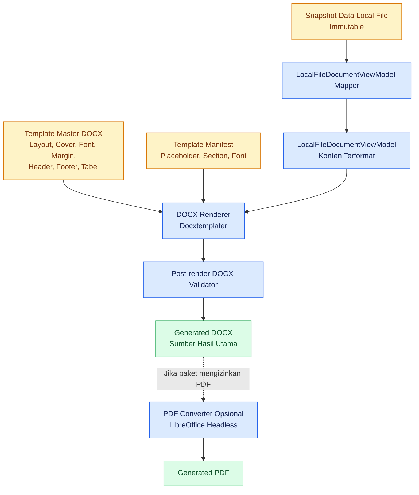
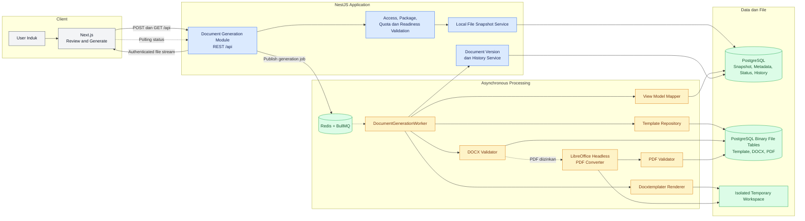
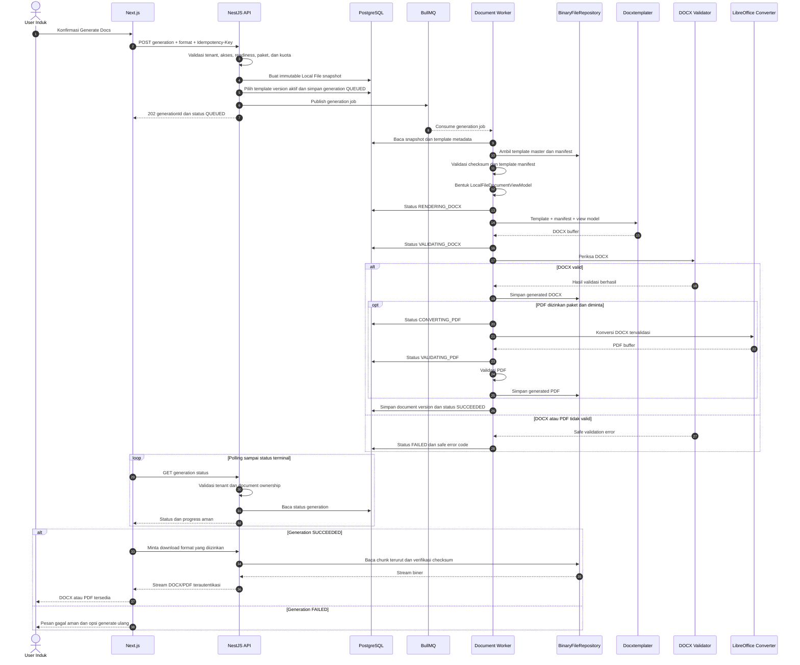
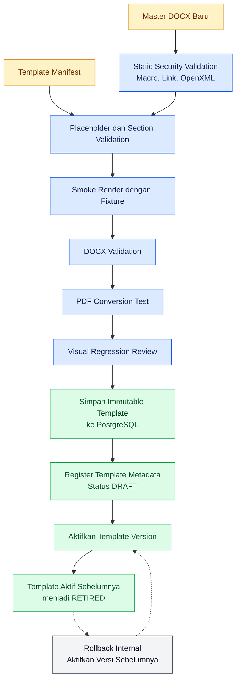
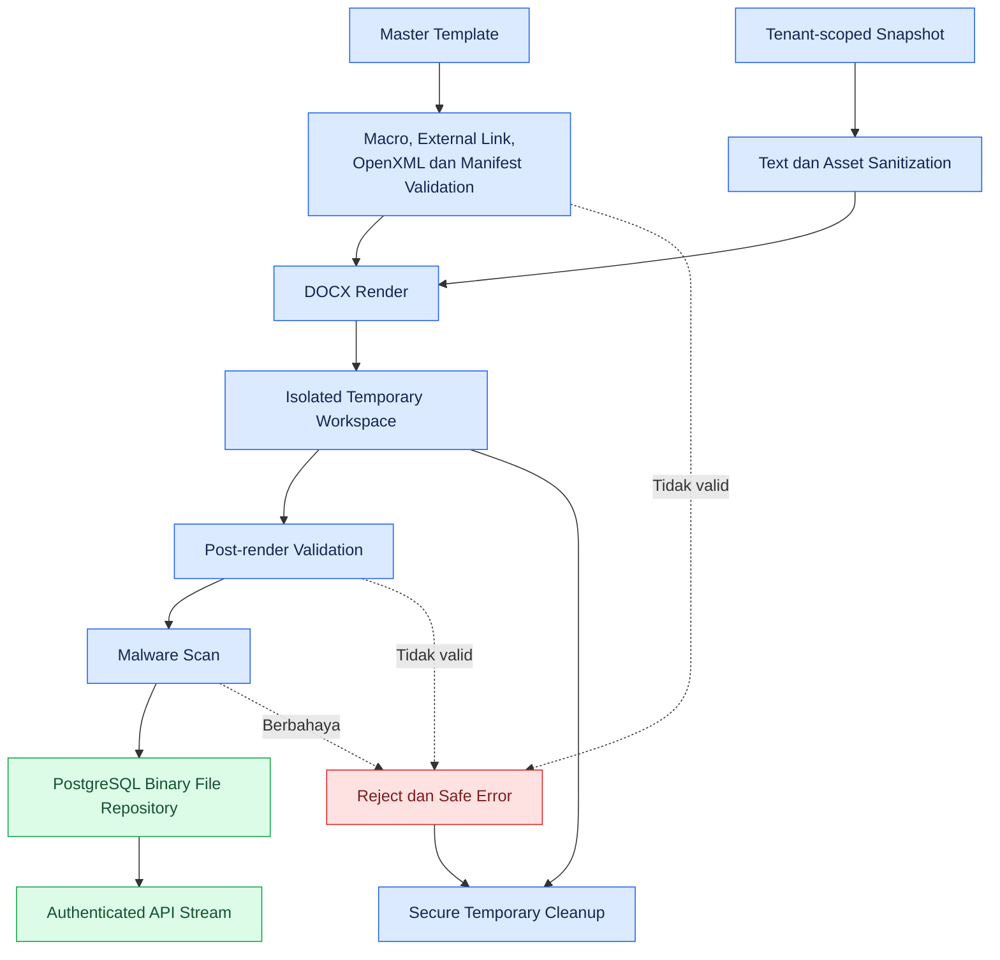

# Document Generation Architecture — TP Docs By System

## 1. Tujuan dan Cakupan

Dokumen ini menjelaskan arsitektur teknis pembentukan draft Local File dalam format DOCX dan PDF menggunakan satu template Word resmi TP Docs.

Template master merupakan sumber kebenaran tampilan dan sudah menetapkan:

- Cover.
- Daftar isi dan penomoran halaman.
- Header dan footer.
- Ukuran kertas dan margin.
- Font, ukuran teks, heading, spacing, serta warna.
- Struktur bab dan section break.
- Struktur tabel.
- Placeholder, repeating section, dan conditional section.

Sistem tidak menyusun ulang desain Word dari nol. Worker mengambil snapshot data Local File, memetakannya ke view model, lalu melakukan binding ke template. DOCX merupakan hasil utama. PDF, jika diizinkan paket, selalu dikonversi dari DOCX yang sama.

### 1.1 Keputusan arsitektur

- Seluruh organisasi menggunakan satu template resmi TP Docs.
- Identitas perusahaan dan isi Local File tetap dinamis.
- Template dikelola melalui rilis internal berversi.
- User Induk dan Administrator tidak dapat mengunggah template pada MVP.
- Template version bersifat immutable dan tidak ditimpa.
- Generation job menyimpan snapshot ID dan template version.
- File hasil generation bersifat immutable.
- Perubahan data atau template menghasilkan version dokumen baru.
- DOCX dan PDF berasal dari snapshot serta template version yang sama.

---

## 2. Template-First Architecture



### 2.1 Pemisahan tanggung jawab

| Lapisan | Sumber kebenaran | Tanggung jawab |
| --- | --- | --- |
| Template DOCX | Tampilan | Cover, margin, font, heading, tabel, header, footer, dan section break |
| Snapshot | Data generation | Nilai Local File pada saat User Induk mengonfirmasi generate |
| View model | Kontrak konten | Data yang sudah diformat agar aman digunakan template |
| Renderer | Binding | Mengisi placeholder, loop, condition, dan gambar |
| Validator | Kelayakan file | Memastikan hasil dapat digunakan dan tidak memiliki placeholder tersisa |
| PDF converter | Format turunan | Mengubah DOCX tervalidasi menjadi PDF tanpa sumber layout terpisah |

Database schema tidak digunakan langsung oleh placeholder. Perubahan database hanya memengaruhi mapper, sedangkan template berkomunikasi melalui `LocalFileDocumentViewModel`.

---

## 3. Component Architecture



### 3.1 Komponen utama

| Komponen | Tanggung jawab |
| --- | --- |
| Document Generation Module | Membuka endpoint, memvalidasi request, dan mengelola generation metadata |
| Snapshot Service | Membekukan data sumber untuk satu generation |
| Template Repository | Memilih dan mengambil template version yang ditetapkan saat job dibuat |
| View Model Mapper | Mengubah snapshot menjadi data terformat yang dipahami template |
| Docxtemplater Renderer | Mengisi placeholder, condition, row loop, dan aset yang diizinkan |
| DOCX Validator | Memeriksa ZIP/OpenXML, placeholder, relationship, macro, dan struktur file |
| LibreOffice Converter | Mengubah DOCX tervalidasi menjadi PDF pada process/container terisolasi |
| PDF Validator | Memastikan PDF terbaca, memiliki halaman, dan berasal dari DOCX yang benar |
| History Service | Menyimpan version, template version, status, checksum, dan file ID |

Docxtemplater dipilih karena mendukung template Word dengan placeholder dan row loop; baris yang diulang mewarisi format baris template. Kebutuhan modul berlisensi untuk gambar atau tabel lanjutan harus dipastikan sebelum production. Rujukan: [Docxtemplater — tables](https://docxtemplater.com/articles/ways-to-create-tables/).

LibreOffice dijalankan dengan mode headless dalam container terisolasi untuk menghasilkan PDF dari DOCX yang sama. Rujukan: [LibreOffice start parameters](https://help.libreoffice.org/latest/is/text/shared/guide/start_parameters.html).

---

## 4. Sequence Diagram Generation



### 4.1 Konsistensi snapshot

- Snapshot dibuat setelah validasi readiness dan konfirmasi User Induk.
- Snapshot bersifat immutable dan memiliki identifier sendiri.
- Perubahan data Local File setelah job dibuat tidak mengubah job berjalan.
- Generation berikutnya membuat snapshot dan document version baru.
- DOCX dan PDF pada satu document version menggunakan snapshot serta template version yang sama.

---

## 5. Template Versioning dan Rilis Internal



### 5.1 Aturan versioning

- Hanya satu template berstatus `ACTIVE` untuk kode `LOCAL_FILE`.
- Object template tidak pernah ditimpa.
- Template version menggunakan identifier stabil dan checksum.
- Template baru selalu dimulai sebagai `DRAFT`.
- Aktivasi hanya dilakukan setelah semua validasi lulus.
- Job memilih template version saat generation dibuat, bukan saat worker mulai.
- Job tetap menggunakan template version yang telah dipilih walaupun versi aktif berubah.
- Rollback dilakukan melalui proses internal terkontrol dengan mengaktifkan kembali versi lama.
- File yang sudah dihasilkan tidak dirender ulang otomatis.
- Tidak tersedia fitur upload atau aktivasi template pada portal User Induk maupun Administrator.

---

## 6. Kontrak Template dan Data

### 6.1 Template metadata

```ts
type DocumentTemplate = {
  id: string;
  code: 'LOCAL_FILE';
  version: string;
  schemaVersion: string;
  templateFileId: string;
  checksum: string;
  status: 'DRAFT' | 'ACTIVE' | 'RETIRED';
  activatedAt: string | null;
};
```

### 6.2 Template manifest

```ts
type TemplateManifest = {
  templateCode: 'LOCAL_FILE';
  templateVersion: string;
  schemaVersion: string;
  requiredPlaceholders: string[];
  optionalPlaceholders: string[];
  repeatingSections: string[];
  conditionalSections: string[];
  requiredFonts: string[];
};
```

Manifest disimpan bersama template dan checksum. Renderer menolak template apabila manifest tidak sesuai dengan placeholder atau section yang ditemukan pada DOCX.

### 6.3 Local File view model

```ts
type LocalFileDocumentViewModel = {
  document: {
    title: string;
    version: number;
    generatedAt: string;
    taxYear: number;
    isDraft: true;
  };
  companyProfile: object;
  ownershipAndManagement: object;
  businessAndStrategy: object;
  financialSummary: object;
  affiliatesAndCompetitors: object;
  industryOverview: object;
  transactions: object;
  farAnalysis: object;
  benchmarking: object;
  reviewSummary: object;
};
```

View model berisi string, angka, boolean, array, dan referensi aset yang telah diformat. Template tidak:

- Melakukan query database.
- Menghitung metode transfer pricing atau PLI.
- Menentukan kelayakan transaksi.
- Memutuskan warning.
- Memvalidasi tenant.
- Mengakses SDK vendor.

### 6.4 Renderer dan converter interfaces

```ts
interface DocumentRenderer {
  render(
    template: Buffer,
    manifest: TemplateManifest,
    data: LocalFileDocumentViewModel
  ): Promise<Buffer>;
}

interface PdfConverter {
  convertDocxToPdf(docx: Buffer): Promise<Buffer>;
}
```

---

## 7. Struktur Template Local File

| Bagian | Tipe binding | Ketentuan |
| --- | --- | --- |
| Cover | Placeholder | Nama entitas, tahun pajak, judul, dan status draft |
| Daftar isi | Word field/template element | Diperbarui saat proses render/conversion jika didukung dan diverifikasi |
| Profil perusahaan | Placeholder dan condition | Mengikuti snapshot profil |
| Pemegang saham | Row loop | Satu baris per pemegang saham |
| Komisaris dan direksi | Row loop | Satu baris per pengurus |
| Uraian proses bisnis | Placeholder | Selalu muncul jika readiness terpenuhi |
| Skema AI | Conditional section | Hanya muncul jika hasil AI telah diterima |
| Produk dan strategi | Row loop dan placeholder | Mengikuti daftar produk dan uraian strategi |
| Informasi keuangan | Tabel dan placeholder | Nilai sudah diformat oleh view model |
| Afiliasi dan pesaing | Row loop | Tidak membuat data baru pada template |
| Gambaran industri | Placeholder/section | Sumber konten telah diproses sebelumnya |
| Transaksi afiliasi | Row loop | Dapat melintasi halaman tanpa merusak header tabel |
| Transaksi independen | Row loop | Mengikuti data snapshot |
| Summary transaksi | Tabel | Nilai berasal dari calculation/application service |
| Analisis FAR | Row loop dan section | Fungsi, aset, risiko, metode, dan evaluasi |
| Pembanding final | Row loop | Nama, negara, COGS, GP, OP, dan PLI |
| Rentang interkuartil | Placeholder/tabel | Min, Q1, median, Q3, dan max |
| Warning | Conditional section | Muncul hanya jika warning telah ditetapkan sebelum render |
| Catatan draft | Static template text | Selalu menegaskan hasil bukan opini atau jaminan kepatuhan |

Bagian opsional disembunyikan melalui conditional section yang sudah disiapkan pada template. Penghapusan section tidak boleh merusak heading, page break, header/footer, atau penomoran berikutnya.

---

## 8. API dan Status Generation

### 8.1 Membuat generation

```http
POST /api/local-files/{localFileId}/generations
Idempotency-Key: <unique-key>
```

Request:

```json
{
  "format": "DOCX_AND_PDF"
}
```

Nilai format:

- `DOCX` — menghasilkan DOCX.
- `DOCX_AND_PDF` — menghasilkan DOCX dan PDF jika paket mengizinkan.

Response `202 Accepted`:

```json
{
  "generationId": "generation-id",
  "status": "QUEUED",
  "pollAfterMs": 2000
}
```

### 8.2 Memeriksa status

```http
GET /api/document-generations/{generationId}
```

### 8.3 Download version

```http
GET /api/document-versions/{versionId}/download?format=docx|pdf
```

Endpoint men-stream file hanya jika tenant, document ownership, package entitlement, status scan, dan format telah tervalidasi. PDF mendukung HTTP Range dan respons `206`.

### 8.4 Status

```ts
type DocumentGenerationStatus =
  | 'QUEUED'
  | 'RENDERING_DOCX'
  | 'VALIDATING_DOCX'
  | 'CONVERTING_PDF'
  | 'VALIDATING_PDF'
  | 'SUCCEEDED'
  | 'FAILED';
```

Status terminal adalah `SUCCEEDED` dan `FAILED`.

---

## 9. Penyimpanan Data dan File

| Data/file | Lokasi | Ketentuan |
| --- | --- | --- |
| Local File aktif | PostgreSQL | Sumber data sebelum snapshot |
| Generation snapshot | PostgreSQL | Immutable dan tenant-scoped |
| Template metadata | PostgreSQL | Version, schema, checksum, status, dan `template_file_id` |
| Template master DOCX | PostgreSQL `files` + `file_blob_chunks` | Private dan immutable |
| Template manifest | PostgreSQL metadata | Terikat pada checksum dan template version |
| Generation job | Redis/BullMQ | TTL terbatas dan membawa tenant context |
| Temporary render files | Workspace sementara worker | Terisolasi per job dan dihapus setelah selesai |
| Generated DOCX | PostgreSQL `files` + `file_blob_chunks` | Private, immutable, checksum tercatat |
| Generated PDF | PostgreSQL `files` + `file_blob_chunks` | Private, immutable, checksum tercatat |
| Document history | PostgreSQL | Version, snapshot, template version, status, waktu |

Template dan hasil dihubungkan menggunakan UUID `files.id`. Identitas file dibentuk backend; request pengguna tidak boleh menentukan kepemilikan organisasi, status scan, jumlah chunk, atau relasi document version.

---

## 10. Security Architecture



### 10.1 Kontrol wajib

- Template tidak boleh memiliki macro, embedded executable, atau external relationship aktif.
- Template dan manifest wajib memiliki checksum.
- Teks dinamis di-escape agar tidak menjadi OpenXML atau template command.
- Worker tidak mengambil gambar dari URL bebas.
- Aset dinamis hanya berasal dari file PostgreSQL yang telah divalidasi dan berstatus `CLEAN`.
- Temporary workspace terpisah untuk setiap job.
- Temporary file dihapus pada success, failure, timeout, dan worker recovery.
- Converter dijalankan tanpa akses credential aplikasi yang tidak diperlukan.
- DOCX dan PDF dipindai sebelum tersedia untuk download.
- File hasil tidak bersifat publik.
- Download memerlukan otorisasi baru pada setiap request dan tidak menggunakan URL file publik.
- Isi dokumen, NPWP lengkap, dan data finansial mentah tidak dicatat pada log.
- Administrator tidak dapat mengunduh isi Local File melalui portal operasional.

---

## 11. Rendering Validation

### 11.1 Validasi template sebelum aktivasi

- File merupakan DOCX/OpenXML yang valid.
- Manifest menggunakan schema version yang didukung.
- Seluruh `requiredPlaceholders` ditemukan tepat sesuai kontrak.
- Optional placeholder, repeating section, dan conditional section dikenali renderer.
- Tidak ada placeholder yang tidak terdaftar pada manifest.
- Font wajib terdaftar dan tersedia pada conversion container.
- Template tidak memiliki macro atau relationship eksternal berbahaya.
- Template dapat di-smoke-render menggunakan fixture minimum dan lengkap.

### 11.2 Validasi DOCX hasil

- File merupakan ZIP/OpenXML yang valid.
- Tidak terdapat placeholder yang belum terisi.
- Header, footer, page number, dan section break tetap tersedia.
- Cover dan section utama terdapat pada file.
- Tabel berulang memiliki jumlah row sesuai view model.
- Tidak ada external relationship baru.
- File dapat dibuka tanpa repair warning pada aplikasi pengujian yang ditentukan.
- Checksum, MIME type, dan ukuran file dicatat.

### 11.3 Validasi PDF hasil

- Konversi selesai tanpa process error.
- PDF memiliki minimal satu halaman.
- Cover dan section utama tersedia.
- Font tidak diganti secara tidak terkontrol.
- Header, footer, margin, tabel, dan page break sesuai baseline.
- Tidak terdapat halaman kosong yang tidak diharapkan.
- Metadata menghubungkan PDF ke DOCX version yang sama.
- Checksum, MIME type, ukuran, dan jumlah halaman dicatat.

---

## 12. Error Model

| Error code | Arti aman | Retry |
| --- | --- | --- |
| `DOCUMENT_NOT_READY` | Data wajib belum lengkap atau belum konsisten | Setelah data diperbaiki |
| `FORMAT_NOT_ALLOWED` | Paket tidak mengizinkan format yang diminta | Setelah paket/format berubah |
| `TEMPLATE_NOT_AVAILABLE` | Template version tidak tersedia | Setelah layanan dipulihkan |
| `TEMPLATE_INVALID` | Template atau manifest gagal validasi | Setelah template diperbaiki |
| `VIEW_MODEL_INVALID` | Snapshot tidak dapat dipetakan ke kontrak template | Setelah data/mapper diperbaiki |
| `DOCX_RENDER_FAILED` | Renderer gagal menghasilkan DOCX | Ya, jika penyebab transient |
| `DOCX_VALIDATION_FAILED` | DOCX tidak lolos post-render validation | Setelah penyebab diperbaiki |
| `PDF_CONVERSION_FAILED` | Converter gagal menghasilkan PDF | Ya, jika DOCX valid |
| `PDF_VALIDATION_FAILED` | PDF tidak lolos pemeriksaan hasil | Setelah penyebab diperbaiki |
| `FILE_SECURITY_REJECTED` | File atau relationship dinilai tidak aman | Tidak sebelum diperbaiki |
| `GENERATION_TIMEOUT` | Proses melebihi batas waktu | Ya |

Error publik tidak memuat path internal, stack trace, isi dokumen, template source, atau credential.

---

## 13. Pengujian dan Kriteria Penerimaan

### 13.1 Template dan view model

- Fixture lengkap menghasilkan seluruh bab dan tabel.
- Fixture minimum menyembunyikan bagian opsional tanpa merusak penomoran.
- Banyak pemegang saham, pengurus, transaksi, FAR, dan pembanding menghasilkan row yang sesuai.
- Nilai Rupiah, persentase, tanggal, dan Bahasa Indonesia diformat konsisten.
- Teks panjang tetap berada dalam margin atau table layout yang diizinkan.
- Skema AI accepted muncul; skema yang tidak digunakan atau belum diterima tidak muncul.
- Warning muncul hanya ketika tersedia pada snapshot.
- Template tidak melakukan perhitungan bisnis.

### 13.2 DOCX dan PDF

- Cover, daftar isi, header, footer, margin, font, dan section break mengikuti master template.
- DOCX dapat dibuka tanpa repair warning.
- PDF berasal dari DOCX version yang sama.
- Font yang digunakan tersedia pada conversion container.
- Visual regression memeriksa cover, daftar isi, tabel transaksi, FAR, pembanding, dan halaman akhir.
- PDF tidak memiliki halaman kosong atau pergeseran layout di luar baseline yang disetujui.

### 13.3 Versioning dan idempotency

- Template version baru tidak mengubah document version lama.
- Job yang berjalan tetap menggunakan template version yang dipilih saat job dibuat.
- Rollback template hanya memengaruhi generation baru.
- Idempotency key yang sama tidak membuat snapshot, file, history, atau penggunaan kuota ganda.
- Retry menggunakan snapshot dan template version yang sama.
- Perubahan data setelah generate menghasilkan document version baru.

### 13.4 Security dan isolation

- Tenant lain tidak dapat membaca generation, snapshot, history, atau file.
- Template dengan macro, external relationship, atau placeholder tidak dikenal ditolak.
- Aset dari URL bebas ditolak.
- Temporary workspace dibersihkan setelah success, failure, dan timeout.
- Endpoint download menolak organisasi lain dan HTTP Range mengembalikan potongan byte yang tepat.
- Log tidak mengandung isi dokumen, NPWP lengkap, atau data finansial mentah.

### 13.5 Performa

- Progress dapat dipantau tanpa mengirim generation berulang kali.
- Target generation DOCX dan PDF tetap maksimal lima menit pada beban yang disepakati.
- Worker dapat di-scale tanpa menghasilkan generation ganda.

---

## 14. Keputusan Pending Validation

| Keputusan | Status |
| --- | --- |
| Master DOCX final | Belum tersedia di repository |
| Daftar placeholder final | Menunggu master DOCX dan mapping konten |
| Font production | Menunggu daftar font template dan pemeriksaan lisensi |
| Modul Docxtemplater lanjutan | Validasi kebutuhan dan lisensi image/table module |
| Versi Docxtemplater | Ditetapkan saat implementation lock |
| Versi LibreOffice | Ditetapkan dan dipin pada container production |
| Toleransi visual regression | Ditetapkan dari baseline master DOCX |
| Pembaruan daftar isi/Word field | Diuji terhadap template dan converter final |

---

## 15. Referensi

- [Technology Stack](./Technology-Stack.md)
- [System Architecture](./System-Architecture.md)
- `API-Contract.md` — akan dilengkapi pada tahap penyusunan kontrak API dengan endpoint dan status generation dari dokumen ini.
- [Document Generation Business Flow](../03-Business-Flow/02-Document-Generation.md)
- [Local File Management](../03-Business-Flow/03-Local-File-Management.md)
- [Use Case User Induk](../02-Use-Case/Organization-Owner.md)
- [Non-Functional Requirements](../01-Requirements/Non-Functional-Requirements.md)
- [Docxtemplater table documentation](https://docxtemplater.com/articles/ways-to-create-tables/)
- [LibreOffice command-line parameters](https://help.libreoffice.org/latest/is/text/shared/guide/start_parameters.html)
