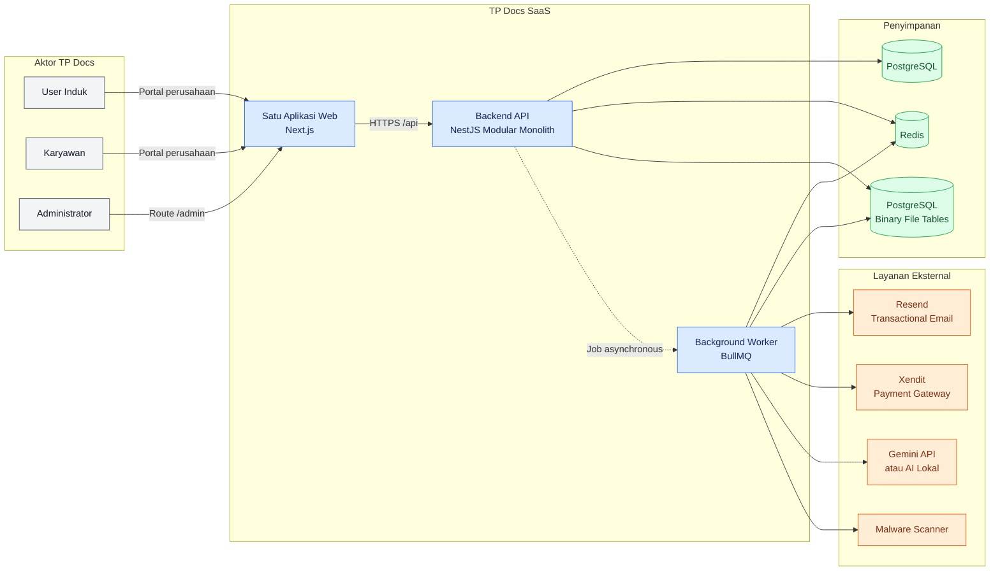
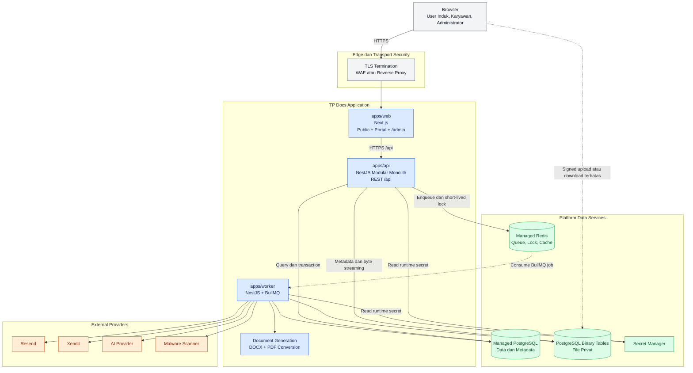
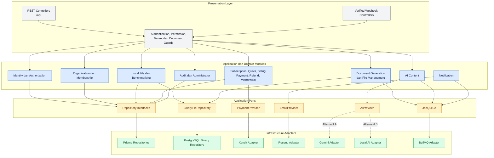
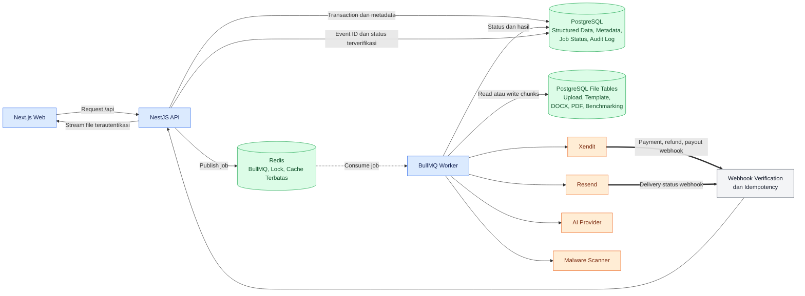
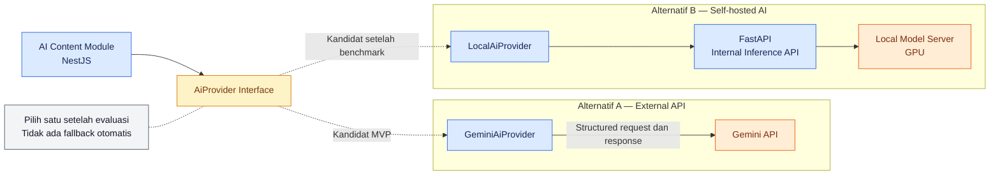
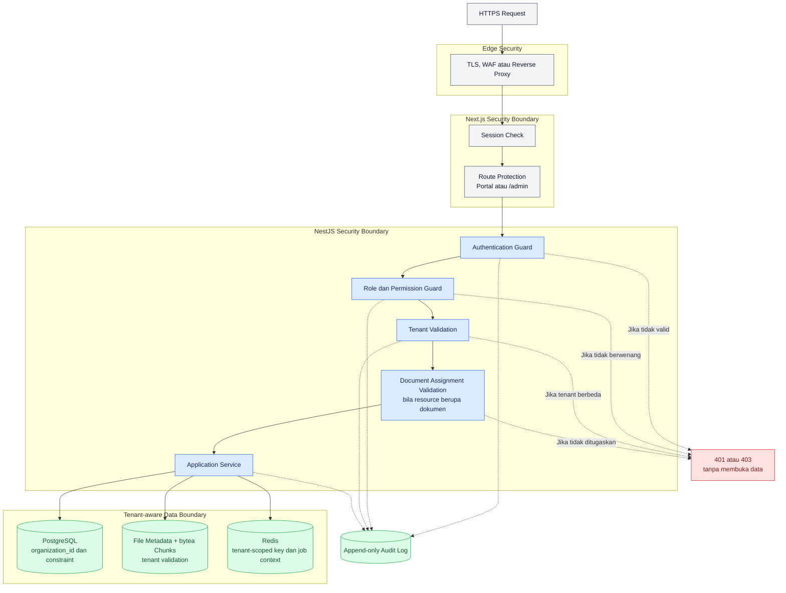
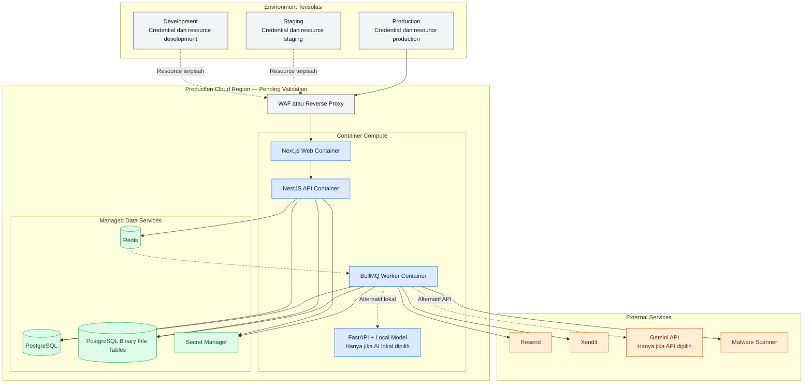
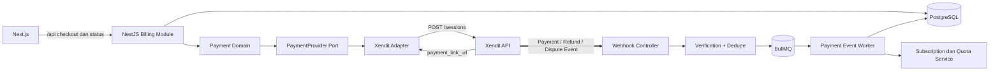

# System Architecture — TP Docs By System

## 1. Tujuan Dokumen

Dokumen ini memberikan gambaran visual arsitektur TP Docs sebagai SaaS multi-tenant untuk penyusunan Local File. Visual berfokus pada struktur sistem, batas komponen, penyimpanan data, integrasi eksternal, keamanan tenant, dan unit deployment.

Urutan aktivitas pengguna dan keputusan bisnis tidak dibahas di sini. Detail tersebut berada pada folder `03-Business-Flow`.

### 1.1 Keputusan arsitektur utama

`DiscountPricingService` berada di modul billing NestJS. Ia membaca harga katalog/quotation dan event aktif dari PostgreSQL, mengembalikan satu harga final untuk Next.js, payment, dan audit. Worker/webhook mencatat pemakaian sesudah pembayaran terverifikasi. Xendit hanya menerima total server yang telah dibekukan.


- User Induk, Karyawan, dan Administrator menggunakan satu aplikasi Next.js.
- Administrator menggunakan route `/admin/**`, tetapi NestJS tetap menjadi sumber otorisasi utama.
- Backend menggunakan NestJS modular monolith.
- PostgreSQL menyimpan data terstruktur dan metadata.
- Redis dan BullMQ menangani antrean serta pekerjaan asynchronous.
- Seluruh file permanen disimpan di PostgreSQL sebagai chunk `bytea`; metadata dan isi biner tetap dipisahkan secara logis.
- Pekerjaan berat dijalankan oleh background worker.
- Integrasi Resend, Xendit, AI, dan malware scanner menggunakan adapter; file memakai repository PostgreSQL internal.
- Gemini API dan AI lokal merupakan dua alternatif deployment; implementasi final hanya memilih satu.
- Seluruh endpoint backend menggunakan prefix `/api`.

---

## 2. Legenda Visual

| Notasi | Arti |
| --- | --- |
| Garis penuh `→` | Komunikasi synchronous atau dependency langsung |
| Garis putus-putus `⇢` | Pekerjaan asynchronous, signed access, atau alternatif deployment |
| Garis tebal `⇒` | Webhook dari layanan eksternal |
| Kotak biru | Aplikasi atau service TP Docs |
| Kotak hijau | Penyimpanan data |
| Kotak jingga | Layanan eksternal |
| Kotak abu-abu | Aktor, batas keamanan, atau catatan arsitektur |

---

## 3. System Context Diagram

Diagram berikut memperlihatkan aktor, sistem TP Docs, dan layanan eksternal pada tingkat tertinggi.



### 3.1 Batas konteks

- Aplikasi web tidak menyimpan credential provider eksternal.
- Browser tidak mengakses PostgreSQL atau Redis secara langsung.
- Semua keputusan akses data dilakukan oleh backend.
- Konten file hanya dapat di-stream oleh backend setelah validasi tenant, assignment, status scan, paket, dan hak format.
- Administrator tidak memperoleh akses otomatis ke isi Local File hanya karena menggunakan route `/admin/**`.

---

## 4. Application Container Diagram

Diagram container memperlihatkan komponen runtime utama dan jalur komunikasi di dalam platform.



### 4.1 Aturan container

- `apps/web` merupakan satu deployment untuk halaman publik, autentikasi, portal perusahaan, dan portal Administrator.
- `apps/api` merupakan sumber authentication, authorization, tenant validation, dan business rule.
- `apps/worker` menangani pekerjaan yang tidak harus selesai dalam request HTTP utama.
- Worker dapat di-scale terpisah dari API.
- AI lokal, bila dipilih, berjalan sebagai service tersendiri dan tidak berada dalam process API.
- Secret hanya dibaca server-side oleh API, worker, atau AI service yang berwenang.

---

## 5. Module Architecture — NestJS Modular Monolith

Modular monolith memisahkan domain secara logis dalam satu backend deployment. Pemisahan ini menjaga konsistensi transaksi tanpa menambah kompleksitas jaringan microservices pada tahap MVP.



### 5.1 Dependency rule

- Domain dan application module bergantung pada interface, bukan SDK vendor.
- Infrastructure adapter mengimplementasikan interface yang ditetapkan application layer.
- Controller tidak mengakses Prisma, Redis, SDK Xendit, SDK Resend, atau repository file secara langsung.
- Gemini adapter dan local AI adapter tidak digunakan bersamaan pada satu environment production.
- Perubahan vendor tidak mengubah kontrak domain selama interface tetap kompatibel.

---

## 6. Data dan Asynchronous Processing

Diagram ini menunjukkan pergerakan data teknis dan hubungan synchronous, asynchronous, serta webhook. Diagram ini bukan business flow pengguna.



### 6.1 Data ownership

- PostgreSQL merupakan sumber kebenaran data bisnis, status, dan metadata.
- Redis bukan sumber kebenaran permanen.
- Isi file biner tidak disimpan dalam PostgreSQL.
- File ID, checksum, MIME type, ukuran, jumlah chunk, tenant, dan status scan disimpan sebagai metadata.
- Webhook disimpan dan diproses secara idempotent.
- Setiap background job membawa tenant context dan correlation ID yang tervalidasi.

---

## 7. AI Deployment Alternatives

Kedua alternatif menggunakan kontrak `AiProvider` yang sama. Hanya satu adapter yang diaktifkan pada environment production setelah evaluasi kualitas, privasi, latency, kapasitas, dan biaya.



### 7.1 Ketentuan bersama

- Input disanitasi dan dibatasi pada data yang diperlukan.
- Output wajib mengikuti schema fase proses bisnis yang ditentukan aplikasi.
- Prompt dan respons mentah tidak ditulis pada application log.
- Data pelanggan tidak digunakan untuk training otomatis.
- Data dan hasil satu tenant tidak digunakan sebagai konteks tenant lain.
- Kegagalan provider tidak menghapus uraian asli pengguna.

---

## 8. Security dan Tenant Boundary

Keamanan diterapkan berlapis. Route frontend membantu navigasi, tetapi backend tetap melakukan validasi untuk setiap request.



### 8.1 Aturan keamanan

- `/admin/**` hanya dapat digunakan role `ADMINISTRATOR`.
- Mengetahui URL `/admin` tidak memberikan hak akses.
- User Induk dan Karyawan yang mencoba mengakses resource Administrator menerima `403 Forbidden`.
- User Induk hanya dapat mengakses organisasinya.
- Karyawan hanya dapat mengakses dokumen yang ditugaskan.
- Administrator tidak otomatis dapat membaca isi dokumen pelanggan.
- Tenant context diterapkan pada query metadata file, pembacaan chunk, cache key, queue job, search, dan background process.
- Akses file menggunakan streaming NestJS dengan otorisasi resource dan HTTP Range bila diperlukan.
- Secret tidak pernah dikirim ke browser.

---

## 9. Deployment View

Diagram deployment memisahkan unit aplikasi, managed data service, secret, dan provider eksternal.



### 9.1 Deployment constraints

- Development, staging, dan production tidak berbagi database, Redis, API key, atau credential payment.
- Web, API, dan worker dapat di-scale secara terpisah.
- AI lokal menggunakan compute GPU terpisah dari API utama.
- Managed PostgreSQL dan Redis direkomendasikan untuk production.
- Region cloud, malware scanner, dan model AI final berstatus **Pending Validation**.
- Backup, retensi, dan disaster recovery mengikuti Non-Functional Requirements.

---

## 10. Tanggung Jawab Komponen

| Komponen | Tanggung jawab utama | Tidak boleh dilakukan |
| --- | --- | --- |
| Next.js Web | Rendering UI, route, session boundary awal, dan pemanggilan `/api` | Mengakses database atau menyimpan secret provider |
| NestJS API | Authentication, authorization, tenant validation, business rule, dan kontrak REST | Mempercayai role, harga, tenant, atau file ID dari frontend tanpa validasi |
| BullMQ Worker | Menjalankan pekerjaan asynchronous dan retry terkontrol | Menjalankan job tanpa tenant context atau idempotency |
| PostgreSQL | Data bisnis, metadata, status, dan audit log | Menyimpan file biner Local File |
| Redis | Queue, lock sementara, rate-control, dan cache terbatas | Menjadi sumber kebenaran data bisnis permanen |
| PostgreSQL Binary Repository | Upload, template, benchmarking, DOCX, dan PDF privat | Mengekspos BLOB langsung atau mengambilnya pada query daftar |
| Document Generator | Menghasilkan DOCX dan PDF dari snapshot data tervalidasi | Mengubah business data sumber |
| Resend Adapter | Mengirim email transactional dan memetakan delivery status | Menjadi mailbox pelanggan atau menyimpan password/reset token pada log |
| Xendit Adapter | Payment, refund, balance, payout, webhook, dan status mapping | Menetapkan harga paket atau mengubah business rule |
| AI Adapter | Mengubah request internal menjadi request provider dan memvalidasi output | Menyimpan prompt lintas tenant atau melatih model otomatis dari data pelanggan |
| Malware Scanner | Memindai upload dan memberi hasil scan | Membuka akses file yang belum dinyatakan aman |
| Secret Manager | Menyimpan dan merotasi credential runtime | Mengirim secret ke browser atau source code |

---

## 11. Jenis Data dan Lokasi Penyimpanan

| Jenis data | Lokasi utama | Perlindungan teknis |
| --- | --- | --- |
| Akun, organisasi, membership | PostgreSQL | Encryption at rest, constraint, tenant validation |
| Profil perusahaan dan NPWP | PostgreSQL | Least privilege, masking pada log, tenant scope |
| Data Local File dan FAR | PostgreSQL | Tenant scope, authorization, audit |
| Transaksi afiliasi dan benchmarking | PostgreSQL | Transaction, versioning, tenant scope |
| Metadata file | PostgreSQL `files` | File ID, checksum, jumlah chunk, status konten, status scan, dan retensi |
| Excel, PDF, DOCX, template | PostgreSQL `files` + `file_blob_chunks` | Encryption, tenant validation, checksum, API streaming |
| Queue dan job sementara | Redis | Tenant context, TTL, access restriction |
| Lock dan cache sementara | Redis | TTL, tenant-scoped key, tidak menyimpan secret |
| Credential provider | Secret manager | Access policy dan rotation |
| Audit log | PostgreSQL atau audit store terkontrol | Append-only dari aplikasi dan retensi minimal sesuai NFR |

---

## 12. Integrasi Eksternal dan Adapter

| Integrasi | Interface internal | Adapter | Arah komunikasi | Status keputusan |
| --- | --- | --- | --- | --- |
| Transactional email | `EmailProvider` | Resend adapter | Outbound API dan inbound delivery webhook | Dipilih |
| Payment gateway | `PaymentProvider` | Xendit adapter | Outbound API dan inbound verified webhook | Kandidat utama; kontrak perlu validasi |
| File storage | `BinaryFileRepository` | PostgreSQL binary repository | Server-side upload dan authenticated streaming | Aktif |
| AI eksternal | `AiProvider` | Gemini adapter | Outbound API | Kandidat MVP |
| AI lokal | `AiProvider` | Local AI adapter | Internal FastAPI | Pending Benchmark |
| Malware scanning | `MalwareScanner` | Provider adapter | Internal atau outbound API | Vendor Pending Validation |

---

## 13. Aturan Arsitektur yang Wajib Dijaga

- Frontend hanya berkomunikasi dengan backend melalui `/api`, kecuali signed file access yang diterbitkan backend.
- SDK vendor hanya berada pada infrastructure adapter.
- Domain module tidak mengimpor SDK Resend, Xendit, Gemini, atau implementasi repository file.
- Background job wajib idempotent, memiliki batas retry, dan membawa tenant context.
- Webhook wajib diverifikasi dan dideduplicasi sebelum mengubah status internal.
- Database—including metadata dan chunk file—Redis, search, dan queue harus mempertahankan isolasi organisasi.
- Route protection frontend tidak menggantikan backend authorization.
- Data rahasia tidak dimasukkan ke log, telemetry, atau error message.
- Gemini API dan AI lokal tidak diaktifkan bersamaan sebagai fallback otomatis.
- Perubahan arsitektur utama dicatat dalam Architecture Decision Record.

---

## 14. Arsitektur Integrasi Xendit

### 14.1 Payment Boundary



Frontend tidak memanggil Xendit secara langsung selain membuka hosted `payment_link_url`. Seluruh pembuatan session, retrieval status, refund, dan payout dilakukan server-side melalui adapter. API key, webhook credential, serta account identifier berada di secret manager.

### 14.2 Interface Internal

```ts
interface PaymentProvider {
  upsertBusinessCustomer(input: ProviderBusinessCustomerInput): Promise<ProviderCustomer>;
  createPaymentSession(input: CreatePaymentSessionInput): Promise<ProviderPaymentSession>;
  getPayment(input: GetProviderPaymentInput): Promise<ProviderPayment>;
  createRefund(input: CreateProviderRefundInput): Promise<ProviderRefund>;
  getRefund(input: GetProviderRefundInput): Promise<ProviderRefund>;
  verifyWebhook(input: VerifyPaymentWebhookInput): Promise<VerifiedProviderEvent>;
  getPayout?(input: GetProviderPayoutInput): Promise<ProviderPayout>;
}
```

Domain tidak mengenal payload mentah Xendit. Adapter memetakan `payment_session_id`, `payment_request_id`, `payment_id`, `refund_id`, status, actions, serta failure code ke model internal.

### 14.3 Data Ownership dan Status

| Data | Sumber kebenaran |
| --- | --- |
| Harga, purpose, paket, quotation | PostgreSQL TP Docs |
| Hosted checkout URL dan expiry | Xendit; cache/snapshot pada `payment_sessions` |
| Status domain payment | PostgreSQL setelah verified webhook/reconciliation |
| Provider status mentah | Metadata payment session/webhook event |
| Entitlement, quota, kursi | Subscription dan quota ledger TP Docs |
| Refund policy dan access adjustment | TP Docs |
| Status refund provider | Xendit, dipetakan ke refund internal |
| Dispute dan due date | Xendit event, disimpan untuk tindakan Admin |

Payment dan entitlement tidak diperbarui dalam callback browser. Worker memproses verified event dengan database transaction dan lock; perubahan `PAID` dan pemberian hak harus atomic atau dapat dilanjutkan secara idempotent.

### 14.4 Customer, Account, dan Payout

- `Organization` dapat dipetakan ke satu Xendit customer `BUSINESS` tetapi bukan Xendit Account/sub-account.
- XenPlatform tidak digunakan karena pelanggan TP Docs bukan merchant penerima pembayaran.
- Refund selalu mengacu pada payment asal.
- Payout hanya untuk transfer keluar yang telah disetujui dan bukan refund.
- Pencairan saldo dari portal Admin berstatus fitur terkendali/Pending Validation; rekening tujuan harus allowlist dan tindakan memerlukan dual approval.
- Settlement report dapat digunakan untuk rekonsiliasi tanpa memberi Administrator akses ke secret provider.

### 14.5 Webhook dan Failure Isolation

- verifikasi dilakukan sebelum parsing bisnis;
- event disimpan dengan dedupe key dan payload hash;
- handler segera mengembalikan respons aman dan pekerjaan bisnis diteruskan ke queue;
- event out-of-order tidak boleh menurunkan status terminal;
- amount, currency, reference ID, dan resource ID wajib cocok;
- retry Xendit atau BullMQ tidak menggandakan subscription, quota, refund, maupun payout;
- kegagalan Xendit tidak mengganggu Local File yang sudah tersimpan;
- rekonsiliasi berkala mengambil status provider untuk payment yang terlalu lama `PENDING/PROCESSING`.

Referensi resmi: [Payment Session](https://docs.xendit.co/docs/subscription-with-initial-payment), [Payment Request](https://docs.xendit.co/apidocs/get-payment-request), [Refund](https://docs.xendit.co/apidocs/get-a-refund), [Payout](https://docs.xendit.co/apidocs/get-payout-v3-by-id), dan [Dispute](https://docs.xendit.co/docs/manage-disputes-via-api).

---

## 15. Referensi

- [Technology Stack](./Technology-Stack.md)
- [API Contract](./API-Contract.md)
- [AI Processing Architecture](./AI-Processing-Architecture.md)
- [Document Generation Architecture](./Document-Generation-Architecture.md)
- [Database Design](../04-Database/README.md)
- [Database ERD](../04-Database/ERD.dbml)
- [Query Optimization dan Pencegahan N+1](../04-Database/Query-Optimization.md)
- [Business Flow Overview](../03-Business-Flow/00-Business-Flow-Overview.md)
- [Document Generation Flow](../03-Business-Flow/02-Document-Generation.md)
- [AI Content Generation Flow](../03-Business-Flow/04-AI-Content-Generation.md)
- [Subscription and Billing Flow](../03-Business-Flow/06-Subscription-Billing.md)
- [Administrator Flow](../03-Business-Flow/07-Administrator-Flow.md)
