# Use Case Administrator — TP Docs (With Consultant)

## 1. Definisi Aktor Administrator

Administrator memelihara portal, langganan, akun, keamanan, integrasi, dan siklus data platform SaaS. Administrator tidak mengelola anggota organisasi, tidak mengubah isi Local File, dan tidak mengambil alih pekerjaan perusahaan pelanggan. Setiap Administrator menggunakan akun pribadi, MFA, dan audit log. Tindakan berisiko tinggi memerlukan autentikasi ulang serta persetujuan Administrator kedua.

## 2. Daftar Use Case — Administrator

### Diskon Event Opsional — UA-05.6

Di bawah UA-05, Administrator dapat membuat draft event, menentukan target produk, nilai persentase atau nominal, periode dan batas penggunaan opsional, lalu mengaktifkan, menonaktifkan, dan memantau pemakaian. UA-05.6.E1 menangani konfigurasi tidak valid. Setiap perubahan diaudit. Tanpa event aktif, harga normal berlaku.

~~~mermaid
flowchart LR
 A[Admin] --> D[UA-05.6 Kelola event diskon]
 D -. include .-> T[UA-05.6.1 Target dan nilai]
 D -. include .-> W[UA-05.6.2 Periode dan batas]
 D -. include .-> S[UA-05.6.3 Aktivasi dan nonaktif]
 D -. include .-> M[UA-05.6.4 Pantau penggunaan]
 E[UA-05.6.E1 Tidak valid] -. extend .-> D
~~~

### 2.1 Visual Aktivitas Administrator

#### 2.1.1 Ikhtisar Aktivitas Langsung Administrator

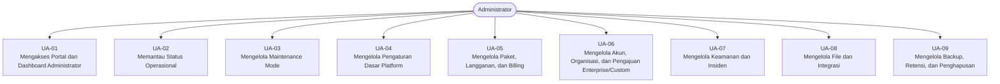

#### 2.1.2 UA-01 — Mengakses Portal dan Dashboard Administrator

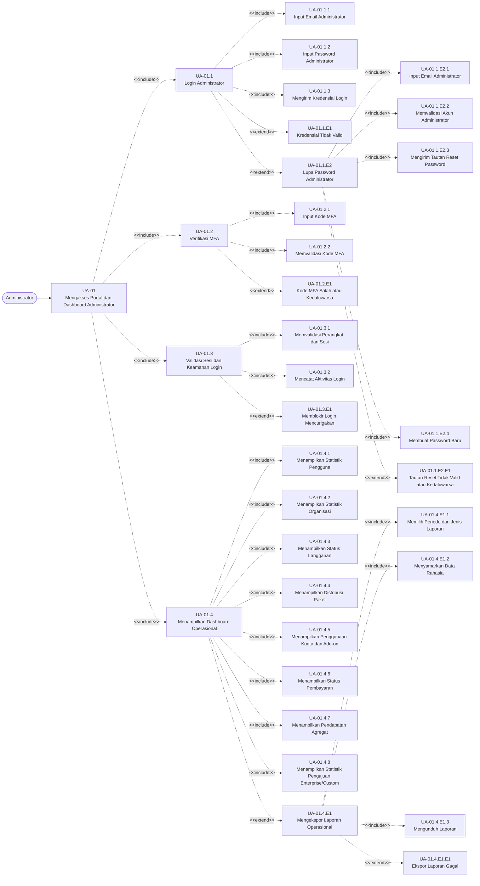

#### 2.1.3 UA-02 — Memantau Status Operasional

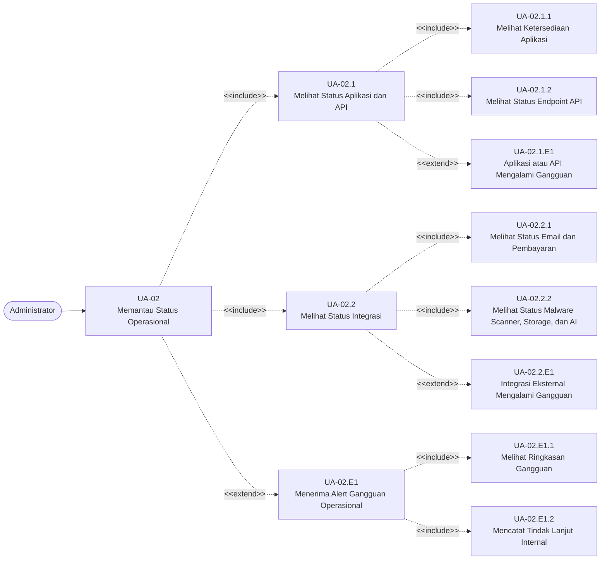

#### 2.1.4 UA-03 — Mengelola Maintenance Mode

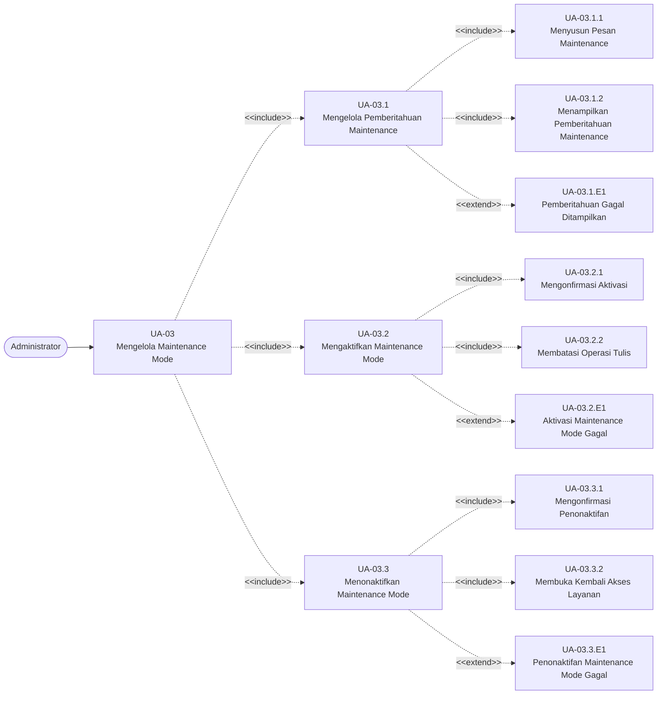

#### 2.1.5 UA-04 — Mengelola Pengaturan Dasar Platform

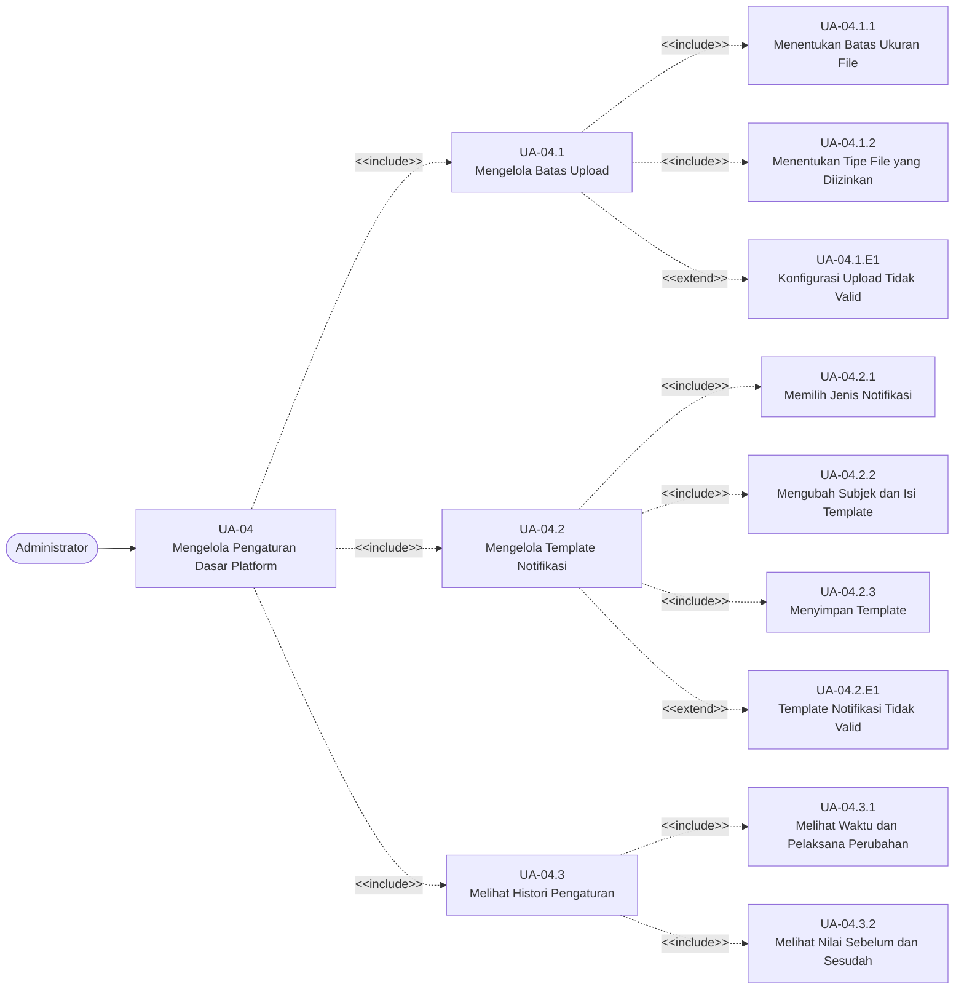

#### 2.1.6 UA-05 — Mengelola Paket, Langganan, dan Billing

```mermaid
flowchart LR
    A([Administrator]) --> UA_05["UA-05<br/>Mengelola Paket, Langganan, dan Billing"]
    UA_05 -. "&lt;&lt;include&gt;&gt;" .-> UA_05_1["UA-05.1<br/>Mengelola Katalog Paket dan Harga"]
    UA_05_1 -. "&lt;&lt;include&gt;&gt;" .-> UA_05_1_1["UA-05.1.1<br/>Melihat Daftar Paket"]
    UA_05_1 -. "&lt;&lt;include&gt;&gt;" .-> UA_05_1_2["UA-05.1.2<br/>Mengubah Harga dan Fitur Paket"]
    UA_05_1 -. "&lt;&lt;include&gt;&gt;" .-> UA_05_1_3["UA-05.1.3<br/>Menyimpan Perubahan Paket"]
    UA_05_1 -. "&lt;&lt;extend&gt;&gt;" .-> UA_05_1_E1["UA-05.1.E1<br/>Data Paket Tidak Valid"]
    UA_05 -. "&lt;&lt;include&gt;&gt;" .-> UA_05_2["UA-05.2<br/>Mengelola Kuota Dokumen dan Kursi"]
    UA_05_2 -. "&lt;&lt;include&gt;&gt;" .-> UA_05_2_1["UA-05.2.1<br/>Mengatur Kuota Dokumen"]
    UA_05_2 -. "&lt;&lt;include&gt;&gt;" .-> UA_05_2_2["UA-05.2.2<br/>Mengatur Kuota Kursi"]
    UA_05_2 -. "&lt;&lt;include&gt;&gt;" .-> UA_05_2_3["UA-05.2.3<br/>Mengatur Ketentuan Add-on"]
    UA_05_2 -. "&lt;&lt;extend&gt;&gt;" .-> UA_05_2_E1["UA-05.2.E1<br/>Kuota Tidak Valid"]
    UA_05 -. "&lt;&lt;include&gt;&gt;" .-> UA_05_3["UA-05.3<br/>Memantau Transaksi Pembayaran"]
    UA_05_3 -. "&lt;&lt;include&gt;&gt;" .-> UA_05_3_1["UA-05.3.1<br/>Melihat Status Transaksi"]
    UA_05_3 -. "&lt;&lt;include&gt;&gt;" .-> UA_05_3_2["UA-05.3.2<br/>Melihat Referensi Payment Gateway"]
    UA_05_3 -. "&lt;&lt;extend&gt;&gt;" .-> UA_05_3_E1["UA-05.3.E1<br/>Pembayaran Gagal atau Tertunda"]
    UA_05 -. "&lt;&lt;include&gt;&gt;" .-> UA_05_4["UA-05.4<br/>Memproses Refund Terotorisasi"]
    UA_05_4 -. "&lt;&lt;include&gt;&gt;" .-> UA_05_4_1["UA-05.4.1<br/>Menerima Pengajuan Refund"]
    UA_05_4 -. "&lt;&lt;include&gt;&gt;" .-> UA_05_4_2["UA-05.4.2<br/>Melihat Transaksi, Alasan & Bukti"]
    UA_05_4 -. "&lt;&lt;include&gt;&gt;" .-> UA_05_4_3["UA-05.4.3<br/>Memvalidasi Kelayakan & Nilai Refund"]
    UA_05_4 -. "&lt;&lt;include&gt;&gt;" .-> UA_05_4_4["UA-05.4.4<br/>Menentukan Dampak Refund"]
    UA_05_4 -. "&lt;&lt;include&gt;&gt;" .-> UA_05_4_5["UA-05.4.5<br/>Meminta Persetujuan Admin Kedua"]
    UA_05_4 -. "&lt;&lt;include&gt;&gt;" .-> UA_05_4_6["UA-05.4.6<br/>Menyetujui / Menolak Refund"]
    UA_05_4 -. "&lt;&lt;include&gt;&gt;" .-> UA_05_4_7["UA-05.4.7<br/>Memperbarui Status Refund"]
    UA_05_4 -. "&lt;&lt;include&gt;&gt;" .-> UA_05_4_8["UA-05.4.8<br/>Memproses Pengembalian Dana"]
    UA_05_4 -. "&lt;&lt;include&gt;&gt;" .-> UA_05_4_9["UA-05.4.9<br/>Menyesuaikan Akses Setelah Berhasil"]
    UA_05_4 -. "&lt;&lt;include&gt;&gt;" .-> UA_05_4_10["UA-05.4.10<br/>Mengirim Hasil ke User Induk"]
    UA_05_4 -. "&lt;&lt;extend&gt;&gt;" .-> UA_05_4_E1["UA-05.4.E1<br/>Pengajuan Refund Ditolak"]
    UA_05_4 -. "&lt;&lt;extend&gt;&gt;" .-> UA_05_4_E2["UA-05.4.E2<br/>Proses Refund Gagal"]
    UA_05 -. "&lt;&lt;include&gt;&gt;" .-> UA_05_5["UA-05.5<br/>Melihat Status dan Histori Langganan"]
    UA_05_5 -. "&lt;&lt;include&gt;&gt;" .-> UA_05_5_1["UA-05.5.1<br/>Melihat Masa Aktif Langganan"]
    UA_05_5 -. "&lt;&lt;include&gt;&gt;" .-> UA_05_5_2["UA-05.5.2<br/>Melihat Histori Perubahan Paket dan Billing"]
    UA_05 -. "&lt;&lt;extend&gt;&gt;" .-> UA_05_E1["UA-05.E1<br/>Melakukan Koreksi Paket atau Kuota"]
    UA_05_E1 -. "&lt;&lt;include&gt;&gt;" .-> UA_05_E1_1["UA-05.E1.1<br/>Mencatat Alasan dan Referensi"]
    UA_05_E1 -. "&lt;&lt;include&gt;&gt;" .-> UA_05_E1_2["UA-05.E1.2<br/>Meminta Persetujuan Administrator Kedua"]
    UA_05_E1 -. "&lt;&lt;include&gt;&gt;" .-> UA_05_E1_3["UA-05.E1.3<br/>Menerapkan Koreksi Terbatas"]
    UA_05_E1 -. "&lt;&lt;include&gt;&gt;" .-> UA_05_E1_4["UA-05.E1.4<br/>Mencatat Koreksi pada Audit Log"]
    UA_05_E1 -. "&lt;&lt;extend&gt;&gt;" .-> UA_05_E1_E1["UA-05.E1.E1<br/>Koreksi Ditolak"]
```

#### 2.1.7 UA-06 — Mengelola Akun, Organisasi, dan Pengajuan Enterprise/Custom

```mermaid
flowchart LR
    A([Administrator]) --> UA_06["UA-06<br/>Mengelola Akun, Organisasi, dan Pengajuan Enterprise/Custom"]
    UA_06 -. "&lt;&lt;include&gt;&gt;" .-> UA_06_1["UA-06.1<br/>Melihat Detail Akun dan Organisasi"]
    UA_06_1 -. "&lt;&lt;include&gt;&gt;" .-> UA_06_1_1["UA-06.1.1<br/>Melihat Status Akun dan Membership"]
    UA_06_1 -. "&lt;&lt;include&gt;&gt;" .-> UA_06_1_2["UA-06.1.2<br/>Melihat Profil Organisasi"]
    UA_06_1 -. "&lt;&lt;include&gt;&gt;" .-> UA_06_1_3["UA-06.1.3<br/>Melihat Paket, Masa Aktif, dan Status Langganan"]
    UA_06 -. "&lt;&lt;include&gt;&gt;" .-> UA_06_2["UA-06.2<br/>Mengirim Tautan Reset Password Pengguna"]
    UA_06_2 -. "&lt;&lt;include&gt;&gt;" .-> UA_06_2_1["UA-06.2.1<br/>Memverifikasi Permintaan Pemulihan"]
    UA_06_2 -. "&lt;&lt;include&gt;&gt;" .-> UA_06_2_2["UA-06.2.2<br/>Mengirim Tautan Reset Password"]
    UA_06_2 -. "&lt;&lt;extend&gt;&gt;" .-> UA_06_2_E1["UA-06.2.E1<br/>Pengiriman Tautan Reset Gagal"]
    UA_06 -. "&lt;&lt;include&gt;&gt;" .-> UA_06_3["UA-06.3<br/>Mereset MFA Pengguna"]
    UA_06_3 -. "&lt;&lt;include&gt;&gt;" .-> UA_06_3_1["UA-06.3.1<br/>Memverifikasi Identitas Pengguna"]
    UA_06_3 -. "&lt;&lt;include&gt;&gt;" .-> UA_06_3_2["UA-06.3.2<br/>Mencabut Faktor MFA Lama"]
    UA_06_3 -. "&lt;&lt;include&gt;&gt;" .-> UA_06_3_3["UA-06.3.3<br/>Mengirim Instruksi Aktivasi MFA Baru"]
    UA_06_3 -. "&lt;&lt;extend&gt;&gt;" .-> UA_06_3_E1["UA-06.3.E1<br/>Verifikasi Identitas Gagal"]
    UA_06 -. "&lt;&lt;include&gt;&gt;" .-> UA_06_4["UA-06.4<br/>Suspend atau Reaktivasi Akun"]
    UA_06_4 -. "&lt;&lt;include&gt;&gt;" .-> UA_06_4_1["UA-06.4.1<br/>Memilih Alasan Perubahan Status"]
    UA_06_4 -. "&lt;&lt;include&gt;&gt;" .-> UA_06_4_2["UA-06.4.2<br/>Memperbarui Status Akun"]
    UA_06_4 -. "&lt;&lt;include&gt;&gt;" .-> UA_06_4_3["UA-06.4.3<br/>Mengirim Notifikasi Perubahan Status"]
    UA_06_4 -. "&lt;&lt;extend&gt;&gt;" .-> UA_06_4_E1["UA-06.4.E1<br/>Perubahan Status Ditolak"]
    UA_06 -. "&lt;&lt;include&gt;&gt;" .-> UA_06_5["UA-06.5<br/>Mengelola Pengajuan Enterprise/Custom"]
    UA_06_5 -. "&lt;&lt;include&gt;&gt;" .-> UA_06_5_1["UA-06.5.1<br/>Melihat Daftar dan Detail Pengajuan"]
    UA_06_5 -. "&lt;&lt;include&gt;&gt;" .-> UA_06_5_2["UA-06.5.2<br/>Meninjau Kebutuhan Enterprise/Custom"]
    UA_06_5_2 -. "&lt;&lt;include&gt;&gt;" .-> UA_06_5_2_1["UA-06.5.2.1<br/>Meninjau Jumlah Dokumen dan Pengguna"]
    UA_06_5_2 -. "&lt;&lt;include&gt;&gt;" .-> UA_06_5_2_2["UA-06.5.2.2<br/>Meninjau Periode dan Jumlah Entitas"]
    UA_06_5_2 -. "&lt;&lt;include&gt;&gt;" .-> UA_06_5_2_3["UA-06.5.2.3<br/>Meninjau SSO dan Lokasi Data"]
    UA_06_5_2 -. "&lt;&lt;include&gt;&gt;" .-> UA_06_5_2_4["UA-06.5.2.4<br/>Meninjau Dukungan Khusus"]
    UA_06_5 -. "&lt;&lt;include&gt;&gt;" .-> UA_06_5_3["UA-06.5.3<br/>Menilai Kelayakan Kebutuhan"]
    UA_06_5 -. "&lt;&lt;include&gt;&gt;" .-> UA_06_5_4["UA-06.5.4<br/>Meminta Revisi Pengajuan"]
    UA_06_5 -. "&lt;&lt;include&gt;&gt;" .-> UA_06_5_5["UA-06.5.5<br/>Meninjau Pengajuan Ulang"]
    UA_06_5 -. "&lt;&lt;include&gt;&gt;" .-> UA_06_5_6["UA-06.5.6<br/>Menyusun Quotation"]
    UA_06_5 -. "&lt;&lt;include&gt;&gt;" .-> UA_06_5_7["UA-06.5.7<br/>Menyetujui atau Menolak Pengajuan"]
    UA_06_5 -. "&lt;&lt;include&gt;&gt;" .-> UA_06_5_8["UA-06.5.8<br/>Mencatat Keputusan User Induk"]
    UA_06_5 -. "&lt;&lt;include&gt;&gt;" .-> UA_06_5_9["UA-06.5.9<br/>Membuat Tagihan"]
    UA_06_5 -. "&lt;&lt;include&gt;&gt;" .-> UA_06_5_10["UA-06.5.10<br/>Memantau Verifikasi Pembayaran"]
    UA_06_5 -. "&lt;&lt;include&gt;&gt;" .-> UA_06_5_11["UA-06.5.11<br/>Mengaktifkan Paket Enterprise/Custom"]
    UA_06_5_11 -. "&lt;&lt;include&gt;&gt;" .-> UA_06_5_11_1["UA-06.5.11.1<br/>Memastikan Pembayaran Terverifikasi"]
    UA_06_5_11 -. "&lt;&lt;include&gt;&gt;" .-> UA_06_5_11_2["UA-06.5.11.2<br/>Menerapkan Konfigurasi Sesuai Quotation"]
    UA_06_5_11 -. "&lt;&lt;include&gt;&gt;" .-> UA_06_5_11_3["UA-06.5.11.3<br/>Mengirim Notifikasi Aktivasi"]
    UA_06_5_11 -. "&lt;&lt;extend&gt;&gt;" .-> UA_06_5_11_E1["UA-06.5.11.E1<br/>Aktivasi Paket Gagal"]
    UA_06_5 -. "&lt;&lt;extend&gt;&gt;" .-> UA_06_5_E1["UA-06.5.E1<br/>Pengajuan Ditolak"]
    UA_06_5 -. "&lt;&lt;extend&gt;&gt;" .-> UA_06_5_E2["UA-06.5.E2<br/>Quotation Ditolak User Induk"]
    UA_06_5 -. "&lt;&lt;extend&gt;&gt;" .-> UA_06_5_E3["UA-06.5.E3<br/>Pembayaran Gagal atau Kedaluwarsa"]
    UA_06 -. "&lt;&lt;extend&gt;&gt;" .-> UA_06_E1["UA-06.E1<br/>Mengunci Akun Darurat"]
    UA_06_E1 -. "&lt;&lt;include&gt;&gt;" .-> UA_06_E1_1["UA-06.E1.1<br/>Mengonfirmasi Kondisi Darurat"]
    UA_06_E1 -. "&lt;&lt;include&gt;&gt;" .-> UA_06_E1_2["UA-06.E1.2<br/>Mengunci Akun"]
    UA_06_E1 -. "&lt;&lt;include&gt;&gt;" .-> UA_06_E1_3["UA-06.E1.3<br/>Mencabut Seluruh Sesi dan Token"]
    UA_06_E1 -. "&lt;&lt;include&gt;&gt;" .-> UA_06_E1_4["UA-06.E1.4<br/>Mencatat Alasan dan Pelaksana"]
```

#### 2.1.8 UA-07 — Mengelola Keamanan dan Insiden

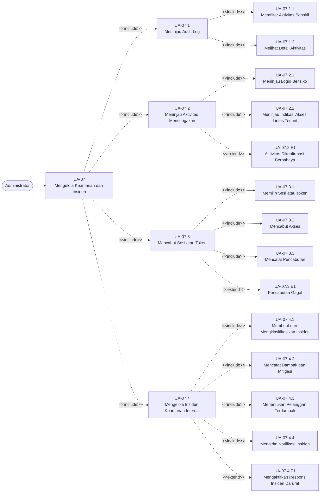

#### 2.1.9 UA-08 — Mengelola File dan Integrasi

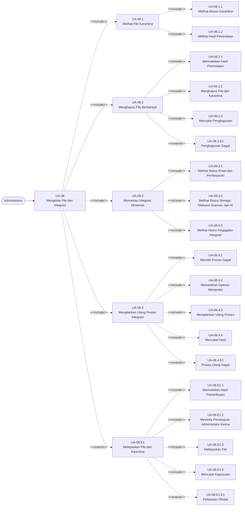

#### 2.1.10 UA-09 — Mengelola Backup, Retensi, dan Penghapusan

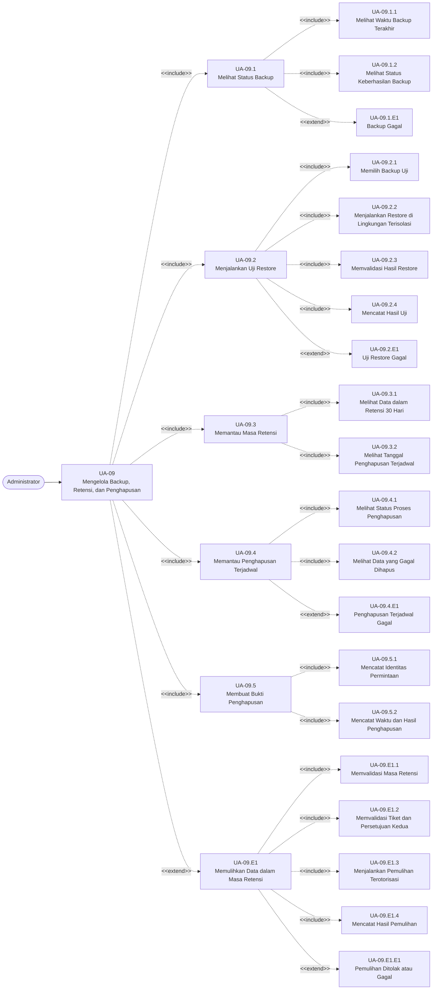

### 2.2 Rincian Aktivitas Administrator

| ID            | Relasi/Level                 | Nama Aktivitas                                                  | Deskripsi                                                                                  | Include                                                                                                                   | Extend                             |
| ------------- | ---------------------------- | --------------------------------------------------------------- | ------------------------------------------------------------------------------------------ | ------------------------------------------------------------------------------------------------------------------------- | ---------------------------------- |
| **UA-01**     | **`[AKTOR DIRECT]`**         | **Mengakses Portal dan Dashboard Administrator**                | [Aktivitas mengakses Portal dan Dashboard Administrator]                                   | UA-01.1, UA-01.2, UA-01.3, UA-01.4                                                                                        | [-]                                |
| UA-01.1       | └── _sub dari UA-01_         | Login Administrator                                             | [Aktivitas login Administrator]                                                            | UA-01.1.1, UA-01.1.2, UA-01.1.3                                                                                           | UA-01.1.E1, UA-01.1.E2             |
| UA-01.1.1     | └── _sub dari UA-01.1_       | Input Email Administrator                                       | [Aktivitas input Email Administrator]                                                      | [-]                                                                                                                       | [-]                                |
| UA-01.1.2     | └── _sub dari UA-01.1_       | Input Password Administrator                                    | [Aktivitas input Password Administrator]                                                   | [-]                                                                                                                       | [-]                                |
| UA-01.1.3     | └── _sub dari UA-01.1_       | Mengirim Kredensial Login                                       | [Aktivitas mengirim Kredensial Login]                                                      | [-]                                                                                                                       | [-]                                |
| UA-01.1.E1    | └── _extend dari UA-01.1_    | Kredensial Tidak Valid                                          | [Aktivitas kredensial Tidak Valid]                                                         | [-]                                                                                                                       | [-]                                |
| UA-01.1.E2    | └── _extend dari UA-01.1_    | Lupa Password Administrator                                     | [Aktivitas lupa Password Administrator]                                                    | UA-01.1.E2.1, UA-01.1.E2.2, UA-01.1.E2.3, UA-01.1.E2.4                                                                    | UA-01.1.E2.E1                      |
| UA-01.1.E2.1  | └── _sub dari UA-01.1.E2_    | Input Email Administrator                                       | [Aktivitas input Email Administrator]                                                      | [-]                                                                                                                       | [-]                                |
| UA-01.1.E2.2  | └── _sub dari UA-01.1.E2_    | Memvalidasi Akun Administrator                                  | [Aktivitas memvalidasi Akun Administrator]                                                 | [-]                                                                                                                       | [-]                                |
| UA-01.1.E2.3  | └── _sub dari UA-01.1.E2_    | Mengirim Tautan Reset Password                                  | [Aktivitas mengirim Tautan Reset Password]                                                 | [-]                                                                                                                       | [-]                                |
| UA-01.1.E2.4  | └── _sub dari UA-01.1.E2_    | Membuat Password Baru                                           | [Aktivitas membuat Password Baru]                                                          | [-]                                                                                                                       | [-]                                |
| UA-01.1.E2.E1 | └── _extend dari UA-01.1.E2_ | Tautan Reset Tidak Valid atau Kedaluwarsa                       | [Aktivitas tautan Reset Tidak Valid atau Kedaluwarsa]                                      | [-]                                                                                                                       | [-]                                |
| UA-01.2       | └── _sub dari UA-01_         | Verifikasi MFA                                                  | [Aktivitas verifikasi MFA]                                                                 | UA-01.2.1, UA-01.2.2                                                                                                      | UA-01.2.E1                         |
| UA-01.2.1     | └── _sub dari UA-01.2_       | Input Kode MFA                                                  | [Aktivitas input Kode MFA]                                                                 | [-]                                                                                                                       | [-]                                |
| UA-01.2.2     | └── _sub dari UA-01.2_       | Memvalidasi Kode MFA                                            | [Aktivitas memvalidasi Kode MFA]                                                           | [-]                                                                                                                       | [-]                                |
| UA-01.2.E1    | └── _extend dari UA-01.2_    | Kode MFA Salah atau Kedaluwarsa                                 | [Aktivitas kode MFA Salah atau Kedaluwarsa]                                                | [-]                                                                                                                       | [-]                                |
| UA-01.3       | └── _sub dari UA-01_         | Validasi Sesi dan Keamanan Login                                | [Aktivitas validasi Sesi dan Keamanan Login]                                               | UA-01.3.1, UA-01.3.2                                                                                                      | UA-01.3.E1                         |
| UA-01.3.1     | └── _sub dari UA-01.3_       | Memvalidasi Perangkat dan Sesi                                  | [Aktivitas memvalidasi Perangkat dan Sesi]                                                 | [-]                                                                                                                       | [-]                                |
| UA-01.3.2     | └── _sub dari UA-01.3_       | Mencatat Aktivitas Login                                        | [Aktivitas mencatat Aktivitas Login]                                                       | [-]                                                                                                                       | [-]                                |
| UA-01.3.E1    | └── _extend dari UA-01.3_    | Memblokir Login Mencurigakan                                    | [Aktivitas memblokir Login Mencurigakan]                                                   | [-]                                                                                                                       | [-]                                |
| UA-01.4       | └── _sub dari UA-01_         | Menampilkan Dashboard Operasional                               | [Aktivitas menampilkan Dashboard Operasional]                                              | UA-01.4.1, UA-01.4.2, UA-01.4.3, UA-01.4.4, UA-01.4.5, UA-01.4.6, UA-01.4.7, UA-01.4.8                                    | UA-01.4.E1                         |
| UA-01.4.1     | └── _sub dari UA-01.4_       | Menampilkan Statistik Pengguna                                  | [Aktivitas menampilkan Statistik Pengguna]                                                 | [-]                                                                                                                       | [-]                                |
| UA-01.4.2     | └── _sub dari UA-01.4_       | Menampilkan Statistik Organisasi                                | [Aktivitas menampilkan Statistik Organisasi]                                               | [-]                                                                                                                       | [-]                                |
| UA-01.4.3     | └── _sub dari UA-01.4_       | Menampilkan Status Langganan                                    | [Aktivitas menampilkan Status Langganan]                                                   | [-]                                                                                                                       | [-]                                |
| UA-01.4.4     | └── _sub dari UA-01.4_       | Menampilkan Distribusi Paket                                    | [Aktivitas menampilkan Distribusi Paket]                                                   | [-]                                                                                                                       | [-]                                |
| UA-01.4.5     | └── _sub dari UA-01.4_       | Menampilkan Penggunaan Kuota dan Add-on                         | [Aktivitas menampilkan Penggunaan Kuota dan Add-on]                                        | [-]                                                                                                                       | [-]                                |
| UA-01.4.6     | └── _sub dari UA-01.4_       | Menampilkan Status Pembayaran                                   | [Aktivitas menampilkan Status Pembayaran]                                                  | [-]                                                                                                                       | [-]                                |
| UA-01.4.7     | └── _sub dari UA-01.4_       | Menampilkan Pendapatan Agregat                                  | [Aktivitas menampilkan Pendapatan Agregat]                                                 | [-]                                                                                                                       | [-]                                |
| UA-01.4.8     | └── _sub dari UA-01.4_       | Menampilkan Statistik Pengajuan Enterprise/Custom               | [Aktivitas menampilkan Statistik Pengajuan Enterprise/Custom]                              | [-]                                                                                                                       | [-]                                |
| UA-01.4.E1    | └── _extend dari UA-01.4_    | Mengekspor Laporan Operasional                                  | [Aktivitas mengekspor Laporan Operasional]                                                 | UA-01.4.E1.1, UA-01.4.E1.2, UA-01.4.E1.3                                                                                  | UA-01.4.E1.E1                      |
| UA-01.4.E1.1  | └── _sub dari UA-01.4.E1_    | Memilih Periode dan Jenis Laporan                               | [Aktivitas memilih Periode dan Jenis Laporan]                                              | [-]                                                                                                                       | [-]                                |
| UA-01.4.E1.2  | └── _sub dari UA-01.4.E1_    | Menyamarkan Data Rahasia                                        | [Aktivitas menyamarkan Data Rahasia]                                                       | [-]                                                                                                                       | [-]                                |
| UA-01.4.E1.3  | └── _sub dari UA-01.4.E1_    | Mengunduh Laporan                                               | [Aktivitas mengunduh Laporan]                                                              | [-]                                                                                                                       | [-]                                |
| UA-01.4.E1.E1 | └── _extend dari UA-01.4.E1_ | Ekspor Laporan Gagal                                            | [Aktivitas ekspor Laporan Gagal]                                                           | [-]                                                                                                                       | [-]                                |
| **UA-02**     | **`[AKTOR DIRECT]`**         | **Memantau Status Operasional**                                 | [Aktivitas memantau Status Operasional]                                                    | UA-02.1, UA-02.2                                                                                                          | UA-02.E1                           |
| UA-02.1       | └── _sub dari UA-02_         | Melihat Status Aplikasi dan API                                 | [Aktivitas melihat Status Aplikasi dan API]                                                | UA-02.1.1, UA-02.1.2                                                                                                      | UA-02.1.E1                         |
| UA-02.1.1     | └── _sub dari UA-02.1_       | Melihat Ketersediaan Aplikasi                                   | [Aktivitas melihat Ketersediaan Aplikasi]                                                  | [-]                                                                                                                       | [-]                                |
| UA-02.1.2     | └── _sub dari UA-02.1_       | Melihat Status Endpoint API                                     | [Aktivitas melihat Status Endpoint API]                                                    | [-]                                                                                                                       | [-]                                |
| UA-02.1.E1    | └── _extend dari UA-02.1_    | Aplikasi atau API Mengalami Gangguan                            | [Aktivitas aplikasi atau API Mengalami Gangguan]                                           | [-]                                                                                                                       | [-]                                |
| UA-02.2       | └── _sub dari UA-02_         | Melihat Status Integrasi                                        | [Aktivitas melihat Status Integrasi]                                                       | UA-02.2.1, UA-02.2.2                                                                                                      | UA-02.2.E1                         |
| UA-02.2.1     | └── _sub dari UA-02.2_       | Melihat Status Email dan Pembayaran                             | [Aktivitas melihat Status Email dan Pembayaran]                                            | [-]                                                                                                                       | [-]                                |
| UA-02.2.2     | └── _sub dari UA-02.2_       | Melihat Status Malware Scanner, Storage, dan AI                 | [Aktivitas melihat Status Malware Scanner, Storage, dan AI]                                | [-]                                                                                                                       | [-]                                |
| UA-02.2.E1    | └── _extend dari UA-02.2_    | Integrasi Eksternal Mengalami Gangguan                          | [Aktivitas integrasi Eksternal Mengalami Gangguan]                                         | [-]                                                                                                                       | [-]                                |
| UA-02.E1      | └── _extend dari UA-02_      | Menerima Alert Gangguan Operasional                             | [Aktivitas menerima Alert Gangguan Operasional]                                            | UA-02.E1.1, UA-02.E1.2                                                                                                    | [-]                                |
| UA-02.E1.1    | └── _sub dari UA-02.E1_      | Melihat Ringkasan Gangguan                                      | [Aktivitas melihat Ringkasan Gangguan]                                                     | [-]                                                                                                                       | [-]                                |
| UA-02.E1.2    | └── _sub dari UA-02.E1_      | Mencatat Tindak Lanjut Internal                                 | [Aktivitas mencatat Tindak Lanjut Internal]                                                | [-]                                                                                                                       | [-]                                |
| **UA-03**     | **`[AKTOR DIRECT]`**         | **Mengelola Maintenance Mode**                                  | [Aktivitas mengelola Maintenance Mode]                                                     | UA-03.1, UA-03.2, UA-03.3                                                                                                 | [-]                                |
| UA-03.1       | └── _sub dari UA-03_         | Mengelola Pemberitahuan Maintenance                             | [Aktivitas mengelola Pemberitahuan Maintenance]                                            | UA-03.1.1, UA-03.1.2                                                                                                      | UA-03.1.E1                         |
| UA-03.1.1     | └── _sub dari UA-03.1_       | Menyusun Pesan Maintenance                                      | [Aktivitas menyusun Pesan Maintenance]                                                     | [-]                                                                                                                       | [-]                                |
| UA-03.1.2     | └── _sub dari UA-03.1_       | Menampilkan Pemberitahuan Maintenance                           | [Aktivitas menampilkan Pemberitahuan Maintenance]                                          | [-]                                                                                                                       | [-]                                |
| UA-03.1.E1    | └── _extend dari UA-03.1_    | Pemberitahuan Gagal Ditampilkan                                 | [Aktivitas pemberitahuan Gagal Ditampilkan]                                                | [-]                                                                                                                       | [-]                                |
| UA-03.2       | └── _sub dari UA-03_         | Mengaktifkan Maintenance Mode                                   | [Aktivitas mengaktifkan Maintenance Mode]                                                  | UA-03.2.1, UA-03.2.2                                                                                                      | UA-03.2.E1                         |
| UA-03.2.1     | └── _sub dari UA-03.2_       | Mengonfirmasi Aktivasi                                          | [Aktivitas mengonfirmasi Aktivasi]                                                         | [-]                                                                                                                       | [-]                                |
| UA-03.2.2     | └── _sub dari UA-03.2_       | Membatasi Operasi Tulis                                         | [Aktivitas membatasi Operasi Tulis]                                                        | [-]                                                                                                                       | [-]                                |
| UA-03.2.E1    | └── _extend dari UA-03.2_    | Aktivasi Maintenance Mode Gagal                                 | [Aktivitas aktivasi Maintenance Mode Gagal]                                                | [-]                                                                                                                       | [-]                                |
| UA-03.3       | └── _sub dari UA-03_         | Menonaktifkan Maintenance Mode                                  | [Aktivitas menonaktifkan Maintenance Mode]                                                 | UA-03.3.1, UA-03.3.2                                                                                                      | UA-03.3.E1                         |
| UA-03.3.1     | └── _sub dari UA-03.3_       | Mengonfirmasi Penonaktifan                                      | [Aktivitas mengonfirmasi Penonaktifan]                                                     | [-]                                                                                                                       | [-]                                |
| UA-03.3.2     | └── _sub dari UA-03.3_       | Membuka Kembali Akses Layanan                                   | [Aktivitas membuka Kembali Akses Layanan]                                                  | [-]                                                                                                                       | [-]                                |
| UA-03.3.E1    | └── _extend dari UA-03.3_    | Penonaktifan Maintenance Mode Gagal                             | [Aktivitas penonaktifan Maintenance Mode Gagal]                                            | [-]                                                                                                                       | [-]                                |
| **UA-04**     | **`[AKTOR DIRECT]`**         | **Mengelola Pengaturan Dasar Platform**                         | [Aktivitas mengelola Pengaturan Dasar Platform]                                            | UA-04.1, UA-04.2, UA-04.3                                                                                                 | [-]                                |
| UA-04.1       | └── _sub dari UA-04_         | Mengelola Batas Upload                                          | [Aktivitas mengelola Batas Upload]                                                         | UA-04.1.1, UA-04.1.2                                                                                                      | UA-04.1.E1                         |
| UA-04.1.1     | └── _sub dari UA-04.1_       | Menentukan Batas Ukuran File                                    | [Aktivitas menentukan Batas Ukuran File]                                                   | [-]                                                                                                                       | [-]                                |
| UA-04.1.2     | └── _sub dari UA-04.1_       | Menentukan Tipe File yang Diizinkan                             | [Aktivitas menentukan Tipe File yang Diizinkan]                                            | [-]                                                                                                                       | [-]                                |
| UA-04.1.E1    | └── _extend dari UA-04.1_    | Konfigurasi Upload Tidak Valid                                  | [Aktivitas konfigurasi Upload Tidak Valid]                                                 | [-]                                                                                                                       | [-]                                |
| UA-04.2       | └── _sub dari UA-04_         | Mengelola Template Notifikasi                                   | [Aktivitas mengelola Template Notifikasi]                                                  | UA-04.2.1, UA-04.2.2, UA-04.2.3                                                                                           | UA-04.2.E1                         |
| UA-04.2.1     | └── _sub dari UA-04.2_       | Memilih Jenis Notifikasi                                        | [Aktivitas memilih Jenis Notifikasi]                                                       | [-]                                                                                                                       | [-]                                |
| UA-04.2.2     | └── _sub dari UA-04.2_       | Mengubah Subjek dan Isi Template                                | [Aktivitas mengubah Subjek dan Isi Template]                                               | [-]                                                                                                                       | [-]                                |
| UA-04.2.3     | └── _sub dari UA-04.2_       | Menyimpan Template                                              | [Aktivitas menyimpan Template]                                                             | [-]                                                                                                                       | [-]                                |
| UA-04.2.E1    | └── _extend dari UA-04.2_    | Template Notifikasi Tidak Valid                                 | [Aktivitas template Notifikasi Tidak Valid]                                                | [-]                                                                                                                       | [-]                                |
| UA-04.3       | └── _sub dari UA-04_         | Melihat Histori Pengaturan                                      | [Aktivitas melihat Histori Pengaturan]                                                     | UA-04.3.1, UA-04.3.2                                                                                                      | [-]                                |
| UA-04.3.1     | └── _sub dari UA-04.3_       | Melihat Waktu dan Pelaksana Perubahan                           | [Aktivitas melihat Waktu dan Pelaksana Perubahan]                                          | [-]                                                                                                                       | [-]                                |
| UA-04.3.2     | └── _sub dari UA-04.3_       | Melihat Nilai Sebelum dan Sesudah                               | [Aktivitas melihat Nilai Sebelum dan Sesudah]                                              | [-]                                                                                                                       | [-]                                |
| **UA-05**     | **`[AKTOR DIRECT]`**         | **Mengelola Paket, Langganan, dan Billing**                     | [Aktivitas mengelola Paket, Langganan, dan Billing]                                        | UA-05.1, UA-05.2, UA-05.3, UA-05.4, UA-05.5, UA-05.6                                                                               | UA-05.E1                           |
| UA-05.1       | └── _sub dari UA-05_         | Mengelola Katalog Paket dan Harga                               | [Aktivitas mengelola Katalog Paket dan Harga]                                              | UA-05.1.1, UA-05.1.2, UA-05.1.3                                                                                           | UA-05.1.E1                         |
| UA-05.1.1     | └── _sub dari UA-05.1_       | Melihat Daftar Paket                                            | [Aktivitas melihat Daftar Paket]                                                           | [-]                                                                                                                       | [-]                                |
| UA-05.1.2     | └── _sub dari UA-05.1_       | Mengubah Harga dan Fitur Paket                                  | [Aktivitas mengubah Harga dan Fitur Paket]                                                 | [-]                                                                                                                       | [-]                                |
| UA-05.1.3     | └── _sub dari UA-05.1_       | Menyimpan Perubahan Paket                                       | [Aktivitas menyimpan Perubahan Paket]                                                      | [-]                                                                                                                       | [-]                                |
| UA-05.1.E1    | └── _extend dari UA-05.1_    | Data Paket Tidak Valid                                          | [Aktivitas data Paket Tidak Valid]                                                         | [-]                                                                                                                       | [-]                                |
| UA-05.2       | └── _sub dari UA-05_         | Mengelola Kuota Dokumen dan Kursi                               | [Aktivitas mengelola Kuota Dokumen dan Kursi]                                              | UA-05.2.1, UA-05.2.2, UA-05.2.3                                                                                           | UA-05.2.E1                         |
| UA-05.2.1     | └── _sub dari UA-05.2_       | Mengatur Kuota Dokumen                                          | [Aktivitas mengatur Kuota Dokumen]                                                         | [-]                                                                                                                       | [-]                                |
| UA-05.2.2     | └── _sub dari UA-05.2_       | Mengatur Kuota Kursi                                            | [Aktivitas mengatur Kuota Kursi]                                                           | [-]                                                                                                                       | [-]                                |
| UA-05.2.3     | └── _sub dari UA-05.2_       | Mengatur Ketentuan Add-on                                       | [Aktivitas mengatur Ketentuan Add-on]                                                      | [-]                                                                                                                       | [-]                                |
| UA-05.2.E1    | └── _extend dari UA-05.2_    | Kuota Tidak Valid                                               | [Aktivitas kuota Tidak Valid]                                                              | [-]                                                                                                                       | [-]                                |
| UA-05.3       | └── _sub dari UA-05_         | Memantau Transaksi Pembayaran                                   | [Aktivitas memantau Transaksi Pembayaran]                                                  | UA-05.3.1, UA-05.3.2                                                                                                      | UA-05.3.E1                         |
| UA-05.3.1     | └── _sub dari UA-05.3_       | Melihat Status Transaksi                                        | [Aktivitas melihat Status Transaksi]                                                       | [-]                                                                                                                       | [-]                                |
| UA-05.3.2     | └── _sub dari UA-05.3_       | Melihat Referensi Payment Gateway                               | [Aktivitas melihat Referensi Payment Gateway]                                              | [-]                                                                                                                       | [-]                                |
| UA-05.3.E1    | └── _extend dari UA-05.3_    | Pembayaran Gagal atau Tertunda                                  | [Aktivitas pembayaran Gagal atau Tertunda]                                                 | [-]                                                                                                                       | [-]                                |
| UA-05.4       | └── _sub dari UA-05_         | Memproses Refund Terotorisasi                                   | [Aktivitas menerima, menilai, memutuskan, dan menyelesaikan pengajuan refund dari UI-08.8] | UA-05.4.1 s/d UA-05.4.10                                                                                                  | UA-05.4.E1, UA-05.4.E2             |
| UA-05.4.1     | └── _sub dari UA-05.4_       | Menerima Pengajuan Refund                                       | [Aktivitas menerima pengajuan yang dikirim melalui UI-08.8.5]                              | [-]                                                                                                                       | [-]                                |
| UA-05.4.2     | └── _sub dari UA-05.4_       | Melihat Transaksi, Alasan, dan Bukti Pendukung                  | [Aktivitas meninjau data transaksi, alasan, dan bukti pengajuan]                           | [-]                                                                                                                       | [-]                                |
| UA-05.4.3     | └── _sub dari UA-05.4_       | Memvalidasi Kelayakan dan Nilai Refund                          | [Aktivitas memeriksa ketentuan dan menghitung nilai yang dapat dikembalikan]               | [-]                                                                                                                       | [-]                                |
| UA-05.4.4     | └── _sub dari UA-05.4_       | Menentukan Dampak Refund                                        | [Aktivitas menentukan perubahan paket, masa aktif, kursi, kuota, atau add-on]              | [-]                                                                                                                       | [-]                                |
| UA-05.4.5     | └── _sub dari UA-05.4_       | Meminta Persetujuan Administrator Kedua                         | [Aktivitas meminta dual approval sebelum keputusan dijalankan]                             | [-]                                                                                                                       | [-]                                |
| UA-05.4.6     | └── _sub dari UA-05.4_       | Menyetujui atau Menolak Refund                                  | [Aktivitas menetapkan keputusan refund beserta alasan]                                     | [-]                                                                                                                       | UA-05.4.E1                         |
| UA-05.4.7     | └── _sub dari UA-05.4_       | Memperbarui Status Refund                                       | [Aktivitas menyinkronkan status agar dapat dilihat melalui UI-08.8.6]                      | [-]                                                                                                                       | [-]                                |
| UA-05.4.8     | └── _sub dari UA-05.4_       | Memproses Pengembalian Dana                                     | [Aktivitas mengembalikan dana melalui metode pembayaran asal]                              | [-]                                                                                                                       | UA-05.4.E2                         |
| UA-05.4.9     | └── _sub dari UA-05.4_       | Menyesuaikan Akses Setelah Refund Berhasil                      | [Aktivitas menyesuaikan paket atau kuota tepat satu kali setelah status Refunded]          | [-]                                                                                                                       | [-]                                |
| UA-05.4.10    | └── _sub dari UA-05.4_       | Mengirim Hasil kepada User Induk                                | [Aktivitas mengirim hasil, nilai refund, dan dampak akses ke UI-08.8.7]                    | [-]                                                                                                                       | [-]                                |
| UA-05.4.E1    | └── _extend dari UA-05.4_    | Pengajuan Refund Ditolak                                        | [Aktivitas mencatat alasan penolakan tanpa mengubah langganan atau kuota]                  | [-]                                                                                                                       | [-]                                |
| UA-05.4.E2    | └── _extend dari UA-05.4_    | Proses Refund Gagal                                             | [Aktivitas mempertahankan histori dan mencegah pengembalian atau penyesuaian akses ganda]  | [-]                                                                                                                       | [-]                                |
| UA-05.5       | └── _sub dari UA-05_         | Melihat Status dan Histori Langganan                            | [Aktivitas melihat Status dan Histori Langganan]                                           | UA-05.5.1, UA-05.5.2                                                                                                      | [-]                                |
| UA-05.5.1     | └── _sub dari UA-05.5_       | Melihat Masa Aktif Langganan                                    | [Aktivitas melihat Masa Aktif Langganan]                                                   | [-]                                                                                                                       | [-]                                |
| UA-05.5.2     | └── _sub dari UA-05.5_       | Melihat Histori Perubahan Paket dan Billing                     | [Aktivitas melihat Histori Perubahan Paket dan Billing]                                    | [-]                                                                                                                       | [-]                                |
| UA-05.6 | └── _sub opsional dari UA-05_ | Mengelola Diskon Event | [Admin mengatur promo event; tanpa event berlaku harga normal] | UA-05.6.1 s/d UA-05.6.4 | UA-05.6.E1 |
| UA-05.6.1 | └── _sub dari UA-05.6_ | Menentukan Target dan Nilai | [Paket, add-on, Enterprise/Custom, serta jasa Konsultan pada varian kedua; persentase atau nominal] | [-] | [-] |
| UA-05.6.2 | └── _sub dari UA-05.6_ | Menentukan Periode dan Batas | [Waktu Asia/Jakarta dan batas penggunaan opsional] | [-] | [-] |
| UA-05.6.3 | └── _sub dari UA-05.6_ | Mengaktifkan atau Menonaktifkan | [Berlaku hanya untuk transaksi baru; perubahan diaudit] | [-] | [-] |
| UA-05.6.4 | └── _sub dari UA-05.6_ | Memantau Penggunaan | [Menampilkan redemption pembayaran berhasil] | [-] | [-] |
| UA-05.6.E1 | └── _extend dari UA-05.6_ | Event Tidak Valid | [Konfigurasi atau batas penggunaan tidak memenuhi syarat] | [-] | [-] |
| UA-05.E1      | └── _extend dari UA-05_      | Melakukan Koreksi Paket atau Kuota                              | [Aktivitas melakukan Koreksi Paket atau Kuota]                                             | UA-05.E1.1, UA-05.E1.2, UA-05.E1.3, UA-05.E1.4                                                                            | UA-05.E1.E1                        |
| UA-05.E1.1    | └── _sub dari UA-05.E1_      | Mencatat Alasan dan Referensi                                   | [Aktivitas mencatat Alasan dan Referensi]                                                  | [-]                                                                                                                       | [-]                                |
| UA-05.E1.2    | └── _sub dari UA-05.E1_      | Meminta Persetujuan Administrator Kedua                         | [Aktivitas meminta Persetujuan Administrator Kedua]                                        | [-]                                                                                                                       | [-]                                |
| UA-05.E1.3    | └── _sub dari UA-05.E1_      | Menerapkan Koreksi Terbatas                                     | [Aktivitas menerapkan Koreksi Terbatas]                                                    | [-]                                                                                                                       | [-]                                |
| UA-05.E1.4    | └── _sub dari UA-05.E1_      | Mencatat Koreksi pada Audit Log                                 | [Aktivitas mencatat Koreksi pada Audit Log]                                                | [-]                                                                                                                       | [-]                                |
| UA-05.E1.E1   | └── _extend dari UA-05.E1_   | Koreksi Ditolak                                                 | [Aktivitas koreksi Ditolak]                                                                | [-]                                                                                                                       | [-]                                |
| **UA-06**     | **`[AKTOR DIRECT]`**         | **Mengelola Akun, Organisasi, dan Pengajuan Enterprise/Custom** | [Aktivitas mengelola Akun, Organisasi, dan Pengajuan Enterprise/Custom]                    | UA-06.1, UA-06.2, UA-06.3, UA-06.4, UA-06.5                                                                               | UA-06.E1                           |
| UA-06.1       | └── _sub dari UA-06_         | Melihat Detail Akun dan Organisasi                              | [Aktivitas melihat Detail Akun dan Organisasi]                                             | UA-06.1.1, UA-06.1.2, UA-06.1.3                                                                                           | [-]                                |
| UA-06.1.1     | └── _sub dari UA-06.1_       | Melihat Status Akun dan Membership                              | [Aktivitas melihat Status Akun dan Membership]                                             | [-]                                                                                                                       | [-]                                |
| UA-06.1.2     | └── _sub dari UA-06.1_       | Melihat Profil Organisasi                                       | [Aktivitas melihat Profil Organisasi]                                                      | [-]                                                                                                                       | [-]                                |
| UA-06.1.3     | └── _sub dari UA-06.1_       | Melihat Paket, Masa Aktif, dan Status Langganan                 | [Aktivitas melihat Paket, Masa Aktif, dan Status Langganan]                                | [-]                                                                                                                       | [-]                                |
| UA-06.2       | └── _sub dari UA-06_         | Mengirim Tautan Reset Password Pengguna                         | [Aktivitas mengirim Tautan Reset Password Pengguna]                                        | UA-06.2.1, UA-06.2.2                                                                                                      | UA-06.2.E1                         |
| UA-06.2.1     | └── _sub dari UA-06.2_       | Memverifikasi Permintaan Pemulihan                              | [Aktivitas memverifikasi Permintaan Pemulihan]                                             | [-]                                                                                                                       | [-]                                |
| UA-06.2.2     | └── _sub dari UA-06.2_       | Mengirim Tautan Reset Password                                  | [Aktivitas mengirim Tautan Reset Password]                                                 | [-]                                                                                                                       | [-]                                |
| UA-06.2.E1    | └── _extend dari UA-06.2_    | Pengiriman Tautan Reset Gagal                                   | [Aktivitas pengiriman Tautan Reset Gagal]                                                  | [-]                                                                                                                       | [-]                                |
| UA-06.3       | └── _sub dari UA-06_         | Mereset MFA Pengguna                                            | [Aktivitas mereset MFA Pengguna]                                                           | UA-06.3.1, UA-06.3.2, UA-06.3.3                                                                                           | UA-06.3.E1                         |
| UA-06.3.1     | └── _sub dari UA-06.3_       | Memverifikasi Identitas Pengguna                                | [Aktivitas memverifikasi Identitas Pengguna]                                               | [-]                                                                                                                       | [-]                                |
| UA-06.3.2     | └── _sub dari UA-06.3_       | Mencabut Faktor MFA Lama                                        | [Aktivitas mencabut Faktor MFA Lama]                                                       | [-]                                                                                                                       | [-]                                |
| UA-06.3.3     | └── _sub dari UA-06.3_       | Mengirim Instruksi Aktivasi MFA Baru                            | [Aktivitas mengirim Instruksi Aktivasi MFA Baru]                                           | [-]                                                                                                                       | [-]                                |
| UA-06.3.E1    | └── _extend dari UA-06.3_    | Verifikasi Identitas Gagal                                      | [Aktivitas verifikasi Identitas Gagal]                                                     | [-]                                                                                                                       | [-]                                |
| UA-06.4       | └── _sub dari UA-06_         | Suspend atau Reaktivasi Akun                                    | [Aktivitas suspend atau Reaktivasi Akun]                                                   | UA-06.4.1, UA-06.4.2, UA-06.4.3                                                                                           | UA-06.4.E1                         |
| UA-06.4.1     | └── _sub dari UA-06.4_       | Memilih Alasan Perubahan Status                                 | [Aktivitas memilih Alasan Perubahan Status]                                                | [-]                                                                                                                       | [-]                                |
| UA-06.4.2     | └── _sub dari UA-06.4_       | Memperbarui Status Akun                                         | [Aktivitas memperbarui Status Akun]                                                        | [-]                                                                                                                       | [-]                                |
| UA-06.4.3     | └── _sub dari UA-06.4_       | Mengirim Notifikasi Perubahan Status                            | [Aktivitas mengirim Notifikasi Perubahan Status]                                           | [-]                                                                                                                       | [-]                                |
| UA-06.4.E1    | └── _extend dari UA-06.4_    | Perubahan Status Ditolak                                        | [Aktivitas perubahan Status Ditolak]                                                       | [-]                                                                                                                       | [-]                                |
| UA-06.5       | └── _sub dari UA-06_         | Mengelola Pengajuan Enterprise/Custom                           | [Aktivitas mengelola Pengajuan Enterprise/Custom]                                          | UA-06.5.1, UA-06.5.2, UA-06.5.3, UA-06.5.4, UA-06.5.5, UA-06.5.6, UA-06.5.7, UA-06.5.8, UA-06.5.9, UA-06.5.10, UA-06.5.11 | UA-06.5.E1, UA-06.5.E2, UA-06.5.E3 |
| UA-06.5.1     | └── _sub dari UA-06.5_       | Melihat Daftar dan Detail Pengajuan                             | [Aktivitas melihat Daftar dan Detail Pengajuan]                                            | [-]                                                                                                                       | [-]                                |
| UA-06.5.2     | └── _sub dari UA-06.5_       | Meninjau Kebutuhan Enterprise/Custom                            | [Aktivitas meninjau Kebutuhan Enterprise/Custom]                                           | UA-06.5.2.1, UA-06.5.2.2, UA-06.5.2.3, UA-06.5.2.4                                                                        | [-]                                |
| UA-06.5.2.1   | └── _sub dari UA-06.5.2_     | Meninjau Jumlah Dokumen dan Pengguna                            | [Aktivitas meninjau Jumlah Dokumen dan Pengguna]                                           | [-]                                                                                                                       | [-]                                |
| UA-06.5.2.2   | └── _sub dari UA-06.5.2_     | Meninjau Periode dan Jumlah Entitas                             | [Aktivitas meninjau Periode dan Jumlah Entitas]                                            | [-]                                                                                                                       | [-]                                |
| UA-06.5.2.3   | └── _sub dari UA-06.5.2_     | Meninjau SSO dan Lokasi Data                                    | [Aktivitas meninjau SSO dan Lokasi Data]                                                   | [-]                                                                                                                       | [-]                                |
| UA-06.5.2.4   | └── _sub dari UA-06.5.2_     | Meninjau Dukungan Khusus                                        | [Aktivitas meninjau Dukungan Khusus]                                                       | [-]                                                                                                                       | [-]                                |
| UA-06.5.3     | └── _sub dari UA-06.5_       | Menilai Kelayakan Kebutuhan                                     | [Aktivitas menilai Kelayakan Kebutuhan]                                                    | [-]                                                                                                                       | [-]                                |
| UA-06.5.4     | └── _sub dari UA-06.5_       | Meminta Revisi Pengajuan                                        | [Aktivitas meminta Revisi Pengajuan]                                                       | [-]                                                                                                                       | [-]                                |
| UA-06.5.5     | └── _sub dari UA-06.5_       | Meninjau Pengajuan Ulang                                        | [Aktivitas meninjau Pengajuan Ulang]                                                       | [-]                                                                                                                       | [-]                                |
| UA-06.5.6     | └── _sub dari UA-06.5_       | Menyusun Quotation                                              | [Aktivitas menyusun Quotation]                                                             | [-]                                                                                                                       | [-]                                |
| UA-06.5.7     | └── _sub dari UA-06.5_       | Menyetujui atau Menolak Pengajuan                               | [Aktivitas menyetujui atau Menolak Pengajuan]                                              | [-]                                                                                                                       | [-]                                |
| UA-06.5.8     | └── _sub dari UA-06.5_       | Mencatat Keputusan User Induk                                   | [Aktivitas mencatat Keputusan User Induk]                                                  | [-]                                                                                                                       | [-]                                |
| UA-06.5.9     | └── _sub dari UA-06.5_       | Membuat Tagihan                                                 | [Aktivitas membuat Tagihan]                                                                | [-]                                                                                                                       | [-]                                |
| UA-06.5.10    | └── _sub dari UA-06.5_       | Memantau Verifikasi Pembayaran                                  | [Aktivitas memantau Verifikasi Pembayaran]                                                 | [-]                                                                                                                       | [-]                                |
| UA-06.5.11    | └── _sub dari UA-06.5_       | Mengaktifkan Paket Enterprise/Custom                            | [Aktivitas mengaktifkan Paket Enterprise/Custom]                                           | UA-06.5.11.1, UA-06.5.11.2, UA-06.5.11.3                                                                                  | UA-06.5.11.E1                      |
| UA-06.5.11.1  | └── _sub dari UA-06.5.11_    | Memastikan Pembayaran Terverifikasi                             | [Aktivitas memastikan Pembayaran Terverifikasi]                                            | [-]                                                                                                                       | [-]                                |
| UA-06.5.11.2  | └── _sub dari UA-06.5.11_    | Menerapkan Konfigurasi Sesuai Quotation                         | [Aktivitas menerapkan Konfigurasi Sesuai Quotation]                                        | [-]                                                                                                                       | [-]                                |
| UA-06.5.11.3  | └── _sub dari UA-06.5.11_    | Mengirim Notifikasi Aktivasi                                    | [Aktivitas mengirim Notifikasi Aktivasi]                                                   | [-]                                                                                                                       | [-]                                |
| UA-06.5.11.E1 | └── _extend dari UA-06.5.11_ | Aktivasi Paket Gagal                                            | [Aktivitas aktivasi Paket Gagal]                                                           | [-]                                                                                                                       | [-]                                |
| UA-06.5.E1    | └── _extend dari UA-06.5_    | Pengajuan Ditolak                                               | [Aktivitas pengajuan Ditolak]                                                              | [-]                                                                                                                       | [-]                                |
| UA-06.5.E2    | └── _extend dari UA-06.5_    | Quotation Ditolak User Induk                                    | [Aktivitas quotation Ditolak User Induk]                                                   | [-]                                                                                                                       | [-]                                |
| UA-06.5.E3    | └── _extend dari UA-06.5_    | Pembayaran Gagal atau Kedaluwarsa                               | [Aktivitas pembayaran Gagal atau Kedaluwarsa]                                              | [-]                                                                                                                       | [-]                                |
| UA-06.E1      | └── _extend dari UA-06_      | Mengunci Akun Darurat                                           | [Aktivitas mengunci Akun Darurat]                                                          | UA-06.E1.1, UA-06.E1.2, UA-06.E1.3, UA-06.E1.4                                                                            | [-]                                |
| UA-06.E1.1    | └── _sub dari UA-06.E1_      | Mengonfirmasi Kondisi Darurat                                   | [Aktivitas mengonfirmasi Kondisi Darurat]                                                  | [-]                                                                                                                       | [-]                                |
| UA-06.E1.2    | └── _sub dari UA-06.E1_      | Mengunci Akun                                                   | [Aktivitas mengunci Akun]                                                                  | [-]                                                                                                                       | [-]                                |
| UA-06.E1.3    | └── _sub dari UA-06.E1_      | Mencabut Seluruh Sesi dan Token                                 | [Aktivitas mencabut Seluruh Sesi dan Token]                                                | [-]                                                                                                                       | [-]                                |
| UA-06.E1.4    | └── _sub dari UA-06.E1_      | Mencatat Alasan dan Pelaksana                                   | [Aktivitas mencatat Alasan dan Pelaksana]                                                  | [-]                                                                                                                       | [-]                                |
| **UA-07**     | **`[AKTOR DIRECT]`**         | **Mengelola Keamanan dan Insiden**                              | [Aktivitas mengelola Keamanan dan Insiden]                                                 | UA-07.1, UA-07.2, UA-07.3, UA-07.4                                                                                        | [-]                                |
| UA-07.1       | └── _sub dari UA-07_         | Meninjau Audit Log                                              | [Aktivitas meninjau Audit Log]                                                             | UA-07.1.1, UA-07.1.2                                                                                                      | [-]                                |
| UA-07.1.1     | └── _sub dari UA-07.1_       | Memfilter Aktivitas Sensitif                                    | [Aktivitas memfilter Aktivitas Sensitif]                                                   | [-]                                                                                                                       | [-]                                |
| UA-07.1.2     | └── _sub dari UA-07.1_       | Melihat Detail Aktivitas                                        | [Aktivitas melihat Detail Aktivitas]                                                       | [-]                                                                                                                       | [-]                                |
| UA-07.2       | └── _sub dari UA-07_         | Meninjau Aktivitas Mencurigakan                                 | [Aktivitas meninjau Aktivitas Mencurigakan]                                                | UA-07.2.1, UA-07.2.2                                                                                                      | UA-07.2.E1                         |
| UA-07.2.1     | └── _sub dari UA-07.2_       | Meninjau Login Berisiko                                         | [Aktivitas meninjau Login Berisiko]                                                        | [-]                                                                                                                       | [-]                                |
| UA-07.2.2     | └── _sub dari UA-07.2_       | Meninjau Indikasi Akses Lintas Tenant                           | [Aktivitas meninjau Indikasi Akses Lintas Tenant]                                          | [-]                                                                                                                       | [-]                                |
| UA-07.2.E1    | └── _extend dari UA-07.2_    | Aktivitas Dikonfirmasi Berbahaya                                | [Aktivitas aktivitas Dikonfirmasi Berbahaya]                                               | [-]                                                                                                                       | [-]                                |
| UA-07.3       | └── _sub dari UA-07_         | Mencabut Sesi atau Token                                        | [Aktivitas mencabut Sesi atau Token]                                                       | UA-07.3.1, UA-07.3.2, UA-07.3.3                                                                                           | UA-07.3.E1                         |
| UA-07.3.1     | └── _sub dari UA-07.3_       | Memilih Sesi atau Token                                         | [Aktivitas memilih Sesi atau Token]                                                        | [-]                                                                                                                       | [-]                                |
| UA-07.3.2     | └── _sub dari UA-07.3_       | Mencabut Akses                                                  | [Aktivitas mencabut Akses]                                                                 | [-]                                                                                                                       | [-]                                |
| UA-07.3.3     | └── _sub dari UA-07.3_       | Mencatat Pencabutan                                             | [Aktivitas mencatat Pencabutan]                                                            | [-]                                                                                                                       | [-]                                |
| UA-07.3.E1    | └── _extend dari UA-07.3_    | Pencabutan Gagal                                                | [Aktivitas pencabutan Gagal]                                                               | [-]                                                                                                                       | [-]                                |
| UA-07.4       | └── _sub dari UA-07_         | Mengelola Insiden Keamanan Internal                             | [Aktivitas mengelola Insiden Keamanan Internal]                                            | UA-07.4.1, UA-07.4.2, UA-07.4.3, UA-07.4.4                                                                                | UA-07.4.E1                         |
| UA-07.4.1     | └── _sub dari UA-07.4_       | Membuat dan Mengklasifikasikan Insiden                          | [Aktivitas membuat dan Mengklasifikasikan Insiden]                                         | [-]                                                                                                                       | [-]                                |
| UA-07.4.2     | └── _sub dari UA-07.4_       | Mencatat Dampak dan Mitigasi                                    | [Aktivitas mencatat Dampak dan Mitigasi]                                                   | [-]                                                                                                                       | [-]                                |
| UA-07.4.3     | └── _sub dari UA-07.4_       | Menentukan Pelanggan Terdampak                                  | [Aktivitas menentukan Pelanggan Terdampak]                                                 | [-]                                                                                                                       | [-]                                |
| UA-07.4.4     | └── _sub dari UA-07.4_       | Mengirim Notifikasi Insiden                                     | [Aktivitas mengirim Notifikasi Insiden]                                                    | [-]                                                                                                                       | [-]                                |
| UA-07.4.E1    | └── _extend dari UA-07.4_    | Mengaktifkan Respons Insiden Darurat                            | [Aktivitas mengaktifkan Respons Insiden Darurat]                                           | [-]                                                                                                                       | [-]                                |
| **UA-08**     | **`[AKTOR DIRECT]`**         | **Mengelola File dan Integrasi**                                | [Aktivitas mengelola File dan Integrasi]                                                   | UA-08.1, UA-08.2, UA-08.3, UA-08.4                                                                                        | UA-08.E1                           |
| UA-08.1       | └── _sub dari UA-08_         | Melihat File Karantina                                          | [Aktivitas melihat File Karantina]                                                         | UA-08.1.1, UA-08.1.2                                                                                                      | [-]                                |
| UA-08.1.1     | └── _sub dari UA-08.1_       | Melihat Alasan Karantina                                        | [Aktivitas melihat Alasan Karantina]                                                       | [-]                                                                                                                       | [-]                                |
| UA-08.1.2     | └── _sub dari UA-08.1_       | Melihat Hasil Pemindaian                                        | [Aktivitas melihat Hasil Pemindaian]                                                       | [-]                                                                                                                       | [-]                                |
| UA-08.2       | └── _sub dari UA-08_         | Menghapus File Berbahaya                                        | [Aktivitas menghapus File Berbahaya]                                                       | UA-08.2.1, UA-08.2.2, UA-08.2.3                                                                                           | UA-08.2.E1                         |
| UA-08.2.1     | └── _sub dari UA-08.2_       | Memvalidasi Hasil Pemindaian                                    | [Aktivitas memvalidasi Hasil Pemindaian]                                                   | [-]                                                                                                                       | [-]                                |
| UA-08.2.2     | └── _sub dari UA-08.2_       | Menghapus File dari Karantina                                   | [Aktivitas menghapus File dari Karantina]                                                  | [-]                                                                                                                       | [-]                                |
| UA-08.2.3     | └── _sub dari UA-08.2_       | Mencatat Penghapusan                                            | [Aktivitas mencatat Penghapusan]                                                           | [-]                                                                                                                       | [-]                                |
| UA-08.2.E1    | └── _extend dari UA-08.2_    | Penghapusan Gagal                                               | [Aktivitas penghapusan Gagal]                                                              | [-]                                                                                                                       | [-]                                |
| UA-08.3       | └── _sub dari UA-08_         | Memantau Integrasi Eksternal                                    | [Aktivitas memantau Integrasi Eksternal]                                                   | UA-08.3.1, UA-08.3.2, UA-08.3.3                                                                                           | [-]                                |
| UA-08.3.1     | └── _sub dari UA-08.3_       | Melihat Status Email dan Pembayaran                             | [Aktivitas melihat Status Email dan Pembayaran]                                            | [-]                                                                                                                       | [-]                                |
| UA-08.3.2     | └── _sub dari UA-08.3_       | Melihat Status Storage, Malware Scanner, dan AI                 | [Aktivitas melihat Status Storage, Malware Scanner, dan AI]                                | [-]                                                                                                                       | [-]                                |
| UA-08.3.3     | └── _sub dari UA-08.3_       | Melihat Histori Kegagalan Integrasi                             | [Aktivitas melihat Histori Kegagalan Integrasi]                                            | [-]                                                                                                                       | [-]                                |
| UA-08.4       | └── _sub dari UA-08_         | Menjalankan Ulang Proses Integrasi                              | [Aktivitas menjalankan Ulang Proses Integrasi]                                             | UA-08.4.1, UA-08.4.2, UA-08.4.3, UA-08.4.4                                                                                | UA-08.4.E1                         |
| UA-08.4.1     | └── _sub dari UA-08.4_       | Memilih Proses Gagal                                            | [Aktivitas memilih Proses Gagal]                                                           | [-]                                                                                                                       | [-]                                |
| UA-08.4.2     | └── _sub dari UA-08.4_       | Memastikan Operasi Idempoten                                    | [Aktivitas memastikan Operasi Idempoten]                                                   | [-]                                                                                                                       | [-]                                |
| UA-08.4.3     | └── _sub dari UA-08.4_       | Menjalankan Ulang Proses                                        | [Aktivitas menjalankan Ulang Proses]                                                       | [-]                                                                                                                       | [-]                                |
| UA-08.4.4     | └── _sub dari UA-08.4_       | Mencatat Hasil                                                  | [Aktivitas mencatat Hasil]                                                                 | [-]                                                                                                                       | [-]                                |
| UA-08.4.E1    | └── _extend dari UA-08.4_    | Proses Ulang Gagal                                              | [Aktivitas proses Ulang Gagal]                                                             | [-]                                                                                                                       | [-]                                |
| UA-08.E1      | └── _extend dari UA-08_      | Melepaskan File dari Karantina                                  | [Aktivitas melepaskan File dari Karantina]                                                 | UA-08.E1.1, UA-08.E1.2, UA-08.E1.3, UA-08.E1.4                                                                            | UA-08.E1.E1                        |
| UA-08.E1.1    | └── _sub dari UA-08.E1_      | Memvalidasi Hasil Pemeriksaan                                   | [Aktivitas memvalidasi Hasil Pemeriksaan]                                                  | [-]                                                                                                                       | [-]                                |
| UA-08.E1.2    | └── _sub dari UA-08.E1_      | Meminta Persetujuan Administrator Kedua                         | [Aktivitas meminta Persetujuan Administrator Kedua]                                        | [-]                                                                                                                       | [-]                                |
| UA-08.E1.3    | └── _sub dari UA-08.E1_      | Melepaskan File                                                 | [Aktivitas melepaskan File]                                                                | [-]                                                                                                                       | [-]                                |
| UA-08.E1.4    | └── _sub dari UA-08.E1_      | Mencatat Keputusan                                              | [Aktivitas mencatat Keputusan]                                                             | [-]                                                                                                                       | [-]                                |
| UA-08.E1.E1   | └── _extend dari UA-08.E1_   | Pelepasan Ditolak                                               | [Aktivitas pelepasan Ditolak]                                                              | [-]                                                                                                                       | [-]                                |
| **UA-09**     | **`[AKTOR DIRECT]`**         | **Mengelola Backup, Retensi, dan Penghapusan**                  | [Aktivitas mengelola Backup, Retensi, dan Penghapusan]                                     | UA-09.1, UA-09.2, UA-09.3, UA-09.4, UA-09.5                                                                               | UA-09.E1                           |
| UA-09.1       | └── _sub dari UA-09_         | Melihat Status Backup                                           | [Aktivitas melihat Status Backup]                                                          | UA-09.1.1, UA-09.1.2                                                                                                      | UA-09.1.E1                         |
| UA-09.1.1     | └── _sub dari UA-09.1_       | Melihat Waktu Backup Terakhir                                   | [Aktivitas melihat Waktu Backup Terakhir]                                                  | [-]                                                                                                                       | [-]                                |
| UA-09.1.2     | └── _sub dari UA-09.1_       | Melihat Status Keberhasilan Backup                              | [Aktivitas melihat Status Keberhasilan Backup]                                             | [-]                                                                                                                       | [-]                                |
| UA-09.1.E1    | └── _extend dari UA-09.1_    | Backup Gagal                                                    | [Aktivitas backup Gagal]                                                                   | [-]                                                                                                                       | [-]                                |
| UA-09.2       | └── _sub dari UA-09_         | Menjalankan Uji Restore                                         | [Aktivitas menjalankan Uji Restore]                                                        | UA-09.2.1, UA-09.2.2, UA-09.2.3, UA-09.2.4                                                                                | UA-09.2.E1                         |
| UA-09.2.1     | └── _sub dari UA-09.2_       | Memilih Backup Uji                                              | [Aktivitas memilih Backup Uji]                                                             | [-]                                                                                                                       | [-]                                |
| UA-09.2.2     | └── _sub dari UA-09.2_       | Menjalankan Restore di Lingkungan Terisolasi                    | [Aktivitas menjalankan Restore di Lingkungan Terisolasi]                                   | [-]                                                                                                                       | [-]                                |
| UA-09.2.3     | └── _sub dari UA-09.2_       | Memvalidasi Hasil Restore                                       | [Aktivitas memvalidasi Hasil Restore]                                                      | [-]                                                                                                                       | [-]                                |
| UA-09.2.4     | └── _sub dari UA-09.2_       | Mencatat Hasil Uji                                              | [Aktivitas mencatat Hasil Uji]                                                             | [-]                                                                                                                       | [-]                                |
| UA-09.2.E1    | └── _extend dari UA-09.2_    | Uji Restore Gagal                                               | [Aktivitas uji Restore Gagal]                                                              | [-]                                                                                                                       | [-]                                |
| UA-09.3       | └── _sub dari UA-09_         | Memantau Masa Retensi                                           | [Aktivitas memantau Masa Retensi]                                                          | UA-09.3.1, UA-09.3.2                                                                                                      | [-]                                |
| UA-09.3.1     | └── _sub dari UA-09.3_       | Melihat Data dalam Retensi 30 Hari                              | [Aktivitas melihat Data dalam Retensi 30 Hari]                                             | [-]                                                                                                                       | [-]                                |
| UA-09.3.2     | └── _sub dari UA-09.3_       | Melihat Tanggal Penghapusan Terjadwal                           | [Aktivitas melihat Tanggal Penghapusan Terjadwal]                                          | [-]                                                                                                                       | [-]                                |
| UA-09.4       | └── _sub dari UA-09_         | Memantau Penghapusan Terjadwal                                  | [Aktivitas memantau Penghapusan Terjadwal]                                                 | UA-09.4.1, UA-09.4.2                                                                                                      | UA-09.4.E1                         |
| UA-09.4.1     | └── _sub dari UA-09.4_       | Melihat Status Proses Penghapusan                               | [Aktivitas melihat Status Proses Penghapusan]                                              | [-]                                                                                                                       | [-]                                |
| UA-09.4.2     | └── _sub dari UA-09.4_       | Melihat Data yang Gagal Dihapus                                 | [Aktivitas melihat Data yang Gagal Dihapus]                                                | [-]                                                                                                                       | [-]                                |
| UA-09.4.E1    | └── _extend dari UA-09.4_    | Penghapusan Terjadwal Gagal                                     | [Aktivitas penghapusan Terjadwal Gagal]                                                    | [-]                                                                                                                       | [-]                                |
| UA-09.5       | └── _sub dari UA-09_         | Membuat Bukti Penghapusan                                       | [Aktivitas membuat Bukti Penghapusan]                                                      | UA-09.5.1, UA-09.5.2                                                                                                      | [-]                                |
| UA-09.5.1     | └── _sub dari UA-09.5_       | Mencatat Identitas Permintaan                                   | [Aktivitas mencatat Identitas Permintaan]                                                  | [-]                                                                                                                       | [-]                                |
| UA-09.5.2     | └── _sub dari UA-09.5_       | Mencatat Waktu dan Hasil Penghapusan                            | [Aktivitas mencatat Waktu dan Hasil Penghapusan]                                           | [-]                                                                                                                       | [-]                                |
| UA-09.E1      | └── _extend dari UA-09_      | Memulihkan Data dalam Masa Retensi                              | [Aktivitas memulihkan Data dalam Masa Retensi]                                             | UA-09.E1.1, UA-09.E1.2, UA-09.E1.3, UA-09.E1.4                                                                            | UA-09.E1.E1                        |
| UA-09.E1.1    | └── _sub dari UA-09.E1_      | Memvalidasi Masa Retensi                                        | [Aktivitas memvalidasi Masa Retensi]                                                       | [-]                                                                                                                       | [-]                                |
| UA-09.E1.2    | └── _sub dari UA-09.E1_      | Memvalidasi Tiket dan Persetujuan Kedua                         | [Aktivitas memvalidasi Tiket dan Persetujuan Kedua]                                        | [-]                                                                                                                       | [-]                                |
| UA-09.E1.3    | └── _sub dari UA-09.E1_      | Menjalankan Pemulihan Terotorisasi                              | [Aktivitas menjalankan Pemulihan Terotorisasi]                                             | [-]                                                                                                                       | [-]                                |
| UA-09.E1.4    | └── _sub dari UA-09.E1_      | Mencatat Hasil Pemulihan                                        | [Aktivitas mencatat Hasil Pemulihan]                                                       | [-]                                                                                                                       | [-]                                |
| UA-09.E1.E1   | └── _extend dari UA-09.E1_   | Pemulihan Ditolak atau Gagal                                    | [Aktivitas pemulihan Ditolak atau Gagal]                                                   | [-]                                                                                                                       | [-]                                |

## 3. Status Pengajuan Enterprise/Custom

| Status               | Makna                                           |
| -------------------- | ----------------------------------------------- |
| `Submitted`          | Pengajuan telah dikirim oleh User Induk.        |
| `Under Review`       | Administrator sedang meninjau kebutuhan.        |
| `Revision Requested` | Administrator meminta perbaikan data pengajuan. |
| `Quoted`             | Quotation telah dikirim kepada User Induk.      |
| `Awaiting Payment`   | Quotation diterima dan menunggu pembayaran.     |
| `Active`             | Pembayaran terverifikasi dan paket telah aktif. |
| `Rejected`           | Pengajuan ditolak oleh Administrator.           |
| `Closed`             | Pengajuan ditutup tanpa aktivasi.               |

## 4. Batas Kewenangan Administrator

Administrator tidak dapat mengubah isi Local File, mengelola anggota organisasi pelanggan, memilih metode TP, melihat password, menyamar sebagai pengguna, atau mengaktifkan Enterprise/Custom sebelum pembayaran terverifikasi.

## 5. Status Refund

Status refund yang digunakan bersama dengan User Induk adalah `Submitted`, `Under Review`, `Approved`, `Rejected`, `Processing`, `Refunded`, dan `Failed`. Refund yang ditolak tidak mengubah langganan. Penyesuaian akses hanya dilakukan satu kali setelah pengembalian dana berhasil.

## 6. Matriks Hubungan User Induk–Administrator

| Proses            | User Induk       | Administrator    | Handoff / Status Update                                                            |
| ----------------- | ---------------- | ---------------- | ---------------------------------------------------------------------------------- |
| Enterprise/Custom | UI-08.1.2.4      | UA-06.5          | Pengajuan, revisi, quotation, pembayaran, dan aktivasi                             |
| Refund            | UI-08.8          | UA-05.4          | Pengajuan refund, keputusan, status, pengembalian dana, dan hasil                  |
| Paket dan kuota   | UI-08.1, UI-08.7 | UA-05.1, UA-05.2 | Perubahan katalog atau kuota tercermin pada tampilan User Induk                    |
| Pembayaran        | UI-08.6          | UA-05.3          | Status transaksi terverifikasi diperbarui pada riwayat pembayaran                  |
| Pemulihan akun    | UI-03            | UA-06.2, UA-06.3 | Reset mandiri menjadi alur utama; Admin hanya membantu tautan reset atau reset MFA |
| Status akun       | UI-09.E2         | UA-06.4          | Suspend atau reaktivasi menghasilkan pemberitahuan kepada User Induk               |

---

## Pengelolaan Konsultan dan Layanan Konsultasi oleh Administrator

### Visual Aktivitas Tambahan

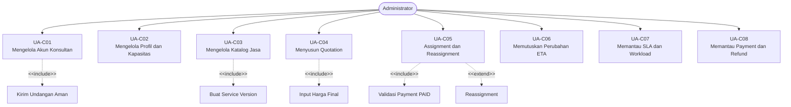

| ID | Aktivitas | Include/Batasan |
| --- | --- | --- |
| UA-C01 | Mengelola akun Konsultan | Invite, activate, suspend, reactivate; Admin tidak membuat password |
| UA-C02 | Profil dan kapasitas | Keahlian, kapasitas aktif, dan availability |
| UA-C03 | Katalog jasa | Model harga, currency, display/minimum price, SLA, revisi, version, status |
| UA-C04 | Quotation | Hanya untuk request yang membutuhkan quotation; harga final diinput Admin |
| UA-C05 | Assignment | Hanya paid request; manual assign dan revoke access sebelumnya saat reassign |
| UA-C06 | ETA decision | Menyetujui atau menolak permintaan perubahan dengan alasan |
| UA-C07 | SLA/workload | Metadata request, deadline, kapasitas, overdue; tanpa isi dokumen |
| UA-C08 | Payment/refund | Status transaksi, refund sebelum/sesudah mulai kerja, audit |

### Business Rules

- Katalog tidak dapat aktif jika field wajib dan harga sesuai pricing mode belum valid.
- Perubahan katalog membuat service version baru.
- Assignment tidak dapat dibuat sebelum payment `PAID`.
- Admin tidak otomatis dapat membuka preview atau komentar pelanggan.
- Reassignment mencabut scoped access Konsultan sebelumnya.
- Seluruh perubahan harga, quotation, assignment, dan ETA diaudit.
