# Use Case Konsultan — TP Docs (With Consultant)

## 1. Definisi Aktor Konsultan

Konsultan adalah tenaga profesional internal TP Docs yang akunnya dibuat melalui undangan Administrator. Konsultan merupakan role platform dan bukan anggota organisasi pelanggan. Karena itu, Konsultan tidak dapat mencari atau membuka organisasi secara bebas.

Akses dokumen hanya diberikan ketika seluruh kondisi berikut terpenuhi:

- request konsultasi telah dibayar;
- Administrator telah memberikan assignment;
- Konsultan telah menerima assignment;
- request dan assignment masih aktif; dan
- versi dokumen atau working copy memang termasuk dalam assignment tersebut.

Konsultan wajib menggunakan akun pribadi dan MFA. Konsultan tidak dapat melihat harga, quotation, metode pembayaran, detail refund, anggota organisasi, maupun Local File lain di luar assignment.

## 2. Daftar Use Case — Konsultan

Struktur use case berikut menjelaskan aktivitas yang dipicu langsung oleh Konsultan beserta hierarki relasi `<<include>>` dan `<<extend>>`. Seluruh kode Konsultan menggunakan awalan `UCN`.

Baris dengan penanda **`[AKTOR DIRECT — KONSULTAN]`** merupakan aktivitas utama yang dapat dimulai langsung oleh Konsultan setelah memperoleh autentikasi dan assignment yang sah.

### 2.1 Visual Use Case Konsultan

Kode dan urutan pada seluruh visual berikut sama dengan ID pada tabel rincian aktivitas.

#### 2.1.1 Alur Aktivitas Utama Konsultan

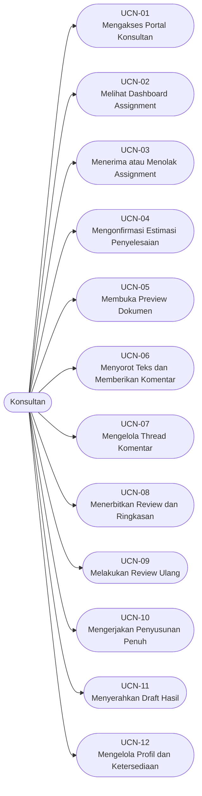

#### 2.1.2 UCN-01 — Mengakses Portal Konsultan

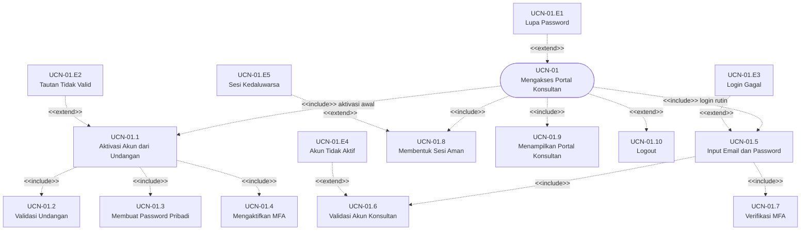

#### 2.1.3 UCN-02 — Melihat Dashboard Assignment

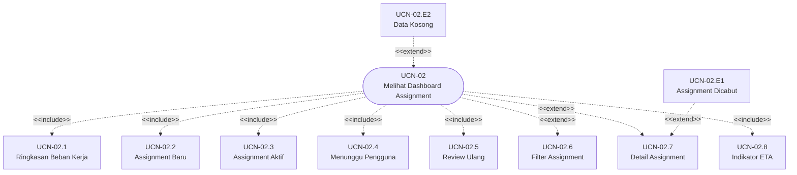

#### 2.1.4 UCN-03 — Menerima atau Menolak Assignment

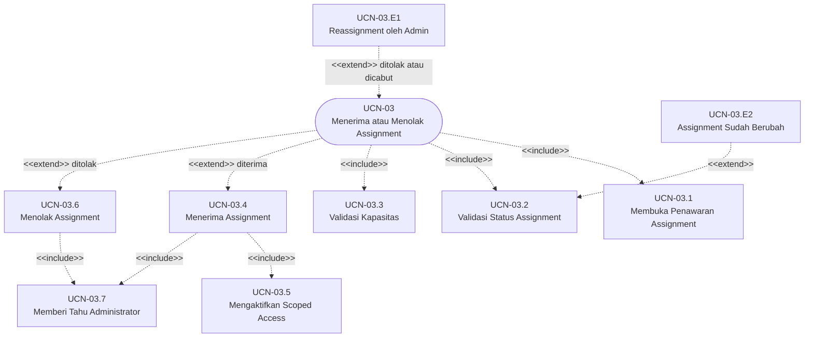

#### 2.1.5 UCN-04 — Mengonfirmasi Estimasi Penyelesaian

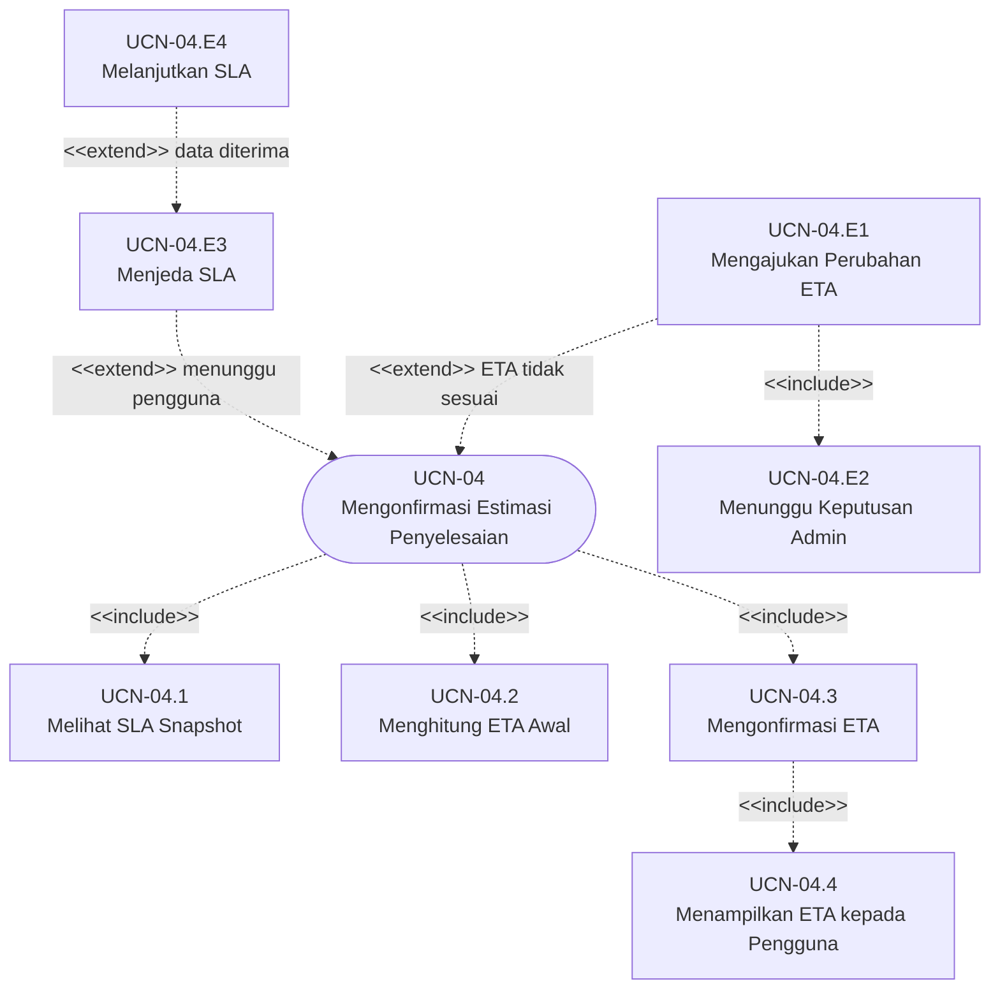

#### 2.1.6 UCN-05 — Membuka Preview Dokumen

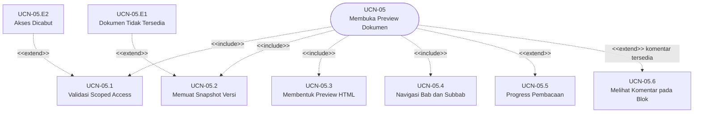

#### 2.1.7 UCN-06 — Menyorot Teks dan Memberikan Komentar

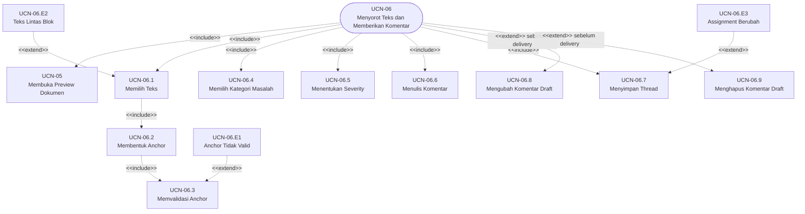

#### 2.1.8 UCN-07 — Mengelola Thread Komentar

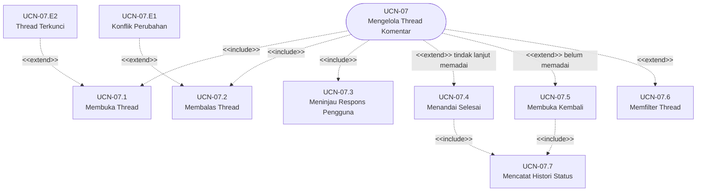

#### 2.1.9 UCN-08 — Menerbitkan Review dan Ringkasan

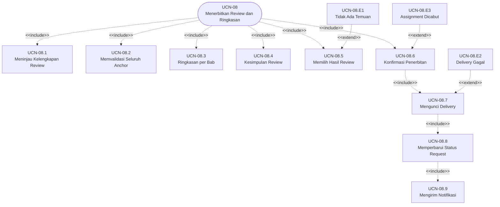

#### 2.1.10 UCN-09 — Melakukan Review Ulang

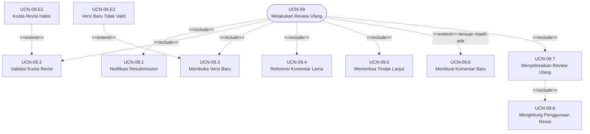

#### 2.1.11 UCN-10 — Mengerjakan Penyusunan Penuh

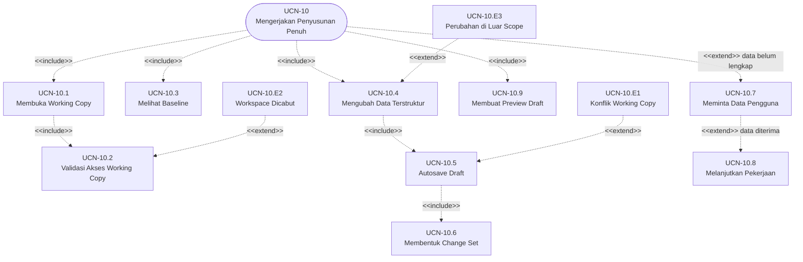

#### 2.1.12 UCN-11 — Menyerahkan Draft Hasil

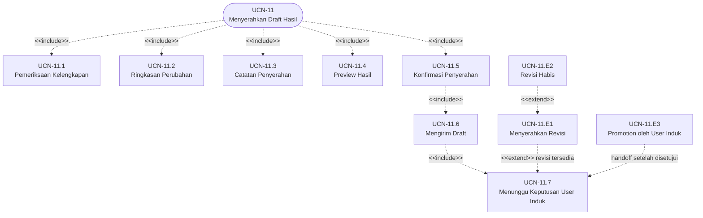

#### 2.1.13 UCN-12 — Mengelola Profil dan Ketersediaan

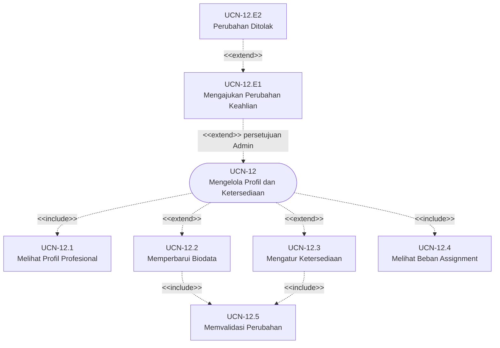

**Legenda:** garis penuh menunjukkan use case yang dipicu langsung oleh Konsultan. Panah putus-putus menunjukkan aktivitas `<<include>>`, `<<extend>>`, atau kondisi khusus dari induk ke aktivitas turunannya. Handoff lintas aktor diberi label `handoff`, bukan `include` atau `extend`.

| ID | Tingkat / Induk | Use Case | Deskripsi / Aktivitas | Include (`<<include>>`) | Extend (`<<extend>>`) |
| --- | --- | --- | --- | --- | --- |
| **UCN-01** | **`[AKTOR DIRECT — KONSULTAN]`** | **Mengakses Portal Konsultan** | [Memastikan hanya akun Konsultan aktif dengan MFA yang dapat masuk ke portal Konsultan. Trigger: Konsultan membuka halaman login atau menerima undangan aktivasi dari Administrator. Prasyarat: Undangan masih berlaku untuk aktivasi awal, atau akun Konsultan sudah berstatus `ACTIVE`. Hasil: Sesi Konsultan terbentuk dan dashboard assignment ditampilkan.] | UCN-01.1 s/d UCN-01.10 | UCN-01.E1 s/d UCN-01.E5 |
| UCN-01.1 | &nbsp;&nbsp;&nbsp;&nbsp;└── _sub dari UCN-01_ | Mengaktifkan akun dari undangan | [Membuka tautan undangan yang dikirim sistem kepada email Konsultan. Kondisi/relasi: Aktivasi awal saja.] | [-] | [-] |
| UCN-01.2 | &nbsp;&nbsp;&nbsp;&nbsp;└── _sub dari UCN-01_ | Memvalidasi undangan | [Sistem memeriksa token, email tujuan, status undangan, dan masa kedaluwarsa. Kondisi/relasi: `include` UCN-01.1.] | [-] | [-] |
| UCN-01.3 | &nbsp;&nbsp;&nbsp;&nbsp;└── _sub dari UCN-01_ | Membuat password pribadi | [Konsultan membuat password sendiri; Administrator tidak pernah menetapkan atau melihat password. Kondisi/relasi: `include` UCN-01.1.] | [-] | [-] |
| UCN-01.4 | &nbsp;&nbsp;&nbsp;&nbsp;└── _sub dari UCN-01_ | Mengaktifkan MFA | [Konsultan mendaftarkan faktor kedua dan menyimpan recovery code secara aman. Kondisi/relasi: Wajib sebelum akun aktif.] | [-] | [-] |
| UCN-01.5 | &nbsp;&nbsp;&nbsp;&nbsp;└── _sub dari UCN-01_ | Memasukkan email dan password | [Konsultan memasukkan kredensial pada portal Konsultan. Kondisi/relasi: Login rutin.] | [-] | [-] |
| UCN-01.6 | &nbsp;&nbsp;&nbsp;&nbsp;└── _sub dari UCN-01_ | Memvalidasi akun Konsultan | [Sistem memeriksa kredensial, role `CONSULTANT`, dan status akun. Kondisi/relasi: `include` login.] | [-] | [-] |
| UCN-01.7 | &nbsp;&nbsp;&nbsp;&nbsp;└── _sub dari UCN-01_ | Memverifikasi MFA | [Sistem meminta kode MFA setelah password benar. Kondisi/relasi: `include` UCN-01.] | [-] | [-] |
| UCN-01.8 | &nbsp;&nbsp;&nbsp;&nbsp;└── _sub dari UCN-01_ | Membentuk sesi aman | [Sistem membuat sesi dengan role serta batas akses Konsultan. Kondisi/relasi: Setelah autentikasi berhasil.] | [-] | [-] |
| UCN-01.9 | &nbsp;&nbsp;&nbsp;&nbsp;└── _sub dari UCN-01_ | Menampilkan portal Konsultan | [Sistem mengarahkan Konsultan ke dashboard assignment, bukan portal pelanggan atau Admin. Kondisi/relasi: Hasil sukses.] | [-] | [-] |
| UCN-01.10 | &nbsp;&nbsp;&nbsp;&nbsp;└── _sub dari UCN-01_ | Logout | [Konsultan mengakhiri sesi dan token aktif dicabut. Kondisi/relasi: Aktivitas langsung.] | [-] | [-] |
| UCN-01.E1 | &nbsp;&nbsp;&nbsp;&nbsp;└── _extend dari UCN-01_ | Lupa Password Konsultan | [Konsultan meminta tautan reset ke email akun dan membuat password baru melalui token terbatas waktu. Kondisi/relasi: `extend` UCN-01.] | [-] | [-] |
| UCN-01.E2 | &nbsp;&nbsp;&nbsp;&nbsp;└── _extend dari UCN-01_ | Menangani tautan tidak valid | [Sistem menolak token aktivasi/reset yang salah, sudah dipakai, atau kedaluwarsa. Kondisi/relasi: Exception.] | [-] | [-] |
| UCN-01.E3 | &nbsp;&nbsp;&nbsp;&nbsp;└── _extend dari UCN-01_ | Menangani login gagal | [Sistem menampilkan pesan aman ketika kredensial atau kode MFA salah tanpa mengungkap keberadaan akun. Kondisi/relasi: Exception.] | [-] | [-] |
| UCN-01.E4 | &nbsp;&nbsp;&nbsp;&nbsp;└── _extend dari UCN-01_ | Menangani akun tidak aktif | [Akun `INVITED`, `SUSPENDED`, atau `DEACTIVATED` tidak memperoleh sesi portal. Kondisi/relasi: Exception.] | [-] | [-] |
| UCN-01.E5 | &nbsp;&nbsp;&nbsp;&nbsp;└── _extend dari UCN-01_ | Menangani sesi kedaluwarsa | [Sistem mengakhiri sesi dan meminta login ulang tanpa kehilangan data yang sudah tersimpan. Kondisi/relasi: Exception.] | [-] | [-] |
| **UCN-02** | **`[AKTOR DIRECT — KONSULTAN]`** | **Melihat Dashboard Assignment** | [Memberikan daftar pekerjaan Konsultan tanpa membuka request atau data organisasi di luar assignment. Trigger: Login berhasil atau Konsultan membuka menu Dashboard Assignment. Prasyarat: Sesi Konsultan aktif. Hasil: Assignment yang boleh diakses tampil beserta status dan ETA yang relevan.] | UCN-02.1 s/d UCN-02.5 dan UCN-02.8 | UCN-02.6, UCN-02.7, UCN-02.E1, dan UCN-02.E2 |
| UCN-02.1 | &nbsp;&nbsp;&nbsp;&nbsp;└── _sub dari UCN-02_ | Melihat ringkasan beban kerja | [Menampilkan jumlah assignment baru, aktif, menunggu pengguna, review ulang, mendekati ETA, dan selesai. Kondisi/relasi: `include` UCN-02.] | [-] | [-] |
| UCN-02.2 | &nbsp;&nbsp;&nbsp;&nbsp;└── _sub dari UCN-02_ | Melihat daftar assignment baru | [Menampilkan assignment berstatus menunggu keputusan Konsultan. Kondisi/relasi: `include` UCN-02.] | [-] | [-] |
| UCN-02.3 | &nbsp;&nbsp;&nbsp;&nbsp;└── _sub dari UCN-02_ | Melihat assignment aktif | [Menampilkan layanan, nomor request, versi dokumen, round, status, dan ETA. Kondisi/relasi: `include` UCN-02.] | [-] | [-] |
| UCN-02.4 | &nbsp;&nbsp;&nbsp;&nbsp;└── _sub dari UCN-02_ | Melihat assignment menunggu pengguna | [Menampilkan pekerjaan yang SLA-nya sedang dijeda karena menunggu data atau revisi pengguna. Kondisi/relasi: Jika tersedia.] | [-] | [-] |
| UCN-02.5 | &nbsp;&nbsp;&nbsp;&nbsp;└── _sub dari UCN-02_ | Melihat review ulang | [Menampilkan round baru yang memang masih termasuk kuota revisi request. Kondisi/relasi: Jika tersedia.] | [-] | [-] |
| UCN-02.6 | &nbsp;&nbsp;&nbsp;&nbsp;└── _sub dari UCN-02_ | Memfilter assignment | [Memfilter berdasarkan status, jenis layanan, ETA, dan urutan waktu. Kondisi/relasi: Opsional.] | [-] | [-] |
| UCN-02.7 | &nbsp;&nbsp;&nbsp;&nbsp;└── _sub dari UCN-02_ | Membuka detail assignment | [Menampilkan scope, source version, SLA snapshot, jumlah revisi, serta instruksi kerja tanpa informasi harga. Kondisi/relasi: Assignment sendiri.] | [-] | [-] |
| UCN-02.8 | &nbsp;&nbsp;&nbsp;&nbsp;└── _sub dari UCN-02_ | Menampilkan indikator ETA | [Memberi tanda assignment yang mendekati atau melewati ETA. Kondisi/relasi: Kondisional.] | [-] | [-] |
| UCN-02.E1 | &nbsp;&nbsp;&nbsp;&nbsp;└── _extend dari UCN-02_ | Menangani assignment dicabut | [Assignment yang dicabut tidak dapat dibuka dan segera hilang dari daftar aktif. Kondisi/relasi: Exception.] | [-] | [-] |
| UCN-02.E2 | &nbsp;&nbsp;&nbsp;&nbsp;└── _extend dari UCN-02_ | Menangani data kosong | [Sistem menampilkan empty state apabila tidak ada assignment. Kondisi/relasi: Alternative.] | [-] | [-] |
| **UCN-03** | **`[AKTOR DIRECT — KONSULTAN]`** | **Menerima atau Menolak Assignment** | [Memastikan Konsultan secara eksplisit menyatakan kesediaan sebelum memperoleh akses kerja penuh. Trigger: Administrator memberikan assignment baru. Prasyarat: Request berstatus sudah dibayar, assignment masih `PENDING`, dan akun Konsultan aktif. Hasil: Assignment menjadi `ACCEPTED`; akses preview atau working copy diaktifkan sesuai jenis layanan. Assignment menjadi `DECLINED`; akses tidak diberikan dan Admin menerima notifikasi untuk reassignment.] | UCN-03.1 s/d UCN-03.3, UCN-03.5, dan UCN-03.7 | UCN-03.4, UCN-03.6, UCN-03.E1, dan UCN-03.E2 |
| UCN-03.1 | &nbsp;&nbsp;&nbsp;&nbsp;└── _sub dari UCN-03_ | Membuka penawaran assignment | [Konsultan melihat jenis layanan, ruang lingkup, SLA snapshot, dan target penyelesaian. Kondisi/relasi: `include` UCN-03.] | [-] | [-] |
| UCN-03.2 | &nbsp;&nbsp;&nbsp;&nbsp;└── _sub dari UCN-03_ | Memvalidasi status assignment | [Sistem memastikan assignment belum diputuskan, belum dicabut, dan request masih dapat dikerjakan. Kondisi/relasi: `include` UCN-03.] | [-] | [-] |
| UCN-03.3 | &nbsp;&nbsp;&nbsp;&nbsp;└── _sub dari UCN-03_ | Memvalidasi kapasitas | [Sistem membandingkan assignment aktif dengan kapasitas Konsultan. Kondisi/relasi: `include` UCN-03.] | [-] | [-] |
| UCN-03.4 | &nbsp;&nbsp;&nbsp;&nbsp;└── _sub dari UCN-03_ | Menerima assignment | [Konsultan menyatakan bersedia mengerjakan assignment. Kondisi/relasi: Pilihan keputusan.] | [-] | [-] |
| UCN-03.5 | &nbsp;&nbsp;&nbsp;&nbsp;└── _sub dari UCN-03_ | Mengaktifkan scoped access | [Sistem memberi akses hanya ke request, versi, dan round yang ditugaskan. Kondisi/relasi: Setelah diterima.] | [-] | [-] |
| UCN-03.6 | &nbsp;&nbsp;&nbsp;&nbsp;└── _sub dari UCN-03_ | Menolak assignment | [Konsultan memilih alasan penolakan dan dapat menambahkan catatan. Kondisi/relasi: Pilihan keputusan.] | [-] | [-] |
| UCN-03.7 | &nbsp;&nbsp;&nbsp;&nbsp;└── _sub dari UCN-03_ | Memberi tahu Administrator | [Sistem mengirim keputusan dan memperbarui histori assignment. Kondisi/relasi: `include` keputusan.] | [-] | [-] |
| UCN-03.E1 | &nbsp;&nbsp;&nbsp;&nbsp;└── _extend dari UCN-03_ | Reassignment oleh Administrator | [Admin memilih Konsultan lain setelah penolakan, pencabutan, atau konflik kapasitas. Kondisi/relasi: `extend` UCN-03; handoff Admin.] | [-] | [-] |
| UCN-03.E2 | &nbsp;&nbsp;&nbsp;&nbsp;└── _extend dari UCN-03_ | Assignment sudah berubah | [Sistem menolak keputusan jika assignment telah dicabut atau diberikan kepada pihak lain. Kondisi/relasi: Exception.] | [-] | [-] |
| **UCN-04** | **`[AKTOR DIRECT — KONSULTAN]`** | **Mengonfirmasi Estimasi Penyelesaian** | [Menetapkan ETA operasional berdasarkan SLA yang telah disalin ke request. Trigger: Konsultan menerima assignment. Prasyarat: Assignment `ACCEPTED` dan ETA belum dikonfirmasi. Hasil: ETA terkonfirmasi dan dapat dilihat pengguna serta Administrator.] | UCN-04.1 s/d UCN-04.4 | UCN-04.E1 s/d UCN-04.E4 |
| UCN-04.1 | &nbsp;&nbsp;&nbsp;&nbsp;└── _sub dari UCN-04_ | Melihat SLA snapshot | [Menampilkan jumlah hari kerja dan target awal yang tidak berubah ketika katalog diperbarui. Kondisi/relasi: `include` UCN-04.] | [-] | [-] |
| UCN-04.2 | &nbsp;&nbsp;&nbsp;&nbsp;└── _sub dari UCN-04_ | Menghitung ETA awal | [Sistem menghitung ETA menggunakan kalender hari kerja dan waktu mulai assignment. Kondisi/relasi: `include` UCN-04.] | [-] | [-] |
| UCN-04.3 | &nbsp;&nbsp;&nbsp;&nbsp;└── _sub dari UCN-04_ | Mengonfirmasi ETA | [Konsultan menerima target awal yang dihitung sistem. Kondisi/relasi: Alur utama.] | [-] | [-] |
| UCN-04.4 | &nbsp;&nbsp;&nbsp;&nbsp;└── _sub dari UCN-04_ | Menampilkan ETA kepada pengguna | [Sistem memperbarui status dan mengirim notifikasi ETA. Kondisi/relasi: Setelah konfirmasi.] | [-] | [-] |
| UCN-04.E1 | &nbsp;&nbsp;&nbsp;&nbsp;└── _extend dari UCN-04_ | Mengajukan perubahan ETA | [Konsultan memasukkan tanggal usulan dan alasan ketika ETA awal tidak dapat dipenuhi. Kondisi/relasi: `extend` UCN-04.] | [-] | [-] |
| UCN-04.E2 | &nbsp;&nbsp;&nbsp;&nbsp;└── _extend dari UCN-04_ | Menunggu keputusan Admin | [ETA lama tetap berlaku sampai Administrator menerima atau menolak usulan. Kondisi/relasi: Setelah UCN-04.E1.] | [-] | [-] |
| UCN-04.E3 | &nbsp;&nbsp;&nbsp;&nbsp;└── _extend dari UCN-04_ | Menjeda SLA | [SLA dijeda jika pekerjaan menunggu data, jawaban, atau revisi pengguna yang tervalidasi. Kondisi/relasi: Kondisional.] | [-] | [-] |
| UCN-04.E4 | &nbsp;&nbsp;&nbsp;&nbsp;└── _extend dari UCN-04_ | Melanjutkan SLA | [Sistem menghitung kembali ETA ketika kondisi tunggu selesai. Kondisi/relasi: Kondisional.] | [-] | [-] |
| **UCN-05** | **`[AKTOR DIRECT — KONSULTAN]`** | **Membuka Preview Dokumen** | [Menyediakan pembacaan aman terhadap versi dokumen immutable yang menjadi objek review. Trigger: Konsultan membuka assignment Review atau Review Ulang. Prasyarat: Assignment diterima, scoped access aktif, dan source document version tersedia. Hasil: Preview HTML semantik tampil dengan navigasi bagian dan blok yang stabil.] | UCN-05.1 s/d UCN-05.4 | UCN-05.5, UCN-05.6, UCN-05.E1, dan UCN-05.E2 |
| UCN-05.1 | &nbsp;&nbsp;&nbsp;&nbsp;└── _sub dari UCN-05_ | Memvalidasi scoped access | [Sistem memeriksa Konsultan, assignment, request, round, dan document version. Kondisi/relasi: `include` UCN-05.] | [-] | [-] |
| UCN-05.2 | &nbsp;&nbsp;&nbsp;&nbsp;└── _sub dari UCN-05_ | Memuat snapshot versi dokumen | [Viewer menggunakan snapshot immutable yang dipilih pengguna saat membuat request. Kondisi/relasi: `include` UCN-05.] | [-] | [-] |
| UCN-05.3 | &nbsp;&nbsp;&nbsp;&nbsp;└── _sub dari UCN-05_ | Membentuk preview HTML | [Sistem merender struktur yang konsisten dengan data sumber DOCX tanpa mengubah dokumen. Kondisi/relasi: `include` UCN-05.] | [-] | [-] |
| UCN-05.4 | &nbsp;&nbsp;&nbsp;&nbsp;└── _sub dari UCN-05_ | Menavigasi bab dan subbab | [Konsultan berpindah melalui daftar isi, section code, dan block key. Kondisi/relasi: `include` UCN-05.] | [-] | [-] |
| UCN-05.5 | &nbsp;&nbsp;&nbsp;&nbsp;└── _sub dari UCN-05_ | Melihat progress pembacaan | [Sistem dapat menyimpan posisi terakhir tanpa mengubah isi preview. Kondisi/relasi: Opsional.] | [-] | [-] |
| UCN-05.6 | &nbsp;&nbsp;&nbsp;&nbsp;└── _sub dari UCN-05_ | Melihat komentar pada blok | [Viewer menampilkan highlight dan thread yang terikat pada versi serta blok tersebut. Kondisi/relasi: Jika tersedia.] | [-] | [-] |
| UCN-05.E1 | &nbsp;&nbsp;&nbsp;&nbsp;└── _extend dari UCN-05_ | Dokumen tidak tersedia | [Sistem menolak pembukaan jika snapshot gagal, dihapus secara sah, atau belum siap. Kondisi/relasi: Exception.] | [-] | [-] |
| UCN-05.E2 | &nbsp;&nbsp;&nbsp;&nbsp;└── _extend dari UCN-05_ | Akses dicabut | [Viewer ditutup dan request berikutnya ditolak ketika assignment dicabut atau selesai. Kondisi/relasi: Exception.] | [-] | [-] |
| **UCN-06** | **`[AKTOR DIRECT — KONSULTAN]`** | **Menyorot Teks dan Memberikan Komentar** | [Mencatat temuan Konsultan secara presisi pada bagian dokumen tertentu. Trigger: Konsultan memilih teks pada preview dan memilih Tambah Komentar. Prasyarat: UCN-05 berhasil; assignment dan round masih aktif. Hasil: Komentar berstatus `OPEN`, anchor valid, dan audit log tercatat.] | UCN-05 dan UCN-06.1 s/d UCN-06.7 | UCN-06.8, UCN-06.9, UCN-06.E1 s/d UCN-06.E3 |
| UCN-06.1 | &nbsp;&nbsp;&nbsp;&nbsp;└── _sub dari UCN-06_ | Memilih teks pada preview | [Konsultan menyorot rentang teks dalam satu blok semantik. Kondisi/relasi: `include` UCN-06.] | [-] | [-] |
| UCN-06.2 | &nbsp;&nbsp;&nbsp;&nbsp;└── _sub dari UCN-06_ | Membentuk anchor komentar | [Sistem mencatat version ID, section code, block key, start/end offset, selected text, dan hash. Kondisi/relasi: `include` UCN-06.] | [-] | [-] |
| UCN-06.3 | &nbsp;&nbsp;&nbsp;&nbsp;└── _sub dari UCN-06_ | Memvalidasi anchor | [Sistem memastikan offset dan hash sesuai dengan snapshot versi dokumen. Kondisi/relasi: `include` UCN-06.] | [-] | [-] |
| UCN-06.4 | &nbsp;&nbsp;&nbsp;&nbsp;└── _sub dari UCN-06_ | Memilih kategori masalah | [Konsultan mengelompokkan temuan, misalnya kelengkapan, konsistensi, FAR, metode TP, pembanding, keuangan, atau redaksional. Kondisi/relasi: `include` UCN-06.] | [-] | [-] |
| UCN-06.5 | &nbsp;&nbsp;&nbsp;&nbsp;└── _sub dari UCN-06_ | Menentukan severity | [Konsultan memilih `INFO`, `LOW`, `MEDIUM`, `HIGH`, atau `CRITICAL`. Kondisi/relasi: `include` UCN-06.] | [-] | [-] |
| UCN-06.6 | &nbsp;&nbsp;&nbsp;&nbsp;└── _sub dari UCN-06_ | Menulis komentar | [Konsultan menjelaskan masalah dan tindakan perbaikan yang disarankan. Kondisi/relasi: `include` UCN-06.] | [-] | [-] |
| UCN-06.7 | &nbsp;&nbsp;&nbsp;&nbsp;└── _sub dari UCN-06_ | Menyimpan thread | [Sistem membuat komentar `OPEN` dan menampilkan highlight pada viewer. Kondisi/relasi: `include` UCN-06.] | [-] | [-] |
| UCN-06.8 | &nbsp;&nbsp;&nbsp;&nbsp;└── _sub dari UCN-06_ | Mengubah komentar sebelum delivery | [Konsultan dapat memperbaiki komentarnya selama review belum diterbitkan. Kondisi/relasi: Kondisional.] | [-] | [-] |
| UCN-06.9 | &nbsp;&nbsp;&nbsp;&nbsp;└── _sub dari UCN-06_ | Menghapus draft komentar | [Komentar draft dapat dihapus sebelum delivery; jejak perubahan mengikuti kebijakan audit. Kondisi/relasi: Kondisional.] | [-] | [-] |
| UCN-06.E1 | &nbsp;&nbsp;&nbsp;&nbsp;└── _extend dari UCN-06_ | Anchor tidak valid | [Sistem meminta Konsultan memilih ulang teks jika snapshot, offset, atau hash tidak cocok. Kondisi/relasi: Exception.] | [-] | [-] |
| UCN-06.E2 | &nbsp;&nbsp;&nbsp;&nbsp;└── _extend dari UCN-06_ | Teks lintas blok | [Sistem meminta pemilihan dipisahkan karena satu anchor hanya mengacu pada satu blok. Kondisi/relasi: Alternative.] | [-] | [-] |
| UCN-06.E3 | &nbsp;&nbsp;&nbsp;&nbsp;└── _extend dari UCN-06_ | Assignment berubah | [Penyimpanan ditolak jika assignment dicabut saat komentar sedang ditulis. Kondisi/relasi: Exception.] | [-] | [-] |
| **UCN-07** | **`[AKTOR DIRECT — KONSULTAN]`** | **Mengelola Thread Komentar** | [Mendukung diskusi dan penyelesaian temuan tanpa mengubah isi versi dokumen asal. Trigger: Konsultan atau pengguna membuka komentar yang sudah tersimpan. Prasyarat: Thread termasuk dalam request yang dapat diakses. Hasil: Balasan dan perubahan status thread tercatat secara kronologis.] | UCN-07.1 s/d UCN-07.3 dan UCN-07.7 | UCN-07.4 s/d UCN-07.6, UCN-07.E1, dan UCN-07.E2 |
| UCN-07.1 | &nbsp;&nbsp;&nbsp;&nbsp;└── _sub dari UCN-07_ | Membuka thread | [Menampilkan kutipan, komentar awal, kategori, severity, status, dan seluruh balasan. Kondisi/relasi: `include` UCN-07.] | [-] | [-] |
| UCN-07.2 | &nbsp;&nbsp;&nbsp;&nbsp;└── _sub dari UCN-07_ | Membalas thread | [Konsultan menambahkan klarifikasi atau jawaban pada thread. Kondisi/relasi: `include` UCN-07.] | [-] | [-] |
| UCN-07.3 | &nbsp;&nbsp;&nbsp;&nbsp;└── _sub dari UCN-07_ | Meninjau respons pengguna | [Konsultan melihat jawaban dan tanda `ADDRESSED_BY_CLIENT`. Kondisi/relasi: Jika pengguna merespons.] | [-] | [-] |
| UCN-07.4 | &nbsp;&nbsp;&nbsp;&nbsp;└── _sub dari UCN-07_ | Menandai komentar selesai | [Konsultan mengubah status menjadi `RESOLVED` setelah tindak lanjut dianggap memadai. Kondisi/relasi: Kondisional.] | [-] | [-] |
| UCN-07.5 | &nbsp;&nbsp;&nbsp;&nbsp;└── _sub dari UCN-07_ | Membuka kembali komentar | [Konsultan mengubah status menjadi `REOPENED` dengan alasan ketika masalah belum terselesaikan. Kondisi/relasi: Kondisional.] | [-] | [-] |
| UCN-07.6 | &nbsp;&nbsp;&nbsp;&nbsp;└── _sub dari UCN-07_ | Memfilter thread | [Memfilter berdasarkan bab, kategori, severity, dan status. Kondisi/relasi: Opsional.] | [-] | [-] |
| UCN-07.7 | &nbsp;&nbsp;&nbsp;&nbsp;└── _sub dari UCN-07_ | Mencatat histori status | [Sistem mencatat siapa, kapan, status asal, status tujuan, dan alasan. Kondisi/relasi: `include` perubahan status.] | [-] | [-] |
| UCN-07.E1 | &nbsp;&nbsp;&nbsp;&nbsp;└── _extend dari UCN-07_ | Konflik perubahan | [Sistem menolak pembaruan lama dan meminta refresh jika thread telah berubah di sesi lain. Kondisi/relasi: Exception.] | [-] | [-] |
| UCN-07.E2 | &nbsp;&nbsp;&nbsp;&nbsp;└── _extend dari UCN-07_ | Thread terkunci | [Thread delivery lama tetap terbaca tetapi tidak dapat diubah setelah request ditutup. Kondisi/relasi: Exception.] | [-] | [-] |
| **UCN-08** | **`[AKTOR DIRECT — KONSULTAN]`** | **Menerbitkan Review dan Ringkasan** | [Menyerahkan hasil review resmi yang immutable kepada pengguna. Trigger: Konsultan menyelesaikan pemeriksaan pada round aktif. Prasyarat: Assignment aktif, seluruh komentar draft valid, dan Konsultan telah meninjau seluruh bagian yang diwajibkan. Hasil: Delivery terkunci; request menjadi `REVIEW_DELIVERED` atau `AWAITING_RESUBMISSION`.] | UCN-08.1 s/d UCN-08.9 | UCN-08.E1 s/d UCN-08.E3 |
| UCN-08.1 | &nbsp;&nbsp;&nbsp;&nbsp;└── _sub dari UCN-08_ | Meninjau kelengkapan review | [Sistem menampilkan checklist bab dan komentar yang belum lengkap. Kondisi/relasi: `include` UCN-08.] | [-] | [-] |
| UCN-08.2 | &nbsp;&nbsp;&nbsp;&nbsp;└── _sub dari UCN-08_ | Memvalidasi seluruh anchor | [Sistem memastikan komentar masih terikat pada source document version yang benar. Kondisi/relasi: `include` UCN-08.] | [-] | [-] |
| UCN-08.3 | &nbsp;&nbsp;&nbsp;&nbsp;└── _sub dari UCN-08_ | Membentuk ringkasan per bab | [Sistem mengelompokkan kutipan, komentar, kategori, severity, dan status berdasarkan bab. Kondisi/relasi: `include` UCN-08.] | [-] | [-] |
| UCN-08.4 | &nbsp;&nbsp;&nbsp;&nbsp;└── _sub dari UCN-08_ | Menulis kesimpulan review | [Konsultan memberikan kesimpulan umum serta prioritas perbaikan. Kondisi/relasi: `include` UCN-08.] | [-] | [-] |
| UCN-08.5 | &nbsp;&nbsp;&nbsp;&nbsp;└── _sub dari UCN-08_ | Memilih hasil review | [Konsultan menentukan apakah diperlukan perbaikan/resubmission atau review dapat diselesaikan. Kondisi/relasi: `include` UCN-08.] | [-] | [-] |
| UCN-08.6 | &nbsp;&nbsp;&nbsp;&nbsp;└── _sub dari UCN-08_ | Mengonfirmasi penerbitan | [Sistem menampilkan konfirmasi bahwa delivery tidak dapat diedit langsung setelah terbit. Kondisi/relasi: `include` UCN-08.] | [-] | [-] |
| UCN-08.7 | &nbsp;&nbsp;&nbsp;&nbsp;└── _sub dari UCN-08_ | Mengunci delivery | [Sistem membuat revision delivery immutable dan mencatat waktu penerbitan. Kondisi/relasi: `include` UCN-08.] | [-] | [-] |
| UCN-08.8 | &nbsp;&nbsp;&nbsp;&nbsp;└── _sub dari UCN-08_ | Memperbarui status request | [Status menjadi `REVIEW_DELIVERED` atau `AWAITING_RESUBMISSION`. Kondisi/relasi: `include` UCN-08.] | [-] | [-] |
| UCN-08.9 | &nbsp;&nbsp;&nbsp;&nbsp;└── _sub dari UCN-08_ | Mengirim notifikasi | [User pemohon dan User Induk menerima pemberitahuan hasil review. Kondisi/relasi: `include` UCN-08.] | [-] | [-] |
| UCN-08.E1 | &nbsp;&nbsp;&nbsp;&nbsp;└── _extend dari UCN-08_ | Tidak ada temuan | [Konsultan tetap wajib memberikan keputusan review eksplisit dan kesimpulan tanpa komentar temuan. Kondisi/relasi: Alternative.] | [-] | [-] |
| UCN-08.E2 | &nbsp;&nbsp;&nbsp;&nbsp;└── _extend dari UCN-08_ | Delivery gagal | [Status tidak berubah; sistem dapat mencoba proses aman tanpa membuat delivery ganda. Kondisi/relasi: Exception.] | [-] | [-] |
| UCN-08.E3 | &nbsp;&nbsp;&nbsp;&nbsp;└── _extend dari UCN-08_ | Assignment dicabut | [Penerbitan ditolak jika akses dicabut sebelum konfirmasi selesai. Kondisi/relasi: Exception.] | [-] | [-] |
| **UCN-09** | **`[AKTOR DIRECT — KONSULTAN]`** | **Melakukan Review Ulang** | [Memeriksa tindak lanjut pengguna pada document version baru dalam kuota revisi yang tersedia. Trigger: Pengguna memperbaiki Local File, generate versi baru, dan mengajukan resubmission. Prasyarat: Request `AWAITING_RESUBMISSION`, revisi masih tersedia, versi baru berhasil di-generate, dan assignment aktif. Hasil: Round review ulang diterbitkan dan penggunaan revisi bertambah tepat satu kali.] | UCN-09.1 s/d UCN-09.5, UCN-09.7, dan UCN-09.8 | UCN-09.6, UCN-09.E1, dan UCN-09.E2 |
| UCN-09.1 | &nbsp;&nbsp;&nbsp;&nbsp;└── _sub dari UCN-09_ | Menerima notifikasi resubmission | [Dashboard menampilkan document version dan round baru. Kondisi/relasi: `include` UCN-09.] | [-] | [-] |
| UCN-09.2 | &nbsp;&nbsp;&nbsp;&nbsp;└── _sub dari UCN-09_ | Memvalidasi kuota revisi | [Sistem memastikan `usedRevisionRounds` belum mencapai snapshot revisi yang termasuk. Kondisi/relasi: `include` UCN-09.] | [-] | [-] |
| UCN-09.3 | &nbsp;&nbsp;&nbsp;&nbsp;└── _sub dari UCN-09_ | Membuka versi baru | [Konsultan membaca preview immutable document version yang diajukan ulang. Kondisi/relasi: `include` UCN-05.] | [-] | [-] |
| UCN-09.4 | &nbsp;&nbsp;&nbsp;&nbsp;└── _sub dari UCN-09_ | Melihat referensi komentar lama | [Komentar versi sebelumnya ditampilkan sebagai referensi, bukan dipindahkan menjadi anchor baru. Kondisi/relasi: `include` UCN-09.] | [-] | [-] |
| UCN-09.5 | &nbsp;&nbsp;&nbsp;&nbsp;└── _sub dari UCN-09_ | Memeriksa tindak lanjut | [Konsultan menilai apakah setiap temuan telah dijawab dan diperbaiki. Kondisi/relasi: `include` UCN-09.] | [-] | [-] |
| UCN-09.6 | &nbsp;&nbsp;&nbsp;&nbsp;└── _sub dari UCN-09_ | Membuat komentar baru | [Temuan yang masih ada diberi anchor baru pada versi baru. Kondisi/relasi: Jika diperlukan.] | [-] | [-] |
| UCN-09.7 | &nbsp;&nbsp;&nbsp;&nbsp;└── _sub dari UCN-09_ | Menyelesaikan review ulang | [Konsultan menerbitkan delivery untuk round terbaru. Kondisi/relasi: `include` UCN-09.] | [-] | [-] |
| UCN-09.8 | &nbsp;&nbsp;&nbsp;&nbsp;└── _sub dari UCN-09_ | Menghitung penggunaan revisi | [Sistem menambah penggunaan revisi secara idempotent setelah round sah dimulai/diselesaikan sesuai aturan bisnis. Kondisi/relasi: `include` UCN-09.] | [-] | [-] |
| UCN-09.E1 | &nbsp;&nbsp;&nbsp;&nbsp;└── _extend dari UCN-09_ | Kuota revisi habis | [Sistem menolak round baru dan mengarahkan pengguna membeli Review Tambahan. Kondisi/relasi: Exception; handoff pengguna.] | [-] | [-] |
| UCN-09.E2 | &nbsp;&nbsp;&nbsp;&nbsp;└── _extend dari UCN-09_ | Versi baru tidak valid | [Resubmission ditolak jika versi gagal di-generate atau bukan milik request tersebut. Kondisi/relasi: Exception.] | [-] | [-] |
| **UCN-10** | **`[AKTOR DIRECT — KONSULTAN]`** | **Mengerjakan Penyusunan Penuh** | [Memungkinkan Konsultan menyusun atau memperbaiki Local File pada working copy terpisah. Trigger: Assignment Penyusunan Penuh diterima setelah quotation dan pembayaran berhasil. Prasyarat: Request `PAID`, assignment `ACCEPTED`, dan working copy aktif tersedia. Hasil: Perubahan tersimpan sebagai change set pada working copy tanpa mengubah Local File asli.] | UCN-10.1 s/d UCN-10.6 dan UCN-10.9 | UCN-10.7, UCN-10.8, UCN-10.E1 s/d UCN-10.E3 |
| UCN-10.1 | &nbsp;&nbsp;&nbsp;&nbsp;└── _sub dari UCN-10_ | Membuka working copy | [Sistem membuka salinan terstruktur yang khusus untuk request Penyusunan Penuh. Kondisi/relasi: `include` UCN-10.] | [-] | [-] |
| UCN-10.2 | &nbsp;&nbsp;&nbsp;&nbsp;└── _sub dari UCN-10_ | Memvalidasi akses working copy | [Sistem memeriksa assignment, request, status workspace, dan scope perubahan. Kondisi/relasi: `include` UCN-10.] | [-] | [-] |
| UCN-10.3 | &nbsp;&nbsp;&nbsp;&nbsp;└── _sub dari UCN-10_ | Melihat baseline | [Konsultan melihat data awal yang disalin dari Local File sumber. Kondisi/relasi: `include` UCN-10.] | [-] | [-] |
| UCN-10.4 | &nbsp;&nbsp;&nbsp;&nbsp;└── _sub dari UCN-10_ | Mengubah data terstruktur | [Konsultan memperbaiki bagian yang termasuk ruang lingkup layanan. Kondisi/relasi: `include` UCN-10.] | [-] | [-] |
| UCN-10.5 | &nbsp;&nbsp;&nbsp;&nbsp;└── _sub dari UCN-10_ | Menyimpan draft otomatis | [Perubahan disimpan berkala tanpa langsung mengubah Local File utama. Kondisi/relasi: `include` UCN-10.] | [-] | [-] |
| UCN-10.6 | &nbsp;&nbsp;&nbsp;&nbsp;└── _sub dari UCN-10_ | Membentuk change set | [Sistem mencatat bagian, nilai sebelumnya, nilai baru, penulis, dan waktu perubahan. Kondisi/relasi: `include` UCN-10.] | [-] | [-] |
| UCN-10.7 | &nbsp;&nbsp;&nbsp;&nbsp;└── _sub dari UCN-10_ | Menandai kebutuhan data pengguna | [Konsultan dapat meminta data tambahan dan memindahkan request ke `WAITING_FOR_CLIENT`. Kondisi/relasi: Kondisional.] | [-] | [-] |
| UCN-10.8 | &nbsp;&nbsp;&nbsp;&nbsp;└── _sub dari UCN-10_ | Melanjutkan pekerjaan | [Workspace dibuka kembali setelah data pengguna diterima. Kondisi/relasi: Kondisional.] | [-] | [-] |
| UCN-10.9 | &nbsp;&nbsp;&nbsp;&nbsp;└── _sub dari UCN-10_ | Membuat preview draft | [Sistem menghasilkan preview untuk pemeriksaan sebelum penyerahan. Kondisi/relasi: `include` UCN-10.] | [-] | [-] |
| UCN-10.E1 | &nbsp;&nbsp;&nbsp;&nbsp;└── _extend dari UCN-10_ | Konflik working copy | [Sistem mencegah overwrite dan meminta rekonsiliasi apabila versi workspace telah berubah. Kondisi/relasi: Exception.] | [-] | [-] |
| UCN-10.E2 | &nbsp;&nbsp;&nbsp;&nbsp;└── _extend dari UCN-10_ | Workspace dicabut | [Penyimpanan ditolak ketika assignment atau workspace sudah ditutup. Kondisi/relasi: Exception.] | [-] | [-] |
| UCN-10.E3 | &nbsp;&nbsp;&nbsp;&nbsp;└── _extend dari UCN-10_ | Perubahan di luar scope | [Sistem menolak perubahan pada data atau organisasi yang tidak termasuk request. Kondisi/relasi: Exception.] | [-] | [-] |
| **UCN-11** | **`[AKTOR DIRECT — KONSULTAN]`** | **Menyerahkan Draft Hasil** | [Menyerahkan hasil Penyusunan Penuh dan daftar perubahan kepada User Induk untuk ditinjau. Trigger: Konsultan selesai mengerjakan working copy. Prasyarat: Working copy valid, tidak memiliki konflik terbuka, dan preview draft berhasil dibuat. Hasil: Draft delivery immutable tersedia untuk User Induk; working copy menunggu keputusan.] | UCN-11.1 s/d UCN-11.7 | UCN-11.E1 s/d UCN-11.E3 |
| UCN-11.1 | &nbsp;&nbsp;&nbsp;&nbsp;└── _sub dari UCN-11_ | Menjalankan pemeriksaan kelengkapan | [Sistem memeriksa bagian wajib, konflik, dan data yang belum terselesaikan. Kondisi/relasi: `include` UCN-11.] | [-] | [-] |
| UCN-11.2 | &nbsp;&nbsp;&nbsp;&nbsp;└── _sub dari UCN-11_ | Melihat ringkasan perubahan | [Konsultan memeriksa change set yang akan ditampilkan kepada User Induk. Kondisi/relasi: `include` UCN-11.] | [-] | [-] |
| UCN-11.3 | &nbsp;&nbsp;&nbsp;&nbsp;└── _sub dari UCN-11_ | Menulis catatan penyerahan | [Konsultan menjelaskan hasil, asumsi, bagian penting, dan hal yang perlu ditinjau. Kondisi/relasi: `include` UCN-11.] | [-] | [-] |
| UCN-11.4 | &nbsp;&nbsp;&nbsp;&nbsp;└── _sub dari UCN-11_ | Menghasilkan preview hasil | [Sistem menghasilkan preview draft dari snapshot working copy. Kondisi/relasi: `include` UCN-11.] | [-] | [-] |
| UCN-11.5 | &nbsp;&nbsp;&nbsp;&nbsp;└── _sub dari UCN-11_ | Mengonfirmasi penyerahan | [Konsultan menyetujui penguncian draft delivery. Kondisi/relasi: `include` UCN-11.] | [-] | [-] |
| UCN-11.6 | &nbsp;&nbsp;&nbsp;&nbsp;└── _sub dari UCN-11_ | Mengirim draft kepada User Induk | [Sistem membuat delivery, memperbarui status, dan mengirim notifikasi. Kondisi/relasi: `include` UCN-11.] | [-] | [-] |
| UCN-11.7 | &nbsp;&nbsp;&nbsp;&nbsp;└── _sub dari UCN-11_ | Menunggu keputusan User Induk | [User Induk dapat menyetujui hasil atau menggunakan revisi yang masih tersedia. Kondisi/relasi: Handoff pengguna.] | [-] | [-] |
| UCN-11.E1 | &nbsp;&nbsp;&nbsp;&nbsp;└── _extend dari UCN-11_ | Menyerahkan revisi working copy | [Konsultan memperbaiki working copy berdasarkan feedback jika revisi masih termasuk order. Kondisi/relasi: `extend` UCN-11.] | [-] | [-] |
| UCN-11.E2 | &nbsp;&nbsp;&nbsp;&nbsp;└── _extend dari UCN-11_ | Revisi habis | [Permintaan tambahan tidak dikerjakan sebelum terdapat order baru yang sah. Kondisi/relasi: Exception.] | [-] | [-] |
| UCN-11.E3 | &nbsp;&nbsp;&nbsp;&nbsp;└── _extend dari UCN-11_ | Promotion oleh User Induk | [Setelah disetujui, sistem mempromosikan hasil menjadi versi Local File baru; Konsultan tidak melakukan promotion. Kondisi/relasi: Handoff pengguna.] | [-] | [-] |
| **UCN-12** | **`[AKTOR DIRECT — KONSULTAN]`** | **Mengelola Profil dan Ketersediaan** | [Menjaga informasi profesional dan kapasitas kerja Konsultan tetap mutakhir. Trigger: Konsultan membuka menu Profil dan Ketersediaan. Prasyarat: Sesi Konsultan aktif. Hasil: Perubahan yang diperbolehkan tersimpan dan digunakan sebagai informasi assignment.] | UCN-12.1, UCN-12.4, dan UCN-12.5 | UCN-12.2, UCN-12.3, UCN-12.E1, dan UCN-12.E2 |
| UCN-12.1 | &nbsp;&nbsp;&nbsp;&nbsp;└── _sub dari UCN-12_ | Melihat profil profesional | [Menampilkan nama, gelar, biodata, keahlian, status akun, dan kapasitas. Kondisi/relasi: `include` UCN-12.] | [-] | [-] |
| UCN-12.2 | &nbsp;&nbsp;&nbsp;&nbsp;└── _sub dari UCN-12_ | Memperbarui biodata | [Konsultan memperbarui informasi profesional yang diizinkan. Kondisi/relasi: Aktivitas langsung.] | [-] | [-] |
| UCN-12.3 | &nbsp;&nbsp;&nbsp;&nbsp;└── _sub dari UCN-12_ | Mengatur ketersediaan | [Konsultan menetapkan periode tersedia atau tidak tersedia beserta catatan. Kondisi/relasi: Aktivitas langsung.] | [-] | [-] |
| UCN-12.4 | &nbsp;&nbsp;&nbsp;&nbsp;└── _sub dari UCN-12_ | Melihat beban assignment | [Menampilkan assignment aktif dibanding kapasitas yang ditentukan. Kondisi/relasi: `include` UCN-12.] | [-] | [-] |
| UCN-12.5 | &nbsp;&nbsp;&nbsp;&nbsp;└── _sub dari UCN-12_ | Memvalidasi perubahan | [Sistem memeriksa format, periode, dan field yang boleh diubah Konsultan. Kondisi/relasi: `include` penyimpanan.] | [-] | [-] |
| UCN-12.E1 | &nbsp;&nbsp;&nbsp;&nbsp;└── _extend dari UCN-12_ | Mengajukan perubahan keahlian | [Perubahan keahlian atau kapasitas dikirim kepada Administrator untuk ditinjau. Kondisi/relasi: Kondisional.] | [-] | [-] |
| UCN-12.E2 | &nbsp;&nbsp;&nbsp;&nbsp;└── _extend dari UCN-12_ | Perubahan ditolak | [Sistem mempertahankan nilai lama dan menampilkan hasil keputusan Admin. Kondisi/relasi: Alternative.] | [-] | [-] |

## 3. Ruang Lingkup dan Batas Kewenangan

| Konsultan dapat | Konsultan tidak dapat |
| --- | --- |
| Melihat assignment berbayar yang ditugaskan | Melihat request yang belum dibayar |
| Menerima atau menolak assignment | Mencari tenant atau dokumen lain |
| Mengonfirmasi atau mengajukan perubahan ETA | Melihat harga dan detail pembayaran |
| Membaca preview versi dokumen yang ditugaskan | Mengelola paket, billing, atau refund |
| Memberikan highlight, komentar, dan balasan | Mengelola anggota organisasi pelanggan |
| Menerbitkan review dan ringkasan per bab | Mengubah dokumen asli pada layanan Review |
| Memeriksa versi baru dalam review ulang | Memindahkan highlight otomatis ke versi baru |
| Mengubah working copy Penyusunan Penuh | Mempromosikan working copy tanpa persetujuan User Induk |
| Memperbarui profil dan ketersediaan | Mengubah katalog, harga, SLA, atau keahlian tanpa Admin |

## 4. Status yang Digunakan Konsultan

### 4.1 Status Assignment

| Status | Makna bagi Konsultan |
| --- | --- |
| `PENDING` | Menunggu keputusan menerima atau menolak |
| `ACCEPTED` | Assignment diterima dan scoped access dapat digunakan |
| `DECLINED` | Assignment ditolak dan menunggu reassignment oleh Admin |
| `REASSIGNED` | Pekerjaan telah dialihkan kepada Konsultan lain |
| `REVOKED` | Akses dihentikan oleh Administrator |
| `COMPLETED` | Seluruh kewajiban assignment selesai |

### 4.2 Status Komentar

| Status | Makna |
| --- | --- |
| `OPEN` | Temuan baru dan belum ditindaklanjuti |
| `ADDRESSED_BY_CLIENT` | Pengguna menyatakan temuan telah ditindaklanjuti |
| `RESOLVED` | Konsultan menerima tindak lanjut dan menutup temuan |
| `REOPENED` | Konsultan membuka kembali temuan karena belum memadai |

### 4.3 Status Request yang Relevan

Konsultan terutama berinteraksi dengan `ASSIGNED`, `IN_PROGRESS`, `WAITING_FOR_CLIENT`, `REVIEW_DELIVERED`, `AWAITING_RESUBMISSION`, `RE_REVIEW`, dan `COMPLETED`. Status pembayaran tidak menampilkan nilai transaksi; sistem hanya menggunakan status tersebut untuk menentukan apakah assignment boleh dibuka.

## 5. Business Rules

- Konsultan hanya melihat request berbayar yang ditugaskan kepadanya.
- Konsultan tidak dapat melihat nominal harga, quotation, payment, atau refund.
- Konsultan tidak dapat mencari tenant, anggota, Local File, atau dokumen di luar scoped assignment.
- Penerimaan assignment merupakan syarat sebelum preview atau working copy dapat dibuka.
- Assignment yang ditolak, dialihkan, dicabut, atau selesai tidak memberikan akses tulis.
- Komentar wajib terikat pada document version dan anchor semantik yang valid.
- Highlight tidak dipindahkan otomatis ke versi dokumen baru.
- Delivery yang telah diterbitkan bersifat immutable; koreksi menghasilkan revision delivery baru.
- Review ulang hanya dapat berjalan jika pengguna mengirim document version baru dan kuota revisi masih tersedia.
- Setelah kuota revisi habis, pekerjaan berikutnya memerlukan order baru.
- Working copy Penyusunan Penuh selalu terpisah dari Local File utama.
- Konsultan tidak dapat mempromosikan working copy menjadi Local File baru.
- SLA dan revisi mengikuti snapshot order, bukan nilai katalog terbaru.
- Perubahan ETA oleh Konsultan merupakan usulan dan memerlukan keputusan Administrator.
- Seluruh keputusan assignment, akses dokumen, komentar, perubahan status, delivery, dan perubahan working copy dicatat pada audit log.

## 6. Traceability Lintas Aktor

| Aktivitas Konsultan | Handoff sebelumnya | Handoff berikutnya |
| --- | --- | --- |
| UCN-03 Menerima assignment | Admin melakukan assignment | Admin menerima keputusan atau melakukan reassignment |
| UCN-04 Mengonfirmasi ETA | Sistem menghitung ETA dari SLA snapshot | Pengguna melihat ETA; Admin memutuskan usulan perubahan |
| UCN-08 Menerbitkan review | Pengguna membayar dan Admin menugaskan Konsultan | Pengguna membaca komentar dan memperbaiki Local File |
| UCN-09 Review ulang | Pengguna generate versi baru dan resubmit | Pengguna menerima delivery round terbaru atau membeli review tambahan |
| UCN-10 Penyusunan Penuh | Quotation diterima, dibayar, dan Admin melakukan assignment | User Induk meninjau working copy |
| UCN-11 Menyerahkan draft | Konsultan menyelesaikan working copy | User Induk menyetujui, meminta revisi, atau membuat order baru |

Hubungan pada tabel ini adalah perpindahan proses antaraktor, bukan relasi UML `include` atau `extend`.

## 7. Kriteria Penerimaan

- Akun Konsultan tidak dapat aktif tanpa undangan sah, password pribadi, dan MFA.
- Konsultan tidak dapat membuka request yang belum dibayar atau tidak ditugaskan kepadanya.
- Harga dan informasi pembayaran tidak pernah tampil pada portal Konsultan.
- Penolakan assignment mencabut akses dan memberi tahu Administrator untuk reassignment.
- ETA berasal dari SLA snapshot dan perubahan ETA memerlukan persetujuan Administrator.
- Preview selalu menggunakan document version immutable yang dipilih pada request.
- Setiap komentar memiliki anchor, kategori, severity, status, penulis, dan audit trail.
- Ringkasan review dikelompokkan per bab dan tidak menghilangkan thread sumber.
- Delivery yang diterbitkan tidak dapat diubah langsung.
- Review ulang menggunakan versi dan anchor baru tanpa memindahkan highlight lama.
- Kuota revisi tidak dapat digunakan lebih dari jumlah snapshot order.
- Working copy tidak mengubah Local File sebelum disetujui User Induk.
- Pencabutan assignment menghentikan akses pada request berikutnya dan sesi viewer aktif.
- Seluruh visual Mermaid dapat dirender tanpa parse error.
