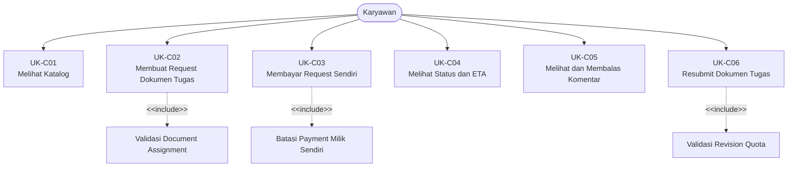

# Use Case Karyawan — TP Docs (With Consultant)

## 1. Definisi Aktor Karyawan

**Karyawan** adalah pengguna tambahan yang menerima link undangan dari User Induk dan menggunakan akun pribadi untuk bergabung ke perusahaan. Jika belum memiliki akun, calon Karyawan melakukan registrasi dan verifikasi email terlebih dahulu melalui alur undangan. Karyawan memperoleh fitur sesuai langganan perusahaan.

## 2. Daftar Use Case — Karyawan

Use case Karyawan pada versi ini dibatasi pada aktivasi dan pemantauan akses langganan perusahaan. Karyawan tidak dapat membeli paket, add-on, mengelola pembayaran, atau mengundang anggota lain.

### 2.1 Visual Aktivitas Karyawan

```mermaid
flowchart TB
    A([Karyawan])

    UIK01(["UK-01<br/>Menerima Undangan Langganan Perusahaan"])
    UIK02(["UK-02<br/>Melihat Status Akses Langganan"])

    A --> UIK01
    A --> UIK02

    OPEN["UK-01.1<br/>Membuka Link Undangan"]
    CHECK["UK-01.2<br/>Memeriksa Kepemilikan Akun"]
    REGISTER["UK-01.2.E1<br/>Registrasi & Verifikasi Akun Baru"]
    LOGIN["UK-01.3<br/>Login atau Melanjutkan dengan Akun"]
    VALIDATE["UK-01.4<br/>Memvalidasi Email Undangan"]
    ACCEPT["UK-01.5<br/>Menyetujui Bergabung"]
    ACTIVATE["UK-01.6<br/>Mengaktifkan Akses Langganan"]
    REJECT["UK-01.E1<br/>Menolak Undangan"]
    INVALID["UK-01.E2<br/>Undangan Tidak Valid / Kedaluwarsa"]

    UIK01 -. "&lt;&lt;include&gt;&gt;" .-> OPEN
    UIK01 -. "&lt;&lt;include&gt;&gt;" .-> CHECK
    CHECK -. "&lt;&lt;extend&gt;&gt;" .-> REGISTER
    UIK01 -. "&lt;&lt;include&gt;&gt;" .-> LOGIN
    UIK01 -. "&lt;&lt;include&gt;&gt;" .-> VALIDATE
    UIK01 -. "&lt;&lt;include&gt;&gt;" .-> ACCEPT
    UIK01 -. "&lt;&lt;include&gt;&gt;" .-> ACTIVATE
    UIK01 -. "&lt;&lt;extend&gt;&gt;" .-> REJECT
    UIK01 -. "&lt;&lt;extend&gt;&gt;" .-> INVALID
    ACTIVATE ~~~ REJECT
    ACTIVATE ~~~ INVALID

    COMPANY["UK-02.1<br/>Melihat Perusahaan Induk"]
    PACKAGE["UK-02.2<br/>Melihat Paket yang Diwarisi"]
    STATUS["UK-02.3<br/>Melihat Status Membership"]
    PERIOD["UK-02.4<br/>Melihat Masa Berlaku Akses"]
    EXPIRED["UK-02.E1<br/>Akses Langganan Berakhir"]

    UIK02 -. "&lt;&lt;include&gt;&gt;" .-> COMPANY
    UIK02 -. "&lt;&lt;include&gt;&gt;" .-> PACKAGE
    UIK02 -. "&lt;&lt;include&gt;&gt;" .-> STATUS
    UIK02 -. "&lt;&lt;include&gt;&gt;" .-> PERIOD
    UIK02 -. "&lt;&lt;extend&gt;&gt;" .-> EXPIRED
    PERIOD ~~~ EXPIRED
```

**Legenda:** garis penuh menunjukkan aktivitas yang dimulai langsung oleh Karyawan. Panah `<<include>>` menunjukkan tahapan wajib, sedangkan `<<extend>>` menunjukkan kondisi atau pilihan tambahan.

| ID         | Tingkat / Induk           | Use Case                                   | Deskripsi / Aktivitas                                                                                  | Include (`<<include>>`) | Extend (`<<extend>>`) |
| ---------- | ------------------------- | ------------------------------------------ | ------------------------------------------------------------------------------------------------------ | ----------------------- | --------------------- |
| **UK-01**  | **`[AKTOR DIRECT]`**      | **Menerima Undangan Langganan Perusahaan** | [Aktivitas menerima akses paket perusahaan melalui link undangan yang dikirim ke email calon Karyawan] | UK-01.1 s/d UK-01.6     | UK-01.E1, UK-01.E2    |
| UK-01.1    | └── _sub dari UK-01_      | Membuka Link Undangan                      | [Aktivitas membuka tautan unik yang dikirim User Induk melalui sistem]                                 | [-]                     | [-]                   |
| UK-01.2    | └── _sub dari UK-01_      | Memeriksa Kepemilikan Akun                 | [Aktivitas sistem memeriksa apakah email tujuan sudah memiliki akun]                                   | [-]                     | UK-01.2.E1            |
| UK-01.2.E1 | └── _extend dari UK-01.2_ | Registrasi dan Verifikasi Akun Baru        | [Aktivitas calon Karyawan membuat akun dan memverifikasi email jika belum terdaftar]                   | [-]                     | [-]                   |
| UK-01.3    | └── _sub dari UK-01_      | Login atau Melanjutkan dengan Akun         | [Aktivitas autentikasi akun tanpa kehilangan konteks link undangan]                                    | [-]                     | [-]                   |
| UK-01.4    | └── _sub dari UK-01_      | Memvalidasi Email Undangan                 | [Aktivitas memastikan email akun sama dengan email tujuan undangan]                                    | [-]                     | [-]                   |
| UK-01.5    | └── _sub dari UK-01_      | Menyetujui Bergabung                       | [Aktivitas menerima membership perusahaan]                                                             | [-]                     | [-]                   |
| UK-01.6    | └── _sub dari UK-01_      | Mengaktifkan Akses Langganan               | [Aktivitas memperoleh fitur sesuai paket dan sisa masa aktif perusahaan]                               | [-]                     | [-]                   |
| UK-01.E1   | └── _extend dari UK-01_   | Menolak Undangan                           | [Aktivitas menolak bergabung ke perusahaan]                                                            | [-]                     | [-]                   |
| UK-01.E2   | └── _extend dari UK-01_   | Undangan Tidak Valid atau Kedaluwarsa      | [Aktivitas menolak token salah, digunakan, dibatalkan, atau kedaluwarsa]                               | [-]                     | [-]                   |
| **UK-02**  | **`[AKTOR DIRECT]`**      | **Melihat Status Akses Langganan**         | [Aktivitas melihat sumber dan masa berlaku akses berbayar]                                             | UK-02.1 s/d UK-02.4     | UK-02.E1              |
| UK-02.1    | └── _sub dari UK-02_      | Melihat Perusahaan Induk                   | [Aktivitas menampilkan perusahaan tempat Karyawan menjadi anggota]                                     | [-]                     | [-]                   |
| UK-02.2    | └── _sub dari UK-02_      | Melihat Paket yang Diwarisi                | [Aktivitas menampilkan paket perusahaan yang berlaku bagi Karyawan]                                    | [-]                     | [-]                   |
| UK-02.3    | └── _sub dari UK-02_      | Melihat Status Membership                  | [Aktivitas menampilkan status aktif, tertunda, atau dicabut]                                           | [-]                     | [-]                   |
| UK-02.4    | └── _sub dari UK-02_      | Melihat Masa Berlaku Akses                 | [Aktivitas menampilkan tanggal berakhir berdasarkan langganan perusahaan]                              | [-]                     | [-]                   |
| UK-02.E1   | └── _extend dari UK-02_   | Akses Langganan Berakhir                   | [Aktivitas mencabut fitur berbayar saat paket perusahaan berakhir]                                     | [-]                     | [-]                   |

---

## Layanan Konsultasi pada Karyawan

Karyawan yang berhak membeli jasa untuk dokumen tugasnya melihat harga normal atau satu diskon event aktif yang sesuai sebelum checkout. Tanpa event, harga normal berlaku. Karyawan tidak dapat membuat atau mengubah event.

| ID | Aktivitas | Batasan |
| --- | --- | --- |
| UK-C01 | Melihat katalog | Hanya layanan aktif |
| UK-C02 | Membuat request | Hanya document version dari dokumen yang ditugaskan |
| UK-C03 | Membayar konsultasi | Dapat checkout tetapi tidak mengelola subscription/add-on organisasi |
| UK-C04 | Melihat status | Hanya request yang dibuat atau dokumen yang masih ditugaskan |
| UK-C05 | Melihat komentar | Reply dan tandai addressed; tidak menghapus komentar Konsultan |
| UK-C06 | Resubmit | Hanya jika assignment dan revision quota masih aktif |

Karyawan tidak dapat melihat seluruh billing konsultasi organisasi, mengubah katalog, menerima quotation atas nama organisasi lain, atau menyetujui promotion working copy. Approval akhir Penyusunan Penuh tetap milik User Induk.
