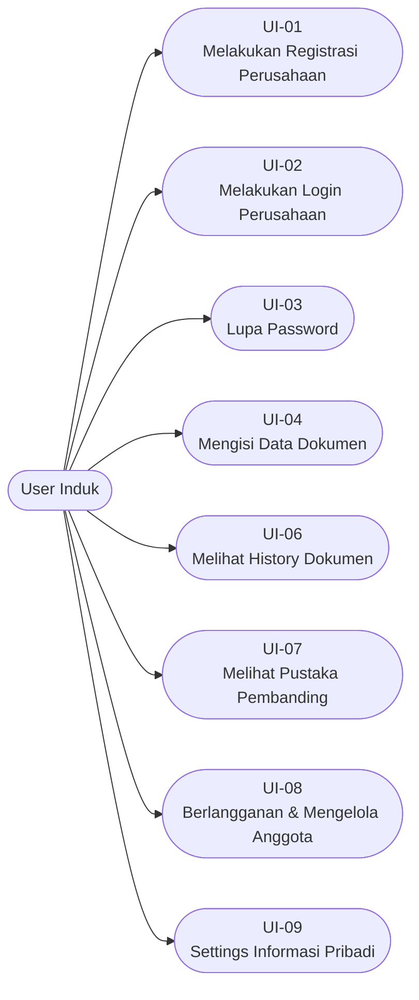
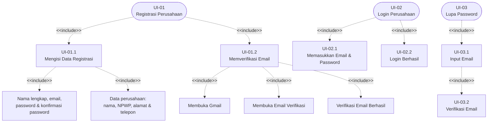
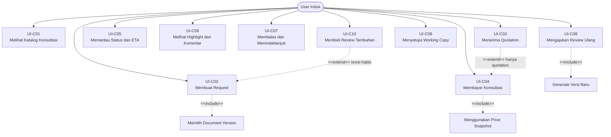

# Use Case User Induk — TP Docs (With Consultant)

## 1. Definisi Aktor User Induk

**User Induk** adalah pengguna pertama yang mendaftarkan perusahaan dan menjadi pemilik operasional organisasi pada TP Docs. User Induk mengelola profil perusahaan, langganan, pembayaran, kuota, anggota, penugasan dokumen, seluruh data perusahaan, serta permintaan ekspor dan penghapusan data.

## 2. Daftar Use Case — User Induk

### Diskon Event Opsional pada UI-08

User Induk melihat harga normal untuk paket, add-on, dan quotation. Jika event aktif sesuai produk, sistem menampilkan harga awal, satu potongan terbesar, dan total sebelum pembayaran. Harga dibekukan pada checkout atau penerbitan quotation. Tanpa event tidak ada baris diskon. Varian Konsultan juga menerapkan aturan ini pada jasa konsultasi.

~~~mermaid
flowchart LR
 U[User Induk] --> P[UI-08 Pilih produk]
 P --> E{Event sesuai?}
 E -->|Tidak| N[Harga normal]
 E -->|Ya| D[Harga promo]
 N --> C[Checkout atau quotation]
 D --> C
~~~

Struktur use case di bawah merefleksikan diagram sistem TP Docs langsung dari interaksi User Induk (tanpa pemisahan modul), terpusat pada hierarki relasi `<<include>>` dan `<<extend>>`.

Baris dengan penanda **`[AKTOR DIRECT]`** atau **`[AKTOR DIRECT — USER INDUK]`** merupakan use case utama yang dipicu langsung oleh User Induk:

### 2.1 Visual Use Case User Induk

Seluruh use case User Induk menggunakan kode `UI`. Kode dan urutan pada visual sama dengan ID yang digunakan pada tabel.

#### 2.1.1 Alur Aktivitas Utama User Induk

Visual ini menunjukkan seluruh aktivitas yang dapat dimulai langsung oleh User Induk. Setiap cabang mewakili titik awal aktivitas utama sebelum pengguna masuk ke proses `<<include>>` atau aktivitas tambahan `<<extend>>` pada diagram berikutnya.

#### 2.1.2 Registrasi, Login, dan Lupa Password

#### 2.1.3 Mengisi Data Dokumen

```mermaid
flowchart TB
    UI04(["UI-04<br/>Mengisi Data Dokumen"])
    DRAFT["UI-04.E1<br/>Dijadikan Draft"]
    UI04 -. "&lt;&lt;extend&gt;&gt;" .-> DRAFT

    UI0401["UI-04.01<br/>Profil Perusahaan<br/>nama entitas, alias, bidang usaha,<br/>tanggal, alamat, karyawan, tahun pajak & jenis dokumen"]
    UI0402["UI-04.02<br/>Kepemilikan & Manajemen<br/>pemegang saham, nominal, persentase,<br/>komisaris, direksi, jabatan & nama"]
    UI0403["UI-04.03<br/>Bisnis, Produk & Strategi<br/>uraian proses, skema AI opsional & daftar produk"]
    UI0404["UI-04.04<br/>Ringkasan Keuangan<br/>pendapatan, biaya, laba kotor,<br/>GPM, OPEX & operating margin"]
    UI0405["UI-04.05<br/>Pihak Afiliasi & Pesaing<br/>nama, aktivitas/peran, hubungan,<br/>pesaing & domisili/negara"]
    UI0407["UI-04.07<br/>Gambaran Industri"]
    UI0408["UI-04.08<br/>Transaksi Afiliasi"]
    UI0409["UI-04.09<br/>Analisis FAR"]
    UI05["UI-05<br/>Data Pembanding & Seleksi"]
    UI0411["UI-04.11<br/>Review and Generate"]

    UI04 -. "&lt;&lt;include&gt;&gt;" .-> UI0401
    UI04 -. "&lt;&lt;include&gt;&gt;" .-> UI0402
    UI04 -. "&lt;&lt;include&gt;&gt;" .-> UI0403
    UI04 -. "&lt;&lt;include&gt;&gt;" .-> UI0404
    UI04 -. "&lt;&lt;include&gt;&gt;" .-> UI0405
    UI04 -. "&lt;&lt;include&gt;&gt;" .-> UI0407
    UI04 -. "&lt;&lt;include&gt;&gt;" .-> UI0408
    UI04 -. "&lt;&lt;include&gt;&gt;" .-> UI0409
    UI04 -. "&lt;&lt;include&gt;&gt;" .-> UI05
    UI04 -. "&lt;&lt;include&gt;&gt;" .-> UI0411

    BUSINESSDESC["UI-04.03.1<br/>Mengisi Uraian Proses Bisnis"]
    STEPS["UI-04.03.1.E1<br/>Menambahkan Langkah Proses Opsional"]
    AI["UI-04.03.1a<br/>Generate Skema AI Opsional"]
    AIRESULT["UI-04.03.1a.1<br/>Skema Proses Bisnis — Generated by AI"]
    UI0403 -. "&lt;&lt;include&gt;&gt;" .-> BUSINESSDESC
    BUSINESSDESC -. "&lt;&lt;extend&gt;&gt;" .-> STEPS
    BUSINESSDESC -. "&lt;&lt;extend&gt;&gt;" .-> AI
    AI -. "&lt;&lt;include&gt;&gt;" .-> AIRESULT

    INDUSTRY["UI-04.07.1<br/>Gambaran Industri"]
    FILE["UI-04.07.1.E1<br/>Memberikan File Word/PDF"]
    TEXT["UI-04.07.1.E2<br/>Isi Deskripsi Teks:<br/>ruang lingkup, impor/pasokan & prospek pasar"]
    UI0407 -. "&lt;&lt;include&gt;&gt;" .-> INDUSTRY
    INDUSTRY -. "&lt;&lt;extend&gt;&gt;" .-> FILE
    INDUSTRY -. "&lt;&lt;extend&gt;&gt;" .-> TEXT

    EXCEL["UI-04.08.1<br/>Template & Upload Excel"]
    AFF["UI-04.08.2<br/>Transaksi Pihak Afiliasi:<br/>jenis, lawan, deskripsi & metode TP"]
    INDEP["UI-04.08.3<br/>Transaksi Pihak Independen:<br/>jenis, lawan & nilai Rp"]
    SUMMARY["UI-04.08.4<br/>Summary Transaksi TP — Auto-generated"]
    DOWNLOAD["Download Template Excel"]
    TSV["Copy Format TSV"]
    UPLOAD["Upload File Excel Transaksi"]
    UI0408 -. "&lt;&lt;include&gt;&gt;" .-> EXCEL
    UI0408 -. "&lt;&lt;include&gt;&gt;" .-> AFF
    UI0408 -. "&lt;&lt;include&gt;&gt;" .-> INDEP
    UI0408 -. "&lt;&lt;include&gt;&gt;" .-> SUMMARY
    EXCEL -. "&lt;&lt;extend&gt;&gt;" .-> DOWNLOAD
    EXCEL -. "&lt;&lt;extend&gt;&gt;" .-> TSV
    EXCEL -. "&lt;&lt;extend&gt;&gt;" .-> UPLOAD

    FUNC["Fungsi yang Dilakukan:<br/>fungsi & deskripsi pelaksanaan"]
    ASSET["Struktur & Nilai Aset:<br/>kategori, nilai buku bersih & keterangan"]
    RISK["Risiko yang Ditanggung:<br/>risiko & deskripsi penanganan"]
    METHOD["Pemilihan & Penerapan Metode:<br/>metode, pihak, indikator laba & alasan"]
    EVAL["Evaluasi 5 Metode TP:<br/>metode, status & alasan evaluasi"]
    UI0409 -. "&lt;&lt;include&gt;&gt;" .-> FUNC
    UI0409 -. "&lt;&lt;include&gt;&gt;" .-> ASSET
    UI0409 -. "&lt;&lt;include&gt;&gt;" .-> RISK
    UI0409 -. "&lt;&lt;include&gt;&gt;" .-> METHOD
    METHOD -. "&lt;&lt;include&gt;&gt;" .-> EVAL
```

#### 2.1.4 Data Pembanding, Review, History, dan Pustaka

```mermaid
flowchart TB
    UI05(["UI-05<br/>Kelola Data Pembanding & Seleksi"])
    PDF["UI-05.1<br/>Upload PDF Benchmarking / TP Catalyst"]
    GEN["UI-05.2<br/>Generate PDF Hasil Pembanding"]
    SEARCH["Strategi Pencarian:<br/>langkah & hasil perusahaan"]
    PLI["Formulasi Indikator Laba / PLI"]
    FINAL["Pembanding Final:<br/>nama, negara, COGS, GP, OP & PLI"]
    RANGE["Rentang Interkuartil:<br/>min, Q1, median, Q2, Q3 & max"]
    CPM["Pilih CPM"]
    OM["Pilih OM"]
    NCP["Pilih NCP"]

    UI05 -. "&lt;&lt;include&gt;&gt;" .-> PDF
    UI05 -. "&lt;&lt;include&gt;&gt;" .-> GEN
    GEN -. "&lt;&lt;include&gt;&gt;" .-> SEARCH
    GEN -. "&lt;&lt;include&gt;&gt;" .-> PLI
    GEN -. "&lt;&lt;include&gt;&gt;" .-> FINAL
    GEN -. "&lt;&lt;include&gt;&gt;" .-> RANGE
    PLI -. "&lt;&lt;extend&gt;&gt;" .-> CPM
    PLI -. "&lt;&lt;extend&gt;&gt;" .-> OM
    PLI -. "&lt;&lt;extend&gt;&gt;" .-> NCP

    REVIEW["UI-04.11<br/>Review and Generate"]
    PREVIEW["Preview Ringkasan:<br/>entitas, tahun, karakteristik, metode,<br/>transaksi afiliasi & pembanding final"]
    DOCS["Generate Docs"]
    WARNING["Warning di Luar Rentang Wajar"]
    REVIEW -. "&lt;&lt;include&gt;&gt;" .-> PREVIEW
    REVIEW -. "&lt;&lt;include&gt;&gt;" .-> DOCS
    PREVIEW -. "&lt;&lt;extend&gt;&gt;" .-> WARNING

    UI06(["UI-06<br/>History Dokumen"])
    HISTORY["Nama dokumen, tahun pajak,<br/>status & diperbarui"]
    OPEN["Buka Dokumen"]
    DUP["Duplikasi Dokumen"]
    UI06 -. "&lt;&lt;include&gt;&gt;" .-> HISTORY
    UI06 -. "&lt;&lt;extend&gt;&gt;" .-> OPEN
    UI06 -. "&lt;&lt;extend&gt;&gt;" .-> DUP
    HISTORY ~~~ OPEN
    HISTORY ~~~ DUP

    UI07(["UI-07<br/>Pustaka Pembanding"])
    LIB["Data Read-only:<br/>nama, negara, COGS, GP & CPM"]
    QUARTILE["Rentang Kuartil Saat Ini"]
    NEWDOC["Buat Dokumen Baru dari Data Pembanding"]
    UI07 -. "&lt;&lt;include&gt;&gt;" .-> LIB
    UI07 -. "&lt;&lt;include&gt;&gt;" .-> QUARTILE
    UI07 -. "&lt;&lt;extend&gt;&gt;" .-> NEWDOC
```

#### 2.1.5 Langganan, Anggota, Kuota, dan Settings

```mermaid
flowchart TB
    UI08(["UI-08<br/>Berlangganan & Mengelola Anggota"])
    PACKAGE["UI-08.1<br/>Mengelola Paket Langganan"]
    SEAT["UI-08.2<br/>Kursi Terpakai & Tersedia"]
    SEATADD["UI-08.3<br/>Membeli Add-on Kursi"]
    MEMBER["UI-08.4<br/>Mengelola Anggota"]
    ASSIGN["UI-08.5<br/>Menugaskan Dokumen"]
    BILL["UI-08.6<br/>Riwayat Pembayaran & Add-on"]
    DOCQUOTA["UI-08.7<br/>Kuota Dokumen"]
    REFUND["UI-08.8<br/>Mengajukan & Memantau Refund"]

    UI08 -. "&lt;&lt;include&gt;&gt;" .-> PACKAGE
    UI08 -. "&lt;&lt;include&gt;&gt;" .-> SEAT
    UI08 -. "&lt;&lt;include&gt;&gt;" .-> SEATADD
    UI08 -. "&lt;&lt;include&gt;&gt;" .-> MEMBER
    UI08 -. "&lt;&lt;include&gt;&gt;" .-> ASSIGN
    UI08 -. "&lt;&lt;include&gt;&gt;" .-> BILL
    UI08 -. "&lt;&lt;include&gt;&gt;" .-> DOCQUOTA
    UI08 -. "&lt;&lt;include&gt;&gt;" .-> REFUND

    CHOOSE["Memilih / Meningkatkan Paket"]
    FREE["Free / Trial:<br/>1 dokumen & 1 User Induk"]
    BASIC["Basic:<br/>5 dokumen / 12 bulan sejak aktivasi"]
    PRO["Professional:<br/>10 dokumen & 3 pengguna / 12 bulan sejak aktivasi"]
    CUSTOM["Enterprise / Custom:<br/>pengajuan, review, quotation & aktivasi"]
    CUSTOM -. "&lt;&lt;include&gt;&gt;" .-> CUSTOMFORM["Mengisi & Mengirim Pengajuan"]
    CUSTOM -. "&lt;&lt;include&gt;&gt;" .-> CUSTOMSTATUS["Melihat Status Pengajuan"]
    CUSTOMSTATUS -. "&lt;&lt;extend&gt;&gt;" .-> CUSTOMREV["Memperbaiki Pengajuan"]
    CUSTOMSTATUS -. "&lt;&lt;extend&gt;&gt;" .-> CUSTOMQUOTE["Menerima / Menolak Quotation"]
    CUSTOMQUOTE -. "&lt;&lt;extend&gt;&gt;" .-> CUSTOMPAY["Membayar Tagihan"]
    CUSTOMPAY -. "&lt;&lt;include&gt;&gt;" .-> CUSTOMACTIVE["Aktivasi Setelah Pembayaran Terverifikasi"]
    PACKAGE -. "&lt;&lt;include&gt;&gt;" .-> CHOOSE
    CHOOSE -. "&lt;&lt;include&gt;&gt;" .-> FREE
    CHOOSE -. "&lt;&lt;include&gt;&gt;" .-> BASIC
    CHOOSE -. "&lt;&lt;include&gt;&gt;" .-> PRO
    CHOOSE -. "&lt;&lt;include&gt;&gt;" .-> CUSTOM

    MEMBER -. "&lt;&lt;include&gt;&gt;" .-> INVITE["Kirim Link Undangan ke Email Karyawan"]
    MEMBER -. "&lt;&lt;include&gt;&gt;" .-> PENDING["Lihat Undangan Tertunda"]
    MEMBER -. "&lt;&lt;include&gt;&gt;" .-> RESEND["Kirim Ulang / Batalkan"]
    MEMBER -. "&lt;&lt;include&gt;&gt;" .-> REMOVE["Hapus Karyawan"]

    DOCQUOTA -. "&lt;&lt;include&gt;&gt;" .-> USED["Dokumen Terpakai"]
    DOCQUOTA -. "&lt;&lt;include&gt;&gt;" .-> LEFT["Sisa & Tanggal Reset Kuota"]
    DOCQUOTA -. "&lt;&lt;include&gt;&gt;" .-> BUY["Beli Dokumen Tambahan"]
    DOCQUOTA -. "&lt;&lt;include&gt;&gt;" .-> LOG["Histori Add-on Dokumen"]

    REFUND -. "&lt;&lt;include&gt;&gt;" .-> REFUNDTRX["Pilih Transaksi yang Memenuhi Syarat"]
    REFUND -. "&lt;&lt;include&gt;&gt;" .-> REFUNDTERM["Lihat Ketentuan Refund"]
    REFUND -. "&lt;&lt;include&gt;&gt;" .-> REFUNDREASON["Isi Alasan Refund"]
    REFUNDREASON -. "&lt;&lt;extend&gt;&gt;" .-> REFUNDEVIDENCE["Unggah Bukti Pendukung"]
    REFUND -. "&lt;&lt;include&gt;&gt;" .-> REFUNDSUBMIT["Kirim Pengajuan Refund"]
    REFUND -. "&lt;&lt;include&gt;&gt;" .-> REFUNDSTATUS["Pantau Status Refund"]
    REFUND -. "&lt;&lt;include&gt;&gt;" .-> REFUNDCONFIRM["Terima Konfirmasi Refund"]
    REFUND -. "&lt;&lt;extend&gt;&gt;" .-> REFUNDREJECT["Refund Ditolak"]
    REFUND -. "&lt;&lt;extend&gt;&gt;" .-> REFUNDFAIL["Proses Refund Gagal"]

    UI09(["UI-09<br/>Settings Informasi Pribadi"])
    VIEW["Melihat Informasi Pribadi"]
    UPDATE["Update nama, email, telepon,<br/>jabatan & foto profil"]
    SAVE["Validasi & Simpan Perubahan"]
    VERIFY["Verifikasi Email Baru"]
    STATUSNOTICE["UI-09.E2<br/>Pemberitahuan Suspend / Reaktivasi"]
    UI09 -. "&lt;&lt;include&gt;&gt;" .-> VIEW
    UI09 -. "&lt;&lt;include&gt;&gt;" .-> UPDATE
    UI09 -. "&lt;&lt;include&gt;&gt;" .-> SAVE
    UPDATE -. "&lt;&lt;extend&gt;&gt;" .-> VERIFY
    UI09 -. "&lt;&lt;extend&gt;&gt;" .-> STATUSNOTICE
```

**Legenda:** garis penuh menunjukkan use case yang dipicu langsung oleh User Induk. Panah putus-putus bergerak dari aktivitas induk di bagian atas menuju aktivitas `<<include>>` atau `<<extend>>` di bawahnya sehingga hierarki mudah dibaca.

| ID               | Tingkat / Induk                                                                                                              | Use Case                                          | Deskripsi / Aktivitas                                                                                                           | Include (`<<include>>`)                | Extend (`<<extend>>`)           |
| ---------------- | ---------------------------------------------------------------------------------------------------------------------------- | ------------------------------------------------- | ------------------------------------------------------------------------------------------------------------------------------- | -------------------------------------- | ------------------------------- |
| **UI-01**        | **`[AKTOR DIRECT]`**                                                                                                         | **Melakukan Registrasi Perusahaan**               | [Aktivitas pendaftaran akun baru oleh perusahaan]                                                                               | UI-01.1, UI-01.2                       | [-]                             |
| UI-01.1          | └── _sub dari UI-01_                                                                                                         | Mengisi Data Registrasi                           | [Aktivitas pengisian form data akun dan perusahaan]                                                                             | UI-01.1.1 s/d UI-01.1.5                | [-]                             |
| UI-01.1.1        | &nbsp;&nbsp;&nbsp;&nbsp;└── _sub dari UI-01.1_                                                                               | Input Nama Lengkap                                | [Aktivitas input nama lengkap penanggung jawab akun]                                                                            | [-]                                    | [-]                             |
| UI-01.1.2        | &nbsp;&nbsp;&nbsp;&nbsp;└── _sub dari UI-01.1_                                                                               | Input Email                                       | [Aktivitas input alamat email aktif perusahaan]                                                                                 | [-]                                    | [-]                             |
| UI-01.1.3        | &nbsp;&nbsp;&nbsp;&nbsp;└── _sub dari UI-01.1_                                                                               | Input Password                                    | [Aktivitas input kata sandi akun]                                                                                               | [-]                                    | [-]                             |
| UI-01.1.4        | &nbsp;&nbsp;&nbsp;&nbsp;└── _sub dari UI-01.1_                                                                               | Input Konfirmasi Password                         | [Aktivitas input ulang kata sandi untuk memastikan kesesuaian]                                                                  | [-]                                    | [-]                             |
| UI-01.1.5        | &nbsp;&nbsp;&nbsp;&nbsp;└── _sub dari UI-01.1_                                                                               | Mengisi Data Perusahaan                           | [Aktivitas pengisian identitas dan kontak perusahaan]                                                                           | UI-01.1.5.1 s/d UI-01.1.5.4            | [-]                             |
| UI-01.1.5.1      | &nbsp;&nbsp;&nbsp;&nbsp;&nbsp;&nbsp;&nbsp;&nbsp;└── _sub dari UI-01.1.5_                                                     | Input Nama Perusahaan                             | [Aktivitas input nama resmi perusahaan]                                                                                         | [-]                                    | [-]                             |
| UI-01.1.5.2      | &nbsp;&nbsp;&nbsp;&nbsp;&nbsp;&nbsp;&nbsp;&nbsp;└── _sub dari UI-01.1.5_                                                     | Input NPWP                                        | [Aktivitas input Nomor Pokok Wajib Pajak perusahaan]                                                                            | [-]                                    | [-]                             |
| UI-01.1.5.3      | &nbsp;&nbsp;&nbsp;&nbsp;&nbsp;&nbsp;&nbsp;&nbsp;└── _sub dari UI-01.1.5_                                                     | Input Alamat Perusahaan                           | [Aktivitas input alamat lengkap perusahaan]                                                                                     | [-]                                    | [-]                             |
| UI-01.1.5.4      | &nbsp;&nbsp;&nbsp;&nbsp;&nbsp;&nbsp;&nbsp;&nbsp;└── _sub dari UI-01.1.5_                                                     | Input Nomor Telepon                               | [Aktivitas input nomor telepon aktif perusahaan]                                                                                | [-]                                    | [-]                             |
| UI-01.2          | └── _sub dari UI-01_                                                                                                         | Memverifikasi Email                               | [Aktivitas verifikasi alamat email akun perusahaan]                                                                             | UI-01.2.1 s/d UI-01.2.3                | [-]                             |
| UI-01.2.1        | &nbsp;&nbsp;&nbsp;&nbsp;└── _sub dari UI-01.2_                                                                               | Membuka Gmail                                     | [Aktivitas membuka Gmail menggunakan alamat email yang didaftarkan]                                                             | [-]                                    | [-]                             |
| UI-01.2.2        | &nbsp;&nbsp;&nbsp;&nbsp;└── _sub dari UI-01.2_                                                                               | Membuka Email Verifikasi                          | [Aktivitas membuka pesan dan menekan tautan verifikasi]                                                                         | [-]                                    | [-]                             |
| UI-01.2.3        | &nbsp;&nbsp;&nbsp;&nbsp;└── _sub dari UI-01.2_                                                                               | Verifikasi Email Berhasil                         | [Aktivitas sistem mengaktifkan akun perusahaan setelah email terverifikasi]                                                     | [-]                                    | [-]                             |
| **UI-02**        | **`[AKTOR DIRECT]`**                                                                                                         | **Melakukan Login Perusahaan**                    | [Aktivitas autentikasi menggunakan akun perusahaan yang telah terverifikasi]                                                    | UI-02.1, UI-02.2                       | [-]                             |
| UI-02.1          | └── _sub dari UI-02_                                                                                                         | Memasukkan Email dan Password                     | [Aktivitas input kredensial akun perusahaan]                                                                                    | [-]                                    | [-]                             |
| UI-02.2          | └── _sub dari UI-02_                                                                                                         | Login Perusahaan Berhasil                         | [Aktivitas sistem menampilkan halaman utama perusahaan]                                                                         | [-]                                    | [-]                             |
| **UI-03**        | **`[AKTOR DIRECT]`**                                                                                                         | **Lupa Password**                                 | [Aktivitas pemulihan kata sandi pengguna]                                                                                       | UI-03.1                                | [-]                             |
| UI-03.1          | └── _sub dari UI-03_                                                                                                         | Input Email                                       | [Aktivitas input alamat email untuk reset]                                                                                      | UI-03.2                                | [-]                             |
| UI-03.2          | &nbsp;&nbsp;&nbsp;&nbsp;└── _sub dari UI-03.1_                                                                               | Verifikasi Email                                  | [Aktivitas verifikasi tautan konfirmasi reset]                                                                                  | [-]                                    | [-]                             |
| **UI-04**        | **`[AKTOR DIRECT]`**                                                                                                         | **Mengisi Data Dokumen**                          | [Aktivitas utama penyusunan konten Local File TP]                                                                               | UI-04.01 s/d UI-04.09, UI-05, UI-04.11 | UI-04.E1                        |
| UI-04.E1         | └── _extend dari UI-04_                                                                                                      | Dijadikan dalam draft                             | [Aktivitas penyimpanan sementara progres pengisian dokumen]                                                                     | [-]                                    | [-]                             |
| UI-04.01         | └── _sub dari UI-04_                                                                                                         | Mengelola Profil Perusahaan                       | [Aktivitas pengisian identitas dan profil utama perusahaan]                                                                     | UI-04.01.1 s/d UI-04.01.9              | [-]                             |
| UI-04.01.1       | &nbsp;&nbsp;&nbsp;&nbsp;└── _sub dari UI-04.01_                                                                              | Input Nama Badan/Entitas                          | [Aktivitas input nama resmi badan atau entitas]                                                                                 | [-]                                    | [-]                             |
| UI-04.01.2       | &nbsp;&nbsp;&nbsp;&nbsp;└── _sub dari UI-04.01_                                                                              | Input Singkatan/Alias                             | [Aktivitas input singkatan atau nama lain perusahaan]                                                                           | [-]                                    | [-]                             |
| UI-04.01.3       | &nbsp;&nbsp;&nbsp;&nbsp;└── _sub dari UI-04.01_                                                                              | Input Bidang Usaha                                | [Aktivitas input bidang atau kegiatan usaha perusahaan]                                                                         | [-]                                    | [-]                             |
| UI-04.01.4       | &nbsp;&nbsp;&nbsp;&nbsp;└── _sub dari UI-04.01_                                                                              | Input Tanggal Pendirian                           | [Aktivitas input tanggal resmi pendirian perusahaan]                                                                            | [-]                                    | [-]                             |
| UI-04.01.5       | &nbsp;&nbsp;&nbsp;&nbsp;└── _sub dari UI-04.01_                                                                              | Input Tanggal Mulai Komersial                     | [Aktivitas input tanggal perusahaan mulai beroperasi secara komersial]                                                          | [-]                                    | [-]                             |
| UI-04.01.6       | &nbsp;&nbsp;&nbsp;&nbsp;└── _sub dari UI-04.01_                                                                              | Input Alamat Kantor/Pabrik                        | [Aktivitas input alamat kantor dan/atau pabrik perusahaan]                                                                      | [-]                                    | [-]                             |
| UI-04.01.7       | &nbsp;&nbsp;&nbsp;&nbsp;└── _sub dari UI-04.01_                                                                              | Input Informasi Jumlah Karyawan                   | [Aktivitas input jumlah karyawan perusahaan]                                                                                    | [-]                                    | [-]                             |
| UI-04.01.8       | &nbsp;&nbsp;&nbsp;&nbsp;└── _sub dari UI-04.01_                                                                              | Input Tahun Pajak                                 | [Aktivitas memilih tahun pajak yang dicakup dokumen]                                                                            | [-]                                    | [-]                             |
| UI-04.01.9       | &nbsp;&nbsp;&nbsp;&nbsp;└── _sub dari UI-04.01_                                                                              | Memilih Jenis Dokumen                             | [Aktivitas memilih jenis dokumen transfer pricing yang akan disusun]                                                            | [-]                                    | [-]                             |
| UI-04.02         | └── _sub dari UI-04_                                                                                                         | Mengisi Data Kepemilikan Perusahaan & Manajemen   | [Aktivitas input struktur pemegang saham dan pengurus perusahaan]                                                               | UI-04.02.1, UI-04.02.2                 | [-]                             |
| UI-04.02.1       | &nbsp;&nbsp;&nbsp;&nbsp;└── _sub dari UI-04.02_                                                                              | Struktur Kepemilikan Saham (Editable Table)       | [Aktivitas mengelola tabel struktur kepemilikan saham]                                                                          | UI-04.02.1.1 s/d UI-04.02.1.3          | [-]                             |
| UI-04.02.1.1     | &nbsp;&nbsp;&nbsp;&nbsp;&nbsp;&nbsp;&nbsp;&nbsp;└── _sub dari UI-04.02.1_                                                    | Input Pemegang Saham                              | [Aktivitas input nama pemegang saham]                                                                                           | [-]                                    | [-]                             |
| UI-04.02.1.2     | &nbsp;&nbsp;&nbsp;&nbsp;&nbsp;&nbsp;&nbsp;&nbsp;└── _sub dari UI-04.02.1_                                                    | Input Nilai Nominal                               | [Aktivitas input nilai nominal saham yang dimiliki]                                                                             | [-]                                    | [-]                             |
| UI-04.02.1.3     | &nbsp;&nbsp;&nbsp;&nbsp;&nbsp;&nbsp;&nbsp;&nbsp;└── _sub dari UI-04.02.1_                                                    | Input Persentase Kepemilikan                      | [Aktivitas input persentase kepemilikan saham]                                                                                  | [-]                                    | [-]                             |
| UI-04.02.2       | &nbsp;&nbsp;&nbsp;&nbsp;└── _sub dari UI-04.02_                                                                              | Data Komisaris dan Direksi                        | [Aktivitas mengelola data pengurus, komisaris, dan direksi perusahaan]                                                          | UI-04.02.2.1, UI-04.02.2.2             | [-]                             |
| UI-04.02.2.1     | &nbsp;&nbsp;&nbsp;&nbsp;&nbsp;&nbsp;&nbsp;&nbsp;└── _sub dari UI-04.02.2_                                                    | Input Jabatan                                     | [Aktivitas input jabatan pengurus perusahaan]                                                                                   | [-]                                    | [-]                             |
| UI-04.02.2.2     | &nbsp;&nbsp;&nbsp;&nbsp;&nbsp;&nbsp;&nbsp;&nbsp;└── _sub dari UI-04.02.2_                                                    | Input Nama Pengurus/Direksi                       | [Aktivitas input nama komisaris, pengurus, atau direksi]                                                                        | [-]                                    | [-]                             |
| UI-04.03         | └── _sub dari UI-04_                                                                                                         | Mengisi Data Bisnis, Produk & Strategi            | [Aktivitas uraian proses usaha, katalog produk & strategi]                                                                      | UI-04.03.1, UI-04.03.2                 | [-]                             |
| UI-04.03.1       | &nbsp;&nbsp;&nbsp;&nbsp;└── _sub dari UI-04.03_                                                                              | Mengisi Uraian Proses Bisnis                      | [Aktivitas wajib mengisi narasi proses operasional/rantai nilai]                                                                | [-]                                    | UI-04.03.1.E1, UI-04.03.1a      |
| UI-04.03.1.E1    | &nbsp;&nbsp;&nbsp;&nbsp;&nbsp;&nbsp;&nbsp;&nbsp;└── _extend dari UI-04.03.1_                                                 | Menambahkan Langkah Proses Opsional               | [Aktivitas opsional menyusun aktivitas berurutan beserta aktor/departemen dan deskripsi]                                        | [-]                                    | [-]                             |
| UI-04.03.1a      | &nbsp;&nbsp;&nbsp;&nbsp;&nbsp;&nbsp;&nbsp;&nbsp;└── _extend dari UI-04.03.1_                                                 | Menekan Tombol Skema AI                           | [Aktivitas opsional membuat diagram proses bisnis dari uraian dan langkah proses]                                               | UI-04.03.1a.1                          | [-]                             |
| UI-04.03.1a.1    | &nbsp;&nbsp;&nbsp;&nbsp;&nbsp;&nbsp;&nbsp;&nbsp;&nbsp;&nbsp;&nbsp;&nbsp;└── _sub dari UI-04.03.1a_                           | Skema Proses Bisnis — Generated by AI             | [Aktivitas meninjau draft fase dinamis untuk diterima atau dibuat ulang setelah input diperbaiki]                               | [-]                                    | [-]                             |
| UI-04.03.2       | &nbsp;&nbsp;&nbsp;&nbsp;└── _sub dari UI-04.03_                                                                              | Daftar Produk (Nama, Deskripsi & Gambar Produk)   | [Aktivitas input daftar produk beserta visual]                                                                                  | [-]                                    | [-]                             |
| UI-04.04         | └── _sub dari UI-04_                                                                                                         | Ringkasan Laporan Keuangan                        | [Aktivitas input pos-pos kinerja keuangan]                                                                                      | UI-04.04.1 s/d UI-04.04.6              | [-]                             |
| UI-04.04.1       | &nbsp;&nbsp;&nbsp;&nbsp;└── _sub dari UI-04.04_                                                                              | Pendapatan                                        | [Aktivitas input nilai penjualan/omzet]                                                                                         | [-]                                    | [-]                             |
| UI-04.04.2       | &nbsp;&nbsp;&nbsp;&nbsp;└── _sub dari UI-04.04_                                                                              | Biaya Pendapatan                                  | [Aktivitas input beban pokok penjualan / COGS]                                                                                  | [-]                                    | [-]                             |
| UI-04.04.3       | &nbsp;&nbsp;&nbsp;&nbsp;└── _sub dari UI-04.04_                                                                              | Laba Kotor                                        | [Aktivitas penentuan nilai laba kotor]                                                                                          | [-]                                    | [-]                             |
| UI-04.04.4       | &nbsp;&nbsp;&nbsp;&nbsp;└── _sub dari UI-04.04_                                                                              | Gross Profit Margin                               | [Aktivitas perhitungan rasio margin laba kotor]                                                                                 | [-]                                    | [-]                             |
| UI-04.04.5       | &nbsp;&nbsp;&nbsp;&nbsp;└── _sub dari UI-04.04_                                                                              | Biaya Operasi                                     | [Aktivitas input beban operasional / OPEX]                                                                                      | [-]                                    | [-]                             |
| UI-04.04.6       | &nbsp;&nbsp;&nbsp;&nbsp;└── _sub dari UI-04.04_                                                                              | Operating Margin (Laba Operasi / Pendapatan)      | [Aktivitas perhitungan rasio laba operasi terhadap omzet]                                                                       | [-]                                    | [-]                             |
| UI-04.05         | └── _sub dari UI-04_                                                                                                         | Input Pihak Afiliasi dan Pesaing                  | [Aktivitas pengisian data perusahaan afiliasi dan pesaing utama]                                                                | UI-04.05.1, UI-04.05.2                 | [-]                             |
| UI-04.05.1       | &nbsp;&nbsp;&nbsp;&nbsp;└── _sub dari UI-04.05_                                                                              | Daftar Pihak Afiliasi (Kolom Editable)            | [Aktivitas mengelola daftar pihak afiliasi melalui tabel yang dapat diedit]                                                     | UI-04.05.1.1 s/d UI-04.05.1.3          | [-]                             |
| UI-04.05.1.1     | &nbsp;&nbsp;&nbsp;&nbsp;&nbsp;&nbsp;&nbsp;&nbsp;└── _sub dari UI-04.05.1_                                                    | Input Nama Perusahaan Afiliasi                    | [Aktivitas input nama perusahaan yang memiliki hubungan afiliasi]                                                               | [-]                                    | [-]                             |
| UI-04.05.1.2     | &nbsp;&nbsp;&nbsp;&nbsp;&nbsp;&nbsp;&nbsp;&nbsp;└── _sub dari UI-04.05.1_                                                    | Input Aktivitas Usaha/Peran                       | [Aktivitas input kegiatan usaha atau peran perusahaan afiliasi]                                                                 | [-]                                    | [-]                             |
| UI-04.05.1.3     | &nbsp;&nbsp;&nbsp;&nbsp;&nbsp;&nbsp;&nbsp;&nbsp;└── _sub dari UI-04.05.1_                                                    | Input Bentuk Hubungan                             | [Aktivitas input bentuk hubungan afiliasi antarpihak]                                                                           | [-]                                    | [-]                             |
| UI-04.05.2       | &nbsp;&nbsp;&nbsp;&nbsp;└── _sub dari UI-04.05_                                                                              | Input Pesaing Utama                               | [Aktivitas mengelola data perusahaan pesaing utama]                                                                             | UI-04.05.2.1, UI-04.05.2.2             | [-]                             |
| UI-04.05.2.1     | &nbsp;&nbsp;&nbsp;&nbsp;&nbsp;&nbsp;&nbsp;&nbsp;└── _sub dari UI-04.05.2_                                                    | Input Nama Perusahaan Pesaing                     | [Aktivitas input nama perusahaan pesaing utama]                                                                                 | [-]                                    | [-]                             |
| UI-04.05.2.2     | &nbsp;&nbsp;&nbsp;&nbsp;&nbsp;&nbsp;&nbsp;&nbsp;└── _sub dari UI-04.05.2_                                                    | Input Domisili/Negara                             | [Aktivitas input domisili atau negara perusahaan pesaing]                                                                       | [-]                                    | [-]                             |
| UI-04.07         | └── _sub dari UI-04_                                                                                                         | Mengisi Gambaran Industri                         | [Aktivitas pengisian informasi mengenai kondisi dan perkembangan industri]                                                      | UI-04.07.1                             | [-]                             |
| UI-04.07.1       | &nbsp;&nbsp;&nbsp;&nbsp;└── _sub dari UI-04.07_                                                                              | Gambaran Industri                                 | [Aktivitas penyediaan gambaran industri melalui dokumen atau deskripsi teks]                                                    | [-]                                    | UI-04.07.1.E1, UI-04.07.1.E2    |
| UI-04.07.1.E1    | &nbsp;&nbsp;&nbsp;&nbsp;&nbsp;&nbsp;&nbsp;&nbsp;└── _extend dari UI-04.07.1_                                                 | Memberikan File Word/PDF                          | [Aktivitas upload dokumen pendukung gambaran industri berformat DOCX/PDF]                                                       | [-]                                    | [-]                             |
| UI-04.07.1.E2    | &nbsp;&nbsp;&nbsp;&nbsp;&nbsp;&nbsp;&nbsp;&nbsp;└── _extend dari UI-04.07.1_                                                 | Isi Deskripsi Teks                                | [Aktivitas mengisi gambaran industri secara langsung melalui teks]                                                              | UI-04.07.1.E2.1 s/d UI-04.07.1.E2.3    | [-]                             |
| UI-04.07.1.E2.1  | &nbsp;&nbsp;&nbsp;&nbsp;&nbsp;&nbsp;&nbsp;&nbsp;&nbsp;&nbsp;&nbsp;&nbsp;└── _sub dari UI-04.07.1.E2_                         | Definisi dan Ruang Lingkup Industri               | [Aktivitas menguraikan definisi serta batas ruang lingkup industri]                                                             | [-]                                    | [-]                             |
| UI-04.07.1.E2.2  | &nbsp;&nbsp;&nbsp;&nbsp;&nbsp;&nbsp;&nbsp;&nbsp;&nbsp;&nbsp;&nbsp;&nbsp;└── _sub dari UI-04.07.1.E2_                         | Ketergantungan Impor/Pasokan                      | [Aktivitas menjelaskan ketergantungan industri terhadap impor atau sumber pasokan]                                              | [-]                                    | [-]                             |
| UI-04.07.1.E2.3  | &nbsp;&nbsp;&nbsp;&nbsp;&nbsp;&nbsp;&nbsp;&nbsp;&nbsp;&nbsp;&nbsp;&nbsp;└── _sub dari UI-04.07.1.E2_                         | Prospek Masa Depan dan Pasar                      | [Aktivitas menjelaskan prospek pertumbuhan, perkembangan, dan kondisi pasar]                                                    | [-]                                    | [-]                             |
| UI-04.08         | └── _sub dari UI-04_                                                                                                         | Mengisi Transaksi Afiliasi                        | [Aktivitas pengisian, impor, dan peringkasan transaksi transfer pricing]                                                        | UI-04.08.1 s/d UI-04.08.4              | [-]                             |
| UI-04.08.1       | &nbsp;&nbsp;&nbsp;&nbsp;└── _sub dari UI-04.08_                                                                              | Fitur Template & Upload File Excel Transaksi      | [Aktivitas menyediakan pilihan template, format TSV, dan upload transaksi]                                                      | [-]                                    | UI-04.08.1.E1 s/d UI-04.08.1.E3 |
| UI-04.08.1.E1    | &nbsp;&nbsp;&nbsp;&nbsp;&nbsp;&nbsp;&nbsp;&nbsp;└── _extend dari UI-04.08.1_                                                 | Download Template Excel                           | [Aktivitas mengunduh template Excel untuk pengisian data transaksi]                                                             | [-]                                    | [-]                             |
| UI-04.08.1.E2    | &nbsp;&nbsp;&nbsp;&nbsp;&nbsp;&nbsp;&nbsp;&nbsp;└── _extend dari UI-04.08.1_                                                 | Copy Format TSV                                   | [Aktivitas menyalin format TSV untuk input data transaksi]                                                                      | [-]                                    | [-]                             |
| UI-04.08.1.E3    | &nbsp;&nbsp;&nbsp;&nbsp;&nbsp;&nbsp;&nbsp;&nbsp;└── _extend dari UI-04.08.1_                                                 | Upload File Excel Transaksi                       | [Aktivitas mengunggah file Excel berisi data transaksi]                                                                         | [-]                                    | [-]                             |
| UI-04.08.2       | &nbsp;&nbsp;&nbsp;&nbsp;└── _sub dari UI-04.08_                                                                              | Transaksi Pihak Afiliasi                          | [Aktivitas input rincian transaksi dengan pihak afiliasi]                                                                       | UI-04.08.2.1 s/d UI-04.08.2.4          | [-]                             |
| UI-04.08.2.1     | &nbsp;&nbsp;&nbsp;&nbsp;&nbsp;&nbsp;&nbsp;&nbsp;└── _sub dari UI-04.08.2_                                                    | Input Jenis Transaksi                             | [Aktivitas input kategori atau jenis transaksi afiliasi]                                                                        | [-]                                    | [-]                             |
| UI-04.08.2.2     | &nbsp;&nbsp;&nbsp;&nbsp;&nbsp;&nbsp;&nbsp;&nbsp;└── _sub dari UI-04.08.2_                                                    | Input Lawan Transaksi                             | [Aktivitas input nama pihak lawan transaksi afiliasi]                                                                           | [-]                                    | [-]                             |
| UI-04.08.2.3     | &nbsp;&nbsp;&nbsp;&nbsp;&nbsp;&nbsp;&nbsp;&nbsp;└── _sub dari UI-04.08.2_                                                    | Input Deskripsi Transaksi                         | [Aktivitas input uraian transaksi afiliasi]                                                                                     | [-]                                    | [-]                             |
| UI-04.08.2.4     | &nbsp;&nbsp;&nbsp;&nbsp;&nbsp;&nbsp;&nbsp;&nbsp;└── _sub dari UI-04.08.2_                                                    | Memilih Metode TP                                 | [Aktivitas memilih metode transfer pricing untuk transaksi afiliasi]                                                            | UI-04.08.2.4.1 s/d UI-04.08.2.4.7      | [-]                             |
| UI-04.08.2.4.1   | &nbsp;&nbsp;&nbsp;&nbsp;&nbsp;&nbsp;&nbsp;&nbsp;&nbsp;&nbsp;&nbsp;&nbsp;└── _sub dari UI-04.08.2.4_                          | CUP                                               | [Aktivitas memilih metode Comparable Uncontrolled Price]                                                                        | [-]                                    | [-]                             |
| UI-04.08.2.4.2   | &nbsp;&nbsp;&nbsp;&nbsp;&nbsp;&nbsp;&nbsp;&nbsp;&nbsp;&nbsp;&nbsp;&nbsp;└── _sub dari UI-04.08.2.4_                          | CUT                                               | [Aktivitas memilih metode Comparable Uncontrolled Transaction]                                                                  | [-]                                    | [-]                             |
| UI-04.08.2.4.3   | &nbsp;&nbsp;&nbsp;&nbsp;&nbsp;&nbsp;&nbsp;&nbsp;&nbsp;&nbsp;&nbsp;&nbsp;└── _sub dari UI-04.08.2.4_                          | RPM                                               | [Aktivitas memilih metode Resale Price Method]                                                                                  | [-]                                    | [-]                             |
| UI-04.08.2.4.4   | &nbsp;&nbsp;&nbsp;&nbsp;&nbsp;&nbsp;&nbsp;&nbsp;&nbsp;&nbsp;&nbsp;&nbsp;└── _sub dari UI-04.08.2.4_                          | C+                                                | [Aktivitas memilih metode Cost Plus]                                                                                            | [-]                                    | [-]                             |
| UI-04.08.2.4.5   | &nbsp;&nbsp;&nbsp;&nbsp;&nbsp;&nbsp;&nbsp;&nbsp;&nbsp;&nbsp;&nbsp;&nbsp;└── _sub dari UI-04.08.2.4_                          | PSM                                               | [Aktivitas memilih metode Profit Split Method]                                                                                  | [-]                                    | [-]                             |
| UI-04.08.2.4.6   | &nbsp;&nbsp;&nbsp;&nbsp;&nbsp;&nbsp;&nbsp;&nbsp;&nbsp;&nbsp;&nbsp;&nbsp;└── _sub dari UI-04.08.2.4_                          | TNMM                                              | [Aktivitas memilih metode Transactional Net Margin Method]                                                                      | [-]                                    | [-]                             |
| UI-04.08.2.4.7   | &nbsp;&nbsp;&nbsp;&nbsp;&nbsp;&nbsp;&nbsp;&nbsp;&nbsp;&nbsp;&nbsp;&nbsp;└── _sub dari UI-04.08.2.4_                          | Valuasi                                           | [Aktivitas memilih pendekatan valuasi]                                                                                          | [-]                                    | [-]                             |
| UI-04.08.3       | &nbsp;&nbsp;&nbsp;&nbsp;└── _sub dari UI-04.08_                                                                              | Transaksi Pihak Independen                        | [Aktivitas input data transaksi pembanding dengan pihak independen]                                                             | UI-04.08.3.1 s/d UI-04.08.3.3          | [-]                             |
| UI-04.08.3.1     | &nbsp;&nbsp;&nbsp;&nbsp;&nbsp;&nbsp;&nbsp;&nbsp;└── _sub dari UI-04.08.3_                                                    | Input Jenis Transaksi                             | [Aktivitas input jenis transaksi pihak independen]                                                                              | [-]                                    | [-]                             |
| UI-04.08.3.2     | &nbsp;&nbsp;&nbsp;&nbsp;&nbsp;&nbsp;&nbsp;&nbsp;└── _sub dari UI-04.08.3_                                                    | Input Lawan Transaksi                             | [Aktivitas input nama pihak lawan transaksi independen]                                                                         | [-]                                    | [-]                             |
| UI-04.08.3.3     | &nbsp;&nbsp;&nbsp;&nbsp;&nbsp;&nbsp;&nbsp;&nbsp;└── _sub dari UI-04.08.3_                                                    | Input Nilai (Rp)                                  | [Aktivitas input nilai transaksi pihak independen dalam rupiah]                                                                 | [-]                                    | [-]                             |
| UI-04.08.4       | &nbsp;&nbsp;&nbsp;&nbsp;└── _sub dari UI-04.08_                                                                              | Tabel Summary Transaksi TP — Auto-generated       | [Aktivitas menghasilkan ringkasan otomatis dari transaksi afiliasi dan independen]                                              | UI-04.08.4.1, UI-04.08.4.2             | [-]                             |
| UI-04.08.4.1     | &nbsp;&nbsp;&nbsp;&nbsp;&nbsp;&nbsp;&nbsp;&nbsp;└── _sub dari UI-04.08.4_                                                    | Transaksi Pendapatan Sewa                         | [Aktivitas merangkum transaksi pendapatan sewa]                                                                                 | UI-04.08.4.1.1, UI-04.08.4.1.2         | [-]                             |
| UI-04.08.4.1.1   | &nbsp;&nbsp;&nbsp;&nbsp;&nbsp;&nbsp;&nbsp;&nbsp;&nbsp;&nbsp;&nbsp;&nbsp;└── _sub dari UI-04.08.4.1_                          | Transaksi yang Dipengaruhi Hubungan Istimewa      | [Aktivitas menampilkan nilai transaksi sewa dengan pihak berelasi]                                                              | [-]                                    | [-]                             |
| UI-04.08.4.1.2   | &nbsp;&nbsp;&nbsp;&nbsp;&nbsp;&nbsp;&nbsp;&nbsp;&nbsp;&nbsp;&nbsp;&nbsp;└── _sub dari UI-04.08.4.1_                          | Transaksi Independen                              | [Aktivitas menampilkan nilai transaksi sewa dengan pihak independen]                                                            | [-]                                    | [-]                             |
| UI-04.08.4.2     | &nbsp;&nbsp;&nbsp;&nbsp;&nbsp;&nbsp;&nbsp;&nbsp;└── _sub dari UI-04.08.4_                                                    | Transaksi Biaya Bunga Pinjaman Intra Grup         | [Aktivitas merangkum transaksi biaya bunga pinjaman intra grup]                                                                 | UI-04.08.4.2.1, UI-04.08.4.2.2         | [-]                             |
| UI-04.08.4.2.1   | &nbsp;&nbsp;&nbsp;&nbsp;&nbsp;&nbsp;&nbsp;&nbsp;&nbsp;&nbsp;&nbsp;&nbsp;└── _sub dari UI-04.08.4.2_                          | Transaksi yang Dipengaruhi Hubungan Istimewa      | [Aktivitas menampilkan biaya bunga dengan pihak berelasi]                                                                       | [-]                                    | [-]                             |
| UI-04.08.4.2.2   | &nbsp;&nbsp;&nbsp;&nbsp;&nbsp;&nbsp;&nbsp;&nbsp;&nbsp;&nbsp;&nbsp;&nbsp;└── _sub dari UI-04.08.4.2_                          | Total Transaksi Biaya Bunga Pinjaman Intra Grup   | [Aktivitas menghitung total biaya bunga pinjaman intra grup]                                                                    | [-]                                    | [-]                             |
| UI-04.09         | └── _sub dari UI-04_                                                                                                         | Melakukan Analisis FAR                            | [Aktivitas analisis fungsi, aset, risiko, serta penerapan metode transfer pricing]                                              | UI-04.09.1 s/d UI-04.09.4              | [-]                             |
| UI-04.09.1       | &nbsp;&nbsp;&nbsp;&nbsp;└── _sub dari UI-04.09_                                                                              | Fungsi yang Dilakukan                             | [Aktivitas mengidentifikasi fungsi yang dijalankan oleh pihak yang dianalisis]                                                  | UI-04.09.1.1, UI-04.09.1.2             | [-]                             |
| UI-04.09.1.1     | &nbsp;&nbsp;&nbsp;&nbsp;&nbsp;&nbsp;&nbsp;&nbsp;└── _sub dari UI-04.09.1_                                                    | Input Fungsi                                      | [Aktivitas input nama atau jenis fungsi yang dilakukan]                                                                         | [-]                                    | [-]                             |
| UI-04.09.1.2     | &nbsp;&nbsp;&nbsp;&nbsp;&nbsp;&nbsp;&nbsp;&nbsp;└── _sub dari UI-04.09.1_                                                    | Input Deskripsi Pelaksanaan                       | [Aktivitas input penjelasan mengenai pelaksanaan fungsi]                                                                        | [-]                                    | [-]                             |
| UI-04.09.2       | &nbsp;&nbsp;&nbsp;&nbsp;└── _sub dari UI-04.09_                                                                              | Struktur & Nilai Aset                             | [Aktivitas mengidentifikasi struktur dan nilai aset yang digunakan]                                                             | UI-04.09.2.1 s/d UI-04.09.2.3          | [-]                             |
| UI-04.09.2.1     | &nbsp;&nbsp;&nbsp;&nbsp;&nbsp;&nbsp;&nbsp;&nbsp;└── _sub dari UI-04.09.2_                                                    | Input Kategori Aset                               | [Aktivitas input kategori aset yang digunakan dalam kegiatan usaha]                                                             | [-]                                    | [-]                             |
| UI-04.09.2.2     | &nbsp;&nbsp;&nbsp;&nbsp;&nbsp;&nbsp;&nbsp;&nbsp;└── _sub dari UI-04.09.2_                                                    | Input Nilai Buku Bersih                           | [Aktivitas input nilai buku bersih aset]                                                                                        | [-]                                    | [-]                             |
| UI-04.09.2.3     | &nbsp;&nbsp;&nbsp;&nbsp;&nbsp;&nbsp;&nbsp;&nbsp;└── _sub dari UI-04.09.2_                                                    | Input Keterangan                                  | [Aktivitas input keterangan tambahan mengenai aset]                                                                             | [-]                                    | [-]                             |
| UI-04.09.3       | &nbsp;&nbsp;&nbsp;&nbsp;└── _sub dari UI-04.09_                                                                              | Risiko yang Ditanggung                            | [Aktivitas mengidentifikasi risiko dan cara penanganannya]                                                                      | UI-04.09.3.1, UI-04.09.3.2             | [-]                             |
| UI-04.09.3.1     | &nbsp;&nbsp;&nbsp;&nbsp;&nbsp;&nbsp;&nbsp;&nbsp;└── _sub dari UI-04.09.3_                                                    | Input Risiko                                      | [Aktivitas input jenis risiko yang ditanggung]                                                                                  | [-]                                    | [-]                             |
| UI-04.09.3.2     | &nbsp;&nbsp;&nbsp;&nbsp;&nbsp;&nbsp;&nbsp;&nbsp;└── _sub dari UI-04.09.3_                                                    | Input Deskripsi Penanganan                        | [Aktivitas input penjelasan mengenai cara penanganan risiko]                                                                    | [-]                                    | [-]                             |
| UI-04.09.4       | &nbsp;&nbsp;&nbsp;&nbsp;└── _sub dari UI-04.09_                                                                              | Pemilihan dan Penerapan Metode                    | [Aktivitas menentukan serta mengevaluasi metode transfer pricing]                                                               | UI-04.09.4.1 s/d UI-04.09.4.5          | [-]                             |
| UI-04.09.4.1     | &nbsp;&nbsp;&nbsp;&nbsp;&nbsp;&nbsp;&nbsp;&nbsp;└── _sub dari UI-04.09.4_                                                    | Input Metode Terpilih                             | [Aktivitas input metode transfer pricing yang dipilih]                                                                          | [-]                                    | [-]                             |
| UI-04.09.4.2     | &nbsp;&nbsp;&nbsp;&nbsp;&nbsp;&nbsp;&nbsp;&nbsp;└── _sub dari UI-04.09.4_                                                    | Input Pihak yang Dianalisis                       | [Aktivitas input pihak atau entitas yang dianalisis]                                                                            | [-]                                    | [-]                             |
| UI-04.09.4.3     | &nbsp;&nbsp;&nbsp;&nbsp;&nbsp;&nbsp;&nbsp;&nbsp;└── _sub dari UI-04.09.4_                                                    | Input Indikator Laba                              | [Aktivitas input indikator tingkat laba yang digunakan]                                                                         | [-]                                    | [-]                             |
| UI-04.09.4.4     | &nbsp;&nbsp;&nbsp;&nbsp;&nbsp;&nbsp;&nbsp;&nbsp;└── _sub dari UI-04.09.4_                                                    | Input Alasan Pemilihan Metode                     | [Aktivitas input alasan pemilihan metode transfer pricing]                                                                      | [-]                                    | [-]                             |
| UI-04.09.4.5     | &nbsp;&nbsp;&nbsp;&nbsp;&nbsp;&nbsp;&nbsp;&nbsp;└── _sub dari UI-04.09.4_                                                    | Evaluasi 5 Metode TP                              | [Aktivitas mengevaluasi lima metode transfer pricing]                                                                           | UI-04.09.4.5.1 s/d UI-04.09.4.5.3      | [-]                             |
| UI-04.09.4.5.1   | &nbsp;&nbsp;&nbsp;&nbsp;&nbsp;&nbsp;&nbsp;&nbsp;&nbsp;&nbsp;&nbsp;&nbsp;└── _sub dari UI-04.09.4.5_                          | Input Metode TP                                   | [Aktivitas input metode transfer pricing yang dievaluasi]                                                                       | [-]                                    | [-]                             |
| UI-04.09.4.5.2   | &nbsp;&nbsp;&nbsp;&nbsp;&nbsp;&nbsp;&nbsp;&nbsp;&nbsp;&nbsp;&nbsp;&nbsp;└── _sub dari UI-04.09.4.5_                          | Input Status                                      | [Aktivitas input status kelayakan metode]                                                                                       | [-]                                    | [-]                             |
| UI-04.09.4.5.3   | &nbsp;&nbsp;&nbsp;&nbsp;&nbsp;&nbsp;&nbsp;&nbsp;&nbsp;&nbsp;&nbsp;&nbsp;└── _sub dari UI-04.09.4.5_                          | Input Keterangan/Alasan Evaluasi                  | [Aktivitas input keterangan atau alasan hasil evaluasi metode]                                                                  | [-]                                    | [-]                             |
| UI-05            | └── _sub dari UI-04_                                                                                                         | Kelola Data Pembanding & Seleksi                  | [Aktivitas mengunggah, mengolah, menyeleksi, dan menyajikan data pembanding]                                                    | UI-05.1, UI-05.2                       | [-]                             |
| UI-05.1          | └── _sub dari UI-05_                                                                                                         | Upload File PDF Benchmarking/TP Catalyst          | [Aktivitas mengunggah file PDF hasil benchmarking atau TP Catalyst]                                                             | [-]                                    | [-]                             |
| UI-05.2          | └── _sub dari UI-05_                                                                                                         | Generate PDF Hasil Pembanding                     | [Aktivitas menghasilkan laporan PDF berdasarkan pengolahan data pembanding]                                                     | UI-05.2.1 s/d UI-05.2.4                | [-]                             |
| UI-05.2.1        | &nbsp;&nbsp;&nbsp;&nbsp;└── _sub dari UI-05.2_                                                                               | Strategi Pencarian Pembanding                     | [Aktivitas mendokumentasikan strategi dan hasil pencarian perusahaan pembanding]                                                | UI-05.2.1.1, UI-05.2.1.2               | [-]                             |
| UI-05.2.1.1      | &nbsp;&nbsp;&nbsp;&nbsp;&nbsp;&nbsp;&nbsp;&nbsp;└── _sub dari UI-05.2.1_                                                     | Langkah Pencarian                                 | [Aktivitas mencatat tahapan dan kriteria pencarian perusahaan pembanding]                                                       | [-]                                    | [-]                             |
| UI-05.2.1.2      | &nbsp;&nbsp;&nbsp;&nbsp;&nbsp;&nbsp;&nbsp;&nbsp;└── _sub dari UI-05.2.1_                                                     | Hasil Perusahaan                                  | [Aktivitas menampilkan hasil perusahaan yang diperoleh dari proses pencarian]                                                   | [-]                                    | [-]                             |
| UI-05.2.2        | &nbsp;&nbsp;&nbsp;&nbsp;└── _sub dari UI-05.2_                                                                               | Formulasi Indikator Laba/PLI                      | [Aktivitas menentukan indikator tingkat laba yang digunakan dalam analisis]                                                     | [-]                                    | UI-05.2.2.E1 s/d UI-05.2.2.E3   |
| UI-05.2.2.E1     | &nbsp;&nbsp;&nbsp;&nbsp;&nbsp;&nbsp;&nbsp;&nbsp;└── _extend dari UI-05.2.2_                                                  | Pilih CPM                                         | [Aktivitas memilih Cost Plus Mark-up sebagai indikator laba]                                                                    | [-]                                    | [-]                             |
| UI-05.2.2.E2     | &nbsp;&nbsp;&nbsp;&nbsp;&nbsp;&nbsp;&nbsp;&nbsp;└── _extend dari UI-05.2.2_                                                  | Pilih OM                                          | [Aktivitas memilih Operating Margin sebagai indikator laba]                                                                     | [-]                                    | [-]                             |
| UI-05.2.2.E3     | &nbsp;&nbsp;&nbsp;&nbsp;&nbsp;&nbsp;&nbsp;&nbsp;└── _extend dari UI-05.2.2_                                                  | Pilih NCP                                         | [Aktivitas memilih Net Cost Plus sebagai indikator laba]                                                                        | [-]                                    | [-]                             |
| UI-05.2.3        | &nbsp;&nbsp;&nbsp;&nbsp;└── _sub dari UI-05.2_                                                                               | Pembanding Final Terpilih                         | [Aktivitas menampilkan perusahaan pembanding yang lolos proses seleksi]                                                         | UI-05.2.3.1 s/d UI-05.2.3.6            | [-]                             |
| UI-05.2.3.1      | &nbsp;&nbsp;&nbsp;&nbsp;&nbsp;&nbsp;&nbsp;&nbsp;└── _sub dari UI-05.2.3_                                                     | Nama Perusahaan Pembanding                        | [Aktivitas menampilkan nama perusahaan pembanding terpilih]                                                                     | [-]                                    | [-]                             |
| UI-05.2.3.2      | &nbsp;&nbsp;&nbsp;&nbsp;&nbsp;&nbsp;&nbsp;&nbsp;└── _sub dari UI-05.2.3_                                                     | Negara                                            | [Aktivitas menampilkan negara domisili perusahaan pembanding]                                                                   | [-]                                    | [-]                             |
| UI-05.2.3.3      | &nbsp;&nbsp;&nbsp;&nbsp;&nbsp;&nbsp;&nbsp;&nbsp;└── _sub dari UI-05.2.3_                                                     | COGS (Rp)                                         | [Aktivitas menampilkan nilai cost of goods sold dalam rupiah]                                                                   | [-]                                    | [-]                             |
| UI-05.2.3.4      | &nbsp;&nbsp;&nbsp;&nbsp;&nbsp;&nbsp;&nbsp;&nbsp;└── _sub dari UI-05.2.3_                                                     | GP (Rp)                                           | [Aktivitas menampilkan nilai gross profit dalam rupiah]                                                                         | [-]                                    | [-]                             |
| UI-05.2.3.5      | &nbsp;&nbsp;&nbsp;&nbsp;&nbsp;&nbsp;&nbsp;&nbsp;└── _sub dari UI-05.2.3_                                                     | OP (Rp)                                           | [Aktivitas menampilkan nilai operating profit dalam rupiah]                                                                     | [-]                                    | [-]                             |
| UI-05.2.3.6      | &nbsp;&nbsp;&nbsp;&nbsp;&nbsp;&nbsp;&nbsp;&nbsp;└── _sub dari UI-05.2.3_                                                     | PLI (%)                                           | [Aktivitas menampilkan nilai indikator laba dalam persentase]                                                                   | [-]                                    | [-]                             |
| UI-05.2.4        | &nbsp;&nbsp;&nbsp;&nbsp;└── _sub dari UI-05.2_                                                                               | Rentang Kewajaran Interkuartil PLI (CPM)          | [Aktivitas menghitung dan menampilkan rentang kewajaran indikator laba]                                                         | UI-05.2.4.1 s/d UI-05.2.4.6            | [-]                             |
| UI-05.2.4.1      | &nbsp;&nbsp;&nbsp;&nbsp;&nbsp;&nbsp;&nbsp;&nbsp;└── _sub dari UI-05.2.4_                                                     | Minimum                                           | [Aktivitas menampilkan nilai minimum PLI]                                                                                       | [-]                                    | [-]                             |
| UI-05.2.4.2      | &nbsp;&nbsp;&nbsp;&nbsp;&nbsp;&nbsp;&nbsp;&nbsp;└── _sub dari UI-05.2.4_                                                     | Q1                                                | [Aktivitas menampilkan kuartil pertama PLI]                                                                                     | [-]                                    | [-]                             |
| UI-05.2.4.3      | &nbsp;&nbsp;&nbsp;&nbsp;&nbsp;&nbsp;&nbsp;&nbsp;└── _sub dari UI-05.2.4_                                                     | Median                                            | [Aktivitas menampilkan nilai median PLI]                                                                                        | [-]                                    | [-]                             |
| UI-05.2.4.4      | &nbsp;&nbsp;&nbsp;&nbsp;&nbsp;&nbsp;&nbsp;&nbsp;└── _sub dari UI-05.2.4_                                                     | Q2                                                | [Aktivitas menampilkan kuartil kedua PLI]                                                                                       | [-]                                    | [-]                             |
| UI-05.2.4.5      | &nbsp;&nbsp;&nbsp;&nbsp;&nbsp;&nbsp;&nbsp;&nbsp;└── _sub dari UI-05.2.4_                                                     | Q3                                                | [Aktivitas menampilkan kuartil ketiga PLI]                                                                                      | [-]                                    | [-]                             |
| UI-05.2.4.6      | &nbsp;&nbsp;&nbsp;&nbsp;&nbsp;&nbsp;&nbsp;&nbsp;└── _sub dari UI-05.2.4_                                                     | Maksimum                                          | [Aktivitas menampilkan nilai maksimum PLI]                                                                                      | [-]                                    | [-]                             |
| UI-04.11         | └── _sub dari UI-04_                                                                                                         | Review and Generate                               | [Aktivitas meninjau ringkasan data dan menghasilkan dokumen akhir]                                                              | UI-04.11.1, UI-04.11.2                 | [-]                             |
| UI-04.11.1       | &nbsp;&nbsp;&nbsp;&nbsp;└── _sub dari UI-04.11_                                                                              | Preview Ringkasan                                 | [Aktivitas menampilkan ringkasan data sebelum dokumen dibuat]                                                                   | UI-04.11.1.1 s/d UI-04.11.1.6          | UI-04.11.1.E1                   |
| UI-04.11.1.1     | &nbsp;&nbsp;&nbsp;&nbsp;&nbsp;&nbsp;&nbsp;&nbsp;└── _sub dari UI-04.11.1_                                                    | Entitas                                           | [Aktivitas menampilkan identitas entitas dalam ringkasan]                                                                       | [-]                                    | [-]                             |
| UI-04.11.1.2     | &nbsp;&nbsp;&nbsp;&nbsp;&nbsp;&nbsp;&nbsp;&nbsp;└── _sub dari UI-04.11.1_                                                    | Tahun Pajak                                       | [Aktivitas menampilkan tahun pajak dokumen]                                                                                     | [-]                                    | [-]                             |
| UI-04.11.1.3     | &nbsp;&nbsp;&nbsp;&nbsp;&nbsp;&nbsp;&nbsp;&nbsp;└── _sub dari UI-04.11.1_                                                    | Karakteristik                                     | [Aktivitas menampilkan karakteristik usaha pihak yang dianalisis]                                                               | [-]                                    | [-]                             |
| UI-04.11.1.4     | &nbsp;&nbsp;&nbsp;&nbsp;&nbsp;&nbsp;&nbsp;&nbsp;└── _sub dari UI-04.11.1_                                                    | Metode                                            | [Aktivitas menampilkan metode transfer pricing yang dipilih]                                                                    | [-]                                    | [-]                             |
| UI-04.11.1.5     | &nbsp;&nbsp;&nbsp;&nbsp;&nbsp;&nbsp;&nbsp;&nbsp;└── _sub dari UI-04.11.1_                                                    | Transaksi Afiliasi                                | [Aktivitas menampilkan ringkasan transaksi pihak afiliasi]                                                                      | [-]                                    | [-]                             |
| UI-04.11.1.6     | &nbsp;&nbsp;&nbsp;&nbsp;&nbsp;&nbsp;&nbsp;&nbsp;└── _sub dari UI-04.11.1_                                                    | Pembanding Final                                  | [Aktivitas menampilkan perusahaan pembanding final yang terpilih]                                                               | [-]                                    | [-]                             |
| UI-04.11.1.E1    | &nbsp;&nbsp;&nbsp;&nbsp;&nbsp;&nbsp;&nbsp;&nbsp;└── _extend dari UI-04.11.1_                                                 | Warning di Luar Rentang Wajar                     | [Aktivitas menampilkan peringatan apabila hasil berada di luar rentang kewajaran]                                               | [-]                                    | [-]                             |
| UI-04.11.2       | &nbsp;&nbsp;&nbsp;&nbsp;└── _sub dari UI-04.11_                                                                              | Generate Docs                                     | [Aktivitas menghasilkan dokumen transfer pricing berdasarkan data final]                                                        | [-]                                    | [-]                             |
| **UI-06**        | **`[AKTOR DIRECT]`**                                                                                                         | **Melihat History Dokumen**                       | [Aktivitas melihat daftar dan informasi riwayat dokumen pengguna]                                                               | UI-06.1 s/d UI-06.4                    | UI-06.E1, UI-06.E2              |
| UI-06.1          | └── _sub dari UI-06_                                                                                                         | Nama Dokumen                                      | [Aktivitas menampilkan nama dokumen]                                                                                            | [-]                                    | [-]                             |
| UI-06.2          | └── _sub dari UI-06_                                                                                                         | Tahun Pajak                                       | [Aktivitas menampilkan tahun pajak dokumen]                                                                                     | [-]                                    | [-]                             |
| UI-06.3          | └── _sub dari UI-06_                                                                                                         | Status                                            | [Aktivitas menampilkan status pengerjaan atau penerbitan dokumen]                                                               | [-]                                    | [-]                             |
| UI-06.4          | └── _sub dari UI-06_                                                                                                         | Diperbarui                                        | [Aktivitas menampilkan waktu terakhir dokumen diperbarui]                                                                       | [-]                                    | [-]                             |
| UI-06.E1         | └── _extend dari UI-06_                                                                                                      | Buka Dokumen                                      | [Aktivitas membuka detail dokumen yang dipilih]                                                                                 | [-]                                    | [-]                             |
| UI-06.E2         | └── _extend dari UI-06_                                                                                                      | Duplikasi Dokumen                                 | [Aktivitas membuat salinan dokumen dari riwayat dokumen]                                                                        | [-]                                    | [-]                             |
| **UI-07**        | **`[AKTOR DIRECT]`**                                                                                                         | **Melihat Pustaka Pembanding**                    | [Aktivitas melihat data pembanding tersimpan tanpa mengakses file sumber]                                                       | UI-07.1, UI-07.2                       | UI-07.E1                        |
| UI-07.1          | └── _sub dari UI-07_                                                                                                         | Data Pustaka Pembanding (Read-only)               | [Aktivitas melihat data perusahaan pembanding dalam mode hanya-baca]                                                            | UI-07.1.1 s/d UI-07.1.5                | [-]                             |
| UI-07.1.1        | &nbsp;&nbsp;&nbsp;&nbsp;└── _sub dari UI-07.1_                                                                               | Nama Perusahaan                                   | [Aktivitas menampilkan nama perusahaan pembanding]                                                                              | [-]                                    | [-]                             |
| UI-07.1.2        | &nbsp;&nbsp;&nbsp;&nbsp;└── _sub dari UI-07.1_                                                                               | Negara                                            | [Aktivitas menampilkan negara perusahaan pembanding]                                                                            | [-]                                    | [-]                             |
| UI-07.1.3        | &nbsp;&nbsp;&nbsp;&nbsp;└── _sub dari UI-07.1_                                                                               | COGS (Rp)                                         | [Aktivitas menampilkan nilai cost of goods sold dalam rupiah]                                                                   | [-]                                    | [-]                             |
| UI-07.1.4        | &nbsp;&nbsp;&nbsp;&nbsp;└── _sub dari UI-07.1_                                                                               | Gross Profit (Rp)                                 | [Aktivitas menampilkan nilai gross profit dalam rupiah]                                                                         | [-]                                    | [-]                             |
| UI-07.1.5        | &nbsp;&nbsp;&nbsp;&nbsp;└── _sub dari UI-07.1_                                                                               | CPM (%)                                           | [Aktivitas menampilkan nilai Cost Plus Mark-up dalam persentase]                                                                | [-]                                    | [-]                             |
| UI-07.2          | └── _sub dari UI-07_                                                                                                         | Melihat Rentang Kuartil Saat Ini                  | [Aktivitas melihat rentang kuartil berdasarkan data pustaka pembanding saat ini]                                                | UI-07.2.1 s/d UI-07.2.6                | [-]                             |
| UI-07.2.1        | &nbsp;&nbsp;&nbsp;&nbsp;└── _sub dari UI-07.2_                                                                               | Minimum                                           | [Aktivitas menampilkan nilai minimum CPM]                                                                                       | [-]                                    | [-]                             |
| UI-07.2.2        | &nbsp;&nbsp;&nbsp;&nbsp;└── _sub dari UI-07.2_                                                                               | Q1                                                | [Aktivitas menampilkan kuartil pertama CPM]                                                                                     | [-]                                    | [-]                             |
| UI-07.2.3        | &nbsp;&nbsp;&nbsp;&nbsp;└── _sub dari UI-07.2_                                                                               | Median                                            | [Aktivitas menampilkan nilai median CPM]                                                                                        | [-]                                    | [-]                             |
| UI-07.2.4        | &nbsp;&nbsp;&nbsp;&nbsp;└── _sub dari UI-07.2_                                                                               | Q2                                                | [Aktivitas menampilkan kuartil kedua CPM]                                                                                       | [-]                                    | [-]                             |
| UI-07.2.5        | &nbsp;&nbsp;&nbsp;&nbsp;└── _sub dari UI-07.2_                                                                               | Q3                                                | [Aktivitas menampilkan kuartil ketiga CPM]                                                                                      | [-]                                    | [-]                             |
| UI-07.2.6        | &nbsp;&nbsp;&nbsp;&nbsp;└── _sub dari UI-07.2_                                                                               | Maksimum                                          | [Aktivitas menampilkan nilai maksimum CPM]                                                                                      | [-]                                    | [-]                             |
| UI-07.E1         | └── _extend dari UI-07_                                                                                                      | Buat Dokumen Baru dari Data Pembanding            | [Aktivitas memulai dokumen baru menggunakan data pustaka pembanding yang dipilih]                                               | [-]                                    | [-]                             |
| **UI-08**        | **`[AKTOR DIRECT — USER INDUK]`**                                                                                            | **Berlangganan dan Mengelola Anggota Perusahaan** | [Aktivitas pengelolaan paket, kuota, kursi, refund, dan akun Karyawan oleh User Induk]                                          | UI-08.1 s/d UI-08.8                    | [-]                             |
| UI-08.1          | └── _sub dari UI-08_                                                                                                         | Mengelola Paket Langganan                         | [Aktivitas melihat, memilih, dan meningkatkan paket perusahaan]                                                                 | UI-08.1.1 s/d UI-08.1.3                | [-]                             |
| UI-08.1.1        | &nbsp;&nbsp;&nbsp;&nbsp;└── _sub dari UI-08.1_                                                                               | Melihat Pilihan Paket                             | [Aktivitas melihat paket Free/Trial, Basic, Professional, dan Enterprise/Custom]                                                | [-]                                    | [-]                             |
| UI-08.1.2        | &nbsp;&nbsp;&nbsp;&nbsp;└── _sub dari UI-08.1_                                                                               | Memilih atau Meningkatkan Paket                   | [Aktivitas memilih paket baru atau melakukan upgrade paket]                                                                     | UI-08.1.2.1 s/d UI-08.1.2.4            | [-]                             |
| UI-08.1.2.1      | &nbsp;&nbsp;&nbsp;&nbsp;&nbsp;&nbsp;&nbsp;&nbsp;└── _sub dari UI-08.1.2_                                                     | Memilih Free/Trial                                | [Aktivitas memilih paket Rp0 dengan 1 dokumen selama masa akun dan 1 User Induk]                                                | [-]                                    | [-]                             |
| UI-08.1.2.2      | &nbsp;&nbsp;&nbsp;&nbsp;&nbsp;&nbsp;&nbsp;&nbsp;└── _sub dari UI-08.1.2_                                                     | Memilih Basic                                     | [Aktivitas memilih paket dengan 5 dokumen dan 1 User Induk untuk 12 bulan sejak paket aktif]                                    | [-]                                    | [-]                             |
| UI-08.1.2.3      | &nbsp;&nbsp;&nbsp;&nbsp;&nbsp;&nbsp;&nbsp;&nbsp;└── _sub dari UI-08.1.2_                                                     | Memilih Professional                              | [Aktivitas memilih paket dengan 10 dokumen dan 3 pengguna total untuk 12 bulan sejak paket aktif]                               | [-]                                    | [-]                             |
| UI-08.1.2.4      | &nbsp;&nbsp;&nbsp;&nbsp;&nbsp;&nbsp;&nbsp;&nbsp;└── _sub dari UI-08.1.2_                                                     | Memilih Enterprise/Custom                         | [Aktivitas meminta paket berdasarkan kebutuhan dan kontrak khusus perusahaan]                                                   | UI-08.1.2.4.1 s/d UI-08.1.2.4.8        | [-]                             |
| UI-08.1.2.4.1    | &nbsp;&nbsp;&nbsp;&nbsp;&nbsp;&nbsp;&nbsp;&nbsp;&nbsp;&nbsp;&nbsp;&nbsp;└── _sub dari UI-08.1.2.4_                           | Mengisi Form Permintaan Paket Custom              | [Aktivitas mengisi kebutuhan paket Custom tanpa checkout otomatis]                                                              | UI-08.1.2.4.1.1 s/d UI-08.1.2.4.1.11   | [-]                             |
| UI-08.1.2.4.1.1  | &nbsp;&nbsp;&nbsp;&nbsp;&nbsp;&nbsp;&nbsp;&nbsp;&nbsp;&nbsp;&nbsp;&nbsp;&nbsp;&nbsp;&nbsp;&nbsp;└── _sub dari UI-08.1.2.4.1_ | Input Nama Perusahaan                             | [Aktivitas input nama resmi perusahaan]                                                                                         | [-]                                    | [-]                             |
| UI-08.1.2.4.1.2  | &nbsp;&nbsp;&nbsp;&nbsp;&nbsp;&nbsp;&nbsp;&nbsp;&nbsp;&nbsp;&nbsp;&nbsp;&nbsp;&nbsp;&nbsp;&nbsp;└── _sub dari UI-08.1.2.4.1_ | Input Nama PIC                                    | [Aktivitas input nama person in charge]                                                                                         | [-]                                    | [-]                             |
| UI-08.1.2.4.1.3  | &nbsp;&nbsp;&nbsp;&nbsp;&nbsp;&nbsp;&nbsp;&nbsp;&nbsp;&nbsp;&nbsp;&nbsp;&nbsp;&nbsp;&nbsp;&nbsp;└── _sub dari UI-08.1.2.4.1_ | Input Email Perusahaan/PIC                        | [Aktivitas input email perusahaan atau PIC]                                                                                     | [-]                                    | [-]                             |
| UI-08.1.2.4.1.4  | &nbsp;&nbsp;&nbsp;&nbsp;&nbsp;&nbsp;&nbsp;&nbsp;&nbsp;&nbsp;&nbsp;&nbsp;&nbsp;&nbsp;&nbsp;&nbsp;└── _sub dari UI-08.1.2.4.1_ | Input Nomor Telepon                               | [Aktivitas input nomor telepon PIC]                                                                                             | [-]                                    | [-]                             |
| UI-08.1.2.4.1.5  | &nbsp;&nbsp;&nbsp;&nbsp;&nbsp;&nbsp;&nbsp;&nbsp;&nbsp;&nbsp;&nbsp;&nbsp;&nbsp;&nbsp;&nbsp;&nbsp;└── _sub dari UI-08.1.2.4.1_ | Input Jumlah Entitas                              | [Aktivitas input jumlah entitas yang akan dikelola]                                                                             | [-]                                    | [-]                             |
| UI-08.1.2.4.1.6  | &nbsp;&nbsp;&nbsp;&nbsp;&nbsp;&nbsp;&nbsp;&nbsp;&nbsp;&nbsp;&nbsp;&nbsp;&nbsp;&nbsp;&nbsp;&nbsp;└── _sub dari UI-08.1.2.4.1_ | Input Perkiraan Jumlah Pengguna                   | [Aktivitas input kebutuhan jumlah pengguna]                                                                                     | [-]                                    | [-]                             |
| UI-08.1.2.4.1.7  | &nbsp;&nbsp;&nbsp;&nbsp;&nbsp;&nbsp;&nbsp;&nbsp;&nbsp;&nbsp;&nbsp;&nbsp;&nbsp;&nbsp;&nbsp;&nbsp;└── _sub dari UI-08.1.2.4.1_ | Input Kebutuhan Dokumen per Tahun                 | [Aktivitas input perkiraan jumlah dokumen tahunan]                                                                              | [-]                                    | [-]                             |
| UI-08.1.2.4.1.8  | &nbsp;&nbsp;&nbsp;&nbsp;&nbsp;&nbsp;&nbsp;&nbsp;&nbsp;&nbsp;&nbsp;&nbsp;&nbsp;&nbsp;&nbsp;&nbsp;└── _sub dari UI-08.1.2.4.1_ | Pilih Kebutuhan Multi-entitas                     | [Aktivitas menentukan kebutuhan pengelolaan multi-entitas]                                                                      | [-]                                    | [-]                             |
| UI-08.1.2.4.1.9  | &nbsp;&nbsp;&nbsp;&nbsp;&nbsp;&nbsp;&nbsp;&nbsp;&nbsp;&nbsp;&nbsp;&nbsp;&nbsp;&nbsp;&nbsp;&nbsp;└── _sub dari UI-08.1.2.4.1_ | Pilih Kebutuhan SSO                               | [Aktivitas menentukan kebutuhan single sign-on]                                                                                 | [-]                                    | [-]                             |
| UI-08.1.2.4.1.10 | &nbsp;&nbsp;&nbsp;&nbsp;&nbsp;&nbsp;&nbsp;&nbsp;&nbsp;&nbsp;&nbsp;&nbsp;&nbsp;&nbsp;&nbsp;&nbsp;└── _sub dari UI-08.1.2.4.1_ | Input Kebutuhan Isolasi/Lokasi Data               | [Aktivitas input kebutuhan isolasi atau lokasi penyimpanan data]                                                                | [-]                                    | [-]                             |
| UI-08.1.2.4.1.11 | &nbsp;&nbsp;&nbsp;&nbsp;&nbsp;&nbsp;&nbsp;&nbsp;&nbsp;&nbsp;&nbsp;&nbsp;&nbsp;&nbsp;&nbsp;&nbsp;└── _sub dari UI-08.1.2.4.1_ | Input Dukungan Khusus dan Catatan                 | [Aktivitas input kebutuhan dukungan dan catatan tambahan]                                                                       | [-]                                    | [-]                             |
| UI-08.1.2.4.2    | &nbsp;&nbsp;&nbsp;&nbsp;&nbsp;&nbsp;&nbsp;&nbsp;&nbsp;&nbsp;&nbsp;&nbsp;└── _sub dari UI-08.1.2.4_                           | Memproses Permintaan Paket Custom                 | [Aktivitas validasi, pembuatan tiket, dan pengiriman notifikasi]                                                                | UI-08.1.2.4.2.1 s/d UI-08.1.2.4.2.7    | [-]                             |
| UI-08.1.2.4.2.1  | &nbsp;&nbsp;&nbsp;&nbsp;&nbsp;&nbsp;&nbsp;&nbsp;&nbsp;&nbsp;&nbsp;&nbsp;&nbsp;&nbsp;&nbsp;&nbsp;└── _sub dari UI-08.1.2.4.2_ | Validasi Kelengkapan Form                         | [Aktivitas memvalidasi seluruh field wajib]                                                                                     | [-]                                    | [-]                             |
| UI-08.1.2.4.2.2  | &nbsp;&nbsp;&nbsp;&nbsp;&nbsp;&nbsp;&nbsp;&nbsp;&nbsp;&nbsp;&nbsp;&nbsp;&nbsp;&nbsp;&nbsp;&nbsp;└── _sub dari UI-08.1.2.4.2_ | Persetujuan untuk Dihubungi                       | [Aktivitas menyetujui komunikasi lanjutan oleh sales]                                                                           | [-]                                    | [-]                             |
| UI-08.1.2.4.2.3  | &nbsp;&nbsp;&nbsp;&nbsp;&nbsp;&nbsp;&nbsp;&nbsp;&nbsp;&nbsp;&nbsp;&nbsp;&nbsp;&nbsp;&nbsp;&nbsp;└── _sub dari UI-08.1.2.4.2_ | Mengirim Permintaan                               | [Aktivitas mengirim data permintaan Custom ke sistem]                                                                           | [-]                                    | [-]                             |
| UI-08.1.2.4.2.4  | &nbsp;&nbsp;&nbsp;&nbsp;&nbsp;&nbsp;&nbsp;&nbsp;&nbsp;&nbsp;&nbsp;&nbsp;&nbsp;&nbsp;&nbsp;&nbsp;└── _sub dari UI-08.1.2.4.2_ | Membuat Tiket Permintaan Custom                   | [Aktivitas menyimpan permintaan dan membuat nomor tiket]                                                                        | [-]                                    | [-]                             |
| UI-08.1.2.4.2.5  | &nbsp;&nbsp;&nbsp;&nbsp;&nbsp;&nbsp;&nbsp;&nbsp;&nbsp;&nbsp;&nbsp;&nbsp;&nbsp;&nbsp;&nbsp;&nbsp;└── _sub dari UI-08.1.2.4.2_ | Mengirim Notifikasi ke Sales                      | [Aktivitas layanan email sistem mengirim detail permintaan kepada sales]                                                        | [-]                                    | [-]                             |
| UI-08.1.2.4.2.6  | &nbsp;&nbsp;&nbsp;&nbsp;&nbsp;&nbsp;&nbsp;&nbsp;&nbsp;&nbsp;&nbsp;&nbsp;&nbsp;&nbsp;&nbsp;&nbsp;└── _sub dari UI-08.1.2.4.2_ | Mengirim Email Konfirmasi                         | [Aktivitas layanan email sistem mengirim konfirmasi kepada pengguna]                                                            | [-]                                    | [-]                             |
| UI-08.1.2.4.2.7  | &nbsp;&nbsp;&nbsp;&nbsp;&nbsp;&nbsp;&nbsp;&nbsp;&nbsp;&nbsp;&nbsp;&nbsp;&nbsp;&nbsp;&nbsp;&nbsp;└── _sub dari UI-08.1.2.4.2_ | Menampilkan Nomor Tiket dan Status                | [Aktivitas menampilkan referensi dan status permintaan Custom]                                                                  | [-]                                    | [-]                             |
| UI-08.1.2.4.3    | &nbsp;&nbsp;&nbsp;&nbsp;&nbsp;&nbsp;&nbsp;&nbsp;&nbsp;&nbsp;&nbsp;&nbsp;└── _sub dari UI-08.1.2.4_                           | Melihat Status Pengajuan Enterprise/Custom        | [Aktivitas melihat status Submitted, Under Review, Revision Requested, Quoted, Awaiting Payment, Active, Rejected, atau Closed] | [-]                                    | [-]                             |
| UI-08.1.2.4.4    | &nbsp;&nbsp;&nbsp;&nbsp;&nbsp;&nbsp;&nbsp;&nbsp;&nbsp;&nbsp;&nbsp;&nbsp;└── _extend dari UI-08.1.2.4_                        | Memperbaiki dan Mengirim Ulang Pengajuan          | [Aktivitas memperbarui data ketika status Revision Requested]                                                                   | [-]                                    | [-]                             |
| UI-08.1.2.4.5    | &nbsp;&nbsp;&nbsp;&nbsp;&nbsp;&nbsp;&nbsp;&nbsp;&nbsp;&nbsp;&nbsp;&nbsp;└── _extend dari UI-08.1.2.4_                        | Melihat Quotation                                 | [Aktivitas melihat rincian harga, kuota, fitur, dan periode yang ditawarkan]                                                    | [-]                                    | [-]                             |
| UI-08.1.2.4.6    | &nbsp;&nbsp;&nbsp;&nbsp;&nbsp;&nbsp;&nbsp;&nbsp;&nbsp;&nbsp;&nbsp;&nbsp;└── _extend dari UI-08.1.2.4_                        | Menerima atau Menolak Quotation                   | [Aktivitas menyampaikan keputusan User Induk atas quotation]                                                                    | [-]                                    | [-]                             |
| UI-08.1.2.4.7    | &nbsp;&nbsp;&nbsp;&nbsp;&nbsp;&nbsp;&nbsp;&nbsp;&nbsp;&nbsp;&nbsp;&nbsp;└── _extend dari UI-08.1.2.4_                        | Membayar Tagihan Enterprise/Custom                | [Aktivitas melakukan pembayaran setelah quotation diterima]                                                                     | [-]                                    | [-]                             |
| UI-08.1.2.4.8    | &nbsp;&nbsp;&nbsp;&nbsp;&nbsp;&nbsp;&nbsp;&nbsp;&nbsp;&nbsp;&nbsp;&nbsp;└── _sub dari UI-08.1.2.4_                           | Menerima Aktivasi Enterprise/Custom               | [Aktivitas memperoleh paket sesuai quotation setelah pembayaran terverifikasi]                                                  | [-]                                    | [-]                             |
| UI-08.1.3        | &nbsp;&nbsp;&nbsp;&nbsp;└── _sub dari UI-08.1_                                                                               | Melihat Paket dan Masa Aktif                      | [Aktivitas melihat paket aktif dan tanggal berakhir langganan perusahaan]                                                       | [-]                                    | [-]                             |
| UI-08.2          | └── _sub dari UI-08_                                                                                                         | Melihat Penggunaan Kursi                          | [Aktivitas melihat kuota kursi perusahaan]                                                                                      | UI-08.2.1, UI-08.2.2                   | [-]                             |
| UI-08.2.1        | &nbsp;&nbsp;&nbsp;&nbsp;└── _sub dari UI-08.2_                                                                               | Kursi Terpakai                                    | [Aktivitas menampilkan jumlah User Induk dan Karyawan aktif]                                                                    | [-]                                    | [-]                             |
| UI-08.2.2        | &nbsp;&nbsp;&nbsp;&nbsp;└── _sub dari UI-08.2_                                                                               | Kursi Tersedia                                    | [Aktivitas menampilkan sisa kursi paket dan add-on]                                                                             | [-]                                    | [-]                             |
| UI-08.3          | └── _sub dari UI-08_                                                                                                         | Membeli Add-on Kursi                              | [Aktivitas membeli kursi tambahan secara prorata sampai akhir periode paket]                                                    | [-]                                    | [-]                             |
| UI-08.4          | └── _sub dari UI-08_                                                                                                         | Mengelola Anggota Perusahaan                      | [Aktivitas pengelolaan akun Karyawan oleh User Induk]                                                                           | UI-08.4.1 s/d UI-08.4.4                | [-]                             |
| UI-08.4.1        | &nbsp;&nbsp;&nbsp;&nbsp;└── _sub dari UI-08.4_                                                                               | Mengirim Link Undangan Karyawan                   | [Aktivitas mengirim tautan undangan unik ke email calon Karyawan, baik yang sudah maupun belum memiliki akun]                   | UI-08.4.1.1 s/d UI-08.4.1.3            | [-]                             |
| UI-08.4.1.1      | &nbsp;&nbsp;&nbsp;&nbsp;&nbsp;&nbsp;&nbsp;&nbsp;└── _sub dari UI-08.4.1_                                                     | Input Email Calon Karyawan                        | [Aktivitas memasukkan email penerima undangan]                                                                                  | [-]                                    | [-]                             |
| UI-08.4.1.2      | &nbsp;&nbsp;&nbsp;&nbsp;&nbsp;&nbsp;&nbsp;&nbsp;└── _sub dari UI-08.4.1_                                                     | Membuat Token dan Link Undangan                   | [Aktivitas sistem membuat token yang hanya berlaku untuk email tujuan dan memiliki waktu kedaluwarsa]                           | [-]                                    | [-]                             |
| UI-08.4.1.3      | &nbsp;&nbsp;&nbsp;&nbsp;&nbsp;&nbsp;&nbsp;&nbsp;└── _sub dari UI-08.4.1_                                                     | Mengirim Link Undangan                            | [Aktivitas sistem mengirim tautan undangan kepada calon Karyawan]                                                               | [-]                                    | [-]                             |
| UI-08.4.2        | &nbsp;&nbsp;&nbsp;&nbsp;└── _sub dari UI-08.4_                                                                               | Melihat Undangan Tertunda                         | [Aktivitas melihat undangan yang belum diterima atau kedaluwarsa]                                                               | [-]                                    | [-]                             |
| UI-08.4.3        | &nbsp;&nbsp;&nbsp;&nbsp;└── _sub dari UI-08.4_                                                                               | Mengirim Ulang atau Membatalkan Undangan          | [Aktivitas mengirim ulang atau membatalkan token undangan]                                                                      | [-]                                    | [-]                             |
| UI-08.4.4        | &nbsp;&nbsp;&nbsp;&nbsp;└── _sub dari UI-08.4_                                                                               | Menghapus Karyawan                                | [Aktivitas mencabut akses Karyawan tanpa menghapus akun dan dokumen perusahaan]                                                 | [-]                                    | [-]                             |
| UI-08.5          | └── _sub dari UI-08_                                                                                                         | Menugaskan Dokumen kepada Karyawan                | [Aktivitas menentukan dokumen yang dapat dilihat dan diubah oleh Karyawan]                                                      | [-]                                    | [-]                             |
| UI-08.6          | └── _sub dari UI-08_                                                                                                         | Melihat Riwayat Pembayaran dan Add-on             | [Aktivitas melihat transaksi paket, pembayaran, dan pembelian kursi tambahan]                                                   | [-]                                    | [-]                             |
| UI-08.7          | └── _sub dari UI-08_                                                                                                         | Mengelola Kuota Dokumen                           | [Aktivitas memantau dan menambah kuota dokumen perusahaan]                                                                      | UI-08.7.1 s/d UI-08.7.6                | [-]                             |
| UI-08.7.1        | &nbsp;&nbsp;&nbsp;&nbsp;└── _sub dari UI-08.7_                                                                               | Melihat Kuota Dokumen Paket                       | [Aktivitas menampilkan kuota bawaan paket aktif]                                                                                | [-]                                    | [-]                             |
| UI-08.7.2        | &nbsp;&nbsp;&nbsp;&nbsp;└── _sub dari UI-08.7_                                                                               | Melihat Dokumen Terpakai                          | [Aktivitas menampilkan jumlah kuota yang telah digunakan]                                                                       | [-]                                    | [-]                             |
| UI-08.7.3        | &nbsp;&nbsp;&nbsp;&nbsp;└── _sub dari UI-08.7_                                                                               | Melihat Sisa Kuota                                | [Aktivitas menampilkan sisa kuota paket dan add-on]                                                                             | [-]                                    | [-]                             |
| UI-08.7.4        | &nbsp;&nbsp;&nbsp;&nbsp;└── _sub dari UI-08.7_                                                                               | Melihat Tanggal Reset Kuota                       | [Aktivitas menampilkan waktu pembaruan kuota tahunan]                                                                           | [-]                                    | [-]                             |
| UI-08.7.5        | &nbsp;&nbsp;&nbsp;&nbsp;└── _sub dari UI-08.7_                                                                               | Membeli Kuota Dokumen Tambahan                    | [Aktivitas paket Professional membeli 1 dokumen tambahan seharga Rp500.000]                                                     | [-]                                    | [-]                             |
| UI-08.7.6        | &nbsp;&nbsp;&nbsp;&nbsp;└── _sub dari UI-08.7_                                                                               | Melihat Histori Add-on Dokumen                    | [Aktivitas melihat transaksi pembelian kuota dokumen tambahan]                                                                  | [-]                                    | [-]                             |
| UI-08.8          | └── _sub dari UI-08_                                                                                                         | Mengajukan dan Memantau Refund                    | [Aktivitas mengajukan refund atas transaksi yang memenuhi syarat serta memantau hasil pemrosesannya]                            | UI-08.8.1 s/d UI-08.8.7                | UI-08.8.E1, UI-08.8.E2          |
| UI-08.8.1        | &nbsp;&nbsp;&nbsp;&nbsp;└── _sub dari UI-08.8_                                                                               | Memilih Transaksi yang Memenuhi Syarat            | [Aktivitas memilih pembayaran paket atau add-on yang tersedia untuk pengajuan refund]                                           | [-]                                    | [-]                             |
| UI-08.8.2        | &nbsp;&nbsp;&nbsp;&nbsp;└── _sub dari UI-08.8_                                                                               | Melihat Ketentuan Refund                          | [Aktivitas melihat kebijakan, nilai yang dapat dikembalikan, dan dampak refund terhadap langganan atau kuota]                   | [-]                                    | [-]                             |
| UI-08.8.3        | &nbsp;&nbsp;&nbsp;&nbsp;└── _sub dari UI-08.8_                                                                               | Mengisi Alasan Refund                             | [Aktivitas memilih kategori alasan dan menuliskan penjelasan pengajuan refund]                                                  | [-]                                    | UI-08.8.3.E1                    |
| UI-08.8.3.E1     | &nbsp;&nbsp;&nbsp;&nbsp;&nbsp;&nbsp;&nbsp;&nbsp;└── _extend dari UI-08.8.3_                                                  | Mengunggah Bukti Pendukung                        | [Aktivitas opsional mengunggah bukti pembayaran atau dokumen pendukung]                                                         | [-]                                    | [-]                             |
| UI-08.8.4        | &nbsp;&nbsp;&nbsp;&nbsp;└── _sub dari UI-08.8_                                                                               | Mengonfirmasi Dampak Refund                       | [Aktivitas menyetujui penyesuaian paket, masa aktif, kursi, kuota, atau add-on apabila refund disetujui]                        | [-]                                    | [-]                             |
| UI-08.8.5        | &nbsp;&nbsp;&nbsp;&nbsp;└── _sub dari UI-08.8_                                                                               | Mengirim Pengajuan Refund                         | [Aktivitas mengirim pengajuan dan memperoleh nomor referensi refund]                                                            | [-]                                    | [-]                             |
| UI-08.8.6        | &nbsp;&nbsp;&nbsp;&nbsp;└── _sub dari UI-08.8_                                                                               | Melihat Status Refund                             | [Aktivitas melihat status Submitted, Under Review, Approved, Rejected, Processing, Refunded, atau Failed]                       | [-]                                    | [-]                             |
| UI-08.8.7        | &nbsp;&nbsp;&nbsp;&nbsp;└── _sub dari UI-08.8_                                                                               | Menerima Konfirmasi Refund                        | [Aktivitas menerima notifikasi hasil, nilai pengembalian, metode pengembalian, dan penyesuaian akses]                           | [-]                                    | [-]                             |
| UI-08.8.E1       | &nbsp;&nbsp;&nbsp;&nbsp;└── _extend dari UI-08.8_                                                                            | Pengajuan Refund Ditolak                          | [Aktivitas menampilkan alasan penolakan tanpa mengubah paket, kuota, atau status pembayaran]                                    | [-]                                    | [-]                             |
| UI-08.8.E2       | &nbsp;&nbsp;&nbsp;&nbsp;└── _extend dari UI-08.8_                                                                            | Proses Refund Gagal                               | [Aktivitas menampilkan kegagalan pengembalian dana dan mempertahankan pengajuan untuk tindak lanjut Administrator]              | [-]                                    | [-]                             |
| **UI-09**        | **`[AKTOR DIRECT — USER INDUK]`**                                                                                            | **Mengelola Settings Informasi Pribadi**          | [Aktivitas melihat dan memperbarui informasi pribadi User Induk]                                                                | UI-09.1 s/d UI-09.3                    | UI-09.E1, UI-09.E2              |
| UI-09.1          | └── _sub dari UI-09_                                                                                                         | Melihat Informasi Pribadi                         | [Aktivitas menampilkan data profil pribadi User Induk yang sedang tersimpan]                                                    | [-]                                    | [-]                             |
| UI-09.2          | └── _sub dari UI-09_                                                                                                         | Memperbarui Informasi Pribadi                     | [Aktivitas mengubah data profil pribadi User Induk]                                                                             | UI-09.2.1 s/d UI-09.2.5                | [-]                             |
| UI-09.2.1        | &nbsp;&nbsp;&nbsp;&nbsp;└── _sub dari UI-09.2_                                                                               | Update Nama Lengkap                               | [Aktivitas mengubah nama lengkap User Induk]                                                                                    | [-]                                    | [-]                             |
| UI-09.2.2        | &nbsp;&nbsp;&nbsp;&nbsp;└── _sub dari UI-09.2_                                                                               | Update Email                                      | [Aktivitas mengubah alamat email akun User Induk]                                                                               | [-]                                    | UI-09.E1                        |
| UI-09.2.3        | &nbsp;&nbsp;&nbsp;&nbsp;└── _sub dari UI-09.2_                                                                               | Update Nomor Telepon                              | [Aktivitas mengubah nomor telepon User Induk]                                                                                   | [-]                                    | [-]                             |
| UI-09.2.4        | &nbsp;&nbsp;&nbsp;&nbsp;└── _sub dari UI-09.2_                                                                               | Update Jabatan                                    | [Aktivitas mengubah jabatan User Induk dalam perusahaan]                                                                        | [-]                                    | [-]                             |
| UI-09.2.5        | &nbsp;&nbsp;&nbsp;&nbsp;└── _sub dari UI-09.2_                                                                               | Update Foto Profil                                | [Aktivitas mengunggah atau mengganti foto profil User Induk]                                                                    | [-]                                    | [-]                             |
| UI-09.E1         | └── _extend dari UI-09.2.2_                                                                                                  | Verifikasi Email Baru                             | [Aktivitas mengirim dan memvalidasi tautan verifikasi pada alamat email baru]                                                   | [-]                                    | [-]                             |
| UI-09.E2         | └── _extend dari UI-09_                                                                                                      | Menerima Pemberitahuan Suspend atau Reaktivasi    | [Aktivitas melihat alasan dan status akun setelah perubahan melalui UA-06.4]                                                    | [-]                                    | [-]                             |
| UI-09.3          | └── _sub dari UI-09_                                                                                                         | Memvalidasi dan Menyimpan Perubahan               | [Aktivitas memvalidasi input lalu menyimpan perubahan informasi pribadi]                                                        | UI-09.3.1, UI-09.3.2                   | [-]                             |
| UI-09.3.1        | &nbsp;&nbsp;&nbsp;&nbsp;└── _sub dari UI-09.3_                                                                               | Validasi Data Pribadi                             | [Aktivitas memeriksa field wajib, format email, nomor telepon, dan foto]                                                        | [-]                                    | [-]                             |
| UI-09.3.2        | &nbsp;&nbsp;&nbsp;&nbsp;└── _sub dari UI-09.3_                                                                               | Simpan Perubahan                                  | [Aktivitas menyimpan data valid dan menampilkan konfirmasi keberhasilan]                                                        | [-]                                    | [-]                             |

**Aturan pemilihan PLI:** Pengguna hanya dapat memilih satu indikator laba—CPM, OM, atau NCP—untuk satu proses analisis pembanding.

## 3. Matriks Hubungan User Induk–Administrator

| Proses            | User Induk       | Administrator    | Handoff / Status Update                                                                              |
| ----------------- | ---------------- | ---------------- | ---------------------------------------------------------------------------------------------------- |
| Enterprise/Custom | UI-08.1.2.4      | UA-06.5          | Pengajuan, revisi, quotation, pembayaran, dan aktivasi                                               |
| Refund            | UI-08.8          | UA-05.4          | Pengajuan melalui UI-08.8.5, keputusan Admin, pembaruan status UI-08.8.6, dan hasil UI-08.8.7        |
| Paket dan kuota   | UI-08.1, UI-08.7 | UA-05.1, UA-05.2 | Perubahan katalog atau kuota oleh Admin tercermin pada tampilan dan histori User Induk               |
| Pembayaran        | UI-08.6          | UA-05.3          | Pembayaran yang diverifikasi Admin tercermin pada riwayat pembayaran                                 |
| Pemulihan akun    | UI-03            | UA-06.2, UA-06.3 | Reset password mandiri menjadi alur utama; Admin hanya mengirim tautan reset atau membantu reset MFA |
| Status akun       | UI-09.E2         | UA-06.4          | Suspend atau reaktivasi menghasilkan pemberitahuan kepada User Induk                                 |

Hubungan pada matriks merupakan referensi proses lintas aktor, bukan relasi UML `<<include>>` atau `<<extend>>`.

## 4. Aturan Periode Paket dan Pengguna

- Masa paket Basic dan Professional adalah 12 bulan sejak pembayaran terverifikasi dan paket diaktifkan.
- Kuota tahunan dihitung untuk periode aktif tersebut, bukan berdasarkan tahun kalender.
- Basic menyediakan 5 dokumen dan hanya 1 User Induk.
- Professional menyediakan 10 dokumen dan 3 pengguna total: 1 User Induk serta maksimal 2 Karyawan.
- Free/Trial hanya menyediakan 1 User Induk dan tidak dapat menggunakan multi-pengguna.
- Pengelolaan anggota hanya tersedia pada Professional dan Enterprise/Custom sesuai kuota kursi.

---

## Layanan Konsultasi pada User Induk

### Visual Aktivitas Konsultasi

### Rincian Aktivitas

| ID | Aktivitas | Aturan |
| --- | --- | --- |
| UI-C01 | Melihat katalog | Harga hanya dari service version aktif |
| UI-C02 | Membuat request | Hanya dari document version berhasil dan tenant sendiri |
| UI-C03 | Menerima/menolak quotation | Berlaku untuk layanan quotation |
| UI-C04 | Membayar konsultasi | Amount berasal dari snapshot order |
| UI-C05 | Memantau status dan ETA | Melihat pause, extension, assignment, serta delivery |
| UI-C06 | Melihat highlight/komentar | Melihat preview, summary per bab, dan thread |
| UI-C07 | Membalas/menindaklanjuti | Reply dan status `ADDRESSED_BY_CLIENT` |
| UI-C08 | Review ulang | Generate versi baru dan resubmit jika revisi tersedia |
| UI-C09 | Menyetujui working copy | Melihat change set dan promotion menjadi versi baru |
| UI-C10 | Review tambahan | Membuat order baru ketika revision quota habis |

User Induk dapat melihat seluruh request dan transaksi konsultasi organisasi.
