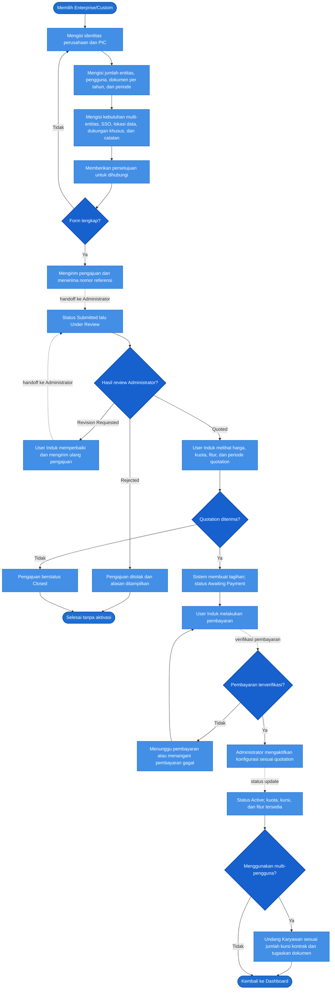
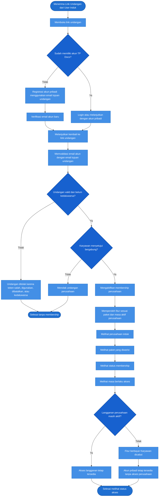
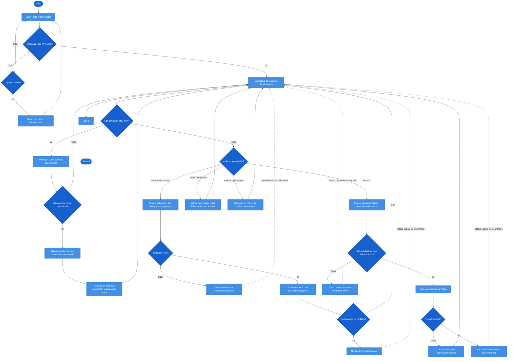
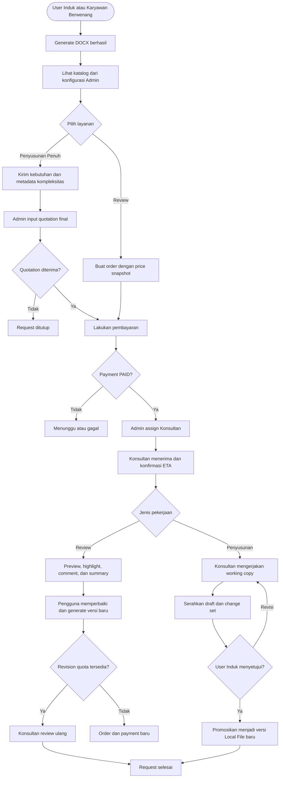

# Business Flow Overview — TP Docs (With Consultant)

## 1. Tujuan

Dokumen ini memberikan gambaran tingkat tinggi perjalanan tiga aktor TP Docs, yaitu **User Induk**, **Karyawan**, dan **Administrator**, sejak mengakses sistem sampai menyelesaikan aktivitas dan keluar dari sistem.

Overview hanya menampilkan proses utama, titik keputusan, hasil alternatif, dan perpindahan tanggung jawab antarpihak. Rincian validasi field, aturan status, proses background, serta exception teknis dijelaskan dalam dokumen business flow terpisah.

## 2. Legenda Diagram

| Bentuk / Relasi          | Makna                                      |
| ------------------------ | ------------------------------------------ |
| Stadium / ujung membulat | Awal atau akhir proses                     |
| Persegi panjang          | Aktivitas yang dilakukan aktor atau sistem |
| Belah ketupat            | Keputusan dengan cabang `Ya` atau `Tidak`  |
| Garis panah              | Urutan proses                              |
| Garis putus-putus        | Handoff atau pembaruan status lintas aktor |

## 3. Overview Business Flow — User Induk

### Cabang Harga Opsional

~~~mermaid
flowchart LR
 P[Pilih produk] --> E{Event aktif sesuai?}
 E -->|Tidak| N[Harga normal]
 E -->|Ya| D[Satu potongan terbesar]
 N --> S[Snapshot checkout atau quotation]
 D --> S
 S --> B[Pembayaran]
~~~

Berlaku pada paket, upgrade, perpanjangan, add-on, Enterprise/Custom, dan jasa Konsultan. Quotation membekukan promo saat diterbitkan.

Alur User Induk dibaca secara berurutan: **login dan penyusunan Local File**, dilanjutkan dengan **langganan dan multi-pengguna**, kemudian **Enterprise/Custom** apabila kebutuhan perusahaan tidak dapat dipenuhi paket reguler.

### 3.1 Login dan Penyusunan Local File

```mermaid
flowchart TD
    UI_START([Mulai]) --> UI_ACCOUNT{"Sudah memiliki akun?"}
    UI_ACCOUNT -- "Tidak" --> UI_REGISTER[Registrasi akun dan perusahaan]
    UI_REGISTER --> UI_VERIFY[Verifikasi email]
    UI_VERIFY --> UI_LOGIN[Login User Induk]
    UI_ACCOUNT -- "Ya" --> UI_LOGIN

    UI_LOGIN --> UI_AUTH{"Kredensial dan MFA valid?"}
    UI_AUTH -- "Tidak" --> UI_RECOVERY{"Lupa password?"}
    UI_RECOVERY -- "Ya" --> UI_RESET[Reset password melalui tautan aman]
    UI_RESET --> UI_LOGIN
    UI_RECOVERY -- "Tidak" --> UI_LOGIN
    UI_AUTH -- "Ya" --> UI_DASHBOARD[Dashboard User Induk]

    UI_DASHBOARD --> UI_DOCUMENT[Memilih Buat Dokumen Baru atau Buka Draft]
    UI_DOCUMENT --> UI_QUOTA{"Kuota dokumen tersedia?"}
    UI_QUOTA -- "Tidak" --> UI_TO_SUBSCRIPTION[Masuk ke proses langganan atau tambah kuota]
    UI_QUOTA -- "Ya" --> UI_IDENTITY[Menentukan entitas dan tahun pajak]

    UI_IDENTITY --> UI_PROFILE[1. Mengisi Profil Perusahaan]
    UI_PROFILE --> UI_PROFILE_DETAIL[Nama entitas, alias, bidang usaha, tanggal, alamat, karyawan, tahun pajak, dan jenis dokumen]
    UI_PROFILE_DETAIL --> UI_OWNERSHIP[2. Mengisi Kepemilikan dan Manajemen]
    UI_OWNERSHIP --> UI_OWNER_DETAIL[Pemegang saham, nilai nominal, persentase, komisaris, dan direksi]
    UI_OWNER_DETAIL --> UI_BUSINESS[3. Mengisi Bisnis, Produk, dan Strategi]
    UI_BUSINESS --> UI_AI_OPTION{"Gunakan visual Skema AI opsional?"}
    UI_AI_OPTION -- "Tidak" --> UI_FINANCE[4. Mengisi Ringkasan Laporan Keuangan]
    UI_AI_OPTION -- "Ya" --> UI_AI_INPUT[Narasi wajib dan langkah proses opsional]
    UI_AI_INPUT --> UI_AI[Generate fase dinamis berdasarkan input pengguna]
    UI_AI --> UI_AI_REVIEW[Terima hasil atau perbaiki input dan generate ulang]
    UI_AI_REVIEW --> UI_FINANCE
    UI_FINANCE --> UI_AFFILIATE[5. Mengisi Pihak Afiliasi dan Pesaing]
    UI_AFFILIATE --> UI_INDUSTRY[6. Mengisi Gambaran Industri]
    UI_INDUSTRY --> UI_INDUSTRY_MODE{"Sumber gambaran industri?"}
    UI_INDUSTRY_MODE -- "File" --> UI_INDUSTRY_FILE[Unggah Word atau PDF]
    UI_INDUSTRY_MODE -- "Teks" --> UI_INDUSTRY_TEXT[Isi ruang lingkup, impor, pasokan, prospek, dan pasar]
    UI_INDUSTRY_FILE --> UI_TRANSACTION
    UI_INDUSTRY_TEXT --> UI_TRANSACTION[7. Mengisi Transaksi Afiliasi]

    UI_TRANSACTION --> UI_TRANSACTION_MODE{"Metode input transaksi?"}
    UI_TRANSACTION_MODE -- "File" --> UI_UPLOAD[Download template, copy TSV, atau upload Excel]
    UI_TRANSACTION_MODE -- "Manual" --> UI_MANUAL[Isi transaksi afiliasi dan independen]
    UI_UPLOAD --> UI_SUMMARY[Summary transaksi TP dibuat otomatis]
    UI_MANUAL --> UI_SUMMARY
    UI_SUMMARY --> UI_FAR[8. Melakukan Analisis FAR]
    UI_FAR --> UI_FAR_DETAIL[Fungsi, aset, risiko, metode terpilih, pihak dianalisis, PLI, dan alasan]
    UI_FAR_DETAIL --> UI_METHOD[Evaluasi lima metode Transfer Pricing]
    UI_METHOD --> UI_BENCHMARK[9. Kelola Data Pembanding dan Seleksi]
    UI_BENCHMARK --> UI_BENCHMARK_SOURCE[Upload benchmarking atau susun strategi pencarian]
    UI_BENCHMARK_SOURCE --> UI_PLI{"Pilih satu PLI"}
    UI_PLI -- "CPM" --> UI_FINAL_COMPARABLE
    UI_PLI -- "OM" --> UI_FINAL_COMPARABLE
    UI_PLI -- "NCP" --> UI_FINAL_COMPARABLE[Pilih pembanding final dan hitung rentang interkuartil]

    UI_FINAL_COMPARABLE --> UI_REVIEW[10. Preview Ringkasan Local File]
    UI_REVIEW --> UI_COMPLETE{"Seluruh data wajib lengkap?"}
    UI_COMPLETE -- "Tidak" --> UI_DRAFT[Simpan draft dan kembali ke bagian yang belum lengkap]
    UI_DRAFT --> UI_DOCUMENT
    UI_COMPLETE -- "Ya" --> UI_RANGE{"Hasil berada dalam rentang wajar?"}
    UI_RANGE -- "Tidak" --> UI_WARNING[Tampilkan warning untuk ditinjau User Induk]
    UI_WARNING --> UI_DECISION{"Tetap generate setelah ditinjau?"}
    UI_DECISION -- "Tidak" --> UI_DOCUMENT
    UI_DECISION -- "Ya" --> UI_GENERATE
    UI_RANGE -- "Ya" --> UI_GENERATE[Generate draft Local File PDF atau Word]
    UI_GENERATE --> UI_HISTORY[Dokumen dan versi tersimpan pada history]
    UI_HISTORY --> UI_NEXT[Masuk ke pengelolaan langganan, anggota, atau logout]

    classDef terminal fill:#1f6fd1,color:#fff,stroke:#1556a8,stroke-width:2px;
    classDef process fill:#438fe6,color:#fff,stroke:#2875c7,stroke-width:1.5px;
    classDef decision fill:#1761cf,color:#fff,stroke:#104ba3,stroke-width:2px;
    class UI_START terminal;
    class UI_REGISTER,UI_VERIFY,UI_LOGIN,UI_RESET,UI_DASHBOARD,UI_DOCUMENT,UI_TO_SUBSCRIPTION,UI_IDENTITY,UI_PROFILE,UI_PROFILE_DETAIL,UI_OWNERSHIP,UI_OWNER_DETAIL,UI_BUSINESS,UI_AI,UI_FINANCE,UI_AFFILIATE,UI_INDUSTRY,UI_INDUSTRY_FILE,UI_INDUSTRY_TEXT,UI_TRANSACTION,UI_UPLOAD,UI_MANUAL,UI_SUMMARY,UI_FAR,UI_FAR_DETAIL,UI_METHOD,UI_BENCHMARK,UI_BENCHMARK_SOURCE,UI_FINAL_COMPARABLE,UI_REVIEW,UI_DRAFT,UI_WARNING,UI_GENERATE,UI_HISTORY,UI_NEXT process;
    class UI_ACCOUNT,UI_AUTH,UI_RECOVERY,UI_QUOTA,UI_INDUSTRY_MODE,UI_TRANSACTION_MODE,UI_PLI,UI_COMPLETE,UI_RANGE,UI_DECISION decision;
```

### 3.2 Langganan Reguler, Kuota, dan Multi-Pengguna

```mermaid
flowchart TD
    SUB_START([Dari Dashboard atau Kuota Tidak Tersedia]) --> SUB_VIEW[Melihat paket dan hak penggunaan]
    SUB_VIEW --> SUB_PLAN{"Paket yang dipilih?"}

    SUB_PLAN -- "Free / Trial" --> SUB_FREE[Aktifkan Free: 1 User Induk dan 1 dokumen selama masa akun]
    SUB_FREE --> SUB_FREE_RULE[Tidak tersedia multi-pengguna, add-on dokumen, atau add-on kursi]
    SUB_FREE_RULE --> SUB_FREE_END([Gunakan kuota Free atau upgrade paket])

    SUB_PLAN -- "Basic" --> SUB_BASIC_PAY[Melakukan pembayaran Basic]
    SUB_BASIC_PAY --> SUB_BASIC_VERIFIED{"Pembayaran terverifikasi?"}
    SUB_BASIC_VERIFIED -- "Tidak" --> SUB_BASIC_PENDING[Basic belum aktif; tampilkan status pending atau gagal]
    SUB_BASIC_PENDING --> SUB_BASIC_PAY
    SUB_BASIC_VERIFIED -- "Ya" --> SUB_BASIC_ACTIVE[Aktifkan Basic untuk 12 bulan sejak tanggal aktivasi]
    SUB_BASIC_ACTIVE --> SUB_BASIC_RIGHT[Alokasikan 5 dokumen dan 1 User Induk untuk periode aktif]
    SUB_BASIC_RIGHT --> SUB_BASIC_RULE[Tidak tersedia multi-pengguna atau add-on dokumen]
    SUB_BASIC_RULE --> SUB_BASIC_END([Gunakan Basic atau upgrade ke Professional])

    SUB_PLAN -- "Professional" --> SUB_PRO_PAY[Melakukan pembayaran Professional]
    SUB_PRO_PAY --> SUB_PRO_VERIFIED{"Pembayaran terverifikasi?"}
    SUB_PRO_VERIFIED -- "Tidak" --> SUB_PRO_PENDING[Professional belum aktif; tampilkan status pending atau gagal]
    SUB_PRO_PENDING --> SUB_PRO_PAY
    SUB_PRO_VERIFIED -- "Ya" --> SUB_PRO_ACTIVE[Aktifkan Professional untuk 12 bulan sejak tanggal aktivasi]
    SUB_PRO_ACTIVE --> SUB_PRO_RIGHT[Alokasikan 10 dokumen dan 3 pengguna total: 1 User Induk serta maksimal 2 Karyawan]
    SUB_PRO_RIGHT --> SUB_MANAGE{"Tambah Karyawan sekarang?"}

    SUB_MANAGE -- "Tidak" --> SUB_PRO_USE[Gunakan paket dan pantau kuota dokumen serta kursi]
    SUB_MANAGE -- "Ya" --> SUB_SEAT{"Kursi Karyawan tersedia?"}
    SUB_SEAT -- "Tidak" --> SUB_BUY_SEAT[Membeli add-on kursi yang berlaku sampai akhir periode Professional]
    SUB_BUY_SEAT --> SUB_EMAIL
    SUB_SEAT -- "Ya" --> SUB_EMAIL[Input email calon Karyawan]
    SUB_EMAIL --> SUB_LINK[Sistem membuat token dan link undangan khusus email tujuan]
    SUB_LINK --> SUB_SEND[Sistem mengirim link undangan]
    SUB_SEND -. "handoff ke Karyawan" .-> SUB_OPEN[Karyawan membuka link undangan]
    SUB_OPEN --> SUB_HAS_ACCOUNT{"Karyawan sudah memiliki akun?"}
    SUB_HAS_ACCOUNT -- "Tidak" --> SUB_REGISTER[Karyawan registrasi dan verifikasi email]
    SUB_REGISTER --> SUB_AUTH
    SUB_HAS_ACCOUNT -- "Ya" --> SUB_AUTH[Karyawan login atau melanjutkan dengan akun]
    SUB_AUTH --> SUB_MATCH{"Email akun sama dengan email undangan?"}
    SUB_MATCH -- "Tidak" --> SUB_INVALID[Undangan tidak dapat diterima oleh akun lain]
    SUB_INVALID --> SUB_EMAIL
    SUB_MATCH -- "Ya" --> SUB_ACCEPT{"Karyawan menerima undangan?"}
    SUB_ACCEPT -- "Tidak" --> SUB_INVITE_STATUS[Status ditolak, tertunda, atau kedaluwarsa]
    SUB_INVITE_STATUS --> SUB_EMAIL
    SUB_ACCEPT -- "Ya" --> SUB_MEMBER[Membership aktif mengikuti sisa masa Professional]
    SUB_MEMBER --> SUB_ASSIGN[User Induk dapat menugaskan dokumen sesuai kewenangan]
    SUB_ASSIGN --> SUB_PRO_USE

    SUB_PRO_USE --> SUB_DOC_QUOTA{"Kuota dokumen habis?"}
    SUB_DOC_QUOTA -- "Ya" --> SUB_BUY_DOC[Membeli add-on dokumen Professional]
    SUB_BUY_DOC --> SUB_PRO_USE
    SUB_DOC_QUOTA -- "Tidak" --> SUB_REFUND{"Mengajukan refund transaksi berbayar?"}
    SUB_REFUND -- "Ya" --> SUB_REFUND_FORM[Pilih transaksi, baca ketentuan, isi alasan, dan bukti bila perlu]
    SUB_REFUND_FORM --> SUB_REFUND_SEND[Kirim pengajuan refund]
    SUB_REFUND_SEND -. "handoff ke Administrator" .-> SUB_REFUND_STATUS[Memantau status hingga Rejected, Refunded, atau Failed]
    SUB_REFUND_STATUS --> SUB_PRO_END
    SUB_REFUND -- "Tidak" --> SUB_PRO_END([Kembali ke Dashboard atau Logout])

    SUB_PLAN -- "Enterprise / Custom" --> SUB_CUSTOM_LINK[Masuk ke flow Enterprise/Custom]

    classDef terminal fill:#1f6fd1,color:#fff,stroke:#1556a8,stroke-width:2px;
    classDef process fill:#438fe6,color:#fff,stroke:#2875c7,stroke-width:1.5px;
    classDef decision fill:#1761cf,color:#fff,stroke:#104ba3,stroke-width:2px;
    class SUB_START,SUB_FREE_END,SUB_BASIC_END,SUB_PRO_END terminal;
    class SUB_VIEW,SUB_FREE,SUB_FREE_RULE,SUB_BASIC_PAY,SUB_BASIC_PENDING,SUB_BASIC_ACTIVE,SUB_BASIC_RIGHT,SUB_BASIC_RULE,SUB_PRO_PAY,SUB_PRO_PENDING,SUB_PRO_ACTIVE,SUB_PRO_RIGHT,SUB_PRO_USE,SUB_BUY_SEAT,SUB_EMAIL,SUB_LINK,SUB_SEND,SUB_OPEN,SUB_REGISTER,SUB_AUTH,SUB_INVALID,SUB_INVITE_STATUS,SUB_MEMBER,SUB_ASSIGN,SUB_BUY_DOC,SUB_REFUND_FORM,SUB_REFUND_SEND,SUB_REFUND_STATUS,SUB_CUSTOM_LINK process;
    class SUB_PLAN,SUB_BASIC_VERIFIED,SUB_PRO_VERIFIED,SUB_MANAGE,SUB_SEAT,SUB_HAS_ACCOUNT,SUB_MATCH,SUB_ACCEPT,SUB_DOC_QUOTA,SUB_REFUND decision;
```

### 3.3 Enterprise/Custom

## 4. Overview Business Flow — Karyawan

## 5. Overview Business Flow — Administrator

## 6. Handoff Utama Antaraktor

| Pemicu                           | Pengirim      | Penerima      | Hasil                                                                    |
| -------------------------------- | ------------- | ------------- | ------------------------------------------------------------------------ |
| Pengajuan Enterprise/Custom      | User Induk    | Administrator | Review, quotation, pembayaran, dan aktivasi paket                        |
| Permintaan revisi atau quotation | Administrator | User Induk    | User Induk memperbaiki pengajuan atau mengambil keputusan atas quotation |
| Pengajuan refund                 | User Induk    | Administrator | Validasi, dual approval, pengembalian dana, dan penyesuaian akses        |
| Status refund                    | Administrator | User Induk    | User Induk melihat status dan hasil refund                               |
| Undangan perusahaan              | User Induk    | Karyawan      | Membership perusahaan aktif setelah undangan diterima                    |
| Suspend atau reaktivasi          | Administrator | User Induk    | User Induk menerima pemberitahuan perubahan status akun                  |

## 7. Dokumen Business Flow Detail

Gunakan dokumen berikut untuk melihat langkah, keputusan, alternative flow, exception flow, dan status secara lebih rinci:

| Area Detail                                             | Dokumen                                                          |
| ------------------------------------------------------- | ---------------------------------------------------------------- |
| Registrasi, login, MFA, lupa password, dan logout       | [01-Authentication.md](./01-Authentication.md)                   |
| Preview dan generate dokumen                            | [02-Document-Generation.md](./02-Document-Generation.md)         |
| Pengisian serta pengelolaan Local File                  | [03-Local-File-Management.md](./03-Local-File-Management.md)     |
| Pembuatan konten atau skema menggunakan AI              | [04-AI-Content-Generation.md](./04-AI-Content-Generation.md)     |
| Undangan, membership, kursi, dan penugasan              | [05-Membership-Organization.md](./05-Membership-Organization.md) |
| Paket, pembayaran, Enterprise/Custom, kuota, dan refund | [06-Subscription-Billing.md](./06-Subscription-Billing.md)       |
| Operasional Administrator dan pengelolaan platform      | [07-Administrator-Flow.md](./07-Administrator-Flow.md)           |
| Pemesanan, payment, review, revisi, dan working copy     | [08-Consultation-Service.md](./08-Consultation-Service.md)       |
| Assignment, ETA, komentar, delivery, dan profil Konsultan | [09-Consultant-Workflow.md](./09-Consultant-Workflow.md)        |

Dokumen overview ini tidak menggantikan use case. Sumber aktivitas dan kewenangan aktor tetap mengacu pada [Organization-Owner.md](../02-Use-Case/Organization-Owner.md), [Employee.md](../02-Use-Case/Employee.md), [Consultant.md](../02-Use-Case/Consultant.md), dan [Admin.md](../02-Use-Case/Admin.md).

---

## 8. Overview Business Flow — Konsultan dan Layanan Konsultasi

### 8.1 Handoff Layanan Konsultasi Antaraktor

| Proses | Dari | Kepada |
| --- | --- | --- |
| Request berbayar | User | Administrator |
| Assignment | Administrator | Konsultan |
| Review delivery | Konsultan | User |
| Resubmission | User | Konsultan |
| Working-copy approval | Konsultan | User Induk |
| Quotation | Administrator | User |
