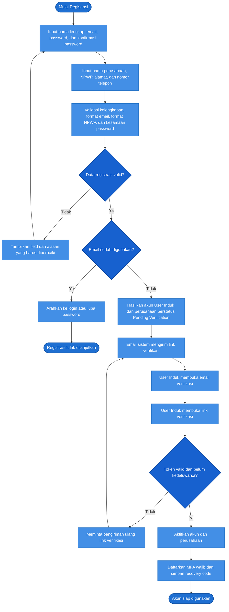
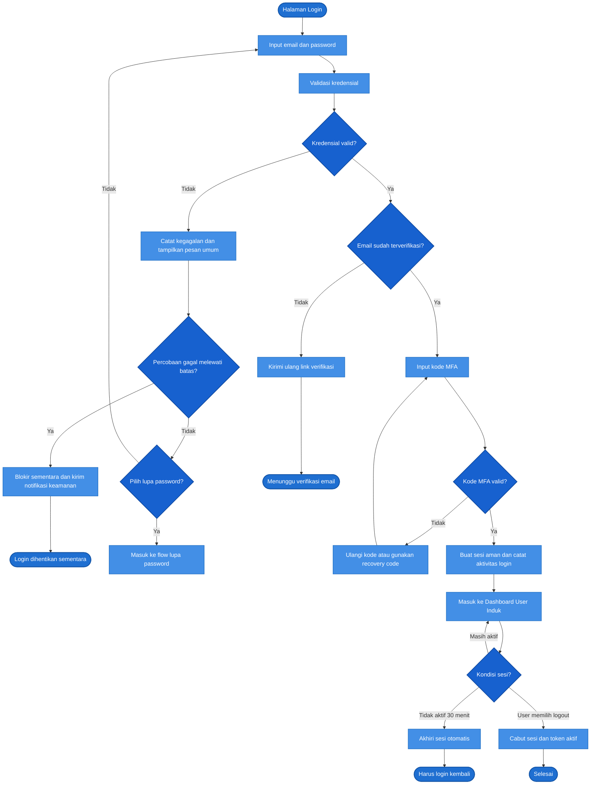
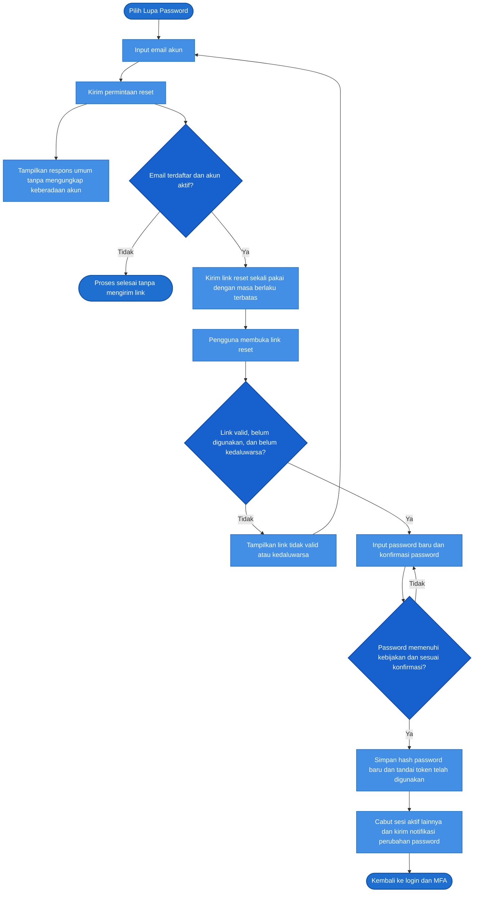
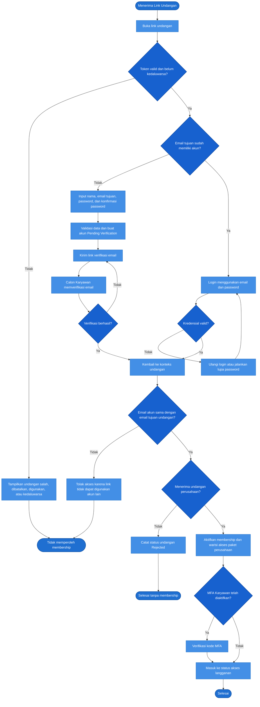
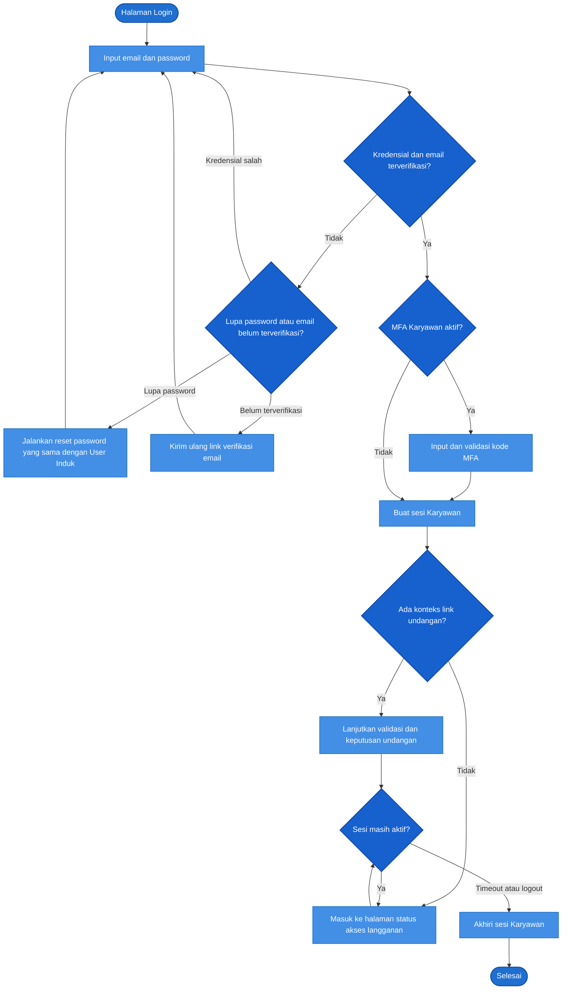
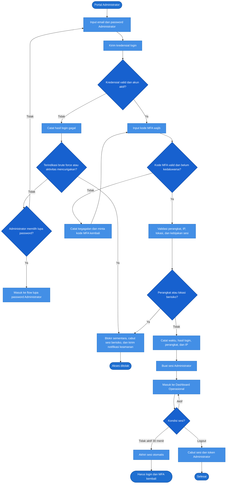
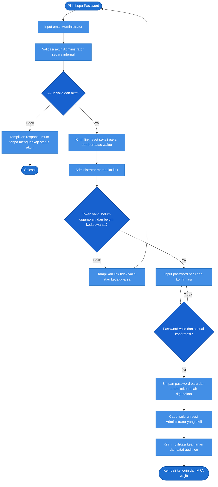
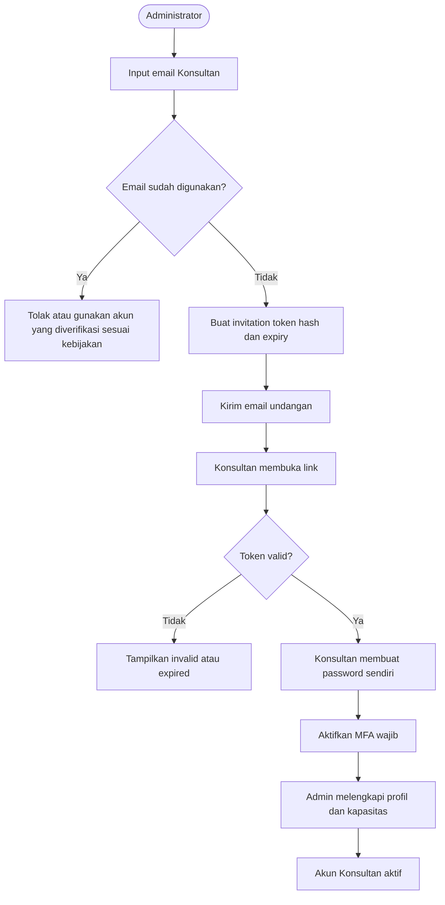

# Authentication Business Flow — TP Docs (With Consultant)

## 1. Tujuan dan Cakupan

Dokumen ini menjelaskan flow autentikasi lengkap untuk **User Induk**, **Karyawan**, dan **Administrator**, meliputi registrasi, verifikasi email, login, MFA, lupa password, pengelolaan sesi, serta logout.

User Induk dan Karyawan menggunakan mekanisme autentikasi akun yang sama. Perbedaannya:

| Aspek                           | User Induk                                     | Karyawan                                               | Administrator                           |
| ------------------------------- | ---------------------------------------------- | ------------------------------------------------------ | --------------------------------------- |
| Sumber akun                     | Registrasi publik sekaligus membuat perusahaan | Registrasi biasa atau registrasi melalui link undangan | Dibuat melalui proses internal platform |
| Data organisasi saat registrasi | Wajib                                          | Tidak membuat organisasi                               | Tidak berlaku                           |
| Verifikasi email                | Wajib                                          | Wajib                                                  | Wajib sebelum akun digunakan            |
| MFA                             | Wajib                                          | Opsional pada versi awal                               | Wajib                                   |
| Tujuan setelah login            | Dashboard User Induk                           | Status akses atau konteks link undangan                | Dashboard operasional Administrator     |
| Lupa password mandiri           | Ya                                             | Ya                                                     | Ya                                      |

## 2. Flow Autentikasi User Induk

### 2.1 Registrasi Perusahaan dan Aktivasi Akun

### 2.2 Login, MFA, Sesi, dan Logout User Induk

### 2.3 Lupa Password User Induk

## 3. Flow Autentikasi Karyawan

### 3.1 Registrasi atau Login melalui Link Undangan

### 3.2 Login, Lupa Password, Sesi, dan Logout Karyawan

Flow login dan lupa password Karyawan mengikuti mekanisme User Induk pada bagian 2.2 dan 2.3 dengan perbedaan berikut:

## 4. Flow Autentikasi Administrator

### 4.1 Login Administrator, MFA, dan Pemeriksaan Keamanan

### 4.2 Lupa Password Administrator

## 5. Aturan Autentikasi Bersama

1. Password tidak pernah disimpan dalam bentuk asli.
2. Respons lupa password tidak boleh mengungkap apakah suatu email terdaftar.
3. Link verifikasi dan reset password hanya dapat digunakan oleh penerima, memiliki masa berlaku terbatas, dan tidak dapat digunakan ulang.
4. Perubahan password mencabut sesi lain yang masih aktif.
5. MFA wajib untuk User Induk dan Administrator; MFA Karyawan opsional pada versi awal.
6. Sesi yang tidak aktif selama 30 menit berakhir otomatis.
7. Percobaan login gagal berulang dikenai rate limiting dan penguncian sementara.
8. Login, logout, reset password, perubahan MFA, kegagalan autentikasi, dan pemblokiran dicatat pada audit log tanpa menyimpan password atau token asli.
9. Link undangan Karyawan tetap terikat pada email tujuan ketika penerima harus melakukan registrasi atau login.
10. Administrator tidak dapat melihat atau menetapkan password User Induk maupun Karyawan.

## 6. Status dan Hasil Akhir

| Proses                               | Status / Hasil                                                                   |
| ------------------------------------ | -------------------------------------------------------------------------------- |
| Registrasi User Induk                | `Pending Verification` → `Active`                                                |
| Registrasi Karyawan melalui undangan | `Pending Verification` → akun aktif → membership aktif setelah undangan diterima |
| Undangan Karyawan                    | `Pending`, `Accepted`, `Rejected`, `Expired`, atau `Cancelled`                   |
| Login berhasil                       | Sesi aktif sesuai aktor dan hak akses                                            |
| Login mencurigakan                   | Percobaan diblokir dan dicatat                                                   |
| Reset password                       | Token digunakan satu kali, password diperbarui, sesi lama dicabut                |
| Session timeout                      | Sesi berakhir dan pengguna harus login kembali                                   |

## 7. Referensi

- [Use Case User Induk](../02-Use-Case/Organization-Owner.md): `UI-01`, `UI-02`, dan `UI-03`.
- [Use Case Karyawan](../02-Use-Case/Employee.md): `UK-01` dan `UK-02`.
- [Use Case Administrator](../02-Use-Case/Admin.md): `UA-01`.
- [Non-Functional Requirements](../01-Requirements/Non-Functional-Requirements.md): keamanan akun, MFA, sesi, rate limiting, password, dan audit log.

---

## Ekstensi Business Flow Layanan Konsultan

Autentikasi User Induk, Karyawan, dan Administrator telah dijelaskan lengkap pada bagian sebelumnya. Ekstensi berikut menambahkan autentikasi Konsultan.

### Onboarding Konsultan

Admin tidak menetapkan password. Reset password dilakukan pemilik akun melalui tautan aman. Suspend Konsultan mencabut seluruh session dan scoped assignment access.
