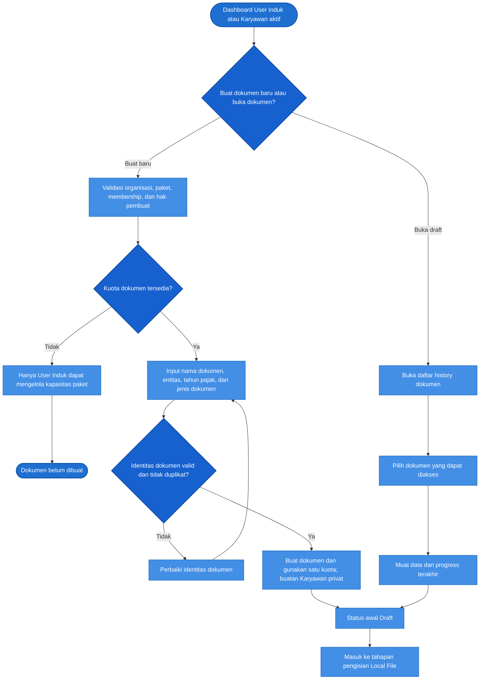
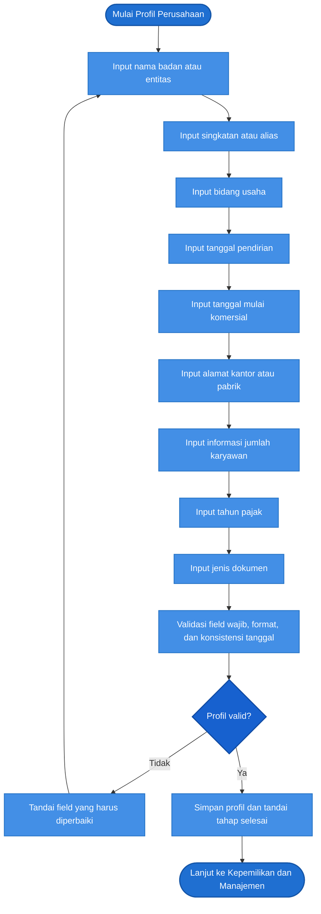
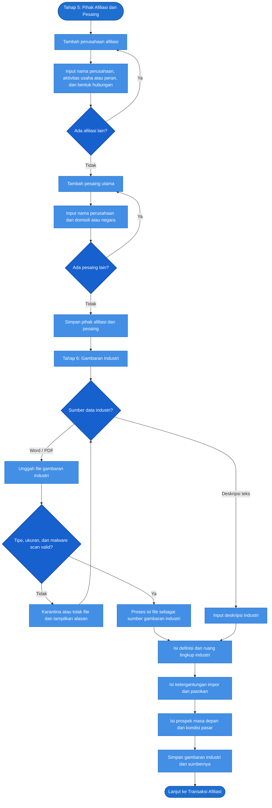
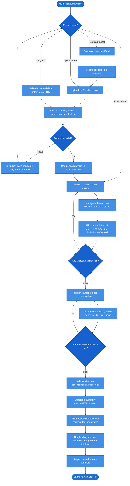
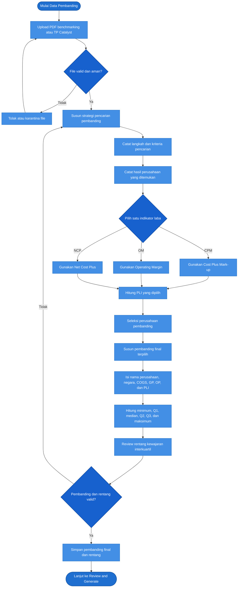
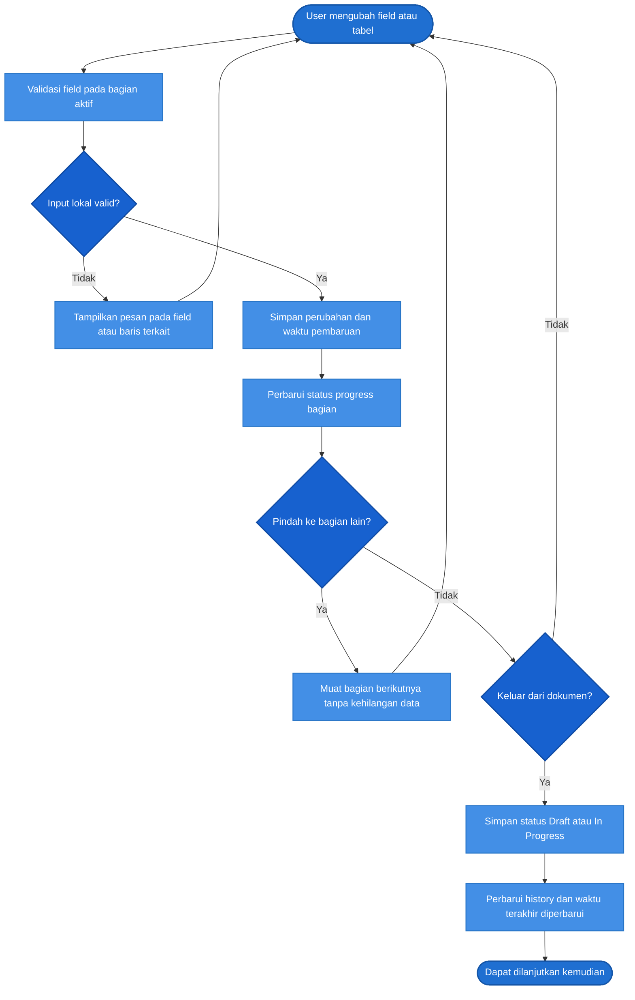

# Local File Management Business Flow — TP Docs (With Consultant)

> Seluruh upload Local File melewati NestJS sebagai `multipart/form-data` dengan batas 50 MB. Sistem menyimpan metadata dan chunk biner di PostgreSQL, lalu hanya mengizinkan pemrosesan setelah checksum lengkap dan hasil malware scan berstatus `CLEAN`.

## 1. Tujuan dan Cakupan

Dokumen ini menjelaskan pengelolaan Local File oleh User Induk, Karyawan pembuat, dan Karyawan yang ditugaskan, mulai dari membuat atau membuka dokumen, mengisi data, menyimpan draft, sampai review dan generate.

Urutan flow mengikuti `UI-04 — Mengisi Data Dokumen`, `UI-05 — Kelola Data Pembanding dan Seleksi`, serta overview pada [00-Business-Flow-Overview.md](./00-Business-Flow-Overview.md).

### 1.1 Posisi Skema AI dalam Local File

Local File mencakup identitas dan kegiatan usaha, transaksi afiliasi dan independen, penerapan prinsip kewajaran termasuk FAR dan metode TP, informasi keuangan, serta kejadian nonkeuangan yang relevan. Uraian proses bisnis merupakan bagian wajib dari penjelasan kegiatan operasional. Skema AI hanya merupakan visual pendukung opsional untuk uraian tersebut dan bukan pengganti analisis transaksi, FAR, metode TP, atau pembanding.

Jika Skema AI tidak digunakan atau layanan AI gagal, pengguna yang berhak tetap dapat menyimpan uraian bisnis dan melanjutkan penyusunan Local File.

Dokumen buatan User Induk dapat ditugaskan kepada Karyawan. Dokumen buatan Karyawan memakai kuota organisasi dan dimulai privat; hanya pembuat aktif yang dapat memberi atau mencabut akses lihat/ubah User Induk. User Induk tidak dapat menugaskan dokumen tersebut kepada Karyawan lain. Dokumen privat hanya dihitung pada kuota agregat User Induk tanpa metadata, isi, versi, atau hasil. Jika membership pembuat dicabut, akses diambil alih User Induk dengan audit.

## 2. Siklus Awal Dokumen Local File

Kuota berkurang hanya setelah dokumen baru berhasil dibuat. Membuka draft, mengubah data, menyimpan, atau melakukan generate ulang tidak menggunakan kuota dokumen baru.

## 3. Tahap 1 — Profil Perusahaan (`UI-04.01`)

## 4. Tahap 2–4 — Kepemilikan, Bisnis, AI, dan Keuangan

```mermaid
flowchart TD
    K_START([Tahap 2: Kepemilikan dan Manajemen]) --> K_SHAREHOLDER[Tambah baris pemegang saham]
    K_SHAREHOLDER --> K_SHARE_DATA[Input nama, nilai nominal, dan persentase kepemilikan]
    K_SHARE_DATA --> K_SHARE_MORE{"Ada pemegang saham lain?"}
    K_SHARE_MORE -- "Ya" --> K_SHAREHOLDER
    K_SHARE_MORE -- "Tidak" --> K_TOTAL[Validasi total persentase kepemilikan]
    K_TOTAL --> K_TOTAL_OK{"Total dan nilai valid?"}
    K_TOTAL_OK -- "Tidak" --> K_SHARE_DATA
    K_TOTAL_OK -- "Ya" --> K_MANAGEMENT[Tambah data komisaris atau direksi]
    K_MANAGEMENT --> K_MANAGER_DATA[Input jabatan dan nama pengurus atau direksi]
    K_MANAGER_DATA --> K_MANAGER_MORE{"Ada pengurus lain?"}
    K_MANAGER_MORE -- "Ya" --> K_MANAGEMENT
    K_MANAGER_MORE -- "Tidak" --> K_SAVE[Simpan Kepemilikan dan Manajemen]

    K_SAVE --> B_START[Tahap 3: Isi Bisnis, Produk, dan Strategi]
    B_START --> B_DESCRIPTION[Isi uraian aktivitas, produk atau jasa, rantai nilai, dan strategi]
    B_DESCRIPTION --> B_STEPS_OPTION{"Tambahkan daftar langkah proses?"}
    B_STEPS_OPTION -- "Ya" --> B_STEPS[Input dan urutkan aktivitas serta aktor/departemen opsional]
    B_STEPS_OPTION -- "Tidak" --> B_AI_OPTION{"Gunakan Skema AI?"}
    B_STEPS --> B_AI_OPTION

    B_AI_OPTION -- "Tidak" --> B_SAVE_TEXT[Simpan uraian tanpa skema AI]
    B_AI_OPTION -- "Ya" --> B_AI[Generate fase dinamis dari input pengguna]
    B_AI --> B_AI_SUCCESS{"Generation berhasil dan valid?"}
    B_AI_SUCCESS -- "Tidak" --> B_AI_FAILURE[Tampilkan kegagalan tanpa menghapus input]
    B_AI_FAILURE --> B_RETRY{"Generate ulang?"}
    B_RETRY -- "Tidak" --> B_SAVE_TEXT
    B_RETRY -- "Ya" --> B_REVISION[Perbaiki uraian atau daftar langkah]
    B_REVISION --> B_AI
    B_AI_SUCCESS -- "Ya" --> B_AI_RESULT[Tampilkan draft fase proses bisnis]
    B_AI_RESULT --> B_AI_VALID{"Skema sesuai input?"}
    B_AI_VALID -- "Tidak" --> B_REVISION
    B_AI_VALID -- "Ya" --> B_ACCEPT[Terima skema AI]
    B_ACCEPT --> B_SAVE_AI[Simpan uraian dan skema yang diterima]

    B_SAVE_TEXT --> F_START[Tahap 4: Isi Ringkasan Laporan Keuangan]
    B_SAVE_AI --> F_START
    F_START --> F_INPUT[Input data keuangan yang diwajibkan untuk analisis]
    F_INPUT --> F_VALIDATE[Validasi periode, format angka, dan konsistensi nilai]
    F_VALIDATE --> F_VALID{"Ringkasan keuangan valid?"}
    F_VALID -- "Tidak" --> F_INPUT
    F_VALID -- "Ya" --> F_SAVE[Simpan ringkasan keuangan]
    F_SAVE --> F_NEXT([Lanjut ke Afiliasi dan Pesaing])

    classDef terminal fill:#1f6fd1,color:#fff,stroke:#1556a8,stroke-width:2px;
    classDef process fill:#438fe6,color:#fff,stroke:#2875c7,stroke-width:1.5px;
    classDef decision fill:#1761cf,color:#fff,stroke:#104ba3,stroke-width:2px;
    class K_START,F_NEXT terminal;
    class K_SHAREHOLDER,K_SHARE_DATA,K_TOTAL,K_MANAGEMENT,K_MANAGER_DATA,K_SAVE,B_START,B_DESCRIPTION,B_STEPS,B_AI,B_AI_FAILURE,B_REVISION,B_AI_RESULT,B_ACCEPT,B_SAVE_TEXT,B_SAVE_AI,F_START,F_INPUT,F_VALIDATE,F_SAVE process;
    class K_SHARE_MORE,K_TOTAL_OK,K_MANAGER_MORE,B_STEPS_OPTION,B_AI_OPTION,B_AI_SUCCESS,B_RETRY,B_AI_VALID,F_VALID decision;
```

Uraian proses bisnis merupakan langkah wajib. Daftar langkah proses dan Skema AI bersifat opsional. Jika daftar langkah diberikan, setiap langkah harus terwakili tepat satu kali dalam fase AI dan urutannya harus dipertahankan. Pengguna yang berhak tidak mengedit kartu fase secara langsung; koreksi dilakukan dengan memperbaiki input lalu memilih generate ulang.

## 5. Tahap 5–6 — Pihak Afiliasi, Pesaing, dan Gambaran Industri

## 6. Tahap 7 — Transaksi Afiliasi (`UI-04.08`)

## 7. Tahap 8 — Analisis FAR (`UI-04.09`)

```mermaid
flowchart TD
    FAR_START([Mulai Analisis FAR]) --> FAR_FUNCTION[Tambah fungsi yang dilakukan]
    FAR_FUNCTION --> FAR_FUNCTION_DATA[Input fungsi dan deskripsi pelaksanaan]
    FAR_FUNCTION_DATA --> FAR_FUNCTION_MORE{"Ada fungsi lain?"}
    FAR_FUNCTION_MORE -- "Ya" --> FAR_FUNCTION
    FAR_FUNCTION_MORE -- "Tidak" --> FAR_ASSET[Tambah struktur dan nilai aset]

    FAR_ASSET --> FAR_ASSET_DATA[Input kategori aset, nilai buku bersih, dan keterangan]
    FAR_ASSET_DATA --> FAR_ASSET_MORE{"Ada kategori aset lain?"}
    FAR_ASSET_MORE -- "Ya" --> FAR_ASSET
    FAR_ASSET_MORE -- "Tidak" --> FAR_RISK[Tambah risiko yang ditanggung]

    FAR_RISK --> FAR_RISK_DATA[Input risiko dan deskripsi penanganan]
    FAR_RISK_DATA --> FAR_RISK_MORE{"Ada risiko lain?"}
    FAR_RISK_MORE -- "Ya" --> FAR_RISK
    FAR_RISK_MORE -- "Tidak" --> FAR_SELECTION[Input metode terpilih, pihak dianalisis, indikator laba, dan alasan]
    FAR_SELECTION --> FAR_EVALUATION[Evaluasi lima metode TP]
    FAR_EVALUATION --> FAR_EVAL_DATA[Untuk setiap metode: input metode, status, dan keterangan atau alasan]
    FAR_EVAL_DATA --> FAR_CONSISTENCY[Periksa konsistensi metode dengan transaksi, fungsi, aset, dan risiko]
    FAR_CONSISTENCY --> FAR_VALID{"Analisis FAR konsisten?"}
    FAR_VALID -- "Tidak" --> FAR_SELECTION
    FAR_VALID -- "Ya" --> FAR_SAVE[Simpan Analisis FAR]
    FAR_SAVE --> FAR_NEXT([Lanjut ke Data Pembanding])

    classDef terminal fill:#1f6fd1,color:#fff,stroke:#1556a8,stroke-width:2px;
    classDef process fill:#438fe6,color:#fff,stroke:#2875c7,stroke-width:1.5px;
    classDef decision fill:#1761cf,color:#fff,stroke:#104ba3,stroke-width:2px;
    class FAR_START,FAR_NEXT terminal;
    class FAR_FUNCTION,FAR_FUNCTION_DATA,FAR_ASSET,FAR_ASSET_DATA,FAR_RISK,FAR_RISK_DATA,FAR_SELECTION,FAR_EVALUATION,FAR_EVAL_DATA,FAR_CONSISTENCY,FAR_SAVE process;
    class FAR_FUNCTION_MORE,FAR_ASSET_MORE,FAR_RISK_MORE,FAR_VALID decision;
```

## 8. Tahap 9 — Data Pembanding dan Seleksi (`UI-05`)

User Induk hanya dapat memilih satu PLI—CPM, OM, atau NCP—untuk satu proses analisis pembanding.

## 9. Penyimpanan Draft, Progress, dan Validasi Antarbagian

## 10. Kriteria Siap ke Document Generation

Dokumen dapat diteruskan ke [02-Document-Generation.md](./02-Document-Generation.md) setelah:

1. Identitas entitas dan tahun pajak valid.
2. Profil perusahaan lengkap.
3. Struktur kepemilikan dan manajemen valid.
4. Uraian bisnis tersedia; jika Skema AI digunakan, hanya hasil yang telah diterima yang dimasukkan ke draft Local File.
5. Ringkasan laporan keuangan tersedia.
6. Pihak afiliasi, pesaing, dan gambaran industri telah disimpan.
7. Transaksi afiliasi dan independen valid serta summary terbentuk.
8. Analisis FAR dan evaluasi metode TP selesai.
9. Satu PLI telah dipilih.
10. Pembanding final dan rentang interkuartil tersedia.

Jika salah satu syarat belum terpenuhi, sistem menampilkan bagian yang belum lengkap dan mempertahankan dokumen sebagai `Draft` atau `In Progress`.

## 11. Status Dokumen

| Status | Pemicu | Hak User Induk |
| --- | --- | --- |
| `Draft` | Dokumen baru berhasil dibuat | Mengisi seluruh bagian |
| `In Progress` | Minimal satu bagian telah disimpan | Melanjutkan, memperbaiki, atau kembali ke bagian sebelumnya |
| `Ready to Generate` | Seluruh validasi minimum berhasil | Membuka preview dan proses generate |
| `Generated` | File draft Local File berhasil dibuat | Membuka, mengunduh, atau membuat versi berikutnya |

## 12. Aturan Penting

1. Dokumen dan seluruh perubahan merupakan milik organisasi.
2. User Induk dapat melihat dan mengubah dokumen buatannya, dokumen Karyawan yang dibagikan kepadanya, atau dokumen yang diambil alih setelah membership pembuat dicabut. Karyawan dapat mengakses dokumen buatannya atau dokumen dengan penugasan aktif.
3. Sistem tidak memverifikasi kebenaran substantif seluruh data; pembuat dan penyunting bertanggung jawab atas isi serta hak penggunaan file.
4. File upload harus melewati validasi tipe, ukuran, ekstensi, dan malware scanning.
5. Data dari file tidak boleh menggantikan data tersimpan sebelum validasi berhasil.
6. Perubahan pada transaksi, metode, PLI, atau pembanding dapat membuat hasil analisis sebelumnya perlu dihitung atau ditinjau ulang.
7. AI hanya membantu membuat skema berdasarkan uraian pengguna dan tidak memberikan opini pajak.
8. Sistem menyimpan audit aktivitas penting tanpa memasukkan isi lengkap dokumen atau data finansial mentah ke log.

## 13. Referensi

- [Business Flow Overview](./00-Business-Flow-Overview.md).
- [Document Generation](./02-Document-Generation.md).
- [Use Case User Induk](../02-Use-Case/Organization-Owner.md): `UI-04`, `UI-05`, dan `UI-06`.
- [Functional Requirements](../01-Requirements/Functional-Requirements.md).
- [Non-Functional Requirements](../01-Requirements/Non-Functional-Requirements.md).

---

## Ekstensi Business Flow Layanan Konsultan

Pengelolaan Local File inti telah dijelaskan lengkap pada bagian sebelumnya. Ekstensi berikut menjelaskan akses Konsultan melalui working copy.

### Perbaikan Setelah Review

1. Pengguna membuka summary komentar per bab.
2. Pengguna membuka Local File asli dan melakukan perbaikan.
3. Pengguna menandai komentar `ADDRESSED_BY_CLIENT` bila sudah ditindaklanjuti.
4. Pengguna menjalankan validasi dan generate document version baru.
5. Version baru dikirim sebagai `consultation_round` berikutnya.

### Working Copy Penyusunan Penuh

- Working copy dibuat dari snapshot Local File dan tidak menggantikan data asli.
- Konsultan hanya mengubah bagian yang termasuk scope layanan.
- Setiap perubahan menghasilkan change set, actor, waktu, before hash, dan after hash.
- User Induk dapat menerima, meminta revisi, atau menolak delivery.
- Promotion dilakukan transactionally dan menghasilkan Local File/document version baru.
- Karyawan yang mengajukan Penyusunan Penuh dan masih ditugaskan dengan hak ubah dapat meninjau delivery serta menyetujui hasil. Jika haknya dicabut, User Induk dapat mengambil alih keputusan dengan audit; Konsultan tidak mengubah Local File utama secara langsung.
