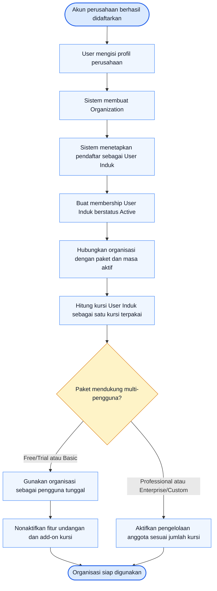
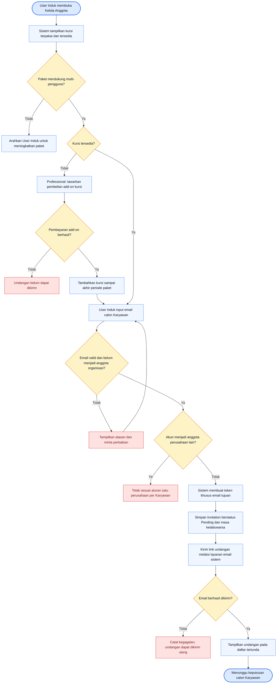
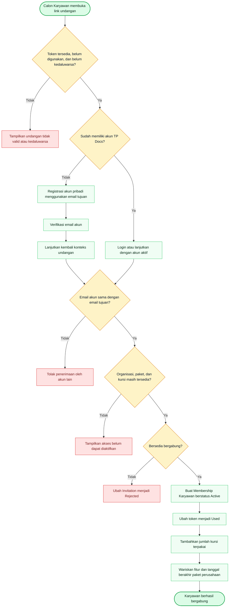
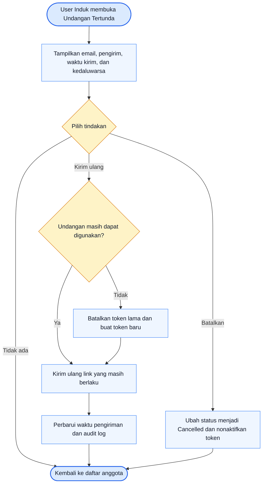
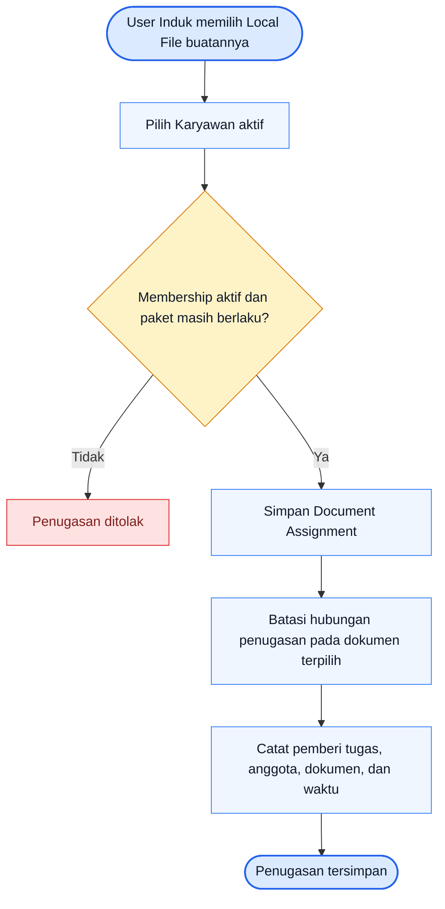
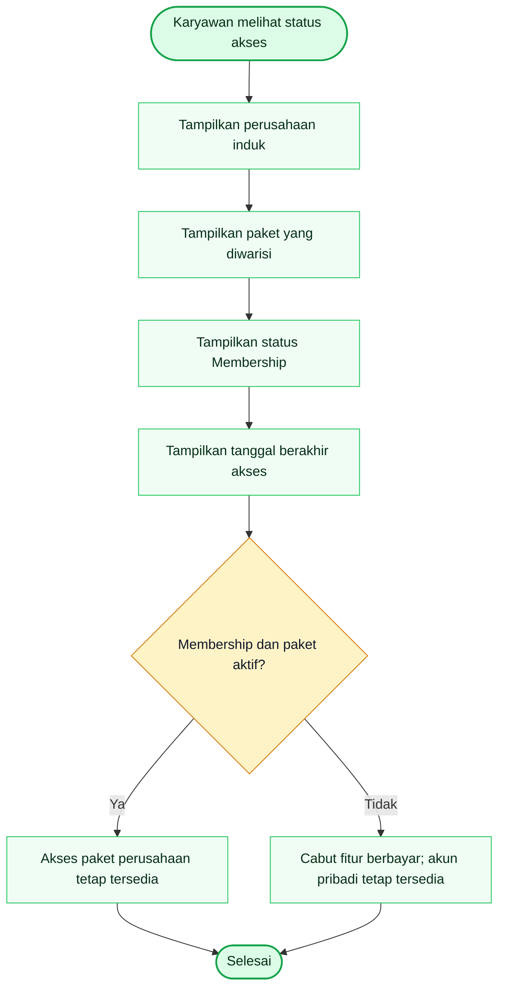
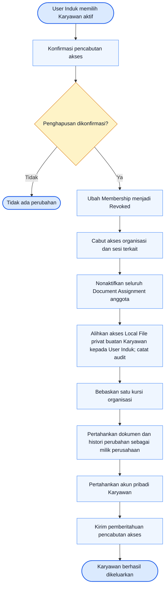
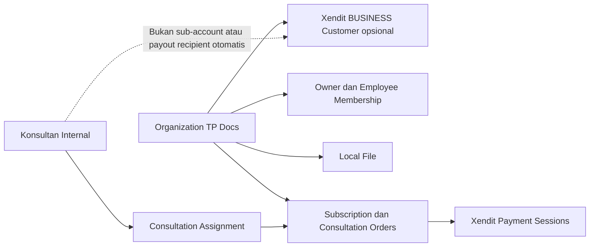

# Membership and Organization Business Flow — TP Docs (With Consultant)

## 1. Tujuan dan Cakupan

Dokumen ini menjelaskan hubungan akun pribadi dengan organisasi perusahaan, mulai dari pembentukan organisasi oleh User Induk, pengiriman undangan, penerimaan membership oleh Karyawan, pemantauan akses, penugasan dokumen oleh User Induk, hingga pencabutan akses.

Aktor yang terlibat:

- **User Induk** sebagai pemilik organisasi dan pengelola anggota.
- **Karyawan** sebagai pengguna tambahan yang menerima akses melalui undangan.
- **Sistem TP Docs** sebagai pengelola token undangan, membership, kursi, dan masa akses.

Administrator tidak mengundang, menghapus, atau menugaskan Karyawan. Setiap pengguna memiliki akun dan password sendiri; akun tidak dibagikan.

Referensi use case: `UI-08.2` sampai `UI-08.5`, `UK-01`, dan `UK-02`.

## 2. Pembentukan Organisasi, User Induk, dan Hak Multi-Pengguna

Pengguna pertama yang membuat perusahaan tetap dicatat sebagai **User Induk** pada seluruh paket. Namun, status User Induk tidak otomatis memberikan hak untuk mengundang Karyawan. Hak multi-pengguna hanya aktif apabila organisasi menggunakan Professional atau Enterprise/Custom dengan kursi yang tersedia.

User pertama yang menyelesaikan registrasi dan profil perusahaan menjadi User Induk. Pada Free/Trial dan Basic, User Induk tetap dapat menggunakan fitur perusahaan sesuai paket, tetapi menu undangan Karyawan tidak dapat digunakan. Pengalihan kepemilikan organisasi belum menjadi bagian dari flow versi ini.

## 3. Flow User Induk Mengundang Karyawan

Undangan hanya tersedia pada paket Professional dan Enterprise/Custom sesuai jumlah kursi. Free/Trial dan Basic hanya mendukung satu User Induk.

## 4. Flow Karyawan Menerima Undangan

Karyawan menerima link, bukan akun atau password dari User Induk. Jika calon Karyawan belum memiliki akun, registrasi dan verifikasi email dilakukan dari konteks undangan agar link tetap dapat dilanjutkan.

## 5. Flow Undangan Tertunda

## 6. Flow Penugasan Dokumen oleh User Induk

Penugasan merupakan aktivitas User Induk pada `UI-08.5`. Flow ini tidak menambahkan aktivitas baru pada use case Karyawan.

## 7. Flow Status Akses Karyawan

## 8. Flow Menghapus Karyawan

## 9. Status Membership dan Invitation

### 9.1 Status Invitation

| Status | Arti |
| --- | --- |
| `Pending` | Undangan telah dibuat dan menunggu keputusan penerima |
| `Used` | Undangan diterima dan membership berhasil dibuat |
| `Rejected` | Calon Karyawan menolak bergabung |
| `Cancelled` | Undangan dibatalkan oleh User Induk |
| `Expired` | Masa berlaku token berakhir |

### 9.2 Status Membership

| Status | Arti |
| --- | --- |
| `Active` | Anggota terhubung dan akses mengikuti paket perusahaan |
| `Pending` | Proses aktivasi belum selesai |
| `Revoked` | Akses dicabut oleh User Induk |
| `Expired` | Akses berbayar berakhir karena paket perusahaan tidak aktif |

## 10. Aturan Bisnis

- Hanya User Induk yang dapat mengelola anggota perusahaan.
- Peran User Induk dimiliki oleh pembuat organisasi pada seluruh paket, tetapi hak multi-pengguna mengikuti paket aktif.
- User Induk Free/Trial dan Basic tidak dapat mengirim undangan atau membeli add-on kursi.
- Administrator tidak dapat mengundang, menghapus, atau menugaskan Karyawan.
- Professional menyediakan tiga pengguna total: satu User Induk dan maksimal dua Karyawan sebelum add-on kursi.
- Enterprise/Custom mengikuti kuota kursi pada quotation dan kontrak.
- Satu akun Karyawan hanya dapat menjadi anggota satu perusahaan pada satu waktu.
- Link undangan hanya berlaku bagi email tujuan dan tidak dapat digunakan akun lain.
- Token yang digunakan, dibatalkan, atau kedaluwarsa tidak dapat dipakai kembali.
- Masa akses Karyawan selalu mengikuti tanggal berakhir paket perusahaan.
- Karyawan tidak memiliki masa Professional tersendiri.
- Berakhirnya paket perusahaan mencabut fitur berbayar Karyawan tanpa menghapus akun pribadi.
- Penghapusan Karyawan membebaskan kursi, tetapi tidak menghapus dokumen atau histori perusahaan.
- Pencabutan membership pembuat menyerahkan akses Local File privat dan request konsultasi yang terkait kepada User Induk dengan audit. Sebelum pengambilalihan, User Induk tidak melihat metadata atau isi dokumen privat.
- User Induk hanya menugaskan Local File buatannya. Berbagi dokumen buatan Karyawan kepada User Induk diubah hanya oleh pembuat aktif dan tidak dapat diteruskan kepada Karyawan lain.
- Seluruh undangan, penerimaan, pembatalan, penugasan, dan pencabutan akses dicatat pada audit log.

## 11. Hubungan Organisasi TP Docs dengan Xendit

`Organization` pada TP Docs adalah batas tenant, pemilik dokumen, langganan, anggota, dan request konsultasi. Organization **bukan** sub-account Xendit karena perusahaan pelanggan bertindak sebagai pembeli layanan, bukan merchant penerima dana.

- pembayaran paket, add-on, Review Konsultan TP, dan Penyusunan Penuh masuk ke akun merchant TP Docs;
- Konsultan merupakan akun internal platform dan bukan penerima payout langsung melalui request pelanggan;
- membership User Induk/Karyawan serta assignment Konsultan tidak dikelola Xendit;
- satu customer Xendit bertipe `BUSINESS` boleh dipetakan ke satu organisasi sebagai identitas billing;
- `organization_id` tetap menjadi sumber kebenaran tenant; provider customer ID hanya referensi integrasi;
- NPWP, isi Local File, komentar review, dan data transaksi perpajakan tidak dikirim ke Xendit.

XenPlatform Accounts tidak digunakan pada MVP. Fitur tersebut baru relevan apabila TP Docs kelak menjadi marketplace dan secara kontraktual membagi dana kepada Konsultan atau organisasi lain.

Referensi Xendit:

- [Customers API — Get Customer](https://docs.xendit.co/apidocs/get-customer-id)
- [XenPlatform Accounts V3 Migration Guide](https://docs.xendit.co/docs/xenplatform-v3-api-migration-guide)

## 12. Referensi

- [Business Flow Overview](./00-Business-Flow-Overview.md)
- [Authentication](./01-Authentication.md)
- [Subscription and Billing](./06-Subscription-Billing.md)
- [Use Case User Induk](../02-Use-Case/Organization-Owner.md)
- [Use Case Karyawan](../02-Use-Case/Employee.md)

---

## Ekstensi Business Flow Layanan Konsultan

Flow membership organisasi telah dijelaskan lengkap pada bagian sebelumnya. Konsultan tetap merupakan role platform dan bukan membership organisasi.

### Batas Konsultan

- Konsultan tidak dibuat sebagai `membership` organisasi.
- Akses berasal dari `consultation_assignment` aktif.
- Assignment membawa organization, request, document version, scope, serta expiry.
- Konsultan tidak menggunakan seat Professional atau Enterprise/Custom pelanggan.
- Penghapusan Karyawan tidak menghapus consultation request, tetapi akses Karyawan terhadap request dievaluasi ulang.
