# Subscription and Billing Business Flow — TP Docs (With Consultant)

## 1. Tujuan dan Cakupan

Dokumen ini menjelaskan business flow paket langganan organisasi, pembayaran, masa aktif, kuota dokumen, kursi pengguna, add-on, Enterprise/Custom, histori transaksi, dan refund.

Aktor yang terlibat:

- **User Induk** memilih paket, melakukan pembayaran, membeli add-on, mengajukan Enterprise/Custom, dan mengajukan refund.
- **Administrator** memelihara katalog, memantau pembayaran, memproses Enterprise/Custom, dan memproses refund terotorisasi.
- **Sistem TP Docs** menghitung periode aktif, kuota, kursi, status transaksi, dan hak akses organisasi.

Karyawan hanya mewarisi akses dari perusahaan dan tidak dapat membeli paket, add-on, atau melihat informasi pembayaran.

Referensi use case: `UI-08.1` sampai `UI-08.8`, `UA-05`, `UA-06.5`, dan `UK-02`.

## 2. Katalog dan Aturan Paket

| Paket | Periode | Kuota dokumen | Kuota pengguna | Add-on dokumen | Add-on kursi |
| --- | --- | --- | --- | --- | --- |
| Free/Trial | Selama masa akun | 1 dokumen | 1 User Induk | Tidak tersedia | Tidak tersedia |
| Basic | 12 bulan sejak aktif | 5 dokumen | 1 User Induk | Tidak tersedia | Tidak tersedia |
| Professional | 12 bulan sejak aktif | 10 dokumen | 3 pengguna total | Rp500.000 per dokumen | Tersedia secara prorata |
| Enterprise/Custom | Sesuai quotation | Sesuai quotation | Sesuai quotation | Sesuai kontrak | Sesuai kontrak |

Periode Basic dan Professional dihitung dari tanggal pembayaran terverifikasi dan paket diaktifkan, bukan berdasarkan tahun kalender.

## 3. Flow Memilih Paket

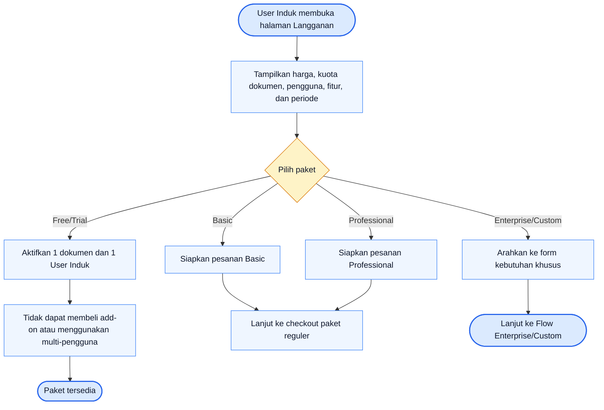

## 4. Flow Checkout Paket Reguler

Flow checkout berlaku untuk Basic dan Professional. Enterprise/Custom tidak melakukan checkout otomatis sebelum quotation diterima.

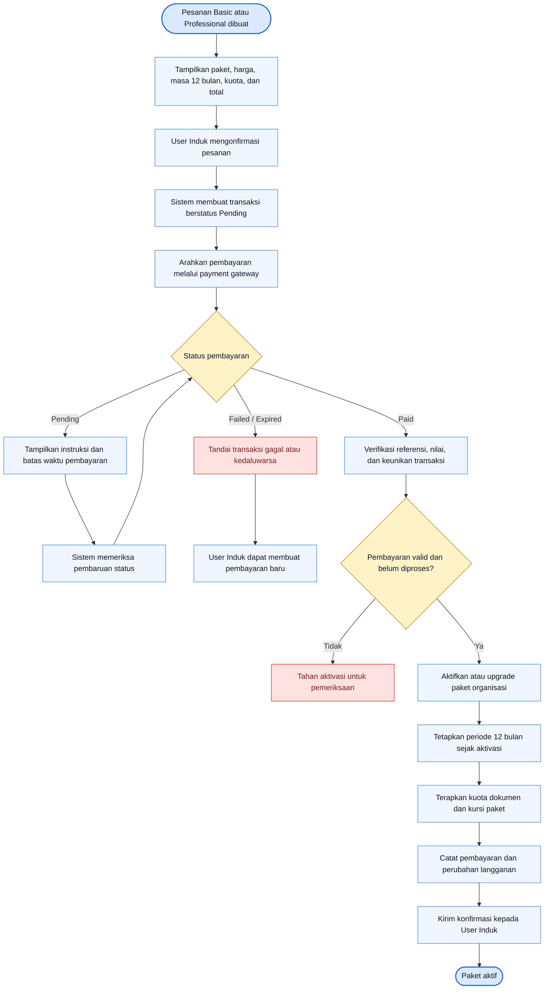

Aktivasi harus bersifat idempotent: satu transaksi pembayaran hanya boleh mengaktifkan paket atau menambah hak akses satu kali.

## 5. Flow Upgrade Paket Reguler

Flow ini digunakan ketika User Induk meningkatkan paket organisasi, termasuk dari Free/Trial ke Basic atau Professional serta dari Basic ke Professional. Upgrade ke Enterprise/Custom mengikuti flow pengajuan dan quotation pada bagian tersendiri.

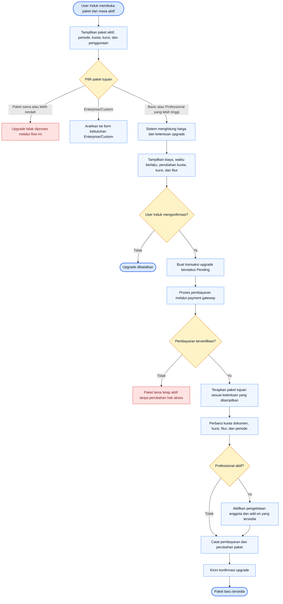

Ketika Basic berhasil ditingkatkan ke Professional, organisasi memperoleh kapasitas tiga pengguna total—satu User Induk dan maksimal dua Karyawan—serta dapat mulai mengirim undangan. Harga upgrade, perlakuan sisa masa Basic, dan tanggal periode baru harus ditampilkan sebelum pembayaran sesuai kebijakan upgrade yang dikonfigurasi.

## 6. Flow Kuota Dokumen

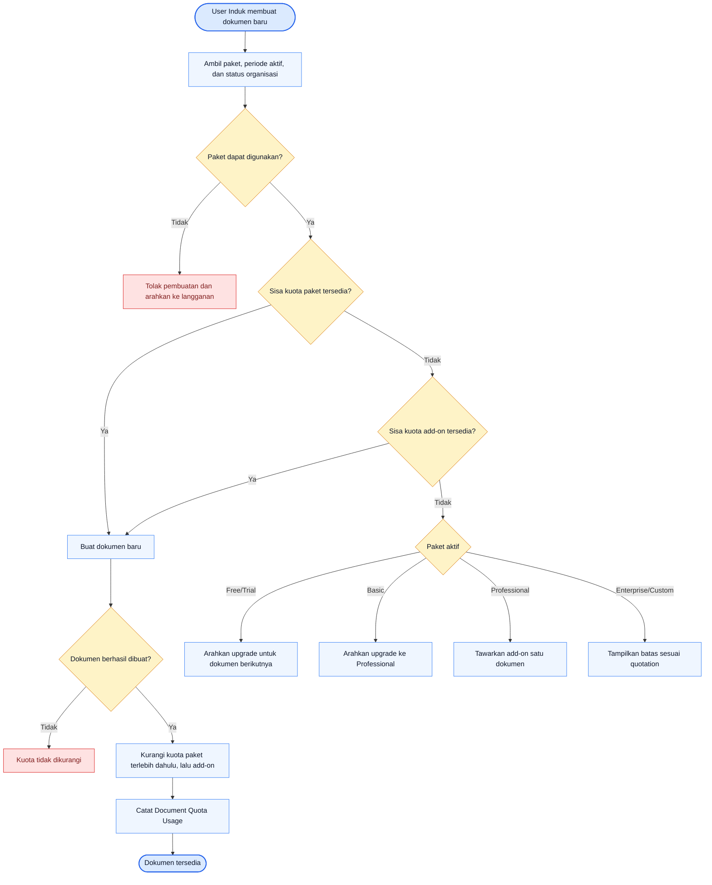

Kuota hanya digunakan setelah dokumen berhasil dibuat. Dokumen yang sudah ada tidak dihapus ketika kuota habis atau paket berakhir.

## 7. Flow Pembelian Add-on Dokumen Professional

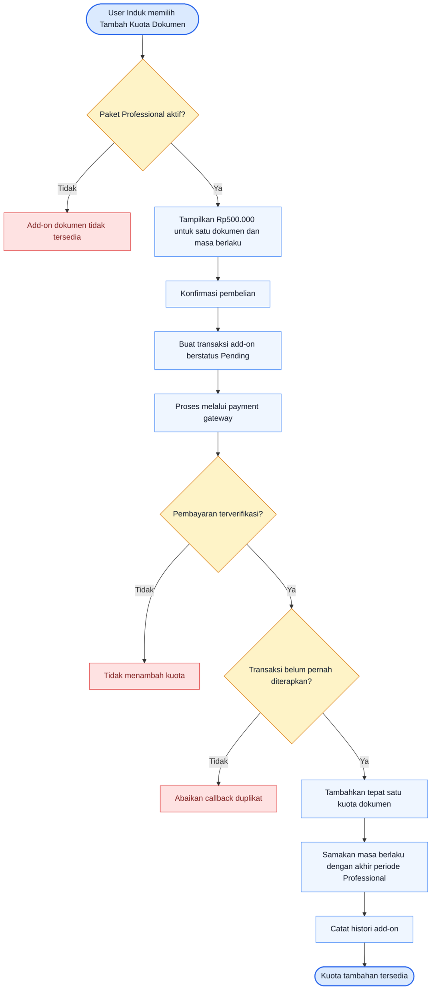

Sisa add-on dokumen tidak dibawa ke periode langganan berikutnya.

## 8. Flow Pembelian Add-on Kursi Professional

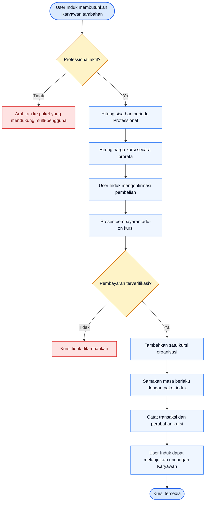

## 9. Flow Enterprise/Custom

Enterprise/Custom menggunakan form, review Administrator, dan quotation. Sistem tidak membuka Gmail atau meminta User Induk mengirim email secara manual.

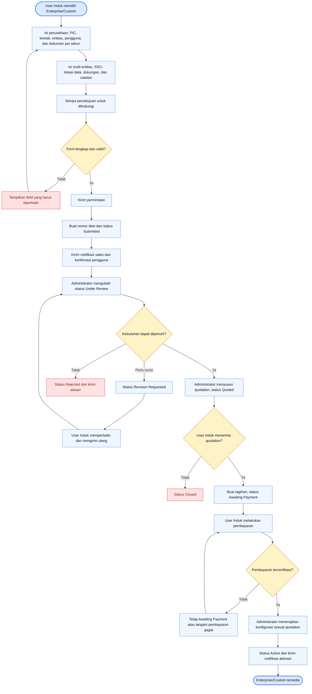

Status Enterprise/Custom yang digunakan bersama oleh User Induk dan Administrator:

`Submitted`, `Under Review`, `Revision Requested`, `Quoted`, `Awaiting Payment`, `Active`, `Rejected`, dan `Closed`.

## 10. Flow Refund

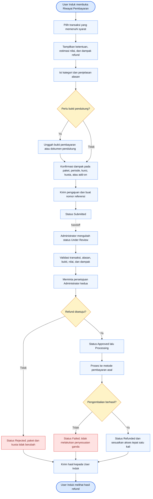

Status refund yang sama digunakan pada kedua sisi:

`Submitted`, `Under Review`, `Approved`, `Rejected`, `Processing`, `Refunded`, dan `Failed`.

## 11. Flow Masa Aktif dan Berakhirnya Paket

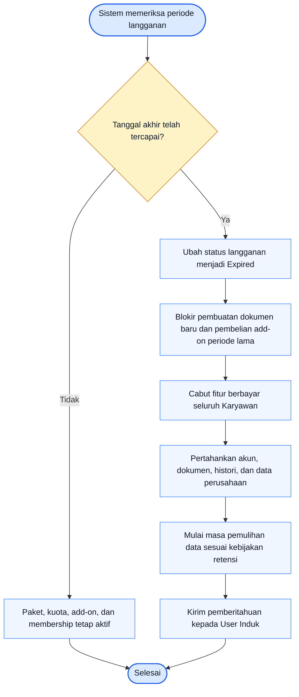

## 12. Riwayat dan Informasi Langganan

User Induk dapat melihat:

- Paket aktif dan tanggal berakhir.
- Kuota dokumen paket, dokumen terpakai, sisa kuota, dan tanggal reset.
- Kuota add-on dokumen dan masa berlakunya.
- Kursi terpakai dan tersedia.
- Transaksi paket dan add-on.
- Status pembayaran `Pending`, `Paid`, `Failed`, atau `Expired`.
- Status pengajuan Enterprise/Custom.
- Status dan hasil refund.

Perubahan katalog atau koreksi kuota oleh Administrator harus tercermin pada tampilan dan histori User Induk. Laporan atau histori tidak menampilkan kredensial payment gateway maupun data pembayaran mentah.

## 13. Aturan Bisnis

### Diskon Event Opsional

Admin mengatur sasaran, nilai, periode Asia/Jakarta, dan batas penggunaan opsional. Saat checkout paket baru, upgrade, perpanjangan, atau add-on, sistem memilih satu diskon terbesar yang aktif dan sesuai. Jika tidak ada, harga katalog berlaku. Quotation Enterprise/Custom membekukan potongan saat diterbitkan; invoice mengikuti total snapshot hingga quotation kedaluwarsa. Payment gagal melepas reservasi setelah TTL; redemption dicatat sekali saat PAID. Refund mengacu pada jumlah dibayar. Free/Trial tidak mendapat diskon.

~~~mermaid
flowchart TD
 P[Harga normal] --> E{Event aktif sesuai?}
 E -->|Tidak| N[Harga normal]
 E -->|Ya| D[Satu diskon terbesar]
 N --> S[Snapshot harga]
 D --> S
 S --> X[Checkout atau quotation]
 X --> V{Pembayaran berhasil?}
 V -->|Ya| R[Catat penggunaan promo]
 V -->|Tidak| F[Lepas reservasi saat TTL]
~~~

- Hanya User Induk yang dapat membeli paket, add-on, atau mengajukan refund.
- User Induk tetap menjadi pemilik organisasi pada Free/Trial dan Basic, tetapi tidak dapat mengundang Karyawan.
- Upgrade Basic ke Professional mengaktifkan hak multi-pengguna setelah pembayaran terverifikasi.
- Pembayaran upgrade yang gagal tidak mengubah paket, kuota, kursi, periode, atau hak akses sebelumnya.
- Karyawan mewarisi fitur dan masa aktif organisasi tanpa memiliki langganan terpisah.
- Basic dan Professional berlaku 12 bulan sejak paket diaktifkan.
- Sistem menggunakan kuota paket sebelum kuota add-on.
- Kuota berkurang hanya setelah dokumen baru berhasil dibuat.
- Add-on Professional berakhir bersama periode paket yang sedang berjalan.
- Sisa add-on tidak dibawa ke periode berikutnya.
- Pembayaran gagal tidak mengaktifkan paket dan tidak menambah kuota atau kursi.
- Callback pembayaran yang sama tidak boleh menerapkan hak akses lebih dari satu kali.
- Enterprise/Custom tidak aktif sebelum quotation diterima dan pembayaran terverifikasi.
- Refund yang ditolak tidak mengubah paket, periode, kursi, kuota, atau add-on.
- Refund yang gagal tetap tercatat dan tidak boleh menghasilkan pengembalian maupun penyesuaian akses ganda.
- Pengembalian dana dilakukan melalui metode pembayaran asal.
- Formula prorata kursi, kelayakan refund, batas waktu refund, dan formula nilai refund mengikuti kebijakan bisnis yang masih perlu divalidasi.

## 14. Referensi

- [Business Flow Overview](./00-Business-Flow-Overview.md)
- [Membership and Organization](./05-Membership-Organization.md)
- [Use Case User Induk](../02-Use-Case/Organization-Owner.md)
- [Use Case Karyawan](../02-Use-Case/Employee.md)
- [Use Case Administrator](../02-Use-Case/Admin.md)
- [Functional Requirements](../01-Requirements/Functional-Requirements.md)
- [Non-Functional Requirements](../01-Requirements/Non-Functional-Requirements.md)

---

## 15. Billing Layanan Konsultasi

### 15.1 Pemisahan Langganan Aplikasi dan Jasa Konsultasi

Langganan aplikasi dan jasa konsultasi merupakan dua produk yang berbeda:

| Aspek | Langganan Aplikasi | Jasa Konsultasi |
| --- | --- | --- |
| Objek pembelian | Paket, kursi, kuota, atau add-on | Layanan untuk satu document version |
| Pemilik | Organisasi | Organisasi melalui pemohon yang berwenang |
| Harga | Katalog paket | Katalog jasa atau quotation |
| Masa berlaku | Mengikuti periode paket | Mengikuti request dan SLA snapshot |
| Kuota revisi | Tidak berlaku | Mengikuti snapshot order konsultasi |
| Aktivasi | Setelah payment paket terverifikasi | Setelah payment konsultasi terverifikasi dan assignment dibuat |
| Dampak berakhir | Fitur paket dibatasi | Scoped access Konsultan ditutup setelah request selesai/dicabut |

Pembelian konsultasi tidak menambah kuota dokumen, kursi, atau masa aktif paket. Penggunaan layanan konsultasi juga tidak mengurangi kuota dokumen, kecuali pengguna membuat document version baru melalui proses generate normal yang memang menggunakan aturan kuota dokumen.

### 15.2 Kewenangan Billing Konsultasi

| Aktivitas | User Induk | Karyawan | Konsultan | Administrator |
| --- | --- | --- | --- | --- |
| Melihat katalog aktif | Ya | Ya | Tidak | Kelola |
| Melihat harga layanan | Ya | Ya | Tidak | Kelola |
| Membuat request | Semua dokumen organisasi | Hanya dokumen yang ditugaskan | Tidak | Tidak |
| Menerima quotation | Ya | Jika menjadi pemohon dan diizinkan | Tidak | Membuat quotation |
| Membayar | Ya | Ya, untuk request miliknya | Tidak | Memantau status |
| Melihat transaksi | Seluruh organisasi | Hanya transaksi konsultasi yang dibuatnya | Tidak | Metadata operasional |
| Mengajukan refund | Ya | Untuk transaksi yang dibuatnya | Tidak | Memutuskan dan memproses |
| Melihat nilai payment | Ya | Hanya transaksi miliknya | Tidak | Sesuai kewenangan |
| Mengubah harga/SLA/revisi | Tidak | Tidak | Tidak | Ya, melalui katalog/version baru |

Konsultan hanya menerima informasi bahwa request telah memenuhi syarat pembayaran. Nominal, metode pembayaran, quotation, refund, dan data finansial pengguna tidak ditampilkan pada portal Konsultan.

### 15.3 Lifecycle Katalog Jasa

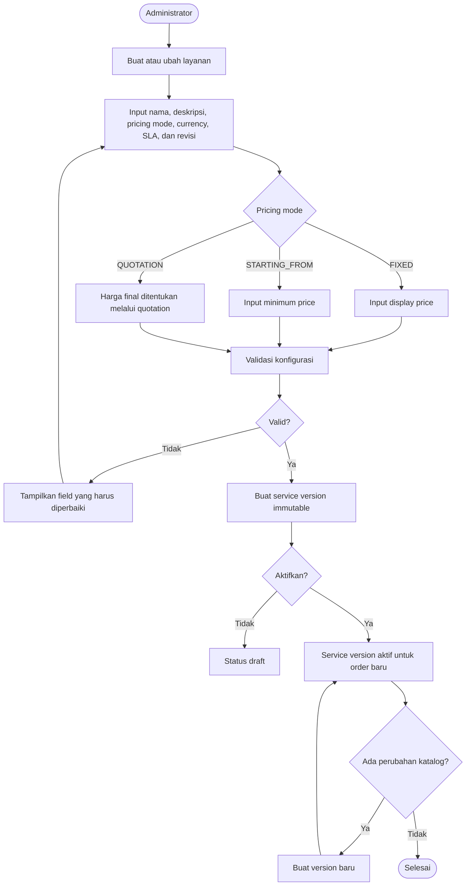

Aturan katalog:

- Harga, currency, SLA, dan revisi tidak ditulis permanen pada frontend.
- Layanan tidak dapat diaktifkan apabila konfigurasi wajib belum valid.
- Perubahan selalu membuat service version baru.
- Order lama tetap menggunakan snapshot dari version yang dipilih ketika request dibuat.
- Menonaktifkan layanan mencegah order baru tanpa membatalkan request yang sudah sah.
- Seluruh perubahan katalog memiliki identitas Administrator, waktu, alasan, dan audit log.

### 15.4 Mode Harga

| Mode | Tampilan kepada pengguna | Waktu menentukan harga final | Syarat checkout |
| --- | --- | --- | --- |
| `FIXED` | Harga tetap dari `displayPrice` | Saat service version dibuat | Request dan snapshot valid |
| `STARTING_FROM` | Teks “Mulai” dari `minimumPrice` | Setelah Admin membuat quotation | Quotation diterima |
| `QUOTATION` | Keterangan meminta quotation tanpa nominal checkout | Setelah kebutuhan ditinjau Admin | Quotation diterima |

`STARTING_FROM` tidak berarti pengguna membayar minimum price secara otomatis. Minimum price hanya informasi katalog; payment selalu memakai nilai quotation final yang diterima pengguna.

### 15.5 Pembentukan Snapshot Order

Ketika request dibuat, backend mengambil service version aktif dan menyimpan:

- ID layanan dan service version.
- Nama serta deskripsi layanan.
- Pricing mode.
- Currency.
- Harga tetap atau nilai quotation final.
- SLA review awal dan review ulang.
- Jumlah revisi yang termasuk.
- Document version sumber.
- Pemohon, membership, organisasi, dan waktu request.

Frontend tidak mengirim nominal sebagai sumber kebenaran. Nilai yang dikirim browser diabaikan atau diverifikasi ulang terhadap snapshot backend.

### 15.6 Checkout Layanan Fixed

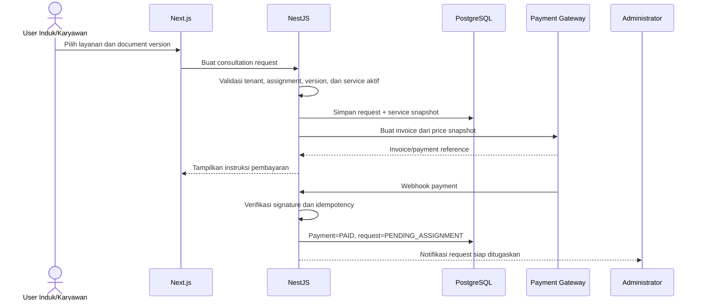

Jika payment gagal atau kedaluwarsa:

- request tidak dapat ditugaskan;
- Konsultan tidak memperoleh akses;
- snapshot order tidak berubah;
- pengguna dapat membuat payment attempt baru sesuai kebijakan;
- retry webhook tidak boleh membuat payment atau assignment ganda.

### 15.7 Quotation Penyusunan Penuh

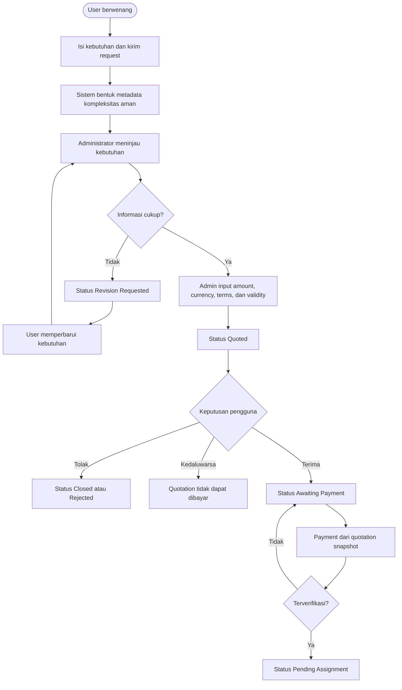

Administrator menilai metadata kompleksitas tanpa otomatis membaca isi dokumen. Akses isi dokumen baru diberikan kepada Konsultan yang sah setelah payment dan assignment.

### 15.8 Status Payment Konsultasi

| Status | Makna | Dampak pada request |
| --- | --- | --- |
| `PENDING` | Invoice dibuat tetapi belum terverifikasi | Tetap `AWAITING_PAYMENT` |
| `PAID` | Webhook valid dan transaksi berhasil | Menjadi `PENDING_ASSIGNMENT` |
| `FAILED` | Provider menyatakan gagal | Tidak ada akses Konsultan |
| `EXPIRED` | Masa pembayaran habis | Memerlukan payment attempt baru |
| `REFUNDED` | Refund selesai | Akses dan status disesuaikan sekali |

Status payment hanya berubah melalui proses backend yang sah. Redirect browser setelah pembayaran bukan bukti keberhasilan.

### 15.9 Revisi dan Review Tambahan

- Review awal tidak dihitung sebagai revision round.
- Setiap resubmission yang diterima sebagai review ulang menggunakan satu revision round.
- `includedRevisionRounds` dan `usedRevisionRounds` dihitung dari snapshot request.
- Penggunaan revisi harus idempotent dan tidak bertambah dua kali karena retry.
- Jika kuota habis, sistem menampilkan layanan Review Tambahan yang aktif.
- Review Tambahan selalu membuat request, snapshot, payment, assignment, dan audit baru.
- Perubahan harga katalog berlaku untuk order tambahan baru, bukan request sebelumnya.

### 15.10 Refund Konsultasi

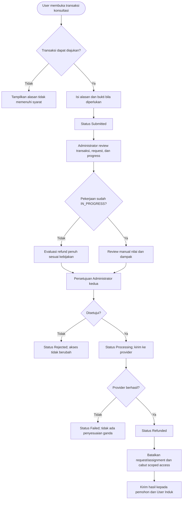

Aturan refund:

- Refund mengacu pada payment konsultasi dan consultation request yang sama.
- Refund sebelum pekerjaan dimulai mengikuti kebijakan kelayakan bisnis.
- Setelah `IN_PROGRESS`, nilai dan kelayakan memerlukan review manual.
- Konsultan tidak melihat alasan finansial atau nilai refund.
- Assignment yang dibatalkan harus mencabut akses preview dan working copy.
- Refund gagal tidak menutup request atau mencabut akses secara otomatis.
- Provider call, status update, dan access adjustment memakai idempotency key terpisah.
- Satu payment tidak boleh menghasilkan refund berhasil lebih dari satu kali.

### 15.11 Sinkronisasi Status Antaraktor

| Kejadian | Status request | Tampilan pengguna | Tampilan Konsultan | Tindakan Admin |
| --- | --- | --- | --- | --- |
| Request fixed dibuat | `AWAITING_PAYMENT` | Invoice tersedia | Tidak terlihat | Memantau payment |
| Payment berhasil | `PENDING_ASSIGNMENT` | Menunggu assignment | Belum terlihat | Pilih Konsultan |
| Assignment dibuat | `ASSIGNED` | Konsultan ditugaskan | Assignment baru | Pantau keputusan |
| Assignment diterima | `IN_PROGRESS` | ETA/progress tersedia | Akses aktif | Pantau SLA |
| Menunggu data pengguna | `WAITING_FOR_CLIENT` | Tindakan diperlukan | SLA pause | Pantau aging |
| Review diterbitkan | `REVIEW_DELIVERED` | Komentar tersedia | Delivery terkunci | Pantau hasil |
| Perlu versi baru | `AWAITING_RESUBMISSION` | Perbaiki dan resubmit | Menunggu | Pantau SLA pause |
| Review ulang | `RE_REVIEW` | Sedang diperiksa | Round aktif | Pantau revisi |
| Pekerjaan selesai | `COMPLETED` | Hasil final tersedia | Read-only/ditutup | Arsip |
| Refund berjalan | `REFUND_PROCESSING` | Status refund | Tidak melihat detail | Proses refund |
| Refund selesai | `REFUNDED` | Konfirmasi refund | Akses dicabut | Audit penyesuaian |

### 15.12 Rekonsiliasi dan Audit Billing

Sistem melakukan rekonsiliasi antara payment internal, webhook provider, consultation request, quotation, refund, dan assignment. Kondisi berikut harus menghasilkan alert operasional:

- payment `PAID` tetapi request belum `PENDING_ASSIGNMENT`;
- request ditugaskan tetapi payment belum `PAID`;
- quotation kedaluwarsa tetapi invoice masih dapat dibayar;
- refund `REFUNDED` tetapi assignment masih aktif;
- amount atau currency provider berbeda dari snapshot;
- webhook duplikat menghasilkan perubahan status kedua;
- request selesai tetapi scoped access belum ditutup.

Audit log mencatat perubahan katalog, quotation, payment reference, status request, refund, access adjustment, dan identitas Administrator tanpa menyimpan data kartu atau credential provider.

### 15.13 Kriteria Penerimaan Billing Konsultasi

- Harga selalu berasal dari katalog/version atau quotation backend.
- Perubahan katalog tidak mengubah request lama.
- Karyawan tidak dapat membayar konsultasi untuk dokumen yang tidak ditugaskan.
- User Induk dapat melihat seluruh transaksi konsultasi organisasi.
- Konsultan tidak dapat melihat nominal maupun metode pembayaran.
- Assignment tidak dapat dibuat sebelum payment `PAID`.
- Webhook duplikat tidak membuat aktivasi atau assignment ganda.
- Quotation kedaluwarsa tidak dapat digunakan untuk checkout.
- Review tambahan selalu menghasilkan order baru setelah revisi habis.
- Refund berhasil mencabut akses tepat satu kali.
- Refund gagal tidak mengubah akses secara prematur.
- Seluruh perubahan finansial dan status memiliki audit trail.

## 16. Implementasi Pembayaran Xendit

### 16.1 Satu Jalur Pembayaran untuk Langganan dan Konsultasi

TP Docs menggunakan Xendit **Payment Session mode `PAYMENT_LINK`** dengan `session_type: PAY` dan `capture_method: AUTOMATIC`. Jalur yang sama dipakai untuk paket, add-on, Enterprise/Custom, Review Konsultan TP, Penyusunan Penuh, dan review tambahan; yang membedakan adalah order snapshot serta `payment_purpose` internal.

| Purpose internal | Sumber nominal | Resource yang aktif setelah `PAID` |
| --- | --- | --- |
| `SUBSCRIPTION` | Version harga paket | Subscription dan quota |
| `UPGRADE` | Snapshot perhitungan upgrade | Paket/entitlement baru |
| `DOCUMENT_ADDON` | Katalog add-on | Tambahan quota dokumen |
| `SEAT_ADDON` | Harga prorata backend | Tambahan kursi sampai akhir periode |
| `CUSTOM_PLAN` | Quotation diterima | Enterprise/Custom |
| `CONSULTATION` | Service version atau quotation | Request masuk `PENDING_ASSIGNMENT` |

Harga tidak pernah berasal dari payload frontend. Consultation request menyimpan snapshot nama layanan, versi katalog, currency, amount, SLA, dan revisi sebelum Payment Session dibuat.

### 16.2 Checkout Xendit

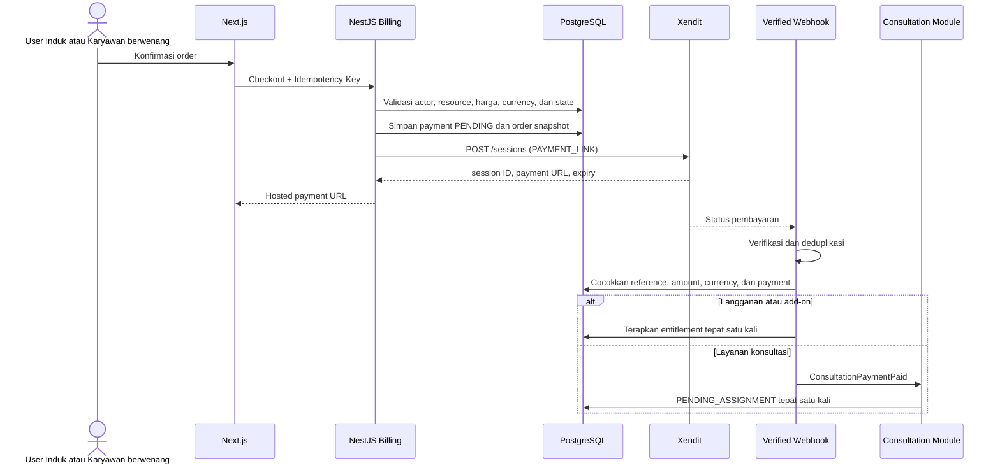

Success/cancel return URL hanya mengembalikan pengguna ke TP Docs. Return URL tidak mengaktifkan paket maupun membuka request Konsultan. Sumber kebenaran adalah webhook valid atau hasil rekonsiliasi server-to-server.

### 16.3 Customer dan Data yang Dikirim

Satu organisasi dapat mempunyai satu customer Xendit bertipe `BUSINESS`. Organization bukan sub-account Xendit. Data yang dikirim dibatasi pada reference ID acak, nama perusahaan, email billing, negara, dan metadata ID internal. Isi Local File, NPWP, komentar Konsultan, hasil FAR, transaksi afiliasi, dan dokumen hasil generate tidak dikirim ke payment provider.

Konsultan tidak menerima informasi channel, nominal, provider payment ID, refund reason, atau detail payout. Konsultan hanya menerima perubahan status bisnis yang relevan, misalnya assignment telah dapat dikerjakan atau akses telah dicabut.

### 16.4 Status dan Rekonsiliasi

| Provider | Internal payment | Consultation request |
| --- | --- | --- |
| Session `ACTIVE` / `REQUIRES_ACTION` | `PENDING` | `AWAITING_PAYMENT` |
| Processing | `PROCESSING` | `AWAITING_PAYMENT` |
| Berhasil | `PAID` | `PENDING_ASSIGNMENT` |
| Gagal | `FAILED` | `AWAITING_PAYMENT` atau checkout ulang |
| Kedaluwarsa | `EXPIRED` | `AWAITING_PAYMENT` |
| Refund `PENDING` | Refund `PROCESSING` | `REFUND_PROCESSING` |
| Refund `SUCCEEDED` | Refund `REFUNDED` | `REFUNDED` dan akses dicabut |
| Refund `FAILED` | Refund `FAILED` | Status kerja tidak diubah otomatis |

Webhook diproses dengan verification, payload hash, dedupe key, database lock, dan idempotency. Rekonsiliasi menghasilkan alert bila payment `PAID` belum mengubah request menjadi `PENDING_ASSIGNMENT`, assignment ada sebelum `PAID`, nominal/currency berbeda, atau refund berhasil tetapi scoped access masih aktif.

### 16.5 Refund, Dispute, dan Payout

- refund selalu merujuk ke provider `payment_id` asal dan dikembalikan melalui mekanisme refund provider;
- penyesuaian subscription atau akses Konsultan dilakukan setelah refund `SUCCEEDED`, bukan saat diajukan;
- dispute kartu disimpan terpisah dari refund karena dapat meminta evidence dan memiliki due date;
- event dispute berulang dideduplicasi menggunakan dispute ID, status, status reason, dan updated time;
- payout bukan pembayaran Konsultan pada MVP dan bukan refund pelanggan;
- pembayaran jasa Konsultan merupakan pendapatan TP Docs; kompensasi Konsultan berada di luar alur order pelanggan sampai kebijakan bisnis dan legalnya ditetapkan;
- pencairan saldo perusahaan melalui Admin hanya dapat diaktifkan setelah rekening allowlist, limit, dual approval, dan dukungan API provider tervalidasi.

### 16.6 Perpanjangan dan Multi-Currency

MVP memakai checkout baru saat perpanjangan. Penyimpanan metode pembayaran dan auto-renew tidak diaktifkan sebelum consent serta mekanisme recurring selesai dirancang. Currency disimpan sebagai ISO-4217 dan amount sebagai minor unit. Dukungan pelanggan luar negeri mengikuti country, channel, settlement currency, dan refund capability yang aktif pada akun Xendit; TP Docs tidak melakukan konversi otomatis.

### 16.7 Referensi Xendit

- [Subscription with Initial Payment — Payment Session](https://docs.xendit.co/docs/subscription-with-initial-payment)
- [Payment Request Details](https://docs.xendit.co/apidocs/get-payment-request)
- [Refund V3](https://docs.xendit.co/apidocs/get-a-refund)
- [Payout V3](https://docs.xendit.co/apidocs/get-payout-v3-by-id)
- [Manage Disputes via API](https://docs.xendit.co/docs/manage-disputes-via-api)
- [Customers API](https://docs.xendit.co/apidocs/get-customer-id)

## 17. Referensi Layanan Konsultasi

- [Consultation Service Business Flow](./08-Consultation-Service.md)
- [Consultant Workflow](./09-Consultant-Workflow.md)
- [Use Case Konsultan](../02-Use-Case/Consultant.md)
- [Consultation Architecture](../05-Architecture/Consultation-Architecture.md)
- [API Contract](../05-Architecture/API-Contract.md)
