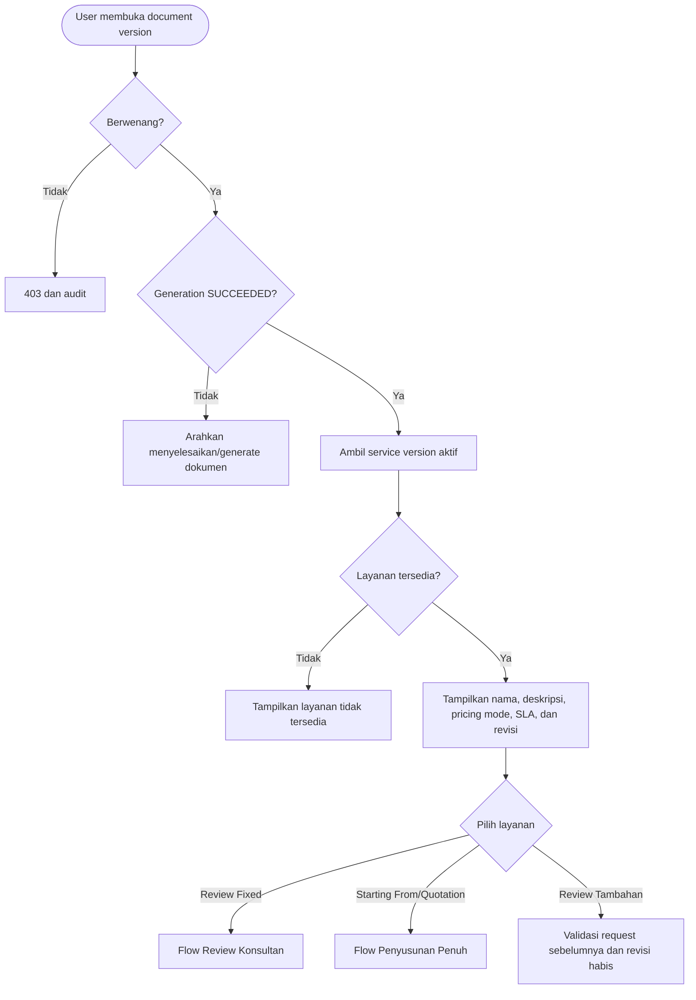
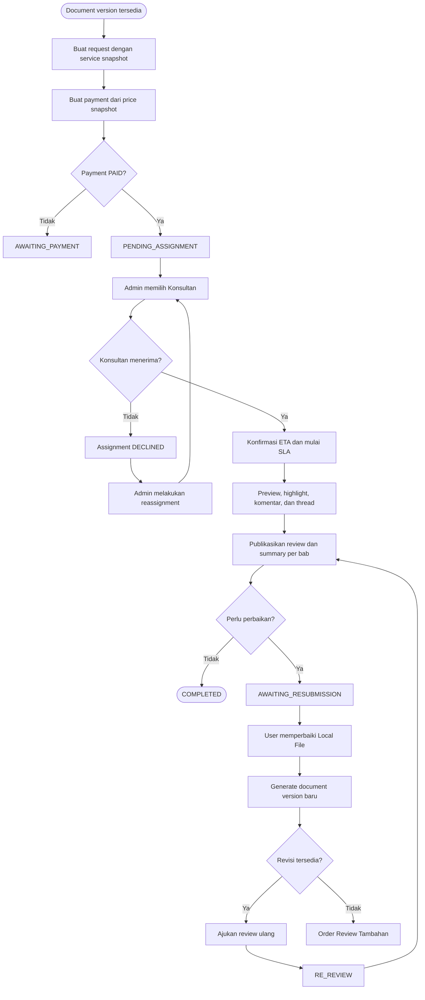
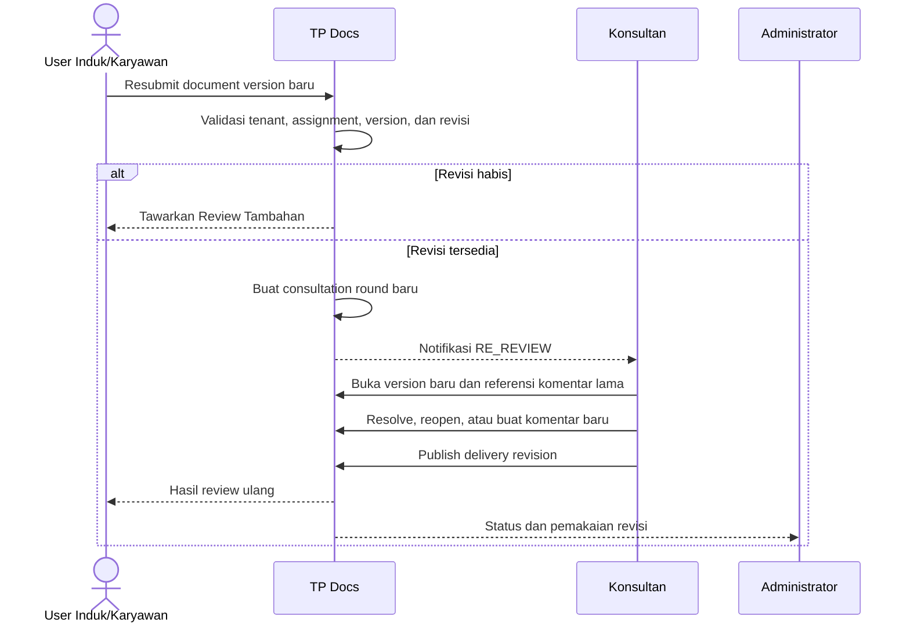
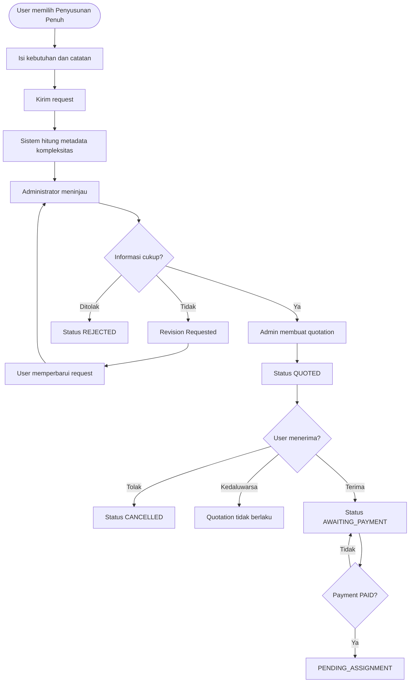
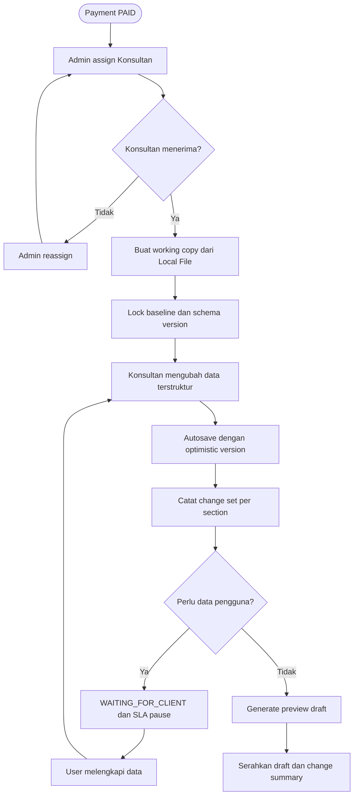
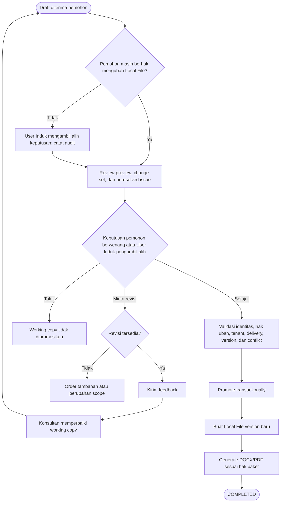

# Consultation Service Business Flow

## 1. Tujuan dan Batas Proses

Dokumen ini menjelaskan alur bisnis layanan konsultasi sejak pengguna memilih layanan sampai request selesai, dibatalkan, atau direfund. Layanan hanya dapat dibuat berdasarkan document version yang berhasil di-generate.

Layanan awal:

- **Review Konsultan TP** — Konsultan membaca versi immutable, memberikan highlight dan komentar, lalu menerbitkan review.
- **Penyusunan Penuh** — Konsultan mengerjakan working copy terpisah berdasarkan quotation yang telah dibayar.
- **Review Tambahan** — order baru ketika kuota revisi request sebelumnya telah habis.

Harga, currency, SLA, dan revisi tidak ditetapkan permanen dalam dokumen ini. Seluruh nilai berasal dari service version atau quotation yang dikelola Administrator.

## 2. Aktor dan Tanggung Jawab

| Aktor | Tanggung jawab dalam layanan |
| --- | --- |
| User Induk | Membuat request untuk dokumen yang dapat diaksesnya, membayar, melihat status yang berhak, menindaklanjuti review, menyetujui hasil request sendiri, dan mengambil alih persetujuan bila hak pemohon Karyawan dicabut |
| Karyawan | Membuat dan membayar request untuk dokumen buatannya atau yang ditugaskan, melihat transaksi sendiri, serta meninjau dan menyetujui hasil Penyusunan Penuh yang diajukannya selama hak ubah Local File masih aktif |
| Konsultan | Menerima assignment, mengonfirmasi ETA, melakukan review atau Penyusunan Penuh, dan menyerahkan hasil |
| Administrator | Mengelola katalog, quotation, akun Konsultan, assignment, perubahan ETA, payment monitoring, refund, dan SLA |
| Sistem | Memvalidasi kewenangan, menyimpan snapshot, mengatur status, membatasi akses, mengirim notifikasi, dan mencatat audit |

## 3. Prasyarat Umum

Request konsultasi hanya dapat dibuat apabila:

1. Akun pengguna aktif dan memiliki sesi sah.
2. Organisasi serta langganan memenuhi aturan akses platform.
3. Local File dan document version berada pada organisasi yang sama.
4. Document generation berstatus `SUCCEEDED`.
5. Pemohon memiliki hak atas dokumen sebagai pembuat aktif, penerima berbagi, Karyawan yang ditugaskan aktif, atau User Induk penerima pengambilalihan.
6. Service version masih aktif ketika request dibuat.
7. Document version belum dihapus atau berada dalam proses penghapusan.
8. Tidak ada request aktif yang dilarang duplikat oleh kebijakan layanan.

Kegagalan prasyarat tidak membuat order, payment, kuota revisi, atau akses Konsultan.

## 4. Flow Pemilihan Layanan

Diskon event merupakan cabang opsional pada Review Konsultan TP dan Penyusunan Penuh. Harga FIXED dibekukan saat checkout. Untuk Penyusunan Penuh, Admin menetapkan harga awal quotation, sistem menerapkan event yang aktif saat quotation diterbitkan, lalu membekukan total sampai quotation berakhir. Tidak ada event berarti harga katalog atau quotation normal. Pembayaran dan refund memakai total snapshot.

Frontend hanya menampilkan data katalog dari API. Nominal yang diubah melalui browser tidak digunakan sebagai sumber payment.

## 5. Flow Review Konsultan TP

### 5.1 Overview

### 5.2 Pembentukan Request

Sistem menyimpan:

- organisasi, Local File, dan source document version;
- pemohon dan membership pemohon;
- service serta service version;
- nama layanan, pricing mode, currency, harga, SLA, dan revisi sebagai snapshot;
- status awal;
- correlation ID dan idempotency key.

Jika tombol diklik ulang atau request jaringan diulang, idempotency key mengembalikan request yang sama dan tidak membuat order ganda.

### 5.3 Pembayaran

- Status awal request fixed adalah `AWAITING_PAYMENT`.
- Invoice memakai amount dan currency snapshot.
- Payment dinyatakan berhasil hanya setelah webhook terverifikasi.
- Redirect browser tidak mengaktifkan request.
- Setelah `PAID`, request menjadi `PENDING_ASSIGNMENT`.
- Setiap retry menambah attempt di `consultation_request_payments` tanpa menghapus attempt gagal, kedaluwarsa, atau dibatalkan. `payments.status` tetap sumber status tiap attempt; request hanya boleh mempunyai satu attempt current dan satu payment sah yang memenangkan aktivasi. Webhook mengunci request dan payment, memeriksa idempotency serta snapshot nominal/currency sebelum transisi, sehingga callback berulang tidak mengaktifkan layanan atau membuat assignment dua kali.
- Konsultan belum dapat melihat request sebelum assignment dibuat dan diterima.

### 5.4 Assignment

Administrator melihat request yang siap ditugaskan dan memilih Konsultan berdasarkan keahlian, kapasitas, ketersediaan, serta konflik kepentingan bila kebijakan tersebut diterapkan.

Jika Konsultan menolak:

1. assignment menjadi `DECLINED`;
2. alasan disimpan;
3. scoped access tidak diberikan;
4. Administrator menerima notifikasi;
5. Administrator memilih Konsultan lain.

Jika assignment dicabut setelah diterima, sesi viewer dan akses request harus dihentikan.

### 5.5 Pelaksanaan Review

Konsultan:

1. membuka preview HTML semantik;
2. menavigasi bab dan blok;
3. menyorot teks;
4. memilih kategori dan severity;
5. menulis komentar;
6. menambah balasan atau klarifikasi;
7. memeriksa kelengkapan seluruh bab;
8. membentuk ringkasan per bab;
9. memberikan kesimpulan;
10. menerbitkan delivery immutable.

Konsultan tidak mengubah DOCX, snapshot, atau Local File asli pada layanan Review.

### 5.6 Tindak Lanjut Pengguna

Setelah review diterbitkan:

- pengguna melihat summary, highlight, dan thread;
- pengguna dapat membalas komentar;
- pengguna memperbaiki data Local File;
- pengguna melakukan generate version baru;
- pengguna memilih version baru untuk resubmission;
- komentar lama tetap mengarah ke version lama;
- Konsultan membuat anchor baru jika masalah masih terdapat pada version baru.

## 6. Flow Review Ulang

Aturan:

- review awal bukan revision round;
- satu resubmission sah memakai satu revisi;
- penggunaan revisi bersifat idempotent;
- version baru wajib berasal dari Local File request yang sama;
- request tambahan dibuat jika revisi habis;
- request tambahan dapat mengacu pada request sebelumnya untuk traceability.

## 7. Flow Penyusunan Penuh

### 7.1 Pengajuan dan Quotation

Metadata kompleksitas dapat mencakup jumlah halaman, entitas, transaksi, tabel FAR, dan pembanding. Administrator tidak otomatis memperoleh akses isi dokumen ketika membuat quotation.

### 7.2 Assignment dan Working Copy

Working copy tidak menimpa Local File utama. Konsultan hanya dapat mengubah section yang berada dalam scope request.

### 7.3 Review Pemohon dan Promotion

Pemohon dapat meminta revisi atau menyetujui hasil jika ia User Induk atau Karyawan dengan penugasan aktif dan hak ubah Local File. Jika hak Karyawan pemohon dicabut, User Induk dapat mengambil alih keputusan; backend mencatat pelaku, alasan pengambilalihan, waktu, dan delivery yang disetujui. Karyawan tanpa hak ubah dan Konsultan tidak dapat menyetujui atau mengganti Local File utama. Setelah persetujuan, sistem menerapkan snapshot delivery sebagai versi baru secara transaksional dan idempotent, tanpa menimpa versi lama. Di UI tindakan ini bernama **Terapkan sebagai versi baru**.

## 8. Status Request dan Transisi

| Status | Pemicu masuk | Aktor yang bertindak berikutnya | Transisi normal |
| --- | --- | --- | --- |
| `DRAFT` | Form belum dikirim | User | `AWAITING_QUOTATION` atau `AWAITING_PAYMENT` |
| `AWAITING_QUOTATION` | Request quotation dikirim | Administrator | `QUOTED`, revision, atau reject |
| `REVISION_REQUESTED` | Admin meminta kelengkapan/perubahan kebutuhan | User | `AWAITING_QUOTATION` |
| `QUOTED` | Quotation diterbitkan | User | `AWAITING_PAYMENT` atau `CANCELLED` |
| `AWAITING_PAYMENT` | Invoice tersedia | User/provider | `PAID` atau tetap menunggu |
| `PAID` | Payment terverifikasi | Sistem | `PENDING_ASSIGNMENT` |
| `PENDING_ASSIGNMENT` | Siap ditugaskan | Administrator | `ASSIGNED` |
| `ASSIGNED` | Assignment dibuat | Konsultan | `IN_PROGRESS` atau reassignment |
| `IN_PROGRESS` | Assignment diterima | Konsultan | `WAITING_FOR_CLIENT` atau delivery |
| `WAITING_FOR_CLIENT` | Data/tindakan pengguna diperlukan | User | `IN_PROGRESS` |
| `REVIEW_DELIVERED` | Review diterbitkan | User | `AWAITING_RESUBMISSION` atau `COMPLETED` |
| `AWAITING_RESUBMISSION` | Perbaikan diperlukan | User | `RE_REVIEW` atau order tambahan |
| `RE_REVIEW` | Version baru diajukan | Konsultan | delivery atau `COMPLETED` |
| `COMPLETED` | Kewajiban selesai | Tidak ada | Terminal |
| `REJECTED` | Admin menyatakan kebutuhan tidak dapat dipenuhi | Tidak ada | Terminal atau request baru |
| `CANCELLED` | Dibatalkan sah | Tidak ada | Terminal |
| `REFUND_PROCESSING` | Refund disetujui untuk diproses | Administrator/provider | `REFUNDED` atau kembali ditangani |
| `REFUNDED` | Refund berhasil | Sistem | Terminal dan akses dicabut |

Setiap transisi divalidasi backend dan dicatat pada `consultation_request_status_history`.

## 9. SLA dan ETA

### 9.1 Perhitungan

- SLA diambil dari snapshot service version.
- ETA awal dihitung menggunakan kalender hari kerja.
- Clock dimulai setelah assignment diterima dan material minimum tersedia.
- Review ulang dapat memiliki SLA snapshot berbeda dari review awal.
- Default bisnis dapat dikonfigurasi Admin dan hanya berlaku pada order baru.

### 9.2 Pause dan Resume

SLA dapat dijeda ketika:

- menunggu data atau jawaban pengguna;
- menunggu document version baru;
- terjadi kondisi lain yang disetujui Administrator.

Setiap pause menyimpan alasan, waktu mulai, pihak pemicu, dan waktu resume. Sistem tidak boleh mengubah ETA secara diam-diam.

### 9.3 Perubahan ETA

1. Konsultan mengusulkan tanggal baru dan alasan.
2. ETA lama tetap aktif.
3. Administrator menerima atau menolak.
4. Jika diterima, ETA baru dicatat dan pengguna diberi notifikasi.
5. Jika ditolak, ETA lama tetap berlaku.
6. Seluruh perubahan masuk audit log.

## 10. Cancellation dan Refund

| Kondisi | Penanganan |
| --- | --- |
| Sebelum payment | Request dapat dibatalkan tanpa refund |
| Payment berhasil, belum assignment | Refund mengikuti kebijakan kelayakan |
| Assignment dibuat tetapi belum diterima | Admin dapat membatalkan/reassign; refund mengikuti kebijakan |
| Sudah `IN_PROGRESS` | Refund memerlukan review manual |
| Refund diproses | Request menjadi `REFUND_PROCESSING` |
| Refund berhasil | Request `REFUNDED`, assignment dan scoped access dicabut |
| Refund gagal | Request tidak disesuaikan dua kali dan ditandai untuk tindak lanjut |

Cancellation tidak menghapus audit, payment, komentar, atau delivery yang telah tercatat.

## 11. Notifikasi

| Kejadian | Penerima |
| --- | --- |
| Request dibuat | Pemohon dan User Induk |
| Quotation diterbitkan/kedaluwarsa | Pemohon dan User Induk |
| Payment berhasil/gagal | Pemohon; Admin untuk status operasional |
| Assignment baru | Konsultan |
| Assignment ditolak | Administrator |
| ETA dikonfirmasi/diubah | Pemohon dan User Induk |
| Menunggu data pengguna | Pemohon dan User Induk |
| Review/draft diterbitkan | Pemohon dan User Induk |
| Resubmission | Konsultan |
| Revisi habis | Pemohon dan User Induk |
| Refund selesai/gagal | Pemohon dan User Induk |

Notifikasi tidak memuat isi dokumen, komentar lengkap, credential, atau data pembayaran mentah.

## 12. Audit dan Kepemilikan Data

Sistem mencatat:

- service version dan snapshot yang dipakai;
- pembuat request;
- quotation dan keputusan pengguna;
- payment reference dan status aman;
- assignment dan reassignment;
- penerimaan/penolakan Konsultan;
- pause/resume SLA dan perubahan ETA;
- pembukaan viewer;
- komentar, reply, status, dan delivery;
- resubmission dan pemakaian revisi;
- perubahan working copy dan promotion;
- cancellation dan refund.

Dokumen, komentar, review, working copy, dan hasil tetap dimiliki organisasi. Penghapusan akun Konsultan tidak menghapus histori pekerjaan.

## 13. Alternative dan Exception Flow

| Kondisi | Respons sistem |
| --- | --- |
| Service dinonaktifkan sebelum request tersimpan | Tolak request dan muat ulang katalog |
| Document version tidak valid | Tolak tanpa membuat order |
| Karyawan bukan pembuat dan tidak ditugaskan aktif | Kembalikan 403 dan audit |
| Payment webhook duplikat | Kembalikan hasil idempotent |
| Konsultan menolak assignment | Tutup akses dan minta reassignment |
| Konsultan melebihi kapasitas | Tolak assignment atau minta Admin memilih pihak lain |
| Assignment dicabut saat viewer terbuka | Hentikan request berikutnya dan tutup akses |
| Anchor komentar tidak valid | Minta pemilihan teks ulang |
| Delivery gagal | Pertahankan status sebelumnya dan retry aman |
| Version resubmission salah | Tolak review ulang |
| Working copy conflict | Minta rekonsiliasi tanpa overwrite |
| Quotation kedaluwarsa | Tolak payment baru |
| Refund provider gagal | Jangan mencabut akses secara ganda |

## 14. Kriteria Penerimaan

- Request hanya dapat dibuat dari document version `SUCCEEDED`.
- Harga selalu berasal dari service version atau quotation backend.
- Karyawan hanya dapat menggunakan dokumen buatannya atau yang ditugaskan aktif. Request dan hasil konsultasi pada dokumen privat tidak terlihat oleh User Induk sebelum berbagi atau pengambilalihan.
- Request belum dibayar tidak terlihat oleh Konsultan.
- Assignment ditolak dapat diberikan kepada Konsultan lain.
- ETA dan seluruh perubahannya terlihat oleh pengguna.
- Review delivery immutable dan memiliki summary per bab.
- Status komentar dicatat pada `review_comment_status_history`; `review_delivery_comments` membekukan isi dan status komentar saat delivery, sehingga edit berikutnya tidak mengubah delivery lama.
- Anchor lama tetap mengarah ke document version asal.
- Review ulang ditolak ketika revisi habis.
- Review Tambahan menghasilkan order dan payment baru.
- Working copy tidak menimpa Local File utama.
- Delivery Penyusunan Penuh membuat revision baru pada `consultation_workspace_deliveries` dengan snapshot versi workspace dan file hasil; revisi berikutnya tidak menimpa delivery lama.
- Promotion hanya dapat dilakukan setelah persetujuan pemohon yang masih berhak mengubah Local File atau User Induk yang mengambil alih karena hak pemohon dicabut; identitas pemberi persetujuan dan delivery dicatat.
- Refund berhasil mencabut scoped access tepat satu kali.
- Seluruh perubahan penting memiliki audit trail.

## 15. Referensi

- [Subscription and Billing](./06-Subscription-Billing.md)
- [Consultant Workflow](./09-Consultant-Workflow.md)
- [Use Case User Induk](../02-Use-Case/Organization-Owner.md)
- [Use Case Karyawan](../02-Use-Case/Employee.md)
- [Use Case Konsultan](../02-Use-Case/Consultant.md)
- [Use Case Administrator](../02-Use-Case/Admin.md)
- [Consultation Architecture](../05-Architecture/Consultation-Architecture.md)
- [Document Review Architecture](../05-Architecture/Document-Review-Architecture.md)
