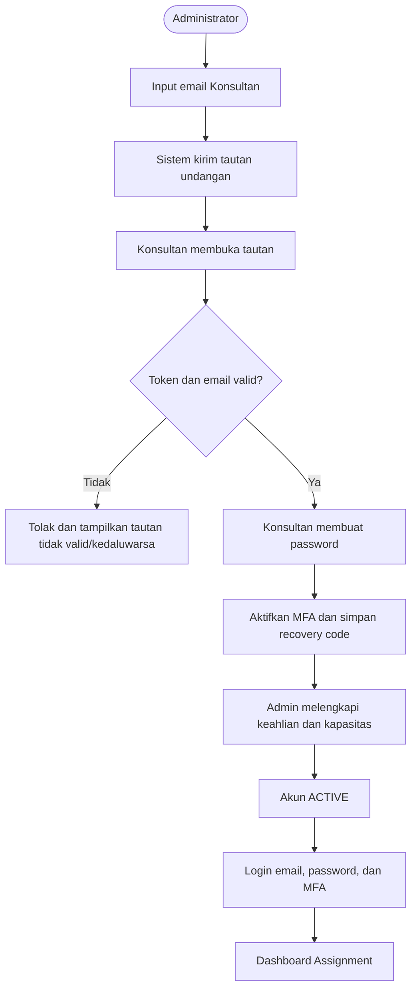
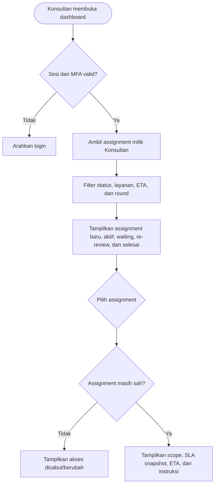
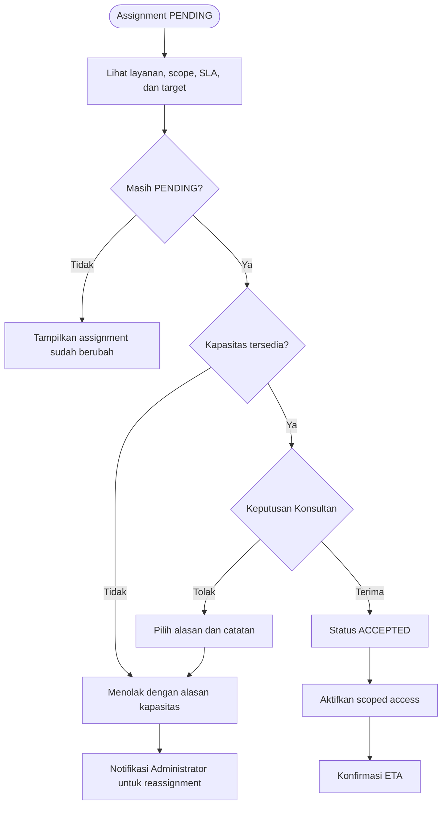
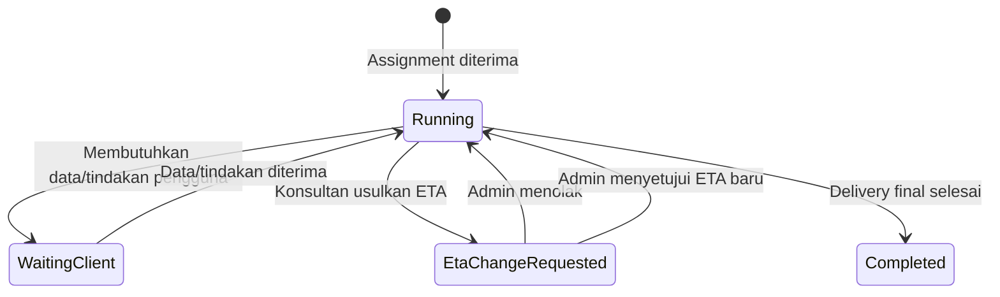
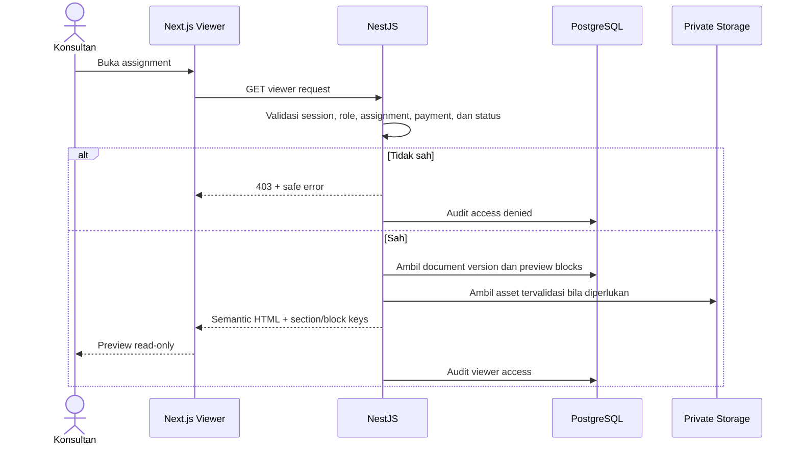
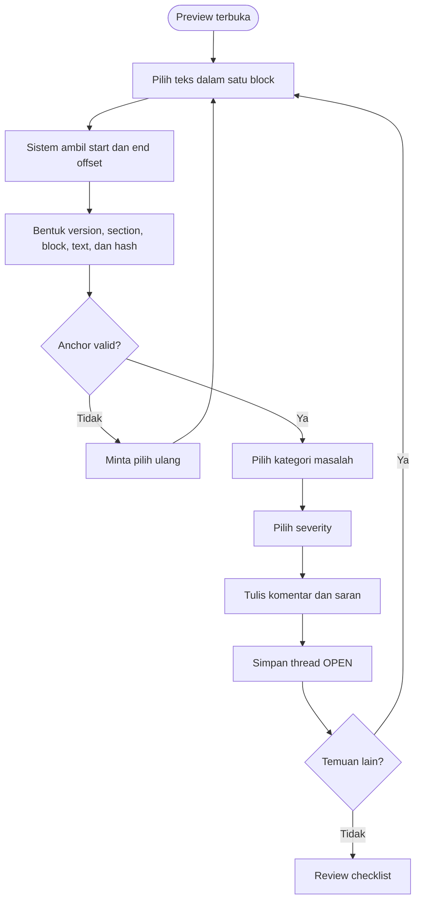
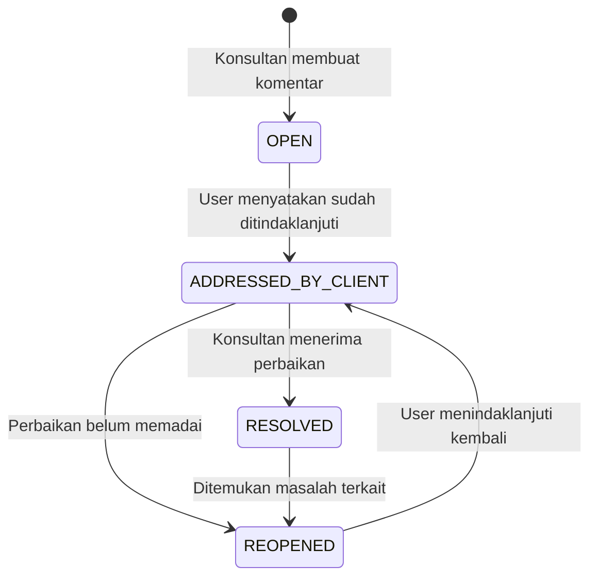
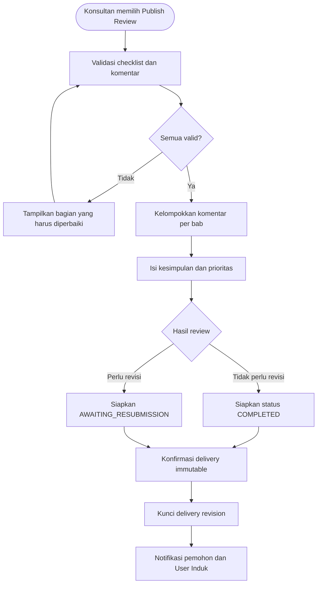
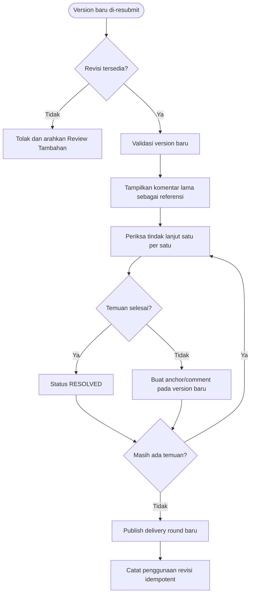
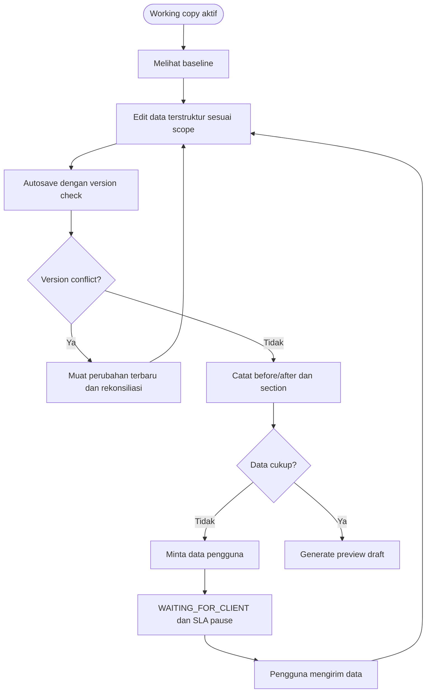

# Consultant Workflow

## 1. Tujuan

Dokumen ini menjelaskan alur operasional Konsultan sebagai aktor platform, mulai dari aktivasi akun sampai assignment ditutup. Konsultan bukan anggota organisasi pelanggan dan hanya memperoleh scoped access terhadap request berbayar yang ditugaskan.

Workflow ini mengacu pada use case `UCN-01` sampai `UCN-12`.

## 2. Batas Kewenangan Konsultan

Konsultan hanya menerima assignment berbayar dan tidak melihat, membuat, atau mengubah harga maupun diskon event. Event tidak mengubah SLA atau jumlah revisi pada order yang telah dibayar.

Konsultan dapat:

- mengaktifkan akun dari undangan Administrator;
- login menggunakan MFA;
- melihat assignment yang diberikan;
- menerima atau menolak assignment;
- mengonfirmasi atau mengusulkan perubahan ETA;
- membuka preview document version yang ditugaskan;
- membuat highlight, komentar, reply, resolve, dan reopen;
- menerbitkan review;
- melakukan review ulang;
- mengubah working copy Penyusunan Penuh;
- menyerahkan draft dan change summary;
- mengelola biodata serta ketersediaan.

Konsultan tidak dapat:

- mencari organisasi atau dokumen secara bebas;
- melihat request yang belum dibayar;
- melihat harga, quotation, metode pembayaran, atau refund;
- mengelola paket dan anggota organisasi;
- mengubah source document pada layanan Review;
- mempromosikan working copy;
- mengubah katalog, SLA snapshot, role, atau kapasitas sendiri;
- menggunakan assignment setelah dicabut atau dialihkan.

## 3. Onboarding dan Autentikasi

Aturan:

- Administrator tidak menetapkan atau melihat password Konsultan.
- Tautan undangan hanya berlaku untuk email tujuan dan terbatas waktu.
- MFA wajib sebelum akun memperoleh akses penuh.
- Akun `SUSPENDED` atau `DEACTIVATED` tidak dapat masuk.
- Lupa password menggunakan tautan reset mandiri.
- Reset MFA oleh Admin hanya setelah verifikasi identitas.
- Login, kegagalan MFA, reset, dan logout dicatat pada audit log.

## 4. Dashboard Assignment

### 4.1 Informasi yang Ditampilkan

| Informasi | Ditampilkan |
| --- | --- |
| Nomor request | Ya |
| Nama/identitas organisasi minimum yang diperlukan | Ya |
| Jenis layanan | Ya |
| Source document version | Ya |
| Round review | Ya |
| Status assignment/request | Ya |
| SLA dan ETA | Ya |
| Indikator overdue | Ya |
| Harga, quotation, payment, refund | Tidak |
| Dokumen organisasi lain | Tidak |

### 4.2 Flow Dashboard

Query dashboard selalu difilter menggunakan `consultantProfileId`. Pagination dan eager loading wajib digunakan untuk mencegah N+1 query pada status, request, round, dan ETA.

## 5. Menerima atau Menolak Assignment

Penerimaan assignment harus atomik. Jika assignment telah dicabut atau dialihkan sebelum keputusan disimpan, sistem menolak perubahan.

Scoped access memuat:

- consultation request;
- consultation round;
- source document version atau working copy;
- preview blocks;
- komentar dan delivery pada request tersebut.

## 6. ETA dan SLA

### 6.1 Konfirmasi ETA

1. Sistem membaca SLA snapshot.
2. Sistem menghitung ETA awal berdasarkan kalender hari kerja.
3. Konsultan menerima assignment.
4. Konsultan mengonfirmasi ETA atau mengusulkan tanggal baru.
5. Jika mengusulkan perubahan, Konsultan wajib memasukkan alasan.
6. Administrator menerima atau menolak usulan.
7. Pengguna menerima notifikasi hasil.
8. SLA event dicatat.

### 6.2 Pause dan Resume

Konsultan tidak dapat langsung mengubah SLA snapshot. Pause harus memiliki alasan dan hanya berlaku pada kondisi yang diizinkan.

## 7. Membuka Review Viewer

Viewer tidak membuka file Word untuk diedit. Preview dibentuk dari snapshot dan struktur yang sama dengan document version.

## 8. Highlight dan Komentar

### 8.1 Membuat Komentar

Satu anchor hanya mengacu pada satu preview block. Pemilihan lintas blok harus dipecah menjadi beberapa komentar.

### 8.2 Struktur Temuan

Setiap komentar memuat:

- document version;
- round;
- section code dan block key;
- start/end offset;
- selected text dan hash;
- kategori masalah;
- severity;
- isi komentar;
- status;
- penulis dan waktu;
- revision komentar.

### 8.3 Kategori dan Severity

Kategori awal dapat mencakup kelengkapan, konsistensi, profil perusahaan, transaksi, FAR, metode TP, benchmarking, keuangan, dan redaksional.

Severity:

| Severity | Penggunaan |
| --- | --- |
| `INFO` | Catatan atau saran informatif |
| `LOW` | Perbaikan kecil yang tidak material |
| `MEDIUM` | Ketidaktepatan yang perlu diperbaiki |
| `HIGH` | Masalah material terhadap analisis/dokumen |
| `CRITICAL` | Masalah utama yang menghalangi penerimaan hasil review |

Severity membantu prioritas, tetapi tidak merupakan opini hukum atau jaminan kepatuhan.

## 9. Thread Komentar

Aturan thread:

- User dan Konsultan dapat membalas sesuai scoped access.
- Setiap perubahan status memiliki penulis, waktu, status asal, status tujuan, dan alasan.
- Konflik optimistic version menghasilkan permintaan refresh.
- Thread pada delivery lama menjadi read-only setelah request ditutup.
- Isi yang telah diterbitkan tidak diubah diam-diam.

## 10. Menerbitkan Review

Ringkasan per bab menampilkan bab, kutipan, komentar, kategori, severity, dan status. Ringkasan tidak menggantikan thread sumber.

Jika delivery gagal disimpan, status request tetap pada kondisi sebelumnya dan retry menggunakan idempotency key.

## 11. Review Ulang

### 11.1 Flow

Anchor lama tidak dipindahkan. Perubahan teks dapat mengubah offset dan konteks, sehingga temuan pada version baru membutuhkan anchor baru.

### 11.2 Hasil Review Ulang

- Semua temuan selesai: request dapat menjadi `COMPLETED`.
- Masih perlu perbaikan dan revisi tersisa: kembali `AWAITING_RESUBMISSION`.
- Revisi habis: pengguna memerlukan order Review Tambahan.
- Version tidak sah: resubmission ditolak tanpa memakai kuota.

## 12. Penyusunan Penuh

### 12.1 Membuka Working Copy

Sistem memvalidasi:

- quotation diterima;
- payment `PAID`;
- assignment diterima;
- workspace `ACTIVE`;
- Konsultan sesuai assignment;
- source Local File dan scope benar.

### 12.2 Mengubah Working Copy

Konsultan tidak boleh mengedit organisasi, membership, billing, atau data di luar scope request.

### 12.3 Menyerahkan Draft

1. Jalankan pemeriksaan kelengkapan.
2. Pastikan tidak ada conflict terbuka.
3. Tinjau change set.
4. Tulis catatan penyerahan dan asumsi.
5. Generate preview draft.
6. Konfirmasi delivery immutable.
7. Kirim kepada User Induk.
8. Tunggu keputusan User Induk.

Jika pemohon yang masih berwenang atau User Induk pengambil alih meminta revisi dan kuota tersedia, Konsultan memperbaiki working copy yang sama lalu membuat delivery revision baru. Jika revisi habis, pekerjaan tambahan memerlukan order baru.

Setiap delivery Penyusunan Penuh dibekukan pada `consultation_workspace_deliveries` bersama versi workspace, snapshot data, checksum, dan file hasil. Perubahan berikutnya pada working copy tidak mengubah delivery lama. Workspace tetap mengacu pada baseline document version sampai promotion yang disetujui pemohon berwenang atau User Induk pengambil alih menghasilkan `promoted_document_version_id`.

### 12.4 Persetujuan dan Promotion

Konsultan tidak melakukan promotion. Setelah pemohon yang masih berhak mengubah Local File atau User Induk pengambil alih menyetujui:

- sistem memvalidasi working copy;
- promotion dilakukan secara transaksional;
- Local File version baru dibuat;
- dokumen dapat di-generate;
- workspace menjadi `PROMOTED` atau `CLOSED`;
- scoped access Konsultan ditutup sesuai kebijakan.

## 13. Profil, Keahlian, dan Ketersediaan

Konsultan dapat mengubah biodata dan periode ketersediaan. Perubahan keahlian terverifikasi, kapasitas maksimum, role, atau status akun memerlukan Administrator.

Ketersediaan digunakan Admin ketika memilih assignment, tetapi tidak otomatis memindahkan pekerjaan aktif. Konsultan wajib menyelesaikan atau meminta reassignment melalui Admin jika tidak dapat melanjutkan.

## 14. Penutupan dan Pencabutan Akses

Scoped access berakhir ketika:

- assignment ditolak;
- assignment di-reassign;
- assignment dicabut;
- request dibatalkan;
- refund berhasil;
- request selesai dan periode akses berakhir;
- akun Konsultan disuspend/deactivated.

Saat akses berakhir:

- viewer dan working copy menolak request berikutnya;
- sesi aktif yang relevan dapat dicabut;
- komentar dan delivery tetap disimpan;
- histori tidak dipindahkan atau dihapus;
- Konsultan tidak dapat mengunduh kembali asset;
- audit mencatat alasan dan waktu pencabutan.

## 15. Notifikasi Konsultan

| Kejadian | Notifikasi |
| --- | --- |
| Undangan akun | Email aktivasi |
| Assignment baru | Portal dan email |
| Assignment dicabut/reassign | Portal dan email |
| ETA change disetujui/ditolak | Portal |
| User mengirim data | Portal |
| User membalas komentar | Portal |
| Document version di-resubmit | Portal dan email |
| Request dibatalkan/refund berhasil | Portal |
| Deadline mendekat | Portal |
| Akun disuspend/reactivate | Email dan portal jika dapat diakses |

Notifikasi tidak memuat isi lengkap dokumen atau data pembayaran.

## 16. Audit dan Observability

Audit Konsultan mencakup:

- aktivasi, login, MFA, reset, dan logout;
- pembukaan dashboard dan assignment;
- keputusan assignment;
- konfirmasi/usulan ETA;
- akses viewer;
- pembuatan/perubahan komentar;
- reply, resolve, dan reopen;
- publish delivery;
- akses dan perubahan working copy;
- penyerahan draft;
- perubahan profil dan availability;
- pencabutan akses.

Metrik operasional dapat mencakup assignment acceptance rate, waktu penerimaan, SLA compliance, aging `WAITING_FOR_CLIENT`, jumlah komentar, review duration, re-review rate, dan workload. Metrik tidak menyimpan isi dokumen atau komentar mentah.

## 17. Alternative dan Exception Flow

| Kondisi | Respons |
| --- | --- |
| Undangan kedaluwarsa | Minta Admin mengirim undangan baru |
| MFA salah berulang | Rate limit dan penguncian sementara |
| Akun suspended | Tolak login dan scoped access |
| Assignment sudah berubah | Tolak keputusan lama |
| Kapasitas penuh | Tolak assignment atau minta reassignment |
| Preview tidak tersedia | Tampilkan error aman dan catat insiden |
| Anchor invalid | Minta selection ulang |
| Komentar conflict | Refresh optimistic version |
| Delivery gagal | Pertahankan status dan retry idempotent |
| Version resubmission salah | Tolak tanpa memakai revisi |
| Workspace conflict | Rekonsiliasi tanpa overwrite |
| Assignment dicabut saat autosave | Tolak penyimpanan dan tutup workspace |
| Model AI/storage/payment terganggu | Hanya fungsi terkait gagal; data review tersimpan tidak hilang |

## 18. Kriteria Penerimaan

- Konsultan tidak dapat aktif tanpa undangan, password pribadi, dan MFA.
- Dashboard hanya menampilkan assignment milik Konsultan.
- Nominal dan informasi payment tidak tampil.
- Assignment harus diterima sebelum viewer/workspace terbuka.
- Penolakan assignment memberi tahu Admin.
- ETA berubah hanya melalui alur persetujuan.
- Viewer menggunakan document version immutable.
- Setiap komentar mempunyai anchor, kategori, severity, status, dan audit.
- Delivery immutable dan ringkasan dapat ditelusuri ke thread.
- Review ulang menggunakan version serta anchor baru.
- Revisi tidak dapat digunakan melebihi snapshot.
- Working copy tidak mengubah Local File utama.
- Promotion hanya dilakukan setelah persetujuan pemohon berwenang atau User Induk pengambil alih, dengan identitas dan alasan pengambilalihan tercatat.
- Revoke/reassign/refund menutup akses.
- Retry tidak menggandakan komentar, delivery, atau pemakaian revisi.

## 19. Referensi

- [Use Case Konsultan](../02-Use-Case/Consultant.md)
- [Consultation Service Business Flow](./08-Consultation-Service.md)
- [Subscription and Billing](./06-Subscription-Billing.md)
- [Consultation Architecture](../05-Architecture/Consultation-Architecture.md)
- [Document Review Architecture](../05-Architecture/Document-Review-Architecture.md)
- [API Contract](../05-Architecture/API-Contract.md)
