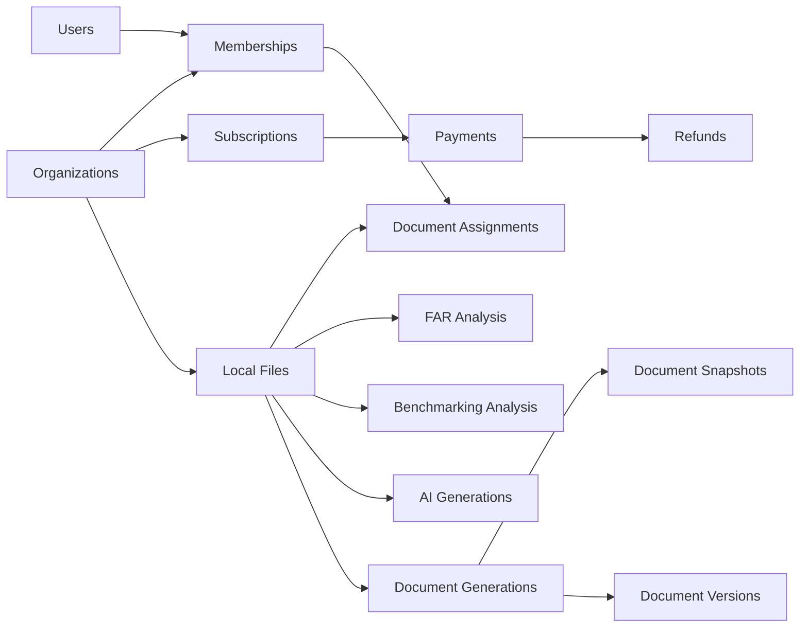

# Data Dictionary — TP Docs (With Consultant)
## Diskon Event Opsional

`discount_campaigns` menyimpan nama, status draft/aktif/nonaktif, jenis persentase atau nominal, nilai, mata uang untuk nominal tetap, rentang waktu, batas pemakaian opsional, dan Admin pembuat. `discount_campaign_targets` menentukan jenis produk dan ID produk opsional; jenis yang didukung ialah paket, add-on dokumen, add-on kursi, Enterprise/Custom, dan pada varian Konsultan juga layanan konsultasi. `discount_redemptions` mencatat penggunaan tepat satu kali per payment berstatus berhasil. Pembelian yang belum berhasil memakai reservasi sementara dengan TTL pada checkout; reservasi kedaluwarsa dilepas.

`payments.original_amount_minor`, `discount_amount_minor`, `amount_minor`, dan `discount_campaign_id` membekukan harga sebelum potongan, potongan, total dibayar, dan event. Kolom sepadan pada `quotations` membekukan Enterprise/Custom saat quotation diterbitkan. Pada varian Konsultan, `consultation_requests` dan `consultation_quotations` menyimpan snapshot jasa. Tanpa promo, referensi event kosong dan potongan nol. Migration menerapkan nilai nonnegatif, `total = original - discount`, `starts_at < ends_at`, persentase 0–100, dan batas penggunaan positif.

## 1. Tujuan

Dokumen ini menjelaskan model data PostgreSQL TP Docs berdasarkan PRD, use case User Induk, Karyawan, Administrator, business flow, serta arsitektur sistem. ERD fisik-logis tersedia pada [ERD.dbml](./ERD.dbml), sedangkan pola query dan pencegahan N+1 dijelaskan pada [Query-Optimization.md](./Query-Optimization.md).

TP Docs merupakan SaaS multi-tenant. `organization_id` merupakan batas tenant utama dan wajib berasal dari konteks autentikasi backend, bukan dipercaya dari request frontend.

## 2. Konvensi Umum

| Ketentuan | Keputusan |
| --- | --- |
| Database | PostgreSQL |
| Primary key | UUID |
| Penamaan | `snake_case`, nama tabel jamak |
| Waktu | `timestamptz` dalam UTC; ditampilkan sesuai timezone pengguna |
| Nilai uang | `bigint amount_minor` untuk billing; `numeric(20,2)` untuk data Local File |
| Data fleksibel | `jsonb` hanya untuk manifest, snapshot immutable, metadata aman, dan ketentuan custom |
| Soft delete | `deleted_at` untuk akun, organisasi, dan file yang memerlukan retensi |
| File biner | PostgreSQL `bytea` pada `file_blob_chunks`; tabel `files` hanya menyimpan metadata dan status konten |
| Secret/token | Hanya hash atau ciphertext; token asli dan password asli tidak disimpan |
| Tenant filter | Seluruh tabel data pelanggan harus difilter dengan `organization_id` |
| Audit | Aktivitas sensitif dicatat pada `audit_logs` tanpa isi dokumen mentah |

## 3. Identity dan Authentication

### 3.1 `users`

Identitas akun pribadi User Induk, Karyawan, dan Administrator.

| Kolom utama | Fungsi |
| --- | --- |
| `id` | Identitas akun |
| `email` | Email login unik dan telah dinormalisasi |
| `full_name`, `phone` | Informasi pribadi |
| `status` | `PENDING_VERIFICATION`, `ACTIVE`, `SUSPENDED`, atau `DEACTIVATED` |
| `email_verified_at` | Waktu verifikasi email |
| `locale`, `timezone` | Preferensi penyajian |
| `deleted_at` | Soft delete akun |

### 3.2 Tabel autentikasi

| Tabel | Fungsi | Relasi penting |
| --- | --- | --- |
| `user_passwords` | Hash password adaptif dan metadata algoritma | Satu-ke-satu dengan `users` |
| `platform_user_roles` | Penetapan role internal `ADMINISTRATOR`, pemberi akses, dan pencabutan | Banyak-ke-satu ke `users`; terpisah dari membership perusahaan |
| `mfa_methods` | Metode MFA terenkripsi, verifikasi, dan pencabutan | Banyak-ke-satu ke `users` |
| `user_sessions` | Refresh token hash, perangkat tersamar, expiry, dan revoke | Banyak-ke-satu ke `users` |
| `auth_tokens` | Token hash verifikasi email dan reset password | Banyak-ke-satu ke `users` |

Password, token asli, kode MFA, dan secret mentah tidak boleh ditulis pada log.

Role Administrator tidak disimpan pada `memberships`. Administrator merupakan role platform internal dan tidak otomatis menjadi anggota organisasi pelanggan atau memperoleh akses ke Local File.

## 4. Organization dan Membership

| Tabel | Fungsi | Constraint utama |
| --- | --- | --- |
| `organizations` | Tenant perusahaan pemilik langganan dan Local File | `slug` unik |
| `organization_profiles` | NPWP terenkripsi, bidang usaha, alamat, telepon, negara, dan lokasi data | Satu-ke-satu dengan organisasi |
| `memberships` | Hubungan akun dengan organisasi sebagai `OWNER` atau `EMPLOYEE` | Unik per `organization_id + user_id` |
| `invitations` | Undangan email, token hash, status, expiry, dan pengirim | Token unik; status mengikuti business flow |
| `document_assignments` | Penugasan Local File kepada membership Karyawan | Unik per dokumen dan membership |

Aturan yang perlu ditegakkan melalui service dan transaction:

- Satu organisasi memiliki tepat satu membership `OWNER` aktif.
- Satu akun Karyawan hanya memiliki satu membership organisasi aktif pada MVP.
- Membership dan assignment harus mempunyai `organization_id` yang sama dengan Local File.
- Undangan hanya dapat diterima akun dengan email tujuan.
- Penghapusan Karyawan mencabut membership, assignment, dan session organisasi tanpa menghapus histori dokumen.

## 5. Subscription, Quota, dan Billing

### 5.1 Katalog dan langganan

| Tabel | Fungsi |
| --- | --- |
| `plans` | Katalog Free, Basic, Professional, dan Enterprise/Custom beserta entitlement dasar |
| `plan_prices` | Riwayat harga per mata uang dan periode berlaku |
| `subscriptions` | Paket organisasi, status, periode aktif, kuota dokumen, kuota kursi, dan ketentuan custom |
| `subscription_document_addons` | Kuota dokumen tambahan dan pemakaiannya sampai akhir periode |
| `subscription_seat_addons` | Kursi tambahan prorata sampai akhir periode |
| `quota_ledger` | Ledger immutable untuk grant, consume, release, adjustment, dan expiry kuota |

Saldo kuota tidak ditentukan hanya dari counter yang dapat diubah bebas. `quota_ledger` menjadi rekam jejak, sedangkan nilai pada subscription/add-on dapat digunakan sebagai read model yang diperbarui secara atomik.

### 5.2 Pembayaran dan refund

| Tabel | Fungsi | Constraint utama |
| --- | --- | --- |
| `payments` | Transaksi paket, upgrade, add-on, dan custom plan | `idempotency_key` serta provider payment ID unik |
| `payment_webhook_events` | Deduplication dan audit webhook payment gateway | Unik per provider dan event ID |
| `refunds` | Pengajuan, review, keputusan, proses provider, dan penyesuaian akses | Terhubung ke payment dan organisasi |
| `refund_approvals` | Persetujuan Administrator individual | Satu keputusan per admin dan refund |
| `withdrawals` | Pencairan dana oleh Administrator dan approval kedua | Idempotency key unik |

Nilai billing disimpan sebagai unit minor, misalnya rupiah dalam bilangan bulat. Penyesuaian akses refund hanya boleh dilakukan sekali dengan memeriksa `access_adjusted_at` dalam transaction.

### 5.3 Enterprise/Custom

| Tabel | Fungsi |
| --- | --- |
| `custom_plan_requests` | Form kebutuhan, tiket, status, kontak, entitas, pengguna, dokumen, SSO, region, dan dukungan |
| `custom_plan_request_history` | Histori transisi status serta pelaku perubahan |
| `quotations` | Harga, masa, kuota, kursi, ketentuan, serta keputusan User Induk |
| `quotation_items` | Rincian item quotation terurut |

Status pengajuan: `SUBMITTED`, `UNDER_REVIEW`, `REVISION_REQUESTED`, `QUOTED`, `AWAITING_PAYMENT`, `ACTIVE`, `REJECTED`, dan `CLOSED`.

## 6. File Management

### `files`

Metadata file privat untuk upload Excel/PDF, bukti refund, benchmarking, template, DOCX, PDF, dan gambar tervalidasi.

| Kolom utama | Fungsi |
| --- | --- |
| `organization_id` | Tenant pemilik; dapat kosong hanya untuk aset platform seperti template internal |
| `chunk_count` | Jumlah chunk 1 MiB; maksimum 50 chunk untuk batas 50 MB |
| `content_status` | `UPLOADING`, `COMPLETE`, `CORRUPTED`, atau `DELETED` |
| `checksum_sha256` | Verifikasi integritas; tidak digunakan untuk deduplikasi lintas organisasi |
| `scan_status` | `PENDING`, `CLEAN`, `INFECTED`, `FAILED`, atau `QUARANTINED` |
| `deleted_at` | Retensi dan penghapusan terjadwal |

Isi file disimpan pada `file_blob_chunks` menggunakan `bytea`, bukan Base64. Setiap baris menyimpan `file_id`, `chunk_index`, `content`, dan `size_bytes`; pasangan `(file_id, chunk_index)` menjadi primary key. File hanya dapat digunakan setelah seluruh chunk lengkap, checksum cocok, dan status malware scan memenuhi kebijakan. Unduhan selalu di-stream oleh NestJS setelah otorisasi.

Upload yang terputus tetap berstatus `UPLOADING` dan dibersihkan oleh job terjadwal; sistem tidak boleh menandainya sebagai file lengkap. Penghapusan permanen menghapus metadata dan seluruh chunk dalam satu transaksi. Batas `size_bytes <= 50 MB`, `chunk_count <= 50`, ukuran tiap chunk maksimal 1 MiB, serta konsistensi total byte ditegakkan oleh service dan migration constraint.

`review_deliveries.delivery_file_id` menghubungkan hasil delivery Konsultan yang berbentuk file ke `files`. Dokumen sumber review tetap menggunakan `document_versions.docx_file_id` atau `pdf_file_id`; seluruh kontennya berada pada chunk PostgreSQL yang sama.

## 7. Local File Inti

### 7.1 Dokumen dan progress

| Tabel | Fungsi |
| --- | --- |
| `local_files` | Aggregate root Local File: tenant, tahun pajak, status, versi, metode, dan editor terakhir |
| `local_file_section_progress` | Status serta validasi setiap bagian wizard |
| `local_file_company_profiles` | Identitas entitas untuk tahun pajak dan dokumen tertentu |
| `document_assignments` | Hak Karyawan terhadap dokumen tertentu |

Status Local File: `DRAFT`, `IN_PROGRESS`, `READY_TO_GENERATE`, `GENERATING`, `GENERATED`, dan `ARCHIVED`.

`local_files.identity_hash` menyimpan hash identitas ternormalisasi untuk mencegah duplikasi entitas, tahun pajak, jenis dokumen, dan nama dokumen pada organisasi yang sama. `duplicated_from_local_file_id` mencatat sumber ketika dokumen dibuat melalui aktivitas Duplikasi.

### 7.2 Kepemilikan dan manajemen

| Tabel | Fungsi |
| --- | --- |
| `shareholders` | Nama pemegang saham, nilai nominal, persentase, dan urutan |
| `company_managements` | Komisaris/direksi, jabatan, nama pengurus, dan urutan |

Validasi aplikasi memastikan total kepemilikan sesuai kebijakan dan nilai persentase berada pada rentang yang sah.

### 7.3 Bisnis, strategi, dan skema AI

| Tabel | Fungsi |
| --- | --- |
| `business_profiles` | Uraian usaha, produk, strategi, dan uraian proses bisnis wajib |
| `business_process_steps` | Daftar langkah opsional yang diurutkan pengguna |
| `ai_generations` | Provider, model, prompt/schema version, status, idempotency, latency, dan error aman |
| `ai_generation_phases` | Fase tervalidasi, kategori, hubungan fase berikutnya, dan traceability ke langkah input |

Generation AI yang belum diterima tidak menjadi skema aktif. `accepted_at` dan status `ACCEPTED` menunjukkan hasil yang boleh digunakan pada draft Local File.

`business_profiles.value_chain_description` menyimpan rantai nilai secara eksplisit sehingga tidak tercampur dengan uraian umum perusahaan.

### 7.4 Keuangan, afiliasi, pesaing, dan industri

| Tabel | Fungsi |
| --- | --- |
| `financial_summaries` | Ringkasan keuangan per tahun dan mata uang |
| `affiliates` | Perusahaan afiliasi, aktivitas/peran, dan bentuk hubungan |
| `competitors` | Pesaing utama dan negara/domisili |
| `industry_overviews` | File sumber, deskripsi teks, ruang lingkup industri, impor/pasokan, dan prospek |
| `file_extractions` | Job ekstraksi Word/PDF, hasil sementara terenkripsi, expiry, dan error aman |

### 7.5 Transaksi

| Tabel | Fungsi |
| --- | --- |
| `affiliate_transactions` | Jenis transaksi, lawan transaksi, uraian, metode TP, dan nilai |
| `independent_transactions` | Jenis transaksi, lawan transaksi, dan nilai independen |
| `transaction_summaries` | Ringkasan hasil agregasi yang dapat diregenerasi |
| `transaction_imports` | Satu proses upload Excel atau paste TSV, status validasi, jumlah baris, dan idempotency |
| `transaction_import_errors` | Error per baris/kolom tanpa menyimpan nilai sensitif mentah |
| `non_financial_events` | Kejadian nonkeuangan yang relevan serta dampaknya pada harga atau laba |

`transaction_summaries` merupakan read model, bukan sumber transaksi. Perubahan transaksi harus meregenerasi summary secara atomik atau melalui job yang idempotent.

### 7.6 Analisis FAR dan metode TP

| Tabel | Fungsi |
| --- | --- |
| `far_analyses` | Induk analisis FAR per Local File |
| `far_functions` | Fungsi dan deskripsi pelaksanaan |
| `far_assets` | Kategori aset, nilai buku bersih, dan keterangan |
| `far_risks` | Risiko dan deskripsi penanganan |
| `tp_method_selections` | Metode terpilih, tested party, PLI, dan alasan |
| `tp_method_evaluations` | Evaluasi tiap metode TP, status, dan alasan |

### 7.7 Benchmarking

| Tabel | Fungsi |
| --- | --- |
| `benchmarking_analyses` | Induk benchmarking, file sumber, strategi, dan status |
| `benchmark_search_steps` | Langkah pencarian serta jumlah hasil |
| `benchmark_search_results` | Kandidat perusahaan dan alasan seleksi/eksklusi |
| `pli_selections` | PLI tunggal yang dipilih dan formulanya |
| `comparables` | Pembanding, negara, COGS, GP, OP, PLI, dan status final |
| `interquartile_ranges` | Minimum, Q1, median, Q3, dan maksimum |
| `review_warnings` | Warning seperti hasil di luar rentang wajar |

Pemilihan PLI bersifat saling eksklusif pada versi awal sehingga hanya satu record `pli_selections` per analisis.

Q2 tidak disimpan sebagai kolom terpisah karena Q2 secara statistik sama dengan median. Antarmuka dan dokumen dapat menampilkan label “Median/Q2” dari kolom `median` tanpa menduplikasi nilai.

## 8. Document Generation

| Tabel | Fungsi |
| --- | --- |
| `document_templates` | Versi template master DOCX, manifest, checksum, dan status rilis |
| `document_generations` | Job, template terpilih, status, progress, idempotency, dan error aman |
| `document_generation_attempts` | Histori setiap percobaan dan retry pada satu generation |
| `document_snapshots` | Snapshot immutable `LocalFileDocumentViewModel` yang digunakan worker |
| `document_versions` | Hasil DOCX/PDF immutable dan nomor versi dokumen |

DOCX merupakan sumber utama. PDF, jika diizinkan paket, selalu berasal dari DOCX tervalidasi pada generation dan snapshot yang sama.

`document_generations.review_confirmed_at` membuktikan konfirmasi final User Induk. `warning_acknowledged_at` diisi ketika pengguna memilih melanjutkan walaupun terdapat warning rentang kewajaran. `include_pdf` merekam format tambahan yang diminta dan telah diizinkan paket.

## 9. Operasional Platform

| Tabel | Fungsi |
| --- | --- |
| `notifications` | Notifikasi dalam aplikasi dan status baca |
| `email_deliveries` | Pengiriman Resend, retry, idempotency, dan error aman |
| `audit_logs` | Aktivitas pengguna, admin, sistem, dan akses sensitif |
| `platform_settings` | Pengaturan dasar platform yang diubah Administrator |
| `maintenance_events` | Aktivasi/nonaktif maintenance mode dan pemberitahuan |
| `integration_events` | Event teknis email, storage, malware scanner, payment, dan AI |
| `idempotency_keys` | Pencegahan duplikasi request lintas modul |

Audit log tidak menyimpan password, token, NPWP lengkap, uraian dokumen, atau data finansial mentah.

## 10. Relasi Aggregate Utama



## 11. Integritas dan Constraint yang Memerlukan Migration SQL

DBML menggambarkan struktur utama. Constraint berikut sebaiknya ditambahkan melalui migration PostgreSQL karena membutuhkan partial index, check constraint, atau trigger terkontrol:

- Unique partial index untuk satu subscription aktif per organisasi.
- Unique partial index untuk satu `OWNER` aktif per organisasi.
- Unique partial index untuk mencegah satu Karyawan mempunyai lebih dari satu membership aktif pada MVP.
- Check `ownership_percentage BETWEEN 0 AND 100`.
- Check `completion_percent BETWEEN 0 AND 100`.
- Check nilai uang dan kuota tidak negatif.
- Check `start_at < end_at`, `valid_from < valid_until`, dan tanggal expiry yang sesuai.
- Check `q1 <= median AND median <= q3`, serta minimum/maksimum mengapit rentang.
- Trigger atau service invariant agar `organization_id` child sama dengan aggregate parent.
- Row Level Security sebagai defense-in-depth setelah pola transaksi dan koneksi Prisma divalidasi.

Contoh partial index yang direncanakan:

```sql
CREATE UNIQUE INDEX uq_active_subscription_per_org
ON subscriptions (organization_id)
WHERE status IN ('ACTIVE', 'PAST_DUE');

CREATE UNIQUE INDEX uq_active_owner_per_org
ON memberships (organization_id)
WHERE role = 'OWNER' AND status = 'ACTIVE';
```

## 12. Retensi dan Penghapusan

- Berakhirnya langganan tidak langsung menghapus Local File; organisasi masuk masa pemulihan sesuai NFR.
- Penghapusan akun Karyawan tidak menghapus data organisasi atau audit history.
- File dan data produksi dihapus melalui proses terjadwal setelah masa retensi.
- Backup mengikuti siklus maksimal yang ditetapkan NFR.
- Record yang diperlukan untuk bukti transaksi, refund, audit, dan kepatuhan mengikuti kebijakan retensi legal yang divalidasi sebelum production.

## 13. Traceability terhadap Business Flow

### 13.1 `03-Local-File-Management.md`

| Tahap business flow | Tabel sumber utama | Status |
| --- | --- | --- |
| Buat/buka dokumen, identitas, tahun pajak, status, duplikasi | `local_files`, `quota_ledger` | Tercakup |
| Progress, draft, validasi antarbagian | `local_file_section_progress`, `local_files`, `audit_logs` | Tercakup |
| Profil perusahaan | `local_file_company_profiles` | Tercakup |
| Pemegang saham | `shareholders` | Tercakup |
| Komisaris dan direksi | `company_managements` | Tercakup |
| Bisnis, produk, rantai nilai, strategi, uraian proses | `business_profiles`, `business_process_steps` | Tercakup |
| Generation dan fase AI accepted | `ai_generations`, `ai_generation_phases` | Tercakup |
| Ringkasan laporan keuangan | `financial_summaries` | Tercakup |
| Pihak afiliasi dan pesaing | `affiliates`, `competitors` | Tercakup |
| Gambaran industri teks/Word/PDF | `industry_overviews`, `files`, `file_extractions` | Tercakup |
| Upload Excel atau paste TSV dan error baris | `transaction_imports`, `transaction_import_errors`, `files` | Tercakup |
| Transaksi afiliasi dan independen | `affiliate_transactions`, `independent_transactions` | Tercakup |
| Summary transaksi otomatis | `transaction_summaries` | Tercakup sebagai read model |
| Kejadian nonkeuangan relevan | `non_financial_events` | Tercakup |
| FAR: fungsi, aset, dan risiko | `far_analyses`, `far_functions`, `far_assets`, `far_risks` | Tercakup |
| Pemilihan serta evaluasi metode TP | `tp_method_selections`, `tp_method_evaluations` | Tercakup |
| File dan strategi benchmarking | `benchmarking_analyses`, `files` | Tercakup |
| Langkah dan hasil pencarian | `benchmark_search_steps`, `benchmark_search_results` | Tercakup |
| PLI tunggal | `pli_selections` | Tercakup |
| Pembanding final | `comparables` | Tercakup |
| Rentang minimum, Q1, median/Q2, Q3, maksimum | `interquartile_ranges` | Tercakup; Q2 memakai kolom `median` |
| Warning hasil analisis | `review_warnings` | Tercakup |

### 13.2 `02-Document-Generation.md`

| Tahap business flow | Tabel sumber utama | Status |
| --- | --- | --- |
| Pemeriksaan kelengkapan bagian | `local_file_section_progress`, seluruh aggregate Local File | Tercakup |
| Status Ready to Generate | `local_files.status` | Tercakup |
| Preview entitas, tahun, karakteristik, metode, transaksi, pembanding | Query projection dari tabel Local File | Derived; tidak memerlukan tabel duplikat |
| Warning dan keputusan melanjutkan | `review_warnings`, `document_generations.warning_acknowledged_at` | Tercakup |
| Konfirmasi final generate | `document_generations.review_confirmed_at` | Tercakup |
| Validasi format terhadap paket | `plans`, `subscriptions`, `document_generations.include_pdf` | Tercakup |
| Snapshot immutable | `document_snapshots` | Tercakup |
| Template aktif dan versinya | `document_templates` | Tercakup |
| Job, progress, status, idempotency | `document_generations` | Tercakup |
| Retry dan error per percobaan | `document_generation_attempts` | Tercakup |
| Hasil DOCX/PDF | `document_versions`, `files` | Tercakup |
| History nama, tahun, status, versi, waktu | `local_files`, `document_versions` | Tercakup |
| Buka dan download | `document_versions`, `files`, `file_blob_chunks`; konten di-stream melalui API terautentikasi | Tercakup tanpa akses database langsung dari browser |
| Duplikasi dokumen dan sumbernya | `local_files.duplicated_from_local_file_id`, `quota_ledger` | Tercakup |
| Audit aktivitas sensitif | `audit_logs` | Tercakup |

### 13.3 Aktivitas yang Tidak Memerlukan Tabel Terpisah

Tidak setiap kotak pada business flow harus menjadi tabel. Aktivitas berikut merupakan proses atau data turunan:

- Validasi field dan keputusan “valid/tidak” dijalankan service; error aktif dapat disimpan pada `local_file_section_progress.validation_errors`.
- Preview ringkasan dibentuk melalui projection dari sumber data, sehingga tidak dibuat tabel preview yang dapat menjadi tidak sinkron.
- Konten file dibaca dengan query terpisah berdasarkan urutan `chunk_index` dan di-stream oleh API; query daftar dokumen tidak boleh mengambil `file_blob_chunks`.
- Pilihan upgrade ketika kuota habis berasal dari `plans`, `subscriptions`, add-on, dan `quota_ledger`.
- Render tabel Word dilakukan dari `document_snapshots`, bukan query per placeholder.
- Status pada UI berasal dari status Local File atau generation dan tidak membutuhkan tabel UI tersendiri.

## 14. Keputusan yang Masih Perlu Divalidasi

| Keputusan | Status |
| --- | --- |
| Versi PostgreSQL production | Pending infrastructure decision |
| Implementasi Row Level Security | Wajib proof of concept dengan Prisma transaction context |
| Kebijakan partisi `audit_logs` dan event | Diterapkan setelah volume terukur |
| Retensi billing dan audit legal | Pending legal validation |
| Formula upgrade, prorata, dan refund | Pending business validation |
| Mata uang selain IDR | Pending payment-provider validation |

---

## Ekstensi Data Layanan Konsultan

Bagian berikut menjelaskan tabel tambahan khusus layanan Konsultan pada skema database terpadu.

### Kelompok Data

| Kelompok | Tabel | Fungsi |
| --- | --- | --- |
| Konsultan | `consultant_invitations`, `consultant_profiles`, `consultant_availabilities` | Onboarding aman, status, keahlian, kapasitas, dan availability |
| Katalog | `consultation_services`, `consultation_service_versions` | Produk jasa dan version immutable harga/SLA/revisi |
| Request | `consultation_requests`, `consultation_request_status_history` | Order, tenant, document version, snapshot ketentuan, serta status |
| Quotation | `consultation_quotations` | Harga final Penyusunan Penuh yang ditentukan Admin |
| Assignment/SLA | `consultation_assignments`, `consultation_sla_events` | Konsultan terpilih, scoped access, ETA, pause, dan extension |
| Review | `consultation_rounds`, `document_preview_blocks`, `review_comments`, `review_comment_anchors`, `review_comment_replies`, `review_deliveries` | Version review, semantic preview, highlight, thread, dan summary |
| Penyusunan Penuh | `consultation_workspaces`, `consultation_change_sets` | Structured working copy dan histori perubahan |

### Katalog dan Harga

- `consultation_services` adalah identitas produk stabil.
- Setiap edit membuat `consultation_service_versions` baru.
- `FIXED` memakai `display_price_minor`.
- `STARTING_FROM` memakai `minimum_price_minor` dan quotation final.
- `QUOTATION` tidak memiliki checkout langsung.
- Request menyalin nama, pricing mode, amount, currency, SLA, revisi, dan service version.
- Nominal tidak dibaca ulang dari katalog setelah request dibuat.

### Request dan Akses

- Status request: `DRAFT`, `AWAITING_QUOTATION`, `REVISION_REQUESTED`, `QUOTED`, `AWAITING_PAYMENT`, `PAID`, `PENDING_ASSIGNMENT`, `ASSIGNED`, `IN_PROGRESS`, `WAITING_FOR_CLIENT`, `REVIEW_DELIVERED`, `AWAITING_RESUBMISSION`, `RE_REVIEW`, `COMPLETED`, `REJECTED`, `CANCELLED`, `REFUND_PROCESSING`, dan `REFUNDED`.
- Request selalu membawa `organization_id`, `local_file_id`, dan `source_document_version_id`.
- Karyawan harus mempunyai assignment baseline yang aktif pada Local File.
- `payment_id` harus berstatus `PAID` sebelum assignment.
- Konsultan tidak menjadi membership organisasi.
- Scoped access berasal dari `consultation_assignments` dan berakhir saat revoke, reassign, complete, atau expiry.

### Comment Anchor

Anchor terdiri atas document version, preview block, section, block key, offset, selected text, serta hash. Offset divalidasi terhadap `content_hash`; perubahan content menyebabkan selection harus dibuat ulang.

### Revision

- `consultation_rounds.round_number=1` adalah review awal.
- Round berikutnya memakai `used_revision_rounds`.
- Request tidak menerima resubmission jika used revision sudah sama dengan snapshot included revision.
- Review tambahan membuat request baru dan dapat mengisi `previous_request_id`.

### Working Copy

- `working_data` adalah structured snapshot terpisah.
- `version` digunakan untuk optimistic concurrency.
- `consultation_change_sets` menyimpan perubahan terarah tanpa menulis isi penuh ke audit log.
- Promotion menghasilkan Local File/document version baru melalui transaction application layer.

### Constraint Migration

- Satu service version current per service menggunakan partial unique index.
- Satu assignment `PENDING`/`ACCEPTED` aktif per request.
- `display_price_minor > 0` untuk `FIXED`.
- `minimum_price_minor > 0` untuk `STARTING_FROM`.
- `start_offset >= 0` dan `end_offset > start_offset`.
- `used_revision_rounds <= included_revision_rounds_snapshot`.
- Harga dan currency quotation tidak dapat diubah setelah diterima.
- Organization pada request, Local File, document version, dan payment harus sama.

### Query dan N+1

- Dashboard dimulai dari assignment dan memilih field request/service snapshot yang diperlukan.
- Comment thread diambil dengan nested read atau batch `IN`, bukan query reply per comment.
- Preview block dipaginasi/diambil per section.
- Summary dibentuk set-based dari seluruh komentar round.
- Aturan query lengkap tersedia pada [Query Optimization](./Query-Optimization.md).
