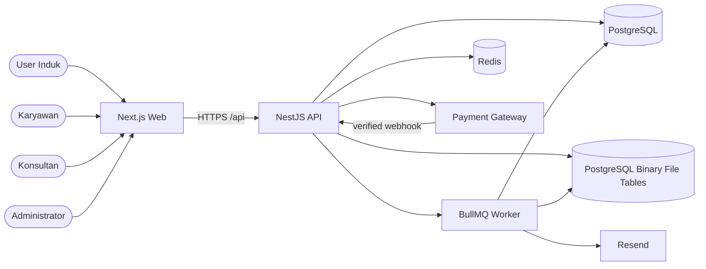
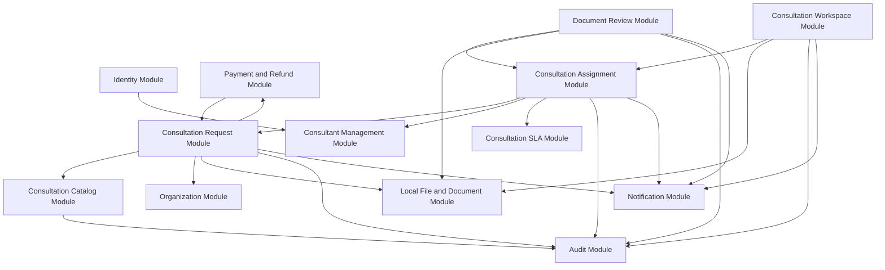
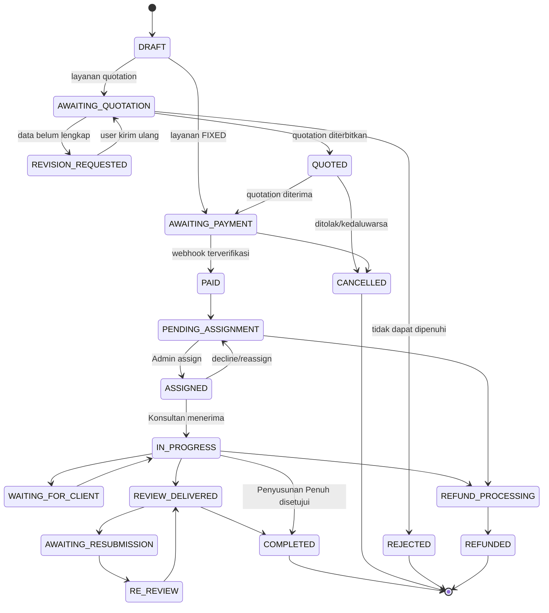
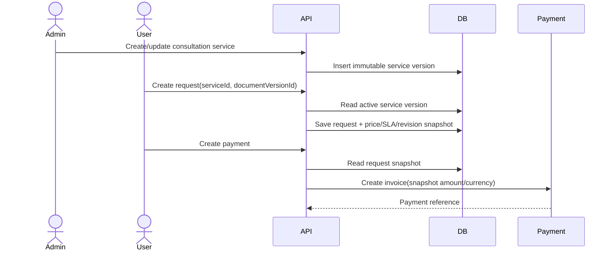
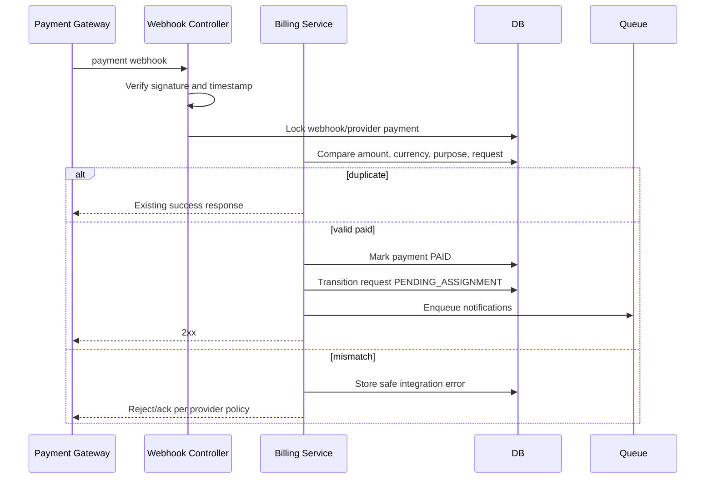
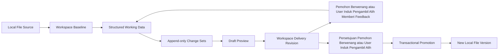

# Consultation Architecture — TP Docs With Consultant


## 1. Tujuan dan Cakupan

Arsitektur ini mendefinisikan domain layanan Konsultan pada TP Docs:

- katalog jasa dan versioning;
- request, quotation, payment, refund, dan status;
- onboarding serta profil Konsultan;
- assignment, reassignment, kapasitas, SLA, dan ETA;
- review dokumen, komentar, review ulang, dan delivery;
- Penyusunan Penuh melalui working copy;
- notifikasi, audit, dan pencabutan akses.

Konsultan merupakan role platform internal, bukan membership organisasi.

## 2. Prinsip Arsitektur

1. Next.js tidak menentukan harga, status pembayaran, atau kewenangan Konsultan.
2. NestJS menjadi satu-satunya public backend.
3. Semua akses tenant divalidasi di backend.
4. Payment wajib terverifikasi sebelum assignment.
5. Assignment yang diterima menjadi sumber scoped access.
6. Document version untuk Review bersifat immutable.
7. Working copy terpisah dari Local File utama.
8. Promotion membutuhkan persetujuan pemohon yang masih berhak mengubah Local File, atau User Induk yang mengambil alih bila hak pemohon dicabut.
9. Harga, currency, SLA, dan revisi disimpan sebagai snapshot.
10. Seluruh tindakan sensitif memiliki audit trail.
11. Retry dan webhook wajib idempotent.
12. Konsultan tidak memperoleh data billing.

## 3. System Context Layanan Konsultasi



Frontend portal menggunakan aplikasi Next.js yang sama. Perbedaan portal ditentukan oleh route, layout, role, dan permission; keamanan akhir tetap berada pada NestJS.

## 4. Modul Domain NestJS



### 4.1 Batas Modul

| Modul | Tanggung jawab | Tidak bertanggung jawab |
| --- | --- | --- |
| Catalog | Layanan, pricing mode, version, SLA, revisi, aktivasi | Membuat payment |
| Request | Lifecycle request dan snapshot | Memverifikasi webhook |
| Consultant Management | Undangan, profil, expertise, kapasitas, status | Membership organisasi |
| Assignment | Pilih Konsultan, accept/decline/reassign/revoke | Isi review |
| SLA | ETA, pause, resume, breach, approval perubahan | Harga layanan |
| Review | Preview, anchor, komentar, thread, delivery, round | Mengubah Local File |
| Workspace | Working copy, change set, feedback, delivery, promotion | Review fixed |
| Billing | Invoice, payment, webhook, refund, reconciliation | Assignment |
| Notification | Email dan in-app event | Menentukan status bisnis |
| Audit | Catatan aktivitas immutable | Penyimpanan isi dokumen |

## 5. Request Lifecycle



Transisi hanya dilakukan oleh application service yang berwenang. Controller tidak mengubah status secara langsung.

## 6. Authorization Chain

Setiap request konsultasi menjalankan pemeriksaan berlapis:

```text
Authenticated session
    → platform role / membership
    → organization boundary
    → Local File ownership
    → document assignment untuk Karyawan
    → consultation request ownership
    → payment state
    → active assignment untuk Konsultan
    → request/round/workspace state
    → resource-specific permission
```

### 6.1 User Induk

- Dapat membuat request dari document version yang dapat diaksesnya: dokumen buatannya, dokumen Karyawan yang dibagikan, atau yang diambil alih.
- Dapat melihat request dan transaksi konsultasi terkait dokumen yang dapat diaksesnya. Request pada dokumen privat Karyawan tidak mengungkap metadata atau isi sebelum berbagi/pengambilalihan.
- Dapat menyetujui hasil request sendiri; dapat mengambil alih keputusan request Karyawan bila hak ubah pemohon dicabut, dengan alasan dan jejak audit.

### 6.2 Karyawan

- Harus memiliki membership aktif.
- Harus menjadi pembuat aktif Local File atau memiliki `document_assignments` aktif pada dokumen buatan User Induk.
- Hanya melihat request atau payment konsultasi yang dibuatnya, kecuali kebijakan organisasi kelak diperluas.
- Dapat menyetujui hasil request sendiri selama hak ubah sebagai pembuat atau penerima penugasan masih aktif; tidak dapat menyetujui request orang lain.

### 6.3 Konsultan

- Harus memiliki role `CONSULTANT`, profil `ACTIVE`, MFA, dan assignment aktif.
- Tidak membutuhkan membership organisasi.
- Hanya mengakses request, round, preview, dan workspace yang ditugaskan.
- Tidak menerima nominal payment dalam DTO.

### 6.4 Administrator

- Mengelola platform, katalog, Konsultan, assignment, quotation, ETA, dan refund.
- Tidak otomatis memperoleh akses isi dokumen ketika membuat quotation.
- Akses isi pelanggan di luar proses assignment tetap mengikuti aturan dukungan dan audit.

## 7. Price Integrity dan Service Versioning

Diskon konsultasi dihitung oleh DiscountPricingService NestJS dari harga katalog FIXED atau harga awal quotation Penyusunan Penuh. Consultation request menyimpan snapshot harga awal, potongan, total, dan event; konsultasi dibayar memakai total tersebut. Katalog jasa tidak berubah karena promosi.




Aturan:

- Browser tidak menjadi sumber nominal.
- Version lama tidak diubah.
- Hanya satu service version current per service.
- Mode `FIXED` memerlukan display price valid.
- `STARTING_FROM` memerlukan minimum price dan quotation final.
- `QUOTATION` tidak dapat checkout sebelum quotation diterima.
- Payment menggunakan minor unit integer.

## 8. Payment dan Refund Integration

### 8.1 Payment Attempt

Satu request dapat memiliki beberapa payment attempt karena payment dapat gagal atau kedaluwarsa. Relasi target:

```text
consultation_requests 1 ── * consultation_request_payments * ── 1 payments
```

Hanya satu attempt current yang boleh aktif. Payment `PAID` pertama yang sah memenangkan aktivasi; webhook berikutnya harus idempotent.

Junction `consultation_request_payments` menyimpan semua attempt dan `payment_id` unik, nomor attempt, penanda current, serta `activated_at` untuk attempt yang memenangkan aktivasi. `consultation_requests.payment_id` tunggal dihapus agar tidak menjadi sumber data kedua. Constraint partial unique menjamin satu attempt current dan satu pemenang aktivasi per request; transaksi webhook mengunci request dan payment sebelum mengubah status. Attempt gagal, kedaluwarsa, atau dibatalkan tetap ada untuk audit dan refund.

### 8.2 Webhook



### 8.3 Refund

Refund memvalidasi payment, request, progress pekerjaan, approval kedua, dan idempotency. Setelah provider menyatakan berhasil, assignment access adjustment dilakukan tepat satu kali.

## 9. Assignment dan Scoped Access

### 9.1 Assignment Model

Assignment menyimpan:

- request;
- Consultant profile;
- Administrator pemberi assignment;
- status;
- initial dan confirmed due date;
- waktu accept/decline/end;
- alasan decline/revoke;
- assignment sebelumnya untuk lineage;
- batas waktu akses.

Kolom `previous_assignment_id` mereferensikan assignment lama pada request yang sama, sedangkan `revoke_reason` menyimpan alasan pencabutan. Assignment lama tidak dihapus saat reassignment; aksesnya ditutup sebelum assignment pengganti aktif.

### 9.2 Scoped Access Decision

```ts
type ConsultantAccessContext = {
  consultantUserId: string;
  consultantProfileId: string;
  assignmentId: string;
  requestId: string;
  roundId?: string;
  documentVersionId?: string;
  workspaceId?: string;
  expiresAt?: string;
};
```

Context dibentuk backend setelah seluruh pemeriksaan. ID dari browser tidak dipercaya tanpa validasi ulang.

### 9.3 Reassignment

Reassignment:

1. mengakhiri assignment lama;
2. mencabut scoped access;
3. mencatat alasan dan Admin;
4. membuat assignment baru;
5. menjaga komentar/delivery lama tetap memiliki penulis asli;
6. mengirim notifikasi kepada kedua Konsultan;
7. tidak mengubah payment atau snapshot request.

## 10. SLA dan ETA Architecture

SLA disimpan sebagai event agar seluruh perubahan dapat ditelusuri:

- `START`
- `PAUSE`
- `RESUME`
- `ETA_PROPOSED`
- `ETA_APPROVED`
- `ETA_REJECTED`
- `BREACHED`
- `COMPLETED`

ETA efektif dihitung dari event terakhir yang disetujui. Worker dapat mendeteksi due date mendekat atau breach tanpa mengubah status bisnis secara diam-diam.

## 11. Review Architecture Integration

Domain Review menggunakan:

- immutable document version;
- semantic preview blocks;
- round;
- comment anchor;
- thread dan reply;
- comment status history;
- immutable delivery revision;
- summary per bab.

`review_comment_status_history` mencatat transisi append-only. Saat publish, `review_delivery_comments` membekukan versi, isi, status, dan anchor komentar; delivery lama tidak membaca ulang body komentar yang dapat diedit. Database dan application layer menolak update/delete snapshot delivery yang sudah terbit.

Detail kontrak anchor dan viewer tersedia pada [Document Review Architecture](./Document-Review-Architecture.md).

## 12. Full Preparation Workspace



### 12.1 Isolation

- Working data memiliki schema version dan optimistic version.
- `baseline_document_version_id` menunjuk versi sumber request yang tetap; `promoted_document_version_id` kosong sampai promotion berhasil.
- Local File sumber tidak berubah selama Konsultan bekerja.
- Change set mencatat path, before/after hash, operation, actor, dan waktu.
- Asset hanya berasal dari storage organisasi yang sama.
- Konsultan hanya mengubah section dalam scope.

### 12.2 Delivery dan Promotion

Delivery Penyusunan Penuh menyimpan preview, change summary, catatan, revision, checksum, dan waktu. Promotion:

Setiap penerbitan membuat `consultation_workspace_deliveries` baru dengan snapshot data, versi workspace, referensi versi dokumen sumber, serta file hasil yang immutable. Edit workspace sesudah delivery tidak mengubah snapshot lama; revisi berikutnya menambah revision baru.

1. memvalidasi pemohon, hak sebagai pembuat atau penerima penugasan dan hak ubah Local File yang masih aktif, atau pengambilalihan User Induk setelah hak pemohon dicabut; validasi dilakukan lagi saat promotion;
2. memeriksa conflict baseline;
3. menjalankan transaction database;
4. membuat Local File version baru;
5. mencatat `promotedDocumentVersionId`;
6. menutup workspace dan scoped access;
7. mengirim job document generation bila diminta.

Persetujuan mengikat satu `consultation_workspace_deliveries` yang immutable dan mencatat `approved_by_user_id` serta `approved_at` pada workspace. Jika User Induk mengambil alih, audit menyimpan pemohon asal, alasan hak dicabut, pengambil alih, delivery, dan waktu. Backend memeriksa organisasi, Local File, baseline, status, serta versi workspace dalam transaksi. Promotion yang diulang memakai idempotency dan `promoted_document_version_id` yang sudah ada sehingga tidak membuat versi kedua.

## 13. Domain Events dan Queue

| Event | Producer | Consumer |
| --- | --- | --- |
| `ConsultationRequestCreated` | Request | Notification, Audit |
| `ConsultationPaymentPaid` | Billing | Request, Admin Notification |
| `ConsultationAssignmentCreated` | Assignment | Consultant Notification |
| `AssignmentAccepted` | Assignment | SLA, User Notification |
| `EtaChangeRequested` | SLA | Admin Notification |
| `ReviewDelivered` | Review | Request, User Notification |
| `ConsultationResubmitted` | Request | Review, Consultant Notification |
| `WorkspaceDeliveryCreated` | Workspace | User Notification |
| `WorkspaceApproved` | Workspace | Promotion Worker |
| `ConsultationRefunded` | Billing | Assignment Access Revocation |
| `ConsultationCompleted` | Request | Access Cleanup, Reporting |

Event memiliki event ID, correlation ID, aggregate ID, tenant ID bila relevan, waktu, dan schema version.

## 14. Data Ownership

| Data | Owner | Penyimpanan |
| --- | --- | --- |
| Katalog jasa | Platform | PostgreSQL |
| Profil Konsultan | Platform | PostgreSQL |
| Request dan quotation | Organisasi/platform | PostgreSQL |
| Payment/refund | Organisasi/platform | PostgreSQL + provider reference |
| Document version | Organisasi | PostgreSQL metadata + chunk biner |
| Preview blocks | Organisasi | PostgreSQL |
| Komentar dan delivery | Organisasi | PostgreSQL |
| Working copy | Organisasi | PostgreSQL |
| Preview/file delivery | Organisasi | PostgreSQL `files` + `file_blob_chunks` |
| Audit | Platform/organisasi | PostgreSQL append-only policy |

Penghapusan akun Konsultan tidak menghapus hasil kerja organisasi.

## 15. Security Controls

- TLS pada seluruh komunikasi.
- MFA wajib untuk Konsultan.
- Tenant validation pada API dan worker.
- Assignment validation untuk setiap viewer/comment/workspace request.
- Streaming asset privat melalui NestJS setelah validasi tenant dan assignment.
- Tidak ada payment amount pada DTO Konsultan.
- Tidak ada isi dokumen pada application log.
- Rate limit untuk login, komentar, dan delivery.
- Optimistic concurrency untuk thread dan workspace.
- Re-authentication untuk tindakan Admin berisiko tinggi.
- Dual approval untuk refund/penyesuaian sesuai kebijakan.
- Session revocation ketika suspend/reassign/refund.
- Malware scanning untuk asset upload.

## 16. Observability

Metrik:

- request per service;
- payment success rate;
- pending assignment aging;
- assignment acceptance/decline;
- time to accept;
- SLA compliance;
- review duration;
- comments per round;
- revision usage;
- durasi menunggu kelengkapan dari pengguna;
- workspace conflict rate;
- refund rate;
- access denied rate.

Log hanya menyimpan metadata aman, correlation ID, error code, resource ID, dan latency.

## 17. Failure Handling

| Gangguan | Respons |
| --- | --- |
| Payment provider timeout | Payment tetap pending; reconciliation dilakukan |
| Webhook duplikat | Hasil idempotent |
| Notification gagal | Retry worker; status bisnis tidak dibatalkan |
| Preview gagal | Assignment tetap ada; viewer menampilkan error aman |
| Comment conflict | 409 dan refresh |
| Delivery job gagal | Tidak mengubah status sampai commit berhasil |
| Assignment dicabut saat request | 403 dan session/access cleanup |
| Workspace conflict | 409 tanpa overwrite |
| Promotion gagal | Transaction rollback; workspace tetap approved/pending retry |
| Penyimpanan file gagal | Tidak menandai file lengkap dan tidak menyediakan konten |
| Refund provider gagal | Request tidak disesuaikan dua kali |

## 18. Deployment

Domain konsultasi tetap berada pada:

- satu Next.js web container;
- satu NestJS modular-monolith API;
- BullMQ worker;
- PostgreSQL;
- Redis;
- repository file biner PostgreSQL;
- Resend;
- payment gateway.

Tidak diperlukan microservice Konsultan pada MVP. Pemisahan baru dipertimbangkan jika workload, tim, compliance boundary, atau deployment cycle menjadi independen.

## 19. Pengujian Arsitektur

- User tenant A tidak dapat membuat request dari document version tenant B.
- Karyawan tanpa assignment ditolak.
- Konsultan tanpa assignment ditolak.
- Payment belum paid tidak dapat ditugaskan.
- Reassignment mencabut akses lama.
- Comment anchor hanya valid pada version asal.
- Delivery immutable.
- Revisi tidak terpakai ganda.
- Working copy tidak mengubah Local File sumber.
- Promotion tanpa approval ditolak.
- Webhook dan retry tidak menggandakan payment, delivery, atau promotion.
- Refund berhasil mencabut akses tepat satu kali.
- DTO Konsultan tidak memuat harga.
- Audit dapat menelusuri seluruh lifecycle.

## 20. Referensi

- [System Architecture](./System-Architecture.md)
- [Technology Stack](./Technology-Stack.md)
- [Document Review Architecture](./Document-Review-Architecture.md)
- [Document Generation Architecture](./Document-Generation-Architecture.md)
- [API Contract](./API-Contract.md)
- [Consultation Service Flow](../03-Business-Flow/08-Consultation-Service.md)
- [Consultant Workflow](../03-Business-Flow/09-Consultant-Workflow.md)
- [ERD](../04-Database/ERD.dbml)
