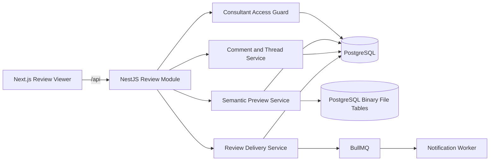
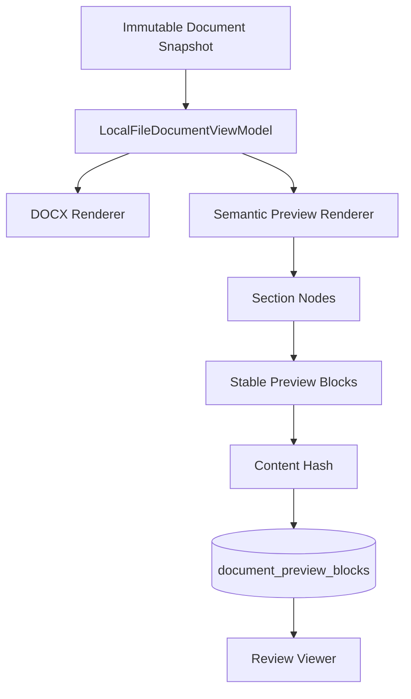
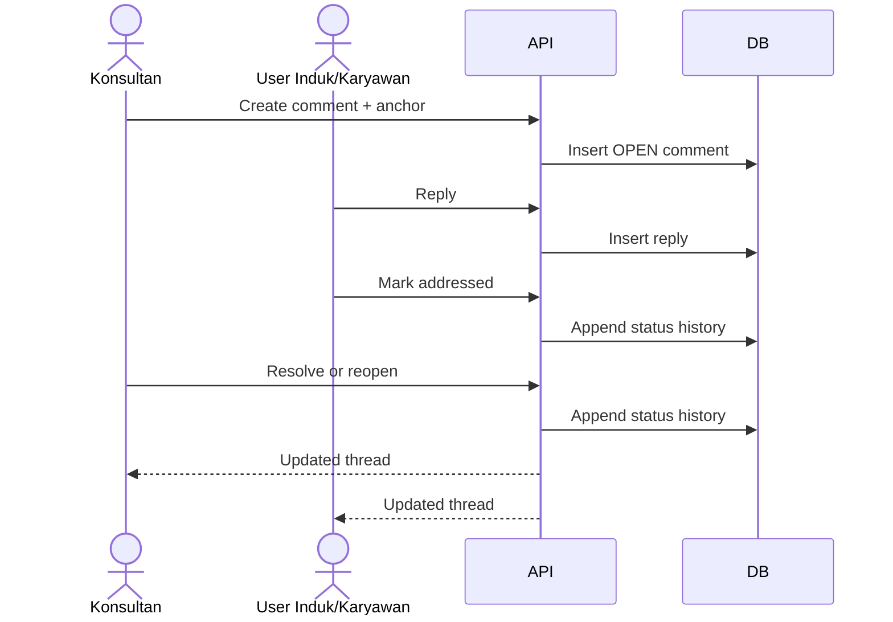
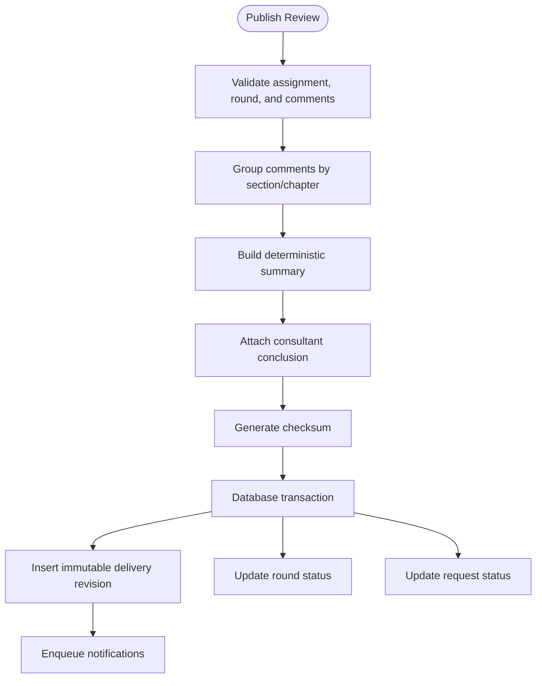
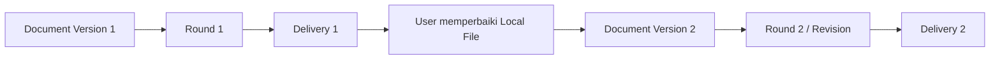

# Document Review Architecture — TP Docs With Consultant

## 1. Tujuan

Arsitektur ini menjelaskan bagaimana Konsultan membaca document version, menyorot teks, membuat komentar, mengelola thread, menerbitkan review, dan melakukan review ulang tanpa mengubah DOCX atau Local File sumber.

## 2. Prinsip Utama

- Source document version immutable.
- Preview HTML berasal dari snapshot/view model yang sama dengan DOCX.
- Anchor berbasis section, block, offset, selected text, dan hash.
- Nomor halaman bukan anchor utama.
- Komentar terikat pada round dan document version.
- Delivery yang diterbitkan immutable.
- Review ulang memakai version dan anchor baru.
- Semua akses memerlukan active assignment.
- Isi dokumen dan komentar tidak ditulis pada log.

## 3. Component Diagram



## 4. Preview Pipeline



### 4.1 Stable Block

Setiap block memiliki:

```ts
type PreviewBlock = {
  id: string;
  documentVersionId: string;
  sectionCode: string;
  blockKey: string;
  blockOrder: number;
  blockType: 'PARAGRAPH' | 'HEADING' | 'TABLE_CELL' | 'LIST_ITEM';
  contentText: string;
  contentHash: string;
};
```

`blockKey` stabil hanya dalam document version yang sama. Version baru boleh menghasilkan block dan hash berbeda.

### 4.2 Rendering

- HTML disanitasi.
- Script, macro, event handler, dan external resource tidak diizinkan.
- Gambar berasal dari file PostgreSQL tervalidasi dengan status scan `CLEAN`.
- Table, heading, paragraph, dan list memiliki semantic identifier.
- Preview bersifat read-only.
- Asset privat di-stream melalui NestJS setelah validasi tenant dan assignment Konsultan.

## 5. Authorization

Setiap endpoint viewer menjalankan:

1. validasi session;
2. role `CONSULTANT`;
3. profil Konsultan `ACTIVE`;
4. MFA/session assurance;
5. assignment `ACCEPTED`;
6. assignment mengarah ke request;
7. request berada pada status yang mengizinkan review;
8. round/document version sesuai assignment;
9. access expiry belum terlewati.

User Induk/Karyawan menggunakan permission berbeda untuk membaca hasil review dan membalas thread.

## 6. Anchor Contract

```ts
type ReviewCommentAnchor = {
  documentVersionId: string;
  previewBlockId: string;
  sectionCode: string;
  blockKey: string;
  startOffset: number;
  endOffset: number;
  selectedText: string;
  selectedTextHash: string;
};
```

### 6.1 Validasi Anchor

```text
0 <= startOffset < endOffset <= contentText.length
substring(contentText, startOffset, endOffset) == selectedText
hash(normalize(selectedText)) == selectedTextHash
previewBlock.documentVersionId == anchor.documentVersionId
previewBlock.sectionCode == anchor.sectionCode
previewBlock.blockKey == anchor.blockKey
```

Pemilihan lintas block ditolak dan pengguna diminta membuat komentar terpisah.

### 6.2 Normalisasi Teks

Normalisasi hanya untuk validasi hash, misalnya line ending dan Unicode normalization. Normalisasi tidak boleh mengubah offset pada teks sumber yang ditampilkan.

## 7. Comment Model

```ts
type ReviewComment = {
  id: string;
  requestId: string;
  roundId: string;
  authorUserId: string;
  category: string;
  severity: 'INFO' | 'LOW' | 'MEDIUM' | 'HIGH' | 'CRITICAL';
  status: 'OPEN' | 'ADDRESSED_BY_CLIENT' | 'RESOLVED' | 'REOPENED';
  body: string;
  version: number;
  anchor: ReviewCommentAnchor;
  createdAt: string;
  updatedAt: string;
};
```

### 7.1 Category

Kategori dikonfigurasi secara terbatas di backend atau constant domain, bukan bebas dari frontend. Contoh:

- completeness;
- consistency;
- company-profile;
- transaction;
- FAR;
- TP-method;
- benchmarking;
- financial;
- editorial.

### 7.2 Optimistic Concurrency

Update komentar atau status mengirim `version`. Jika version berbeda dari database:

- API mengembalikan `409 COMMENT_VERSION_CONFLICT`;
- frontend memuat ulang thread;
- perubahan pengguna tidak menimpa perubahan terbaru.

## 8. Thread dan Reply



Reply mendukung version/update metadata jika dapat diedit. Setelah delivery/request ditutup, thread menjadi read-only kecuali alur reopen yang sah.

## 9. Status History

Perubahan status sebaiknya disimpan terstruktur:

```ts
type ReviewCommentStatusHistory = {
  id: string;
  commentId: string;
  fromStatus: CommentStatus;
  toStatus: CommentStatus;
  changedByUserId: string;
  reason?: string;
  createdAt: string;
};
```

Audit log tetap dicatat, tetapi status history digunakan untuk query bisnis dan tampilan timeline.

## 10. Review Delivery

### 10.1 Build Delivery



### 10.2 Delivery Contract

```ts
type ReviewDelivery = {
  id: string;
  requestId: string;
  roundId: string;
  revision: number;
  deliveredByUserId: string;
  summary: ReviewChapterSummary[];
  conclusion: string;
  commentIds: string[];
  checksum: string;
  deliveredAt: string;
};
```

Summary dibuat deterministik dari komentar tersimpan. AI tidak digunakan untuk menghasilkan keputusan atau komentar pada MVP.

### 10.3 Immutability

Setelah delivery terbit:

- body delivery tidak diperbarui;
- koreksi membuat delivery revision berikutnya;
- checksum lama tetap tersedia;
- komentar sumber yang termasuk delivery harus dapat direkonstruksi;
- perubahan setelah delivery tidak mengubah delivery lama.

Untuk menjamin ini, `review_delivery_comments` menyimpan body, kategori, severity, status, anchor, dan versi setiap komentar pada saat publish. `review_comment_status_history` menyimpan transisi status secara append-only. FK ke komentar hanya untuk lineage; isi delivery lama dibaca dari snapshot. Update atau delete delivery/snapshot yang telah terbit ditolak pada application layer dan permission/trigger database; koreksi membuat revision baru.

## 11. Review Round dan Resubmission



Aturan:

- satu round mengacu pada satu source document version;
- round number unik dalam request;
- round pertama bukan pemakaian revisi;
- round revisi memakai kuota tepat satu kali;
- version harus berasal dari Local File yang sama;
- komentar lama tidak dipindahkan;
- UI dapat menampilkan komentar lama sebagai referensi read-only.

## 12. Read Model Viewer

Untuk menghindari N+1 query, endpoint viewer tidak mengambil komentar satu per satu. Read model memuat:

- request dan assignment;
- round aktif;
- document version;
- seluruh preview block yang diminta;
- komentar pada block/section;
- anchor;
- replies;
- status terakhir;
- permission actor.

Gunakan pagination untuk thread panjang dan lazy loading per section, tetapi jangan mengorbankan konsistensi anchor.

## 13. API Interaction

Endpoint utama:

- `GET /api/consultant/requests/{requestId}/viewer`
- `GET /api/consultant/requests/{requestId}/viewer/sections/{sectionCode}`
- `POST /api/consultant/requests/{requestId}/comments`
- `PATCH /api/consultant/comments/{commentId}`
- `POST /api/consultant/comments/{commentId}/replies`
- `POST /api/consultant/comments/{commentId}/resolve`
- `POST /api/consultant/comments/{commentId}/reopen`
- `POST /api/consultant/requests/{requestId}/deliver-review`
- `GET /api/consultation-requests/{requestId}/review-summary`
- `GET /api/consultation-requests/{requestId}/comments`
- `POST /api/consultation-comments/{commentId}/replies`
- `POST /api/consultation-comments/{commentId}/mark-addressed`

Kontrak lengkap tersedia pada [API Contract](./API-Contract.md).

## 14. Security

- HTML sanitizer pada render dan penyajian.
- Content Security Policy untuk viewer.
- No inline script.
- Assignment guard pada setiap request.
- Streaming asset melalui endpoint NestJS yang memvalidasi assignment.
- Rate limiting create/reply/update.
- Maximum comment length.
- Validation category dan severity.
- Output encoding untuk body/reply.
- Audit access denied dan mutation.
- Tidak menyimpan isi lengkap dokumen atau komentar pada log.
- Revocation memutus akses aktif.

## 15. Performance

Target awal:

- metadata viewer P95 maksimal 3 detik;
- section preview dimuat per kebutuhan;
- create comment P95 maksimal 2 detik;
- publish review memakai transaction singkat dan job asynchronous untuk notifikasi;
- index pada document/version/section, request/round/status, dan comment/thread;
- maximum page size untuk reply dan comments.

## 16. Failure Model

| Error | HTTP | Penanganan |
| --- | --- | --- |
| `ASSIGNMENT_ACCESS_DENIED` | 403 | Jangan ungkap tenant/resource |
| `REVIEW_ROUND_NOT_ACTIVE` | 409 | Refresh request |
| `PREVIEW_NOT_READY` | 409 | Retry setelah job selesai |
| `PREVIEW_BLOCK_NOT_FOUND` | 404 | Muat ulang section |
| `COMMENT_ANCHOR_INVALID` | 422 | Pilih teks ulang |
| `COMMENT_VERSION_CONFLICT` | 409 | Refresh thread |
| `COMMENT_LOCKED` | 409 | Read-only |
| `DELIVERY_ALREADY_PUBLISHED` | 409 | Kembalikan delivery existing |
| `DELIVERY_VALIDATION_FAILED` | 422 | Tampilkan checklist |
| `ACCESS_REVOKED` | 403 | Tutup viewer |

## 17. Testing

### 17.1 Authorization

- Konsultan A tidak dapat membuka assignment Konsultan B.
- Konsultan tidak dapat menebak request tenant lain.
- Request belum paid tidak dapat dibuka.
- Reassignment/revoke menghentikan akses.

### 17.2 Anchor

- Offset valid menghasilkan highlight yang sama.
- Hash mismatch ditolak.
- Selection lintas block ditolak.
- Anchor version lama tidak diterapkan ke version baru.

### 17.3 Thread

- Status transition valid.
- Transition ilegal ditolak.
- Version conflict menghasilkan 409.
- Delivery lama tidak berubah setelah comment update baru.

### 17.4 Delivery

- Summary per bab konsisten.
- Publish retry tidak membuat revision ganda.
- Checksum tersimpan.
- Notifikasi gagal tidak membatalkan delivery.

### 17.5 Security

- XSS payload dinetralisasi.
- Asset eksternal diblokir.
- Log tidak memuat selected text atau comment body.
- Rate limit bekerja.

## 18. Referensi

- [Consultation Architecture](./Consultation-Architecture.md)
- [Document Generation Architecture](./Document-Generation-Architecture.md)
- [API Contract](./API-Contract.md)
- [Consultant Workflow](../03-Business-Flow/09-Consultant-Workflow.md)
- [ERD](../04-Database/ERD.dbml)
